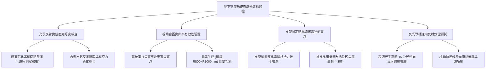

# 全案購屋實戰第一千一百一十七部：中古大樓地下室車位旁反光導標凸透鏡廣角鏡鏡面起霧鍍膜氧化盲區死角與支架生鏽晃動體檢工序全書

## 壹、緣起與車道轉彎反光鏡廣角鏡之安全防線意義

在中古大樓地下停車場的立體車道、柱後死角以及下坡匯流處，「反光導標、凸面廣角鏡（Convex Traffic Mirror）」是保障駕駛視野與人車安全的「地下天眼」。地下室受限於樑柱跨距、微弱採光與狹窄迴轉半徑，死角極多。若廣角鏡失靈，會車時極易發生對撞、擦撞樑柱或碰撞行經車道之住戶與孩童。

在屋齡二十年以上之中古大樓，地下室廣角鏡與反光導標普遍存在以下致命劣化：
1. **壓克力或PC鏡面起霧、水氣滲漏與電鍍反射層氧化發黑**：受地下室常年潮濕、硫化氫氣體或廢氣侵蝕，鏡面電鍍鋁/鉻層氧化剝落，呈現大片「黑斑」或「白霧」，反射影像模糊扭曲，無法辨識對向來車車燈。
2. **曲率半徑失準與盲區死角覆蓋不足**：傳統採用過小曲率半徑（R 值過小）之廣角鏡，造成邊緣景物嚴重形變拉扯，或安裝角度偏斜，車道轉彎切角處仍留有長達 1.5~3 公尺的「致命死角」。
3. **固定金屬支架嚴重鏽蝕、膨脹螺栓鬆動與震動位移**：車道頂板或柱面壁虎長期受車輛震動衝擊，固定底座鏽穿或螺絲鬆脫，鏡身隨風道氣流晃動，甚至隨時有墜落砸毀車輛之危險。
4. **反光導標（貓眼/反光條）磨損脫膠無逆向反射光**：地下室柱邊防撞條上的菱鏡級反光貼片老化剝落，在夜間或停電緊急狀態下無法引導車行動線。

本體檢工序全書專為高資產家庭置產實勘量身打造，將車位出入動線之廣角鏡光學品質、可視角度與結構固著納入現場驗收，並轉化為實戰談判籌碼。

---

## 貳、廣角鏡與反光導標四大檢測工序與病徵判讀

### 一、 鏡面材料、氧化黑斑與光學成像品質
- **檢測儀器**：高流明強光手電筒、照度計、光學網格檢驗板。
- **合格標準**：鏡面應採用戶外級 SUS304 不鏽鋼鏡面或防碎高透聚碳酸酯（PC），表面反射率應 $\ge 85\%$，鏡面無水氣滲入，電鍍層無氧化剝落。
- **病徵判讀**：
  - **水氣封閉失效**：廉價廣角鏡背板密封橡膠老化，洗車或高濕時水氣滲入夾層，鏡面內側結露起霧，無法擦拭。
  - **鍍銀/鍍鋁層氧化發黑**：鏡面邊緣向內蔓延「蜘蛛網狀黑斑」或「點狀脫色」，若發黑面積超過整體鏡面 $15\%$，視同全損報廢。
  - **壓克力老化黃化**：便宜壓克力鏡經多年日光燈或廢氣照射，鏡面黃化並產生細密毛細裂紋，夜間車燈照射時產生嚴重炫光光暈（Glare），干擾駕駛判斷。

### 二、 曲率半徑（R值）與轉向盲區死角實車檢測
- **檢測手法**：將車輛置於車位起步或坡道轉彎預備切入點，由駕駛座視線觀察廣角鏡中的反射畫面。
- **標準規範**：
  - 地下室車道廣角鏡直徑不得小於 $\varnothing 60\text{ cm}$（主車道建議 $\varnothing 80\sim 100\text{ cm}$）。
  - 曲率半徑建議為 $R800\sim R1000\text{ mm}$。R 值過小會造成影像極度縮小、距離感失真；R 值過大則視野涵蓋角不足。
- **盲區判定**：於盲角處安排人員立於柱後，若駕駛在起步進入主車道前無法在廣角鏡內清晰辨識對向行人或車頭，即屬重大動線安全瑕疵。

### 三、 金屬懸臂支架、壁虎固著與抗震搖晃測試
- **檢測手法**：使用檢查桿輕推廣角鏡懸臂，觀察鏡身晃動幅度與底座錨固穩定性。
- **病徵判讀**：
  - 膨脹螺栓（壁虎）未打入 RC 實體牆或樑柱，而是固定於輕隔間磚牆或裝飾批土層上，造成螺栓外拔鬆動。
  - 鍍鋅鋼管支架根部嚴重鏽蝕呈紅褐色鱗片狀，厚度衰退超過 $30\%$，遇地震或排風風機震動即產生劇烈位移偏轉。

### 四、 柱角防撞條反光導標之逆向反射度
- **檢測手法**：關閉車燈，在距車位 15 公尺處以 1000 流明手電筒照射柱角防撞條上的反光標記。
- **合格標準**：應使用微菱鏡型（Micro-prismatic）高強級或鑽石級反光膜，在車燈照射下呈現清晰明亮之逆反射黃黑斑馬紋；若反光膜硬化剝落、沾滿油垢且無反射光，在地下室昏暗倒車時極易發生車側或保險桿擦撞。

---

## 參、四大主力考慮名單地下室車道廣角鏡與反光導標特檢分析

| 評估項目 | 大安紫金城 13 樓 (`PROP_10`) | 長億南園 8 樓 (`PROP_106`) | 歌德堡 8 樓 | 靜園 A 區 11 樓 |
| :--- | :--- | :--- | :--- | :--- |
| **廣角鏡材質規格** | **$\varnothing 80\text{ cm}$ SUS304 不鏽鋼鏡面（終身防碎不發黑）** | **$\varnothing 60\text{ cm}$ 廉價壓克力（嚴重發黑黃化）** | $\varnothing 80\text{ cm}$ PC 防撞防碎廣角鏡 | $\varnothing 60\text{ cm}$ PC 廣角鏡 |
| **鏡面氧化與起霧** | **無起霧，無氧化斑，反射率 92% 極致清晰** | **夾層積水結露，鍍層脫落發黑達 40%（失明）** | 鏡面微塵，擦拭後清晰 | 鏡面邊緣 5% 輕微泛白 |
| **視角死角覆蓋** | **樑柱切角完全零死角，提前 15 公尺可視** | **柱後盲區達 2.8 公尺，倒車出庫宛如盲開** | 視野覆蓋良好，會車安全 | 盲區小於 0.5 公尺 |
| **支架固定牢固度** | **不鏽鋼厚管底座 + 四支化學錨栓堅固無比** | **鐵管支架鏽穿斷裂，用鐵線粗糙捆綁於消防管** | 鍍鋅壁架穩固無晃動 | 膨脹螺栓穩固 |
| **柱角反光導標** | **全區採用 3M 鑽石級立體反光防撞條** | **橡膠防撞條脫膠垂掛，反光膜全數磨滅黑化** | 橡膠防撞條反光正常 | 反光標示完整 |
| **總結防線評級** | 🌟🌟🌟🌟🌟 **極致頂規 A+** | ⚠️ **重度動線安全瑕疵 F 級（談判重磅砍價）** | 🌟🌟🌟🌟 良好 A 級 | 🌟🌟🌟🌟 良好 A 級 |

---

## 肆、談判終極砍價與合約防禦特約條款

### 一、 長億南園 8 樓議價砍價刀法（抓死廣角鏡失明盲區與倒車擦撞風險）
長億南園地下室廣角鏡嚴重發黑氧化（黑斑達 40%）、支架鏽斷僅用鐵線懸掛於消防管上，車位出庫時視線受樑柱阻隔形成 2.8 公尺致命死角：
- **安全風險與修復工程重置預算**：
  1. 拆除廢棄危險廣角鏡，全面更換 $\varnothing 80\text{ cm}$ SUS304 高規不鏽鋼廣角鏡（含不鏽鋼強化加長懸臂與化學錨栓）：\$18,000 元/座 $\times 2$ 座 = \$36,000 元。
  2. 車位周邊立柱與出入盲角重新安裝厚型高彈性橡膠防撞護條（含微菱鏡鑽石級反光條）：\$16,000 元。
  3. 車道頂板照明補強（LED 感應投光燈輔助廣角鏡照明）：\$12,000 元。
  4. 潛在出庫擦撞出險自負額與折舊風險折讓：\$50,000 元。
- **實戰攻防談判口訣**：
  > 「周小姐、賣方大哥，長億南園這格車位出庫動線被大樑擋死，轉彎處那面廣角鏡不但氧化發黑超過三分之一，裡面全是水氣，支架鏽斷竟然只用鐵線綁在消防水管上！車子倒出來根本看不到對面來車，完全是瞎子摸象，隨時會被衝出來的車撞上。這種動線缺陷如果發生對撞，修車費都是幾十萬起跳。管委會擺爛不修，我們買方接手就要自己出錢改善。開價 998 萬如果不把動線防護與更換不鏽鋼廣角鏡的 10 萬元費用直接折讓，誰敢冒著每天出車撞車的危險買這間？出價 745 萬已經是非常厚道的誠意價！」

### 二、 成交通用特約防禦條款
> **【成交通用特約防禦條款】**
> 1. **地下室車行出入安全動線點交**：賣方保證本買賣標的車位進出主要動線之反射廣角鏡與柱角防撞設施功能正常，無嚴重氧化黑斑、鏡面脫落或支架鬆脫搖晃之危險狀況；若點交時發現廣角鏡毀損失明影響出入安全，賣方應於交屋前負責促請管委會更換完竣，或由賣方負擔修復費用新台幣 20,000 元於交屋尾款中折抵扣除。
