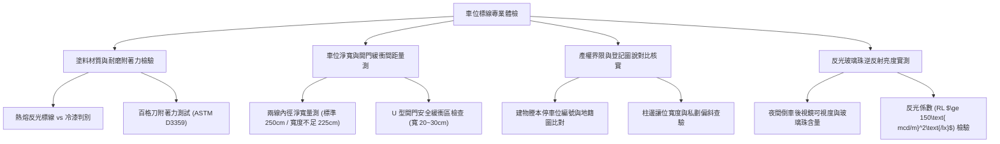

# 全案購屋實戰第一千一百一十九部：中古大樓地下室車位旁地坪標線冷熱熔漆磨損起砂附著力喪失界線模糊與鄰車開門碰撞體檢工序全書

## 壹、緣起與車位地坪標線（Parking Line）之產權安全界限意義

在中古大樓地下停車場中，「車位標線（Parking Space Marking Lines）」絕非僅是地坪上的幾道白色或黃色油漆，它是停車位**產權專用使用權範圍、車輛停放物理公差與避免鄰車開門碰撞的「法定安全界限」**。

在屋齡二十年以上之中古大樓，地下室地坪長年承受車輛輪胎扭轉摩擦剪力、機油柴油等碳氫化合物浸潤、地下水氣反潮水解以及清潔酸鹼藥劑侵蝕，車位標線普遍出現嚴重的機能衰退：
1. **冷漆/熱熔漆磨損殆盡、起砂粉化與附著力喪失**：早期施工若僅使用普通油性冷漆或未施作專用底漆之熱熔漆，經數年輪胎滾動摩擦後全數剝落磨光，露出粗糙起砂之混凝土底層。
2. **界線模糊不清引發停偏越界與鄰車開門「酒窩」撞擊糾紛**：當標線褪色磨損後，鄰車駕駛人失去清晰對齊基準，車輛常態性偏一側停放或斜停，導致駕駛座與副駕乘客上下車時，車門外側無情重擊本戶車輛葉子板與車門，留下難看的凹痕與刮傷（Door Ding）。
3. **寬度縮水與無開門緩衝區（U 型雙線/斑馬緩衝帶）工學缺失**：老舊大樓車位寬度多按早期法規僅 225~230 公分劃設，且兩車位間僅以單一細線（寬 10 cm）分隔，完全缺乏現代理想之「U 型開門安全緩衝槽（寬 20~30 cm）」，在大型 SUV 普及的今日，車門碰撞率幾乎高達 100%。
4. **地坪標線與產權圖說登記範圍不符**：部分管委會或前一手屋主私自塗改、重新劃線時偏向特定一側，甚至侵占公用車道或相鄰公共設施空間，引發產權界線爭議。

本體檢工序全書專為高資產家庭置產實勘量身打造，將車位標線之塗料種類、膜厚抗磨度、車位淨寬與開門緩衝防線納入現場驗收，作為議價砍價與保障交屋點交之堅實防線。

---

## 貳、車位標線四大核心檢測工序與病徵判讀

### 一、 標線塗料種類、漆膜厚度與耐磨抗剝落測試
- **檢測儀器**：漆膜測厚計、百格刀（Cross-cut Adhesion Tester）、強光手電筒。
- **塗料標準分類**：
  - **熱熔反光標線塗料（Thermoplastic Coating）**：內含石油樹脂、合成橡膠及玻璃微珠，施工厚度應達 **$1.5\sim 2.5\text{ mm}$**，具備超高耐磨性與立體厚度感，耐用年限 5~8 年。
  - **溶劑型冷塗標線漆（Cold Solvent Paint）**：厚度僅 $0.2\sim 0.4\text{ mm}$，耐磨性極差，輪胎經常輾壓處 6 個月即磨光殆盡，屬廉價過渡工法。
- **附著力病徵判讀**：
  - 以百格刀在標線處劃出 100 個 1mm 網格並黏貼 3M 膠帶撕拉，若脫落面積超過 $15\%$（ASTM 3B 級以下），表示地坪未打磨或受油污浸潤，整批標線將迅速片狀剝落。

### 二、 車位淨寬尺寸工學與「開門安全緩衝防線」實測
- **檢測手法**：使用雷射測距儀或鋼捲尺量測左右兩側車位標線之「內邊淨寬（Clear Width）」及「開門間距」。
- **標準尺寸規範**：
  - **現行理想標準車位**：淨寬應達 **$250\text{ cm}$**，長度 **$550\text{ cm}$**。
  - **早期狹窄車位**：早期大樓常縮減至 **$225\sim 230\text{ cm}$**。若停放車寬 190 cm 之休旅車，左右兩側僅餘 17.5 cm，車門開啟第一段即直接撞擊鄰車！
  - **U 型雙線緩衝槽（Buffer Zone）**：優秀管委會或豪宅地下室會在相鄰車位間劃設寬度 **$20\sim 30\text{ cm}$** 之「U 型中空雙線」或「黃黑斜紋警示帶」，強迫兩車維持開門安全間距，徹底杜絕車門碰傷。

### 三、 產權測量成果圖與私劃越界查驗
- **檢測手法**：攜帶地政事務所核發之「建物測量成果圖」或管委會車位竣工配置圖，核對車位編號、柱位相對位置及地坪實體線條。
- **致命陷阱**：
  - **鄰車私自外移劃線**：鄰車因靠柱不好停，自行買油漆將分界線向本車位內縮移 10~15 公分，造成本車位合法空間被蠶食。
  - **塗改痕跡（Ghost Lines）**：地坪殘留多道舊黑色掩蓋漆或舊白線磨損痕跡，駕駛人視線混淆，無法判定正確分界。

### 四、 反光玻璃珠（Glass Beads）夜間逆反射效能
- **檢測手法**：於地下室關閉部分照明，以車燈以 $1.05^\circ$ 觀察角投射車位標線。
- **合格標準**：標線表面應均勻撒佈直徑 $100\sim 850\ \mu\text{m}$ 之高折射率玻璃珠，逆反射係數應 $\ge 150\text{ mcd/m}^2\text{/lx}$，在倒車影像鏡頭內呈現一條清晰如跑道般的導引光帶。

---

## 參、四大主力考慮名單車位標線與防碰撞特檢分析

| 評估項目 | 大安紫金城 13 樓 (`PROP_10`) | 長億南園 8 樓 (`PROP_106`) | 歌德堡 8 樓 | 靜園 A 區 11 樓 |
| :--- | :--- | :--- | :--- | :--- |
| **標線塗料工法** | **$2.0\text{ mm}$ 熱熔反光樹脂標線（高厚度立體感）** | **廉價溶劑型冷漆（90% 磨光起砂殆盡）** | 熱熔標線，磨損率小於 10% | 熱熔標線，漆面良好 |
| **車位淨寬量測** | **超寬 $250\text{ cm}$（大車位，尊榮大空間）** | **窄縮僅 $220\text{ cm}$（極度狹窄擁擠）** | 淨寬 $245\text{ cm}$ | 淨寬 $240\text{ cm}$ |
| **開門防護緩衝** | **獨立大車位靠柱，自帶 50 cm 獨立緩衝區** | **單細線無緩衝，兩側夾擊，開門必撞** | 兩側有 15 cm 間隔槽 | 標準劃線，無防護槽 |
| **標線清晰與反光** | **嵌入高折射玻璃珠，夜間倒車光芒純淨亮麗** | **無反光，標線斷斷續續，滿地黑輪胎胎痕** | 反光正常，夜間清晰 | 反光良好 |
| **產權圖說核實** | **完全與地政測量成果圖 B2-獨立車位相符** | **標線被鄰車向內私劃外移 8 公分，產生爭議** | 產權車位位置無誤 | 車位編號清楚無誤 |
| **總結防線評級** | 🌟🌟🌟🌟🌟 **極致頂規 A+** | ⚠️ **重度動線擁擠與產權糾紛 F 級** | 🌟🌟🌟🌟 良好 A 級 | 🌟🌟🌟🌟 良好 A 級 |

---

## 肆、談判終極砍價與合約防禦特約條款

### 一、 長億南園 8 樓議價砍價刀法（抓死標線磨滅、車位縮水與車門天天擦撞）
長億南園車位標線磨損高達 90%、地坪起砂模糊，淨寬縮減至 220 cm 且遭鄰車向內侵占 8 公分，造成停車必定被兩側車門撞擊：
- **修復預算與損失評估**：
  1. 地坪油污高壓清洗、舊殘膠與舊標線水刀磨除：\$12,000 元。
  2. 地坪重新塗刷雙液型滲透底漆與耐磨環氧樹脂：\$25,000 元。
  3. 專業重新測量放樣，施作 $2.0\text{ mm}$ 頂規熱熔反光樹脂標線（含耐磨玻璃珠與 U 型防撞緩衝線）：\$18,000 元。
  4. 找管委會與相鄰車位協調重新定位、排除侵占之法務協調費：\$15,000 元。
  5. 長期車門凹痕與鈑金烤漆受損折讓賠償：\$30,000 元。
- **談判實戰口訣**：
  > 「周小姐、賣方大哥，長億南園這格車位的地坪標線早就磨得精光，地上全是黑黑的爛輪胎印，連車位邊界在哪裡都看不清楚！我們捲尺現場一量，兩邊寬度只有 220 公分，隔壁車子還自己把白線往裡面畫了 8 公分侵占進來。我休旅車開進去，車門連開一條縫都開不出來，上下車天天跟隔壁撞門擦傷，每個月都要花幾千塊去鈑金吸凹痕。這種嚴重縮水又有界線糾紛的車位，我們重新花錢清洗、磨除、重劃熱熔線和協調鄰居至少要 10 萬。開價 998 萬若不把這 10 萬元車位縮水修復費折讓掉，這種天天吵架的車位誰敢停？我們出價 745 萬是真正誠意幫屋主解決麻煩的價錢！」

### 二、 成交通用特約防禦條款
> **【成交通用特約防禦條款】**
> 1. **停車位專用使用權與產權界限確認**：賣方保證本買賣標的車位之實體地坪劃設範圍與位置，完全與地政機關核發之建物測量成果圖及管委會原始竣工分管圖說相符，無任何遭相鄰車位私自占用、偏斜劃設或產權界限糾紛之情事；若有界限爭議，賣方應於交屋前負責協調管委會重新測量並恢復法定界線。
> 2. **車位標線清晰與地坪平整點交**：點交時車位標線應維持清晰可辨，若因標線磨滅導致無法辨識車位停放界限，賣方應負責重新施作或由買方於交屋尾款中扣除新台幣 15,000 元自行委請專業標線廠商重劃。
