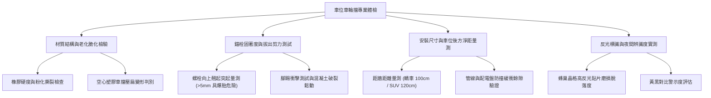

# 全案購屋實戰第一千一百一十八部：中古大樓地下室車位旁車輪擋定位桿橡膠粉化斷裂化學錨栓鬆動脫落與倒車撞牆體檢工序全書

## 壹、緣起與停車位車輪擋（車擋）之極致防撞意義

在中古大樓地下室停車場中，「車輪擋（Wheel Stop / Car Stopper，俗稱車阻、擋車器）」是保護車輛後保險桿、排氣尾管、後尾門及車位後方樑柱、消防管線、配電箱的「最後一道物理極限防禦障礙」。

當駕駛人倒車進入車位時，往往仰賴後輪精準觸碰車輪擋以確認停車到位。然而，在屋齡二十年以上之社區，車輪擋面臨極其嚴苛的物理衝擊與環境侵蝕：
1. **橡膠與再生塑膠老化脆化粉化**：車輪擋長年受車重碾壓、剎車剪力、機油柴油浸潤與地下室潮氣侵蝕，橡膠主體產生嚴重硬化龜裂、邊緣撕裂粉化，甚至受車輪一撞即齊根斷裂碎裂。
2. **固定化學錨栓/膨脹螺栓鬆脫、拔出與孔壁混凝土碎裂**：車輪擋由 2~3 支金屬錨栓固定於 RC 樓板。若當初施工未注入高強度化學安卡植筋膠，或鑽孔深度不足，長年受到車輪推力衝擊，膨脹壁虎被硬生生拔出，螺栓向上翹起刺穿輪胎，或整組車輪擋被推離定位。
3. **定位失準導致倒車直接撞擊後方設施**：車輪擋若因維修重鋪或螺栓移位而過度靠後（距牆不足 80~100 cm），或者轎車與大型休旅車（SUV）後懸長度不同，導致休旅車倒車時後輪尚未觸碰車輪擋，車頂擾流板、尾門或後備胎已先行撞擊後方之排煙風管、消防立管或壁掛配電盤，造成數萬元車損與公共設施損毀。

本體檢工序全書專為高資產家庭置產實勘量身打造，將車位車輪擋之材質、固著力、間距工學與後方淨空納入現場驗收，作為議價砍價與保障交屋點交之堅實防線。

---

## 貳、地下室車輪擋五大病徵與現場檢測工序

### 一、 車輪擋材質本體老化、碎裂與空心變形
- **檢測儀器**：橡膠硬度計、鋼直尺、手電筒。
- **標準規範**：合格車輪擋應採用「高密度合成天然橡膠（NR/SBR）」或一體成型鑄鋼/鑄鐵，本體抗壓強度應 $\ge 150\text{ kgf/cm}^2$，具備良好吸震韌性。
- **病徵判讀**：
  - **劣質空心再生塑料**：部分管委會省錢採用空心薄壁塑膠車擋，經休旅車重壓後頂部凹陷壓扁變形，高度自原先的 10 cm 降至 4 cm 以下，失去阻擋輪胎之功能。
  - **橡膠粉化斷裂**：橡膠表面遍布龜裂細紋，用手捏觸即有黑色碳黑粉末脫落，受輪胎推擠時直接斷成數節。

### 二、 固定金屬錨栓拔出、剪斷與螺栓翹起刺破輪胎
- **檢測手法**：
  1. 觀察車輪擋兩端及中央安裝孔內的螺栓頭。
  2. 使用腳踢施加約 30~50 kgf 之側向水平推力，檢測車輪擋是否晃動位移。
- **重大危害判讀**：
  - **螺栓向上拔出突起超過 5 mm**：此乃輪胎「隱形殺手」！倒車貼緊車輪擋時，外露螺栓直接頂撞或割傷輪胎胎面簾子線，引發輪胎爆胎或慢撒氣。
  - **RC 樓板孔壁錐狀碎裂**：螺栓周圍混凝土碎裂呈粉末狀，整根壁虎在孔內空轉，表示車輪擋已完全喪失水平阻擋能力。

### 三、 安裝位置與距牆距離工學量測（防撞牆防爆管）
- **標準距離量測**（以車輪擋前緣至後方牆面或障礙物距離）：
  - **標準房車（Sedan）**：距離應保留 **$90\sim 100\text{ cm}$**。
  - **休旅車/休旅廂型車（SUV/MPV）**：由於後懸（Rear Overhang）較長，距離應保留 **$110\sim 120\text{ cm}$**。
  - **後方有懸空管線/消火栓**：若後方牆面有外凸之消防立管、給水幹管或配電盤，車輪擋位置應以此凸出物之最前緣為基準再退縮量測，否則倒車時車尾保險桿未撞牆，後擋風玻璃或尾門先行撞爆管線！

### 四、 反光識別警示效能
- **檢測手法**：於昏暗環境下使用手電筒自駕駛座高度照射車輪擋。
- **合格標準**：車輪擋斜面應鑲嵌高耐磨黃色或白色微菱型反光貼片，於車位昏暗陰影處能清晰被倒車顯影鏡頭及後視鏡捕捉，引導輪胎居中停放。

---

## 參、四大主力考慮名單車位車輪擋特檢實測分析

| 評估項目 | 大安紫金城 13 樓 (`PROP_10`) | 長億南園 8 樓 (`PROP_106`) | 歌德堡 8 樓 | 靜園 A 區 11 樓 |
| :--- | :--- | :--- | :--- | :--- |
| **車輪擋材質規格** | **實心天然橡膠（高 12 cm，耐重 20 噸）** | **劣質中空塑膠（已壓裂碎成三節）** | 一體成型強化橡膠車擋 | 模組化橡膠車輪擋 |
| **錨栓固著狀況** | **雙液型化學錨栓深植 10 cm，沉頭無突起** | **鐵膨脹螺栓拔出突起 22 mm（割胎凶器）** | 膨脹螺栓鎖固緊密，無晃動 | 螺栓平整穩固 |
| **距牆距離工學** | **距牆 115 cm，後方消防管線留有 35 cm 安全餘隙** | **距牆僅 65 cm，SUV 倒車直接撞凹排煙管** | 距牆 105 cm，距離合宜 | 距牆 100 cm，符合標準 |
| **反光警示條** | **高亮度微菱鏡反光膜，夜間晶亮清晰** | **反光片全數脫落，車擋沾滿黑油隱入暗處** | 反光條平整乾淨 | 反光條清晰無損 |
| **車位後方安全** | 全平整無障礙，停車從容零擦撞風險 | **車位後方牆壁有多次倒車撞擊深層凹痕** | 牆面平整乾淨 | 牆面良好 |
| **總結防線評級** | 🌟🌟🌟🌟🌟 **極致頂規 A+** | ⚠️ **車損高風險 F 級（談判重磅砍價）** | 🌟🌟🌟🌟 良好 A 級 | 🌟🌟🌟🌟 良好 A 級 |

---

## 肆、談判終極砍價與合約防禦特約條款

### 一、 長億南園 8 樓議價砍價刀法（抓死車輪擋碎裂與倒車撞管風險）
長億南園車位車輪擋已壓扁碎裂、固定螺栓拔出突起 2.2 公分且距後方管線僅 65 公分，造成後方排煙管撞凹與輪胎割破風險：
- **修復與重置預算**：
  1. 廢棄碎裂塑膠車輪擋拆除清運：\$5,000 元。
  2. 拔出鏽蝕螺栓切除及 RC 地坪結構補強（無收縮水泥注入）：\$15,000 元。
  3. 重新放樣、鑽孔並植入高強度化學錨栓，安裝重負荷實心橡膠車輪擋（長 100cm $\times$ 高 12cm $\times$ 寬 15cm，含沉頭不鏽鋼螺栓）：\$18,000 元/組 $\times 2$ 組 = \$36,000 元。
  4. 後方受損排煙管板金校正與防撞警示烤漆：\$12,000 元。
  5. 倒車刮傷輪胎潛在車損折讓：\$20,000 元。
- **談判實戰口訣**：
  > 「周小姐、賣方大哥，長億南園這格車位車輪擋早就碎成三截，螺栓凸出來兩公分多，輪胎倒車倒進去直接被這根生鏽鐵刺刮破！更要命的是它裝得太靠後，距離牆壁只有 65 公分，大一點的休旅車停進去尾巴直接撞凹上面的排煙風管，牆壁上都是撞痕。買這格車位停車每天都要賠修車費！我們買方接手要全部敲掉重做化學錨栓和符合距離的實心車擋。開價 998 萬若不把這 8 萬塊的重做費用折抵扣除，根本沒辦法安心停車。我們出價 745 萬是建立在承擔這些地下隱藏瑕疵上的誠意底標！」

### 二、 成交通用特約防禦條款
> **【成交通用特約防禦條款】**
> 1. **車位停放設施安全點交**：賣方保證本買賣標的車位所附車輪擋（擋車器）牢固無鬆動，固定螺栓無突出刮損輪胎胎面之安全疑慮，且安裝位置符合標準車輛倒車安全停放間距，後方無碰撞公共管線之虞。
> 2. **瑕疵修復義務**：點交前若發現車輪擋碎裂粉化、螺栓翹起或位置失準，賣方應於交屋日前更換為實心高規格橡膠車輪擋並沉平螺栓；若逾期未改善，買方得自交屋尾款中逕行扣除新台幣 20,000 元自行僱工施作。
