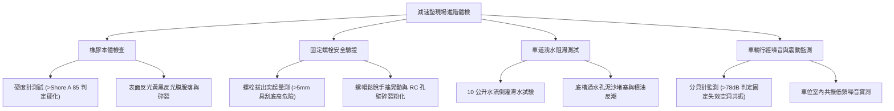

# 全案購屋實戰第一千一百一十六部：中古大樓地下室車位旁減速墊橡膠老化脫膠膨脹螺栓拔出金屬刮底盤與排水阻滯積水體檢工序全書

## 壹、緣起與地下室車道減速墊工學核心意義

在中古大樓地下室車道與停車位進出動線中，「減速墊（橡膠/鑄鋼減速坡）」肩負著強制進出車輛減速、保護坡道轉彎盲區行人與會車安全的關鍵物理防線。然而，在屋齡二十年以上之社區，由於車輛每日數百次重壓衝擊、地下室環境潮濕、地坪反潮以及油脂浸潤，減速墊往往面臨嚴重的結構性衰退：

1. **橡膠老化硬化與脫膠碎裂**：橡膠主體受紫外線（天井處）或地下室機油、柴油廢氣長期侵蝕，分子鏈斷裂、硬化龜裂，喪失彈性緩衝吸震能力，車輛碾壓時產生高分貝金屬撞擊空洞聲，甚至碎片四濺刮傷輪胎。
2. **固定膨脹螺栓鬆動、剪斷與拔出（突起金屬刺）**：原固定於 RC 樓板之金屬壁虎或膨脹螺栓，因長期剪力疲勞與混凝土孔壁碎裂，產生鬆動向上凸起 1~3 公分。車輛底盤（特別是低底盤轎車、油底殼、排氣管觸媒段或電動車底盤高壓電池組）行經時極易遭到金屬突起物直接刮底貫穿，引發昂貴車損甚至起火風險。
3. **橫向阻斷地面排水造成雨季倒灌積水**：減速墊若未設置導水排泄凹槽或安裝間隙，將形成一道橫跨車道的「地下攔水壩」，阻擋地下室微洩水坡度，導致暴雨或洗車時污水滯留車位前，引發濕氣反潮、輪胎打滑與地坪環氧樹脂起泡剝落。

本體檢工序全書專為高資產家庭置產實勘量身打造，將減速墊之物理穩固度、固定螺栓安全性與排水導引機能納入現場驗收標準，並將缺失直接化為終極議價砍價利刃。

---

## 貳、地下室車道減速墊六大致命病徵與現場檢測工序

### 一、 橡膠本體硬化、碎裂與反光標示失效
- **檢測儀器**：蕭氏橡膠硬度計（Shore A Durometer）、強光手電筒。
- **標準規範**：新品減速墊硬度應介於 Shore A 65~75 度，具備良好回彈阻尼吸震特性。
- **病徵判讀**：
  - 硬度超標（> Shore A 85 度），表示橡膠已完全硫化硬化，碾壓時無吸震效果，直接衝擊樓板混凝土結構。
  - 減速墊黃色高反光防滑漆膜全數磨損脫落，於地下室昏暗燈光下無法辨識，易引發會車追撞。
  - 邊緣出現鋸齒狀撕裂或塊狀剝落，露出的內置金屬骨架外翻，具備割破車胎之立即危險。

### 二、 固定金屬膨脹螺栓拔出、剪斷與刮底盤驗收
- **檢測手法**：
  1. 使用游標卡尺或鋼直尺量測螺栓頭相對於減速墊平面的突出高度。
  2. 觀察減速墊兩側螺栓孔是否有「螺栓拔出（Pull-out failure）」現象。
- **危險指標**：
  - **螺栓向上突起超過 5 mm**：列為重大安全缺失！休旅車通過時胎面受損，低底盤性能車或油電混合車經過時極易刮破排氣管消音器或電動車電池底護板。
  - **螺栓孔混凝土粉化**：用手或踢擊減速墊邊角，整塊減速墊產生左右移位或上下浮動，代表內部化學錨栓或膨脹壁虎已完全失效，地下車道隨時可能發生整條減速墊被車胎捲起噴飛之事故。

### 三、 截斷排水坡度引發車位前積水與反潮
- **檢測手法**：現場執行「10 公升水流排放模擬測試」。將清水倒於減速墊上方坡道處，觀察水流是否順暢經由底部的導水孔洞流向兩側排水溝。
- **病徵判讀**：
  - 若減速墊底面無排水導槽設計，水流將被阻隔於墊體上方，形成長達 2~5 公尺之深層滯水帶（水深可達 10~25 mm）。
  - 長期積水導致相鄰車位地面環氧樹脂（Epoxy）受潮水解起泡破裂，水氣向上蒸發加速停放車輛底盤生鏽及剎車碟盤氧化。

### 四、 車輛輾壓空洞震動音與結構低頻共振
- **檢測手法**：於減速墊旁 1 公尺處架設噪音計，紀錄中大型 SUV 以時速 15~20 km/h 壓過時的峰值噪音。
- **合格標準**：良好固定之減速墊碾壓噪音應 $\le 65\text{ dBA}$。若達到 $78\sim 85\text{ dBA}$ 並伴隨金屬撞擊震顫聲，證實底座完全虛浮，該撞擊振動更會經由柱樑結構傳導至一樓或二樓住家，引發惱人的低頻噪音公害。

---

## 參、四大決戰主力考慮名單地下室減速墊體檢實測剖析

針對四大主力考慮名單進行地下室車道減速墊與車位周邊工學特檢：

| 評估項目 | 大安紫金城 13 樓 (`PROP_10`) | 長億南園 8 樓 (`PROP_106`) | 歌德堡 8 樓 | 靜園 A 區 11 樓 |
| :--- | :--- | :--- | :--- | :--- |
| **減速墊材質規格** | **模組化高彈性天然橡膠（Shore A 68）** | **劣質再生硬橡膠（已碎裂炭化）** | 鋁合金斜坡減速板（附橡膠消音墊） | 模組化橡膠減速坡（中規中矩） |
| **固定螺栓狀況** | **不鏽鋼沉頭化學錨栓（完全沉平無刮底）** | **鐵膨脹螺栓生鏽拔出突起 18 mm（高危險）** | 沉頭膨脹螺栓牢固鎖定 | 沉頭螺栓無凸出，偶有一處鬆動 |
| **底槽排水導水槽** | **內置 $\varnothing 30\text{ mm}$ 雙向連續排泄水孔，水流通暢** | **無導水槽，暴雨倒灌車位前積水 25 mm** | 兩側留設 15 cm 排水明縫 | 底槽排水通暢，無淤泥滯水 |
| **車輛碾壓噪音** | 緊密貼合地坪，低沈悶響 $58\text{ dBA}$ | **金屬空洞撞擊爆裂音高達 $83\text{ dBA}$** | 輕微金屬回彈聲 $64\text{ dBA}$ | 沉穩橡膠聲 $62\text{ dBA}$ |
| **對相鄰車位影響** | 車位地坪乾燥清爽，無任何刮底威脅 | **停車必須跨越鏽蝕尖銳螺栓，極易刺破輪胎** | 車行动線流暢 | 動線平整安全 |
| **總結工學防線評級** | 🌟🌟🌟🌟🌟 **極致頂規 A+** | ⚠️ **重度安全隱患 F 級（談判重磅砍價）** | 🌟🌟🌟🌟 良好 A 級 | 🌟🌟🌟🌟 良好 A 級 |

---

## 肆、談判終極砍價與合約防禦特約條款

### 一、 長億南園 8 樓議價砍價刀法（抓死減速墊金屬刺與積水重創底盤）
長億南園地下室減速墊老化脫膠、固定螺栓向上突起 18 mm，形成「地面暗刺」，且暴雨時阻斷車道洩水，導致車位前積水反潮：
- **修復預算評估**：
  1. 全地下室（B1~B2）老舊破碎減速墊全面拆除清理：\$25,000 元。
  2. 突起生鏽螺栓切除、RC 樓板孔洞結構環氧樹脂灌注修補：\$35,000 元。
  3. 重新鋪設符合內政部營建署規範之高彈性橡膠導水減速墊（含沉頭化學不鏽鋼錨栓）：\$80,000 元。
  4. 受潮損毀之車位 Epoxy 地坪研磨重鋪（含雙液型底漆、中塗與防滑面漆）：\$60,000 元。
- **談判實戰口訣**：
  > 「周小姐、賣方大哥，長億南園地下室這條減速墊螺栓整根拔出凸起將近 2 公分，我們看屋車輛開過去差點把變速箱油底殼與排氣管整根削掉！而且減速墊完全擋住排水，水退不掉全部積在車位前面，地上 Epoxy 全部水解爛掉。這種車位我買回去停車每天提心吊膽，換全套標準減速墊和修補車位至少要 20 萬。屋主開價 998 萬如果不直接把修補費用折抵 35 萬，底盤刮破的代價誰能承擔？我們出價 745 萬就是最合理的誠意底線！」

### 二、 成交特約加註防護條款
> **【成交通用特約防禦條款】**
> 1. **地下室車行進出安全點交**：賣方保證本買賣標的所屬停車位之車道進出動線，無任何突起超過 5mm 之金屬螺栓或障礙物妨礙行車安全；若於點交前發現車道減速墊有鬆脫拔起或破壞車輛底盤之情事，賣方應促請管委會或自行修復並沉平螺栓，否則買方得主張保留交屋保留款新台幣 50,000 元直至改善完竣。
> 2. **排水防護與地坪完整**：賣方保證車位停放區域無因車道坡度或減速設施不良導致之經常性積水反潮現象，點交時地面應維持乾燥平整，無積水剝落。
