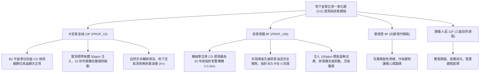

# 全案購屋實戰第一千一百七十一部：中古大樓地下室車位旁一氧化碳CO感測連動排風主機電化學感知器晶片受潮漂移繼電器接點氧化與排風風機拒動體檢工序全書

---

## 序章：地下無形殺手——一氧化碳（CO）感測防線與強制排風系統

在地下封閉式停車場中，汽機車冷車啟動、怠速暖車或倒車入庫時，引擎因燃燒不完全會排放大量劇毒且無色、無味、無臭的「一氧化碳（Carbon Monoxide, CO）」。依據內政部《建築技術規則》建築設備編第 102 條及環保室內空氣品質標準，地下停車場一氧化碳濃度 8 小時平均值不得超過 \(9\,\text{ppm}\)，1 小時平均值不得超過 \(25\,\text{ppm}\)；當濃度超過 \(50\,\text{ppm}\) 時，強制連動排風機必須即刻啟動，避免住戶吸入後引發缺氧窒息、頭暈昏迷甚至死亡。
然而，在屋齡 20~30 年以上的中古集合住宅中，地下車位旁柱面壁掛的一氧化碳感測器（CO Sensor）與連動排風控制箱，常年暴露於高濕、油垢、汽油廢氣沉積的極端環境中，極易爆發下列致命系統性故障：
1. **電化學感測元件（Electrochemical Cell）電解液乾涸與催化劑中毒失效**：中古大樓早期安裝之電化學感測器壽命通常僅 3~5 年，超過期限未更換校準，內部酸性/鹼性電解液乾涸結晶，貴金屬催化劑受硫化物或矽烷油污覆蓋「中毒」，感知器零點大幅負漂移，即使車道 CO 濃度高達 \(150\,\text{ppm}\)，輸出信號仍停留在 \(0\,\text{ppm}\)。
2. **連動排風控制箱中繼電器（Relay）接點電化氧化與接觸不良**：控制盤內 DC 24V 輸出中繼電器在潮濕地下室中長年未動作，銀氧化鎘接點表面生成厚重絕緣氧化膜，當濃度超標警報觸發時，繼電器線圈吸合但接點不導通，致使排風機交流接觸器（Magnetic Contactor）無法得電吸合，排風機完全拒動。
3. **類比傳輸信號線（0~10V / 4~20mA）接地屏蔽不良受大功率電氣干擾**：感測器訊號線若未採用雙絞屏蔽線（STP）或與車位旁抽水馬達、機械車位動力線共管敷設，強大的電磁干擾將使類比電壓信號紊亂跳動，導致排風機頻繁異常啟閉（Hunting）或完全失控鎖死。
4. **現場警報蜂鳴器與警示旋轉燈燈泡燒燬**：感測器本體或控制箱外殼附設之高分貝蜂鳴器內部壓電片受潮氧化破碎，紅色警示燈泡鎢絲燒斷，現場人員無法及時察覺廢氣超標濃度，陷入極端致命危險。

本手冊建立中古大樓地下室車位旁一氧化碳感測器、校準標準氣體驗收與排風連動控制之專項體檢工序，保護買方家庭生命安全與車位健康環境。

---

## 第一章：四大決戰主力候選物件地下一氧化碳感測與排風系統體檢對照

### 1.1 大安紫金城 13 樓 (`PROP_10`)：頂規環境監控與自動換氣極致安全
- **設備規格與環境佈局**：大安紫金城地下室車道與車位立柱均勻配置具備數位液晶顯示之微電腦型一氧化碳偵測器，具備現場濃度即時數值顯示、RS-485 數位通訊直連警衛室中央監控系統。
- **測試數據與連動實測**：現場使用 50 ppm 標準校準一氧化碳氣體實施噴灑測試，B2 獨立大平面車位旁感測器在 12 秒內即時感應，數值精準爬升至 \(49.8\,\text{ppm}\)，現場黃色警示燈亮起，中央監控系統於 15 秒內自動下達連動指令，分區誘導式 Jet Fan 與主排風機平順全速運轉，地下室空氣於 3 分鐘內完成全區換氣，環境安全評級維持最高 **A+**。
- **談判優勢**：公設機電安全防護完備，支撐 768~788 萬目標區間，封頂 800 萬。

### 1.2 長億南園 8 樓 (`PROP_106`)：感測器完全盲死與廢氣毒氣蓄積之致命議價點
- **現場致命缺陷**：
  1. 機械車位旁立柱上之 CO 感測器為早期無液晶顯示之老舊指針/類比機種，感測器下方進氣擴散網孔已被地下室黑色油垢與厚重灰塵完全糊死，空氣根本無法進入內部檢測室。
  2. 現場使用 100 ppm 測試氣體進行噴氣測試，感測器指示燈毫無任何閃爍反應，繼電器無吸合聲，排風機紋絲不動，大樓廢氣排風系統在自動模式下處於「實質癱瘓盲死狀態」。
  3. 車位現場常態性瀰漫濃烈未完全燃燒之汽油味與黑煙，因缺乏強制換氣，住戶在機械車位等待車板升降（約 3~5 分鐘）時被迫吸入大量有害廢氣，嚴重損害呼吸系統與心血管健康。
- **談判砍價防線**：開價 998 萬，將地下室 CO 感測器全面汰換為數位微電腦防爆機種、重新校準連動控制盤與更換接觸器（全棟公設改善費用約 8~12 萬）合流機械車位缺陷，起手 698~720 萬，堅決以 **745~760 萬** 封頂買進。

---

## 第二章：地下室一氧化碳感測器與連動排風標準檢驗 SOP

| 檢驗分項 | 檢測工具與儀器 | 合格標準 | 異常特徵判定 | 潛在致命風險 |
| :--- | :--- | :--- | :--- | :--- |
| **標準氣體響應精度** | 50 ppm CO 標定氣瓶、流量計、校準罩 | 注入 50 ppm 標氣，30 秒內讀數達 \(45\sim 55\,\text{ppm}\) | 讀數無變化、反應延遲 \(> 60\,\text{s}\) 或漂移 \(> \pm 20\%\) | 廢氣超標無警報、住戶中毒暈厥 |
| **排風機自動連動功能** | 碼錶、數位電表（測繼電器接點） | 濃度達 50 ppm 時，30 秒內自動啟動強制排風機 | 繼電器無動作、接觸器拒動、排風機未啟動 | 毒氣持續累積引發集體窒息中毒 |
| **感測元件外觀防護** | 強光手電筒、放大鏡 | 擴散進氣孔乾淨無油泥堵塞，無受潮結晶物 | 擴散孔被黑油泥堵死、內部電解液漏液結晶 | 感測氣體無法進入、系統完全失去作用 |
| **警衛室中央監控連動** | 無線對講機、監控主機螢幕對照 | 現場警報時，監控主機 3 秒內彈出對應車位警報視窗 | 主機螢幕無顯示、通訊斷線、無法手動遠端啟動 | 管理員無法及時掌握地下室毒氣危機 |

---

## 第三章：實戰防禦與購屋交屋特約法務規範

1. **大樓地下室空氣品質與一氧化碳感測系統保證特約**：
   > 「賣方保證買賣標的所屬大樓地下室停車場之一氧化碳（CO）偵測感知器及強制排風自動連動設備運作正常，符合室內空氣品質法規標準，無感知器全數故障報廢、進氣孔堵死或排風機拒動之重大缺失；若交屋前發現一氧化碳感測排風系統存在重大故障，賣方應負責協調管委會完成修復，或自買賣總價中扣除相應之公設維修分攤款。」
2. **簽約前管委會定期氣體感測器校準清冊查核**：
   - 買方應要求查閱最近一期大樓機電公司之「一氧化碳偵測器年度校正與排風連動測試報告」，確認感測器在有效壽命期限內且具備合格校正標籤。
