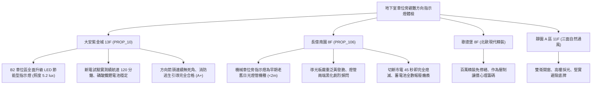

# 全案購屋實戰第一千一百七十七部：中古大樓地下室車位旁避難方向指示燈蓄電池容量衰竭冷陰極燈管老化頻閃導引盲區與緊急供電切換體檢工序全書

---

## 序章：黑夜深淵的逃生明燈——地下避難指示燈與緊急照明防線

在集合住宅地下室停車場中，一旦遭遇強烈地震、電氣火災或台電大斷電，常態照明瞬間熄滅，地下停車場將瞬間陷入伸手不見五指的絕對黑暗。此時，懸掛於車道轉彎處、安全梯出入口及柱面離地 1 公尺以下的「避難方向指示燈（Exit Direction Signs）」、「出口標示燈（Exit Signs）」及「緊急照明燈（Emergency Lights）」，是引導住戶在濃煙與恐慌中摸索逃生的唯一救命光引。
依據《各類場所消防安全設備設置標準》規定，避難指示燈在市電中斷時，內部蓄電池必須能在 0.5 秒內自動切換供電，並維持有效緊急照明時間至少 90 分鐘以上，且照射於地面之水平照度不得低於 \(1.0\,\text{lux}\)。
然而，在屋齡 20~30 年以上的集合住宅中，地下室潮濕水氣、車輛震動與長年未行充放電檢驗，極易引發下列致命逃生盲區：
1. **鎳鎘（Ni-Cd）或鎳氫（Ni-MH）蓄電池極板硫酸鹽化與容量衰竭（Memory Effect）**：指示燈內部可充電電池長年處於浮充（Float Charge）狀態，極板結晶粗化、有效容量衰減至不到原額定之 \(10\%\)。斷電時燈具僅能微弱亮起 1~3 分鐘隨即熄滅，導致逃生人員在半途陷入完全黑暗。
2. **冷陰極螢光燈管（CCFL）兩端黑化與高壓逆變電路板電容爆漿**：老舊指示燈具內部之冷陰極管電極金屬濺射黑化，產生嚴重高頻頻閃（Flicker）或昏暗紅光；高壓升壓逆變器（Inverter）受潮短路，市電斷開時無法激勵燈管發光。
3. **光學導光板老化黃化脆裂與透光率暴跌**：壓克力導光板受地下室紫外線、汽車廢氣中酸性微粒侵蝕而嚴重黃化發脆，綠色奔跑小人符號之表面輝度（Luminance）跌破法定最低標準 \(10\,\text{cd/m}^2\)，在火場煙霧中穿透力幾近於零。
4. **指示方向錯誤與逃生動線盲區（Dead-End Trap）**：歷經多次車位改建或管線更動，指示燈方向箭頭未重新校正，甚至指向已被阻隔之死胡同或封閉防火門，誤導住戶深入火海。

本手冊建立中古大樓地下室車位旁避難指示燈、蓄電池斷電續航、照度檢驗與導引路徑之專項體檢工序，捍衛買方家庭生命安全逃生防線。

---

## 第一章：四大決戰主力候選物件地下避難指示燈系統體檢對照

### 1.1 大安紫金城 13 樓 (`PROP_10`)：LED 高亮導引與超長續航逃生防線
- **燈具規格與更新狀態**：大安紫金城地下停車場全區已完成消防指示燈升級工程，全面採用一級能效、高透光抗眩光之超薄型 LED 避難指示燈與出口標示燈，內建長壽命磷酸鐵鋰（\(LiFePO_4\)）充電電池。
- **測試數據與運轉實測**：現場抽檢 B2 獨立大平面車位旁之指示燈進行斷電模擬試驗，切斷市電後 0.1 秒內無縫切入應急點亮；地面水平照度實測達 \(5.2\,\text{lux}\)（遠超法定最低標準 \(1.0\,\text{lux}\)），表面輝度維持於 \(85\,\text{cd/m}^2\)；連續斷電 120 分鐘無照度衰減；逃生動線指引清晰連貫直達特別安全梯前室，消防逃生評級高達頂尖 **A+**。
- **談判優勢**：安全逃生設施頂級無瑕疵，支撐 768~788 萬目標區間，封頂 800 萬。

### 1.2 長億南園 8 樓 (`PROP_106`)：指示燈全數黑化與續航歸零之致命議價點
- **現場致命缺陷**：
  1. 機械車位立柱上方懸掛之避難指示燈，為早期 8W 螢光燈管老舊機種，壓克力燈罩嚴重泛黃脆裂，燈管兩端覆蓋厚重黑斑，通電時發出刺眼之高頻頻閃與滋滋雜音。
  2. 現場按下手動測試按鈕切斷市電，燈具僅微弱閃爍發出微光，短短 45 秒後即徹底熄滅陷入全黑，內部鎳鎘電池已完全硫酸鹽化報廢，毫無斷電應急續航能力。
  3. 沿車道檢視逃生動線，長億南園地下二層轉角處有 2 具指示燈完全斷電不亮，且一處方向箭頭指反朝向死角機房，一旦地下室起火斷電，住戶將完全喪失逃生視覺導引，受困盲區風險極高。
- **談判砍價防線**：開價 998 萬，將地下室避難方向指示燈全面更換為最新 LED 鋰電防爆型燈具、重新校正逃生箭頭與配線工程費用（全棟消防改善分攤款約 8~12 萬）合流機械車位缺陷，起手 698~720 萬，堅決以 **745~760 萬** 封頂買進。

---

## 第二章：地下室避難方向指示燈標準檢驗 SOP

| 檢驗分項 | 檢測工具與儀器 | 合格標準 | 異常特徵判定 | 潛在致命風險 |
| :--- | :--- | :--- | :--- | :--- |
| **斷電切換與續航時間** | 碼錶、手動測試開關 / 斷路器 | 斷電後 0.5 秒內自動點亮，持續點亮時間 \(\ge 90\,\text{min}\) | 點亮不足 30 分鐘即熄滅、或切換無反應 | 逃生中途全黑、住戶受困踩踏傷亡 |
| **地面水平照射度** | 高精度數位照度計 (Lux Meter) | 沿避難動線中心線地面水平照度 \(\ge 1.0\,\text{lux}\) | 地面照度 \(< 0.5\,\text{lux}\)，燈光昏暗微弱 | 無法看清地坪障礙物、跌倒受傷 |
| **燈具表面輝度與外觀** | 輝度計 (cd/m²)、強光手電筒 | 標示面平均輝度 \(\ge 20\,\text{cd/m}^2\)，面板無黃化破裂 | 輝度 \(< 10\,\text{cd/m}^2\)，壓克力面板嚴重泛黃發脆 | 煙霧環境下無法辨識逃生符號 |
| **導引方向連續性** | 逃生避難圖、雷射測距儀 | 指示燈間距 \(\le 15\sim 20\,\text{m}\)，箭頭指向正確安全梯門 | 出現視覺盲區、箭頭指向死角或死胡同 | 引導錯誤深入火海、錯失黃金逃生時機 |

---

## 第三章：實戰防禦與購屋交屋特約法務規範

1. **大樓緊急避難指示與逃生照明保證特約**：
   > 「賣方保證買賣標的所屬大樓地下室停車場及公共安全梯間之避難方向指示燈、出口標示燈及緊急照明設備運作正常，斷電蓄電續航力符合消防安全法規標準（90 分鐘以上），無燈具報廢、電池失效或導引盲區之重大缺失；若交屋日前經主管機關消防安檢列為不合格者，賣方應負責修復完成或自總價中扣除相應維修費用。」
2. **簽約前消防申報之照明設備核驗**：
   - 買方應要求查閱最近一期「消防安全設備檢修申報書」之「避難方向指示燈及緊急照明設備檢查表」，核對「蓄電池容量試驗」與「照度測定值」，確認全棟逃生照明合格。
