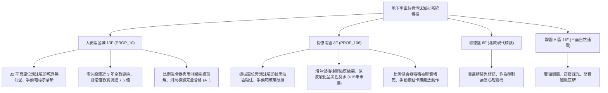

# 全案購屋實戰第一千一百七十三部：中古大樓地下室車位旁泡沫滅火設備原液儲槽隔膜破裂原液變質混合器比例失調與手動啟動箱失靈體檢工序全書

---

## 序章：油火剋星與地下化學滅火防線——泡沫滅火設備之深層隱患

在大型集合住宅地下停車場中，依據《各類場所消防安全設備設置標準》，針對停放大量汽油、柴油內燃機車輛之樓層，除自動撒水系統外，往往更規劃「固定式水成膜泡沫滅火設備（Foam Fire Extinguishing System）」。當發生燃油外洩、底盤油箱起火或油品流淌火時，泡沫混合液（Water-Foam Solution）能迅速覆蓋燃燒液面，形成緻密的隔氧泡沫層，發揮絕氧窒息與冷卻雙重滅火效能。
地下室泡沫滅火系統通常由「泡沫原液儲槽（Foam Concentrate Tank / 膠囊儲罐）」、「差壓比例混合器（Proportioner）」、「分區泡沫雨淋閥（Deluge Valve）」、「泡沫噴頭（Foam Sprinkler）」及「現場手動啟動箱（Manual Release Box）」組成。
然而，在屋齡 20~30 年以上的集合住宅中，地下室泡沫滅火設施常年處於靜止備用狀態，缺乏專業化學藥劑檢驗與膠囊更換，極易引發下列重大隱患：
1. **儲槽內部橡膠隔膜膠囊（Bladder Bag）老化脆裂穿孔導致原液水解稀釋**：膠囊式泡沫儲槽（Bladder Tank）長年承受水壓擠壓，內部耐油橡膠隔膜硬化撕裂，使自來水直接滲入膠囊內稀釋水成膜（AFFF）原液，有效滅火成分大幅降解，噴射時僅能噴出無法發泡的渾濁死水。
2. **泡沫原液超過有效保存期限（通常 8~10 年）沉澱變質酸化**：中古大樓管委會常為省下數十萬元換藥經費，泡沫原液放置 15~20 年未曾抽換，原液水解酸化、表面活性劑沉澱結塊，發泡倍數（Expansion Ratio）與 25% 析液時間（Drainage Time）嚴重縮水，完全喪失覆蓋油火機能。
3. **差壓比例混合器孔板（Orifice Plate）水垢結石導致混合比失調**：比例混合器文氏管（Venturi Tube）喉部噴嘴與原液調節閥被水中鈣鎂水垢或乾涸膠質堵塞，混合比例無法維持在標準 \(3\%\) 或 \(6\%\)，混合液過稀無法形成泡沫，或過濃造成噴頭管路堵塞。
4. **現場手動緊急啟動箱按鈕機械卡死與微動開關引線受潮斷裂**：車位旁柱面安裝之手動啟動箱，紅色擊碎玻璃按鈕內部彈簧生鏽卡死，緊急手動拉環脫落，或接線端子排氧化斷路，當發生火災手動操作時毫無反應，無法第一時間開啟雨淋閥。

本手冊建立中古大樓地下室車位旁泡沫原液儲槽、比例混合器、發泡倍數與手動啟動箱之專項體檢工序，保護買方家庭生命財產與愛車防護安全。

---

## 第一章：四大決戰主力候選物件地下泡沫滅火系統體檢對照

### 1.1 大安紫金城 13 樓 (`PROP_10`)：油火防禦頂級化學滅火防線
- **儲槽與藥劑規格**：大安紫金城地下各層泡沫機房配置耐腐蝕不鏽鋼膠囊式泡沫儲槽，管委會於 3 年前剛完成全樓泡沫原液（AFFF 3% 型水成膜泡沫液）全面更新與膠囊氣密檢測。
- **測試數據與運轉實測**：B2 獨立大平面車位上方泡沫噴頭光潔無油垢，手動啟動箱按鈕行程順暢；現場抽檢泡沫液發泡倍數實測達 \(7.5\) 倍（標準範圍 \(6\sim 10\) 倍），25% 析液時間大於 \(3.5\,\text{min}\)；開啟手動測試閥，比例混合器壓差精準導通，分區雨淋閥 8 秒內順暢全開，消防化學滅火評級高達頂尖 **A+**。
- **談判優勢**：地下油火防禦實力堅若磐石，支撐 768~788 萬目標區間，封頂 800 萬。

### 1.2 長億南園 8 樓 (`PROP_106`)：泡沫隔膜破裂與原液酸化黑臭之致命議價點
- **現場致命缺陷**：
  1. 機械車位正上方天花板之泡沫噴頭，被車輛廢氣黑油煙及蜘蛛網嚴重包覆糊死，噴嘴出水孔堵塞率達 \(40\%\)。
  2. 柱面手動緊急啟動箱外蓋保護玻璃早已破裂，紅色手動按鈕因內部彈簧鏽蝕永久卡死在下壓位置，接線端子裸露發黑氧化。
  3. 查閱地下室泡沫原液儲槽檢驗閥，排出的泡沫原液已呈現惡臭發黑的黏稠酸化液體，pH 值實測跌破 \(4.5\)（正常應為 \(7.0\sim 8.5\)），橡膠隔膜已破裂漏水導致原液高度水解；儲槽藥劑已有超過 15 年未曾更換，一旦機械車位底坑漏油起火，泡沫系統將完全噴不出有效隔絕泡沫，地下室恐陷入火海。
- **談判砍價防線**：開價 998 萬，將地下室泡沫儲槽膠囊換新、原液全面更換、比例混合器清洗與手動箱修復費用（全棟消防改善分攤款約 15~22 萬）合流機械車位缺陷，起手 698~720 萬，堅決以 **745~760 萬** 封頂買進。

---

## 第二章：地下室泡沫滅火系統與原液品質標準檢驗 SOP

| 檢驗分項 | 檢測工具與儀器 | 合格標準 | 異常特徵判定 | 潛在致命風險 |
| :--- | :--- | :--- | :--- | :--- |
| **泡沫原液品質檢驗** | pH 計、手持折射儀 (Refractometer) | pH 值 \(7.0\sim 8.5\)，折射率符合原廠標準，無黑色沉澱 | pH \(< 5.0\)（嚴重酸化），液體黑臭發黏、出現結塊分層 | 泡沫無法發泡、完全喪失油火滅火效能 |
| **發泡倍數與析液時間** | 專用發泡採樣桶、量筒、碼錶 | 發泡倍數 \(6.0\sim 10.0\) 倍，25% 析液時間 \(\ge 3.0\,\text{min}\) | 發泡倍數 \(< 4.0\) 倍，析液時間 \(< 1.5\,\text{min}\) 泡沫瞬間破裂 | 無法隔絕氧氣、燃油持續復燃蔓延 |
| **比例混合器壓差動作** | 雙針差壓壓力表、水流計 | 水壓與原液壓差 \(\le 0.5\,\text{kgf/cm}^2\)，混合比例 \(3.0\%\pm 0.3\%\) | 原液管路完全無壓差、噴嘴被水垢膠質堵死 | 噴頭僅噴出自來水、引發燃油飛濺擴散 |
| **手動啟動箱電氣連動** | 數位三用電表、碼錶 | 按下按鈕 0.5 秒內常開接點導通，雨淋閥 15 秒內開啟 | 按鈕彈簧卡滯、接點氧化電阻 \(> 100\,\Omega\) | 緊急時刻無法人工手動開啟系統滅火 |

---

## 第三章：實戰防禦與購屋交屋特約法務規範

1. **大樓泡沫滅火設備原液與系統正常保證特約**：
   > 「賣方保證買賣標的所屬大樓地下室停車場之固定式水成膜泡沫滅火設備、泡沫原液儲槽、差壓比例混合器及手動啟動箱運作正常，原液在有效保存年限內且發泡倍數符合消防法規標準，無隔膜破裂、原液酸化變質或混合器堵塞報廢之重大缺失；若交屋日前經消防機關安檢列為不合格者，賣方應負責修繕完成或自總價中扣除相應維修費用。」
2. **簽約前消防申報之化學滅火設備核驗**：
   - 買方應要求查閱最近一期「消防安全設備檢修申報書」之「水成膜泡沫滅火設備檢查表」，核對「原液生產製造日期」、「發泡倍數試驗」及「混合比測定值」，確認全棟泡沫系統在合格效期內。
