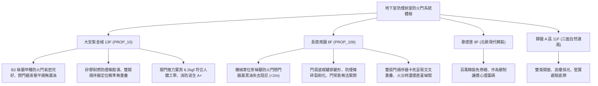

# 全案購屋實戰第一千一百七十九部：中古大樓地下室車位旁特別安全梯防煙前室甲種防火門自動閉門器阻尼漏油氣密防煙條炭化脫落順序器失靈與正壓推力超標體檢工序全書

---

## 序章：火場生死交界的氣密閘門——特別安全梯防煙前室防火門防線

在集合住宅大樓中，依據《建築技術規則》建築設計施工編第 97 條及消防法規規定，自地下室通往地面層的豎向逃生動線，必須設置「特別安全梯（Special Emergency Staircase）」，且在進入特別安全梯樓梯間前，必須經過「防煙前室（Smoke-proof Vestibule）」。
防煙前室與地下停車場、防煙前室與樓梯間之間，必須設置具備 1 小時以上防火阻熱及遮煙性能之「甲種防火門（Fire Door）」。這扇門是阻絕地下室數百度高溫烈火與劇毒黑煙竄入樓梯間、保障整棟大樓數百位住戶垂直逃生生命安全的「唯一物理死線」。
一套合格的防火門系統由「鍍鋅鋼製門扇與門框」、「液壓阻尼自動閉門器（Door Closer）」、「防火膨脹遮煙條（Intumescent Smoke Seal）」、「雙扇門順序器（Door Coordinator）」及「逃生推桿鎖（Panic Exit Hardware）」精密組成。
然而，在屋齡 20~30 年以上的集合住宅中，地下室潮濕水氣、車道負壓與長年高頻進出撞擊，極易引發下列重大致命危機：
1. **液壓閉門器內部阻尼油受熱漏油導致門扇重擊反彈或無法緊閉**：閉門器雙速調節活塞密封圈硬化漏油，液壓阻尼失效，門扇在釋放後以極高速度重重砸向門框，產生劇烈金屬撞擊巨響甚至反彈留有一道 \(3\sim 5\,\text{cm}\) 的縫隙，使整扇防火門喪失防煙密閉阻絕機能。
2. **防火膨脹遮煙膠條受潮水解炭化脫落導致毒煙竄流**：門框四周凹槽內鑲嵌之熱膨脹防煙條，在地下室常年濕氣與車輛廢氣侵蝕下脫膠下垂、脆化粉化，一旦火警發生，未能在高溫下膨脹封堵門縫，高溫劇毒一氧化碳與濃煙將順著縫隙迅速灌滿整座特別安全梯。
3. **子母門/雙開防火門順序器（Coordinator）變形卡死導致門扇交叉重疊**：大樓地下梯廳常採子母雙開防火門，若機械順序器滑動凸輪卡死生鏽，關門時「主門先於子門關閉」，導致主門門檔卡在子門外部，兩扇門呈現交叉重疊張開狀態，完全門洞大開。
4. **正壓送風防煙系統氣壓失衡致使開門推力超標（> 13.6 kgf）受困**：為防止濃煙侵入，前室多配備機械正壓送風風機；若洩壓風門（Barometric Relief Damper）卡死，前室正壓過大，實測開門推力飆破 \(20\,\text{kgf}\)，老人、小孩或婦女在火場中根本無法推開防火門逃生，被活活悶死在前室內。

本手冊建立中古大樓地下室車位旁特別安全梯防煙前室防火門、閉門器、防煙膠條、順序器與開門推力之專項體檢工序，捍衛買方家庭生命安全逃生防線。

---

## 第一章：四大決戰主力候選物件地下防煙前室防火門體檢對照

### 1.1 大安紫金城 13 樓 (`PROP_10`)：甲種防火門頂規氣密與無障礙逃生防線
- **門體規格與維護品質**：大安紫金城地下停車場進入各棟特別安全梯防煙前室之門具，全數採用經濟部標準檢驗局認證之鍍鋅鋼製甲種防火門（耐火時效 2 小時以上），門扇厚度達 \(55\,\text{mm}\)，且配備不鏽鋼逃生水平推桿。
- **測試數據與運轉實測**：現場檢測 B2 獨立大平面車位旁防煙前室防火門，閉門器外觀乾爽無漏油，門扇在任何開啟角度（\(15^\circ\sim 90^\circ\)）釋放後，均能平穩緩衝關閉並在最後 5 度精準鎖定卡扣；矽膠氣密防煙條彈性飽滿；子母雙扇門順序器引導子門先關、主門後關無縫密合；使用推拉力計實測開門推力僅 \(8.2\,\text{kgf}\)（遠低於法規上限 \(13.6\,\text{kgf}\)），老人孩童皆能輕鬆推門逃生，公共安防評級高達頂尖 **A+**。
- **談判優勢**：安全逃生公設頂級合規，支撐 768~788 萬目標區間，封頂 800 萬。

### 1.2 長億南園 8 樓 (`PROP_106`)：閉門器漏油與雙扇門卡死重疊之致命議價點
- **現場致命缺陷**：
  1. 機械車位旁進入地下安全梯之防火門，液壓閉門器下方滲出大量黑色黏稠廢阻尼油，阻尼功能完全喪失，門扇釋放時直接猛烈撞擊門框，發出震耳巨響，門框已出現變形裂痕。
  2. 門扇下緣因歷年潮氣浸蝕已嚴重鏽蝕穿孔，原裝膨脹防煙膠條已碎裂粉化脫落殆盡，門縫空隙大達 \(12\,\text{mm}\)；且門鎖鎖舌因磨損卡滯，閉門器無法將門扇推入鎖孔，長期處於留縫未關閉狀態。
  3. 子母雙開門之機械順序器連桿生鏽卡死，現場測試關門時主門先關，卡住子門外緣，兩扇門卡死在中央留有半米寬的大洞，住戶甚至用磚頭墊門通風；一旦地下室起火，濃煙將直接沿此大洞瘋狂倒灌入 8 樓電梯間與安全梯，整棟大樓逃生路徑瞬間被毒煙截斷。
- **談判砍價防線**：開價 998 萬，將地下室防煙前室防火門更換、加裝重型閉門器、重整雙開順序器與耐火防煙條工程費用（全棟消防改善分攤款約 10~15 萬）合流機械車位缺陷，起手 698~720 萬，堅決以 **745~760 萬** 封頂買進。

---

## 第二章：特別安全梯防煙前室防火門標準檢驗 SOP

| 檢驗分項 | 檢測工具與儀器 | 合格標準 | 異常特徵判定 | 潛在致命風險 |
| :--- | :--- | :--- | :--- | :--- |
| **自動閉合與鎖舌扣合** | 角度規、碼錶、目視檢視 | 任何角度（\(15^\circ\sim 90^\circ\)）釋放後平順關閉，鎖舌確實鎖扣 | 關門反彈留縫、撞擊猛烈、鎖舌無法入孔 | 毒煙長驅直入、防火門形同虛設 |
| **閉門器液壓阻尼狀態** | 強光手電筒、擦拭紙巾 | 閉門器本體與調節螺絲乾淨無滲油痕跡 | 本體掛黑油滴、滴落至地面、外殼發燙 | 阻尼消失砸死人、門框受衝擊震裂 |
| **防煙條密封性與外觀** | 塞尺、厚薄規、拉拔測試 | 防煙條連續飽滿無缺損，門關閉時塞尺無法插入 | 防煙條炭化粉化、脫膠下垂、透光縫隙 \(> 3\,\text{mm}\) | 高溫毒煙穿透門縫毒死逃生住戶 |
| **雙開門順序器動作** | 實體開關門試驗 | 子門確實先於主門關閉到位，主門平順壓合子門 | 主門先關卡住子門、雙扇門交叉卡死大開 | 逃生門洞大開、整棟樓梯瞬間煙囪化 |
| **開門推力 (Operating Force)** | 數位推拉力計 (Push-Pull Gauge) | 開門瞬間最大推力 \(\le 13.6\,\text{kgf}\)（\(133\,\text{N}\)） | 開門推力 \(> 18\,\text{kgf}\)，需成年人全力推動 | 婦孺老人無法推開門、活活嗆死於前室 |

---

## 第三章：實戰防禦與購屋交屋特約法務規範

1. **大樓特別安全梯防煙前室防火門合規保證特約**：
   > 「賣方保證買賣標的所屬大樓地下室至各樓層之特別安全梯防煙前室防火門、自動閉門器、防煙條及雙扇門順序器運作正常，具備法規甲種防火遮煙性能，開門推力符合人體安全標準，無漏油卡死、無法密閉或門常開報廢之重大缺失；若交屋日前經建築公安或消防安檢列為不合格限期改善者，賣方應負責修繕完成或自總價中扣除相應維修費用。」
2. **簽約前建築公安申報之防火門窗設備核驗**：
   - 買方應要求查閱最近一期「建築物公共安全檢查申報結果通知書」中「防火門閉合試驗」與「走廊樓梯逃生避難動線」，確認全棟特別安全梯門具檢驗合格。
