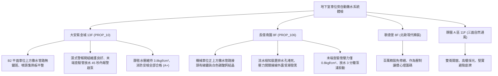

# 全案購屋實戰第一千一百七十二部：中古大樓地下室車位旁自動撒水系統濕式流水檢知裝置警報逆止閥閥瓣卡死延遲壓力開關失靈與末端查驗管失壓體檢工序全書

---

## 序章：頭頂上的水系護城河——自動撒水系統與濕式流水檢知裝置防線

在集合住宅大樓地下室停車場中，由於汽機車油箱含有易燃汽油、柴油或高能量鋰電池，火載量（Fire Load）極大，法規強制要求全區天花板必須密佈「閉式自動撒水滅火設備（Automatic Sprinkler System）」。而掌控整個地下分區撒水系統動作感知與通報的關鍵核心，即為安裝於車位旁或通道牆面的「濕式流水檢知裝置」（Wet Alarm Valve Assembly / 濕式警報逆止閥）。
濕式流水檢知裝置由本體警報逆止閥（Alarm Check Valve）、延遲室（Retard Chamber）、壓力開關（Pressure Switch）、水力警鈴（Water Motor Gong）及分區末端查驗管（Inspector's Test Connection）構成。
然而，在屋齡 20~30 年以上的中古大樓中，地下室潮濕環境、水質鐵鏽硬垢沉積與長年未行放水測試，極易引發下列滅火致命癱瘓：
1. **警報逆止閥閥瓣（Clapper）橡膠密封圈硬化與青銅閥座卡死**：長期自來水靜態受壓，水垢雜質沉積於鉸鏈銷軸（Hinge Pin）與橡膠墊圈，當火場高溫使撒水噴頭（Sprinkler Head）\(68^\circ\text{C}\) 玻璃球破裂噴水時，閥瓣因受水垢黏連無法順暢掀開，致使大流量滅火水源無法灌入管網，撲滅初期火災失敗。
2. **警報延遲室排水節流孔（Drain Orifice）泥沙堵塞引發誤報，或延遲過久錯失黃金時機**：延遲室底部的細小排水平衡孔若被管網鐵鏽泥沙堵死，微小管網水壓波動將使延遲室積滿水，導致壓力開關頻繁誤報火警；反之，若延遲室內部彈簧薄膜破裂，壓力開關將完全無法受壓動作。
3. **電氣壓力開關（Pressure Switch）微動開關接點電化氧化**：地下室水氣侵入壓力開關外殼，接點表面氧化發黑，當水流衝擊薄膜使頂桿上升時，微動開關接點不導通，致使消防受信總機無法接收「流水檢知動作」信號，無法自動啟動地下室消防撒水加壓泵浦。
4. **分區末端查驗管（Inspector's Test Connection）失壓與管網管壁穿孔鏽蝕**：長期缺乏維護之鍍鋅鋼管或配水支管，在死水環境下產生嚴重的電化學孔蝕（Pitting Corrosion）與微生物腐蝕（MIC），末端查驗管壓力表實測壓力跌破 \(1.0\,\text{kgf/cm}^2\)（法定最低運轉壓力），甚至管壁內部結垢閉塞達管徑一半以上，實際噴水量嚴重不足。

本手冊建立中古大樓地下室車位旁濕式流水檢知裝置、末端查驗管放水測試與壓力開關之專項體檢工序，保護買方愛車與人身生命安全。

---

## 第一章：四大決戰主力候選物件地下自動撒水系統體檢對照

### 1.1 大安紫金城 13 樓 (`PROP_10`)：頂級水系消防防護與精準滅火聯鎖
- **管網規格與佈局**：大安紫金城地下各層停車位均佈設符合法規標準之濕式自動撒水管網，噴頭間距均勻（\(< 3.0\,\text{m}\)），且配備原廠集熱板（Heat Collector），無任何被管線或吊架遮擋情況。
- **測試數據與運轉實測**：B2 獨立大平面車位分區之濕式流水檢知裝置保養狀態極佳，表頭靜態水壓達 \(3.8\,\text{kgf/cm}^2\)；現場打開末端查驗管測試閥進行放水實測，警報逆止閥平穩掀開，水力警鈴清脆響起，延遲室在 42 秒內充水推動壓力開關，警衛室消防主機即刻顯示該分區火警，撒水輔助加壓泵浦於 48 秒內自動投入運轉，消防水滅火維護評級高達頂尖 **A+**。
- **談判優勢**：滅火生命線完全達標，支撐 768~788 萬目標區間，封頂 800 萬。

### 1.2 長億南園 8 樓 (`PROP_106`)：撒水管網失壓與流水檢知癱瘓之致命議價點
- **現場致命缺陷**：
  1. 機械車位正上方之撒水鍍鋅鋼管，三通接頭與管束卡箍處已有嚴重的紅褐色鐵鏽斑痕，部分接縫處甚至滲漏出白色碳酸鈣結晶水漬，管壁已有穿孔漏水前兆。
  2. 車位旁濕式警報逆止閥本體外觀斑駁，警報測試閥把手生鏽卡死無法轉動；壓力開關外殼破裂，內部微動開關接點長滿綠鏽；延遲室下方節流排水孔已被黑色油泥硬塊完全糊死。
  3. 實測長億南園該棟地下室末端查驗管，壓力表指針僅停留在 \(0.8\,\text{kgf/cm}^2\)（嚴重低於法定最低要求 \(1.0\,\text{kgf/cm}^2\)）；開啟放水閥實施放水測試，長達 3 分鐘無任何水流信號反饋，加壓泵浦完全未啟動，地下室自動滅火防線處於「實質癱瘓狀態」。
- **談判砍價防線**：開價 998 萬，將地下室撒水管網除鏽換管、更換濕式警報逆止閥組與壓力開關（全棟消防改善分攤款約 12~18 萬）合流機械車位缺陷，起手 698~720 萬，堅決以 **745~760 萬** 封頂買進。

---

## 第二章：地下室濕式流水檢知裝置與撒水系統標準檢驗 SOP

| 檢驗分項 | 檢測工具與儀器 | 合格標準 | 異常特徵判定 | 潛在致命風險 |
| :--- | :--- | :--- | :--- | :--- |
| **末端查驗管放水測試** | 耐震充油壓力表、碼錶、量筒 | 放水壓力 \(\ge 1.0\,\text{kgf/cm}^2\)，放水流量 \(\ge 80\,\text{L/min}\) | 靜態壓力 \(< 1.0\,\text{kgf/cm}^2\)，水流如涓流，水色發黑渾濁 | 噴水量不足、無法壓制初期火勢 |
| **警報響應與報警時間** | 碼錶、警報受信總機對照 | 開啟測試閥後，\(15\sim 60\,\text{s}\) 內水力警鈴鳴響且總機報警 | 超過 90 秒無動作，或關閉後警報持續鳴響不停 | 延遲開關故障、無法啟動加壓泵 |
| **警報逆止閥密封性能** | 旁通管壓力表、試漏計 | 上下腔壓力平衡，無水流經警報管路洩入排水溝 | 警報管路持續流水漏水、閥瓣磨損無法復歸 | 自來水持續浪費、加壓泵頻繁啟動 |
| **撒水噴頭外觀防護** | 強光手電筒、測距輪 | 噴頭玻璃球液體飽滿無氣泡，周圍無油漆油污附著 | 玻璃球顏色變淡、噴頭被裝修油漆塗污掩蓋 | 噴頭感溫遲鈍、火場中無法爆破噴水 |

---

## 第三章：實戰防禦與購屋交屋特約法務規範

1. **大樓自動撒水系統與流水檢知運轉保證特約**：
   > 「賣方保證買賣標的所屬大樓地下室停車場及公共空間之閉式自動撒水設備、濕式流水檢知裝置及加壓泵浦運作正常，末端查驗管水壓符合法定標準，無管網腐蝕穿孔、流水檢知裝置卡死或無法連動啟泵之重大安全缺失；若交屋日前經消防機關安檢列為不合格者，賣方應負責修繕完成或自總價中扣減相應費用。」
2. **簽約前消防申報之水系滅火設備檢核**：
   - 買方應要求賣方出示最近一期「消防安全設備檢修申報書」中「自動撒水設備檢查表」，核對「放水壓力（kgf/cm²）」、「放水流量（L/min）」與「流水檢知裝置作動試驗」是否全數列為合格。
