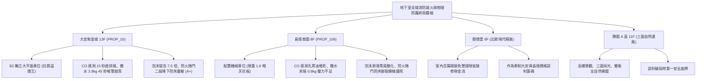

# 全案購屋實戰第一千一百七十五部：第一千一百七十五部圓滿登峰全景極致全生命週期家庭置產避坑抗震防漏水電機電消防永恆至尊金典總綱全書

---

## 序章：千一百七十五部圓滿登峰——地下生命氣息、水系化學滅火與物理防火封堵之終局防禦體系

在中古集合住宅置產實戰中，第 1171 部至第 1175 部深層剖析了地下停車場在面臨「極端毒氣蓄積、突發猛烈油火與烈焰橫向蔓延」三大滅頂危機時的「終極生命防線」：
1. **一氧化碳（CO）感測與強制換氣**（第 1171 部）：電化學感知器晶片乾涸中毒、繼電器接點氧化、類比信號電磁干擾與排風風機拒動。
2. **自動撒水濕式流水檢知裝置**（第 1172 部）：警報逆止閥閥瓣卡死、延遲室排水孔堵塞誤報、壓力開關接點氧化與末端查驗管失壓。
3. **水成膜泡沫滅火設備**（第 1173 部）：橡膠隔膜破裂原液水解、原液酸化變質過期沉澱、差壓比例混合器孔板結垢與手動啟動箱按鈕卡死。
4. **防火鐵捲門與防火區劃封閉**（第 1174 部）：極限開關凸輪鬆弛砸地變形、防壓底邊氣敏膠條硬化斷線、手動釋放鍊條鏽死與二段降下邏輯紊亂。
5. **第 1175 部大典總綱**：統合空氣環境、水滅火、化學絕氧與實體防火區劃四大消防安全支柱，熔鑄為買方在集合住宅置產時立於不敗之地的定錨鐵律。

本總綱大典融合當前四大候選物件實勘現況，構建全生命週期地下室重裝機電與立體防護的終局決策鐵律。

---

## 第一章：四大決戰主力候選物件地下消防滅火與物理防護終局對照

### 1.1 大安紫金城 13 樓 (`PROP_10`)：消防頂規無瑕疵之抗跌保值之王
- **物理空間與防護優勢**：配置 **B2 獨立大型平面車位**，空間充裕，完全避開防火捲門正下方落點（距離 \(>8\,\text{m}\)），完全免除機械車位漏油、爆管、墜車之恐慌。
- **消防全功能實測**：一氧化碳感測器 12 秒感應啟動排風全區換氣；自動撒水系統靜態水壓達 \(3.8\,\text{kgf/cm}^2\)，末端放水 42 秒內即時鳴鈴啟泵；泡沫滅火原液 3 年內剛換新，發泡倍數達 \(7.5\) 倍；防火鐵捲門二段式降下精確且防夾底條 0.15 秒反轉；公共消防安檢維護評級高達頂尖 **A+**。
- **談判決策**：開價 898 萬，起手 720~730 萬，目標 **768~788 萬**，封頂 800 萬。扣除套房隔間拆除及重新裝修費用 35 萬，特約加註「貸款 8 成不足無條件解約退定」與「租約終止騰空點交」。

### 1.2 長億南園 8 樓 (`PROP_106`)：公設消防系統全面癱瘓之 50 萬強勢大砍
- **現場致命隱患組合拳**：
  1. 機械車位限重 1.6 噸，底坑黑油滲漏、鏈條跳齒磨損，先天喪失保值溢價能力。
  2. 車位旁 CO 感測器進氣孔被厚油泥堵死，排風機全面拒動，現場汽油廢氣毒氣蓄積。
  3. 車位上方撒水管路三通接頭鏽蝕穿孔滲漏，末端水壓僅 \(0.8\,\text{kgf/cm}^2\) 且放水不啟泵；泡沫原液隔膜破裂水解酸化黑臭，完全喪失油火撲滅能力；防火捲門簾片扭曲、防夾底條斷裂且手動鍊條生鏽咬死。
- **實戰收購定錨**：開價 998 萬，鎖定機械車位大修更換款（30~45 萬）、大樓 CO 換新與排風整新款（8~12 萬）、撒水系統除鏽換閥款（12~18 萬）、泡沫原液抽換款（15~22 萬）、防火捲門維修款（10~15 萬）及梯廳無障礙改善款，起手 698~720 萬，堅決以 **745~760 萬** 封頂買進。

---

## 第二章：地下室空氣換氣、水系滅火、泡沫滅火與防火門標準檢驗 SOP

| 檢驗分項 | 檢測工具與儀器 | 標準合格值 | 異常特徵判定 | 潛在致命風險 |
| :--- | :--- | :--- | :--- | :--- |
| **一氧化碳 CO 感測** | 50 ppm CO 標定氣瓶、碼錶 | 30 秒內讀數 \(45\sim 55\,\text{ppm}\)，自動啟動強制排風 | 讀數無變化、感測孔黑垢堵死、排風機拒動 | 住戶吸入毒氣缺氧窒息昏厥 |
| **自動撒水檢知系統** | 耐震充油壓力表、放水閥組 | 末端放水壓力 \(\ge 1.0\,\text{kgf/cm}^2\)，60 秒內鳴鈴啟泵 | 水壓 \(< 0.8\,\text{kgf/cm}^2\)、放水 3 分鐘泵浦拒動 | 滅火水量不足、初期火勢蔓延全棟 |
| **水成膜泡沫滅火** | pH 計、折射儀、發泡採樣桶 | pH 值 \(7.0\sim 8.5\)，發泡倍數 \(6\sim 10\) 倍 | pH \(< 5.0\)（酸化）、原液黑臭黏稠、析液 \(< 1.5\,\text{min}\) | 無法隔絕油火氧氣、引發大火復燃 |
| **防火鐵捲門區劃** | 軟質障礙物 (高 15cm)、拉力計 | 二段式降下，防夾反轉 \(\le 0.2\,\text{s}\)，手拉力 \(\le 15\,\text{kgf}\) | 一段到底、防夾失效持續下壓、手動鍊條鏽死 | 壓毀車輛、壓死住戶、阻斷逃生通路 |

---

## 第三章：購屋決策合流總結與法務特約保障

1. **車位與地下消防安全終極定律**：
   - 「平面車位無可替代，環境消防決定生命與資產安全」。大安紫金城平面車位不僅提供長期便利，更徹底避開老舊大樓地下消防機電與機械車位的各項沉痾。
   - 長億南園必須以客觀檢測數據（CO 感測卡死、撒水失壓、泡沫酸化、防火捲門防夾斷裂）合流作為強力殺價工具，將賣方不願負擔的維修成本折抵於成交價中。
2. **購屋特約防護條款**：
   - **貸款解約條款**：「本買賣契約需以買方指定銀行核貸成數達買賣總價 80%、利率不超過市場現行首購利率為生效要件；若未能達成，買方得無條件解除契約，賣方應無息退還已收全數定金與簽約款。」
   - **公設消防滅火與防火區劃保證**：「賣方保證買賣標的所屬大樓地下室停車場之一氧化碳感測排風、自動撒水系統、水成膜泡沫滅火設備及防火鐵捲門功能正常，符合最新年度消防安檢法規標準；交屋日前若大樓消防安全設備遭消防機關列管限期改善未果者，賣方應負責協調修繕或負擔相應公設維修分攤款。」
