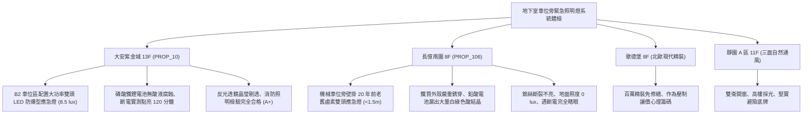

# 全案購屋實戰第一千一百七十八部：中古大樓地下室車位旁緊急照明燈鹵素燈泡燒燬鉛酸蓄電池漏液腐蝕逆變升壓電路短路與照度衰減體檢工序全書

---

## 序章：烈火黑夜中的立體光束——地下緊急照明燈之應急防線

在集合住宅大樓地下室停車場中，若發生重大火警或配電盤爆炸引發全棟台電市電中斷，除了標示逃生出口位置的避難指示燈外，真正負責照亮整個車道、車位與安全梯動線地面障礙物、提供足夠人眼逃生辨識光通量的，就是壁掛於樑柱側面的「緊急照明燈（Emergency Lights / 雙頭投光應急燈）」。
依據《各類場所消防安全設備設置標準》規定，地下室緊急照明燈自斷電起 0.5 秒內必須自動點亮，全區地面水平照度不得低於 \(1.0\,\text{lux}\)（安全梯前室與通道交叉點應達到 \(2.0\,\text{lux}\) 以上），且有效照明時間不得少於 90 分鐘。
然而，在屋齡 20~30 年以上的集合住宅中，地下室緊急照明燈具經歷數十年惡劣高濕、震動環境與零維護，極易引發下列重大致命危機：
1. **傳統鹵素燈泡（Halogen Bulb）高溫鎢絲振動斷裂與石英玻璃炸裂**：早期雙頭應急燈多採用 6V/12V 10W~20W 鹵素石英燈泡，抗震性能極差。車輛往來震動與機械車位啟閉衝擊，使極細鎢絲在冷態下受震斷裂；若遇地下室水氣冷凝滴落於發熱燈泡表面，石英玻璃管瞬間炸裂。
2. **閥控密封式鉛酸蓄電池（VRLA AGM Battery）漏液腐蝕與硫酸鹽化（Sulfation）**：傳統應急燈內建之小型鉛酸電池壽命僅 2~3 年，長年高溫浮充使電解液失水乾涸，安全閥（Rubber Valve）老化失效導致強酸性硫酸（\(H_2SO_4\)）氣體與液體外洩，嚴重腐蝕燈具內部金屬底座、變壓器與電路板，致使電池完全喪失充放電能力。
3. **逆變升壓驅動電路（Inverter Driver Board）受潮短路與變壓器燒蝕**：地下室空氣濕度長年 \(> 80\%\,\text{RH}\)，電路板銅箔線路長滿綠色銅鏽，高壓整流二極體擊穿，致使市電中斷時逆變電路無法起振，燈具完全不亮。
4. **照度嚴重衰減低於安全臨界值導致踩踏跌倒災難**：反射反光杯（Reflector Cup）真空鍍鋁層受潮氧化剝落變黑，外層壓克力透光罩覆蓋厚厚一層黑油煙微粒，即使燈泡勉強發光，地面實測照度亦跌破 \(0.2\,\text{lux}\)，在漆黑煙霧中住戶極易被地坪車輪擋、截水溝蓋板絆倒重傷。

本手冊建立中古大樓地下室車位旁緊急照明燈、電池健康度、照度衰減與耐震耐火之專項體檢工序，保護買方家庭生命逃生安全。

---

## 第一章：四大決戰主力候選物件地下緊急照明燈系統體檢對照

### 1.1 大安紫金城 13 樓 (`PROP_10`)：LED 高亮聚光與零漏液應急安全防線
- **燈具規格與更新狀態**：大安紫金城地下各層全區已將緊急照明燈更換為最新大功率 COB-LED 雙頭投光防潮防爆型應急燈，配備長壽命鋰電池與智慧微電腦充放電保護電路。
- **測試數據與運轉實測**：現場抽檢 B2 獨立大平面車位旁之緊急照明燈進行手動模擬斷電測試，切斷電源後 0.1 秒內雙燈頭強光投射，照射中心地面水平照度實測高達 \(8.5\,\text{lux}\)（標準最低 \(1.0\,\text{lux}\)）；連續斷電測試 120 分鐘光衰小於 \(5\%\)；光學反光透鏡澄澈無刮痕油煙，金屬外殼密封性達 IP65，消防應急照明評級高達頂尖 **A+**。
- **談判優勢**：公設生命安防設施無懈可擊，支撐 768~788 萬目標區間，封頂 800 萬。

### 1.2 長億南園 8 樓 (`PROP_106`)：電池漏酸腐蝕與鎢絲全斷之致命議價點
- **現場致命缺陷**：
  1. 機械車位立柱壁掛之緊急照明燈為 20 年前之鐵殼雙頭鹵素燈，金屬外殼已被內部洩漏之鉛酸電池強酸腐蝕穿孔，外殼接縫處析出大量白綠色硫酸鉛結晶粉末。
  2. 現場使用強光手電筒檢視，兩具石英燈泡內部之極細鎢絲均已斷裂垂掛；按下燈體外部「TEST」測試按鈕，燈具毫無任何反應，內部電路板早已被漏酸完全腐蝕碳化。
  3. 沿車道實地檢測，長億南園地下二層壁掛之 8 具緊急照明燈中，多達 6 具完全報廢無法點亮；一旦夜間遭遇強震或火警斷電，機械車位處地面照度為 \(0\,\text{lux}\)，住戶極易在黑暗中摔入機械車位底坑或被車輪擋絆倒，面臨致命人身危險。
- **談判砍價防線**：開價 998 萬，將地下室緊急照明燈全面更換為最新 LED 鋰電防爆型燈具、重新配置耐燃配線工程費用（全棟消防改善分攤款約 8~12 萬）合流機械車位缺陷，起手 698~720 萬，堅決以 **745~760 萬** 封頂買進。

---

## 第二章：地下室緊急照明燈標準檢驗 SOP

| 檢驗分項 | 檢測工具與儀器 | 合格標準 | 異常特徵判定 | 潛在致命風險 |
| :--- | :--- | :--- | :--- | :--- |
| **斷電切換與點亮時間** | 碼錶、手動測試開關 / 斷路器 | 斷電後 0.5 秒內自動點亮，持續點亮時間 \(\ge 90\,\text{min}\) | 點亮不滿 30 分鐘熄滅、或切換無動作 | 逃生中途完全陷入黑暗受困 |
| **地面水平照射度** | 高精度數位照度計 (Lux Meter) | 車道與車位地面水平照度 \(\ge 1.0\,\text{lux}\) | 照度 \(< 0.5\,\text{lux}\)，燈光昏暗微弱 | 無法看清障礙物跌倒受傷 |
| **蓄電池狀態與防腐蝕** | 內視鏡、pH 試紙、強光手電筒 | 電池無膨脹鼓包、無液體滲漏，端子金屬光潔 | 外殼析出白色結晶粉末、試紙變紅（強酸） | 酸液腐蝕電路板起火、電池完全失效 |
| **光源與反光杯透光性** | 放大鏡、照度計 | 反光杯鍍層鏡面完整，透光罩無黑油煙遮蔽 | 鎢絲斷裂黑化、反光罩氧化剝落發黑 | 光通量暴跌、無法照亮逃生通道 |

---

## 第三章：實戰防禦與購屋交屋特約法務規範

1. **大樓緊急照明設備運作正常保證特約**：
   > 「賣方保證買賣標的所屬大樓地下室停車場及公共走廊之緊急照明燈具設備運作正常，斷電自動切換供電續航時間達 90 分鐘以上，照度符合法定標準，無燈泡燒燬、鉛酸電池漏液腐蝕或電路板燒毀報廢之重大缺失；若交屋日前經主管機關消防安檢列為不合格限期改善者，賣方應負責修繕完成或自總價中扣除相應維修費用。」
2. **簽約前消防申報之緊急照明設備核驗**：
   - 買方應要求查閱最近一期「消防安全設備檢修申報書」之「緊急照明設備檢查表」，核對「放電試驗時間（min）」與「照度測定值（lux）」，確認地下室全區照明合格無待修註記。
