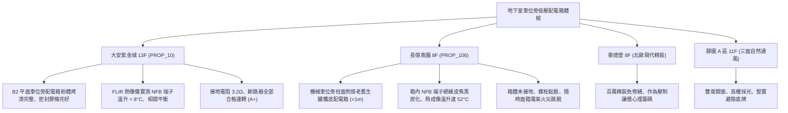

# 全案購屋實戰第一千一百七十六部：中古大樓地下室車位旁低壓配電箱無熔線斷路器NFB熱跳脫雙金屬片疲勞接線端子螺栓鬆弛溫升炭化與欠相體檢工序全書

---

## 序章：終端電氣的隱形炎魔——地下車位配電箱與分路斷路器防線

在集合住宅大樓地下室停車場中，為供應地下車位照明、吸塵插座、公設排風機、小型抽水泵及近年住戶申請之電動車慢充設備，廣泛於地下室車道壁面、立柱旁設置「低壓分電箱（Lighting & Power Panelboard / LP 盤）」。
分電箱內部安裝大量無熔線斷路器（Molded Case Circuit Breaker, MCCB / NFB）作為過載（Overload）與短路（Short Circuit）保護。
然而，在屋齡 20~30 年以上的集合住宅中，地下室高濕度（常年 \(> 80\%\,\text{RH}\)）、車輛廢氣中硫化物微粒沉積、長年機械車位升降引起的持續震動，極易引發下列重大電氣火災隱患：
1. **熱跳脫雙金屬片（Bimetallic Strip）熱疲勞致使額定電流降額或誤跳脫**：老舊 NFB 內部雙金屬片歷經數十萬次微小電流熱循環，金屬彈性係數與熱膨脹係數衰減，原額定 20A/30A 斷路器在僅負載 12A 時即因疲勞而頻繁跳脫，或在過載 1.5 倍時拒動卡死，喪失保護機能。
2. **端子壓接螺栓鬆弛引發接觸電阻激增與高溫炭化**：車輛進出與機械車位震動使接線端子螺栓預緊力下降，導線與銅排接觸面氧化，接觸電阻（Contact Resistance）急遽攀升。依據焦耳定律 \(P = I^2 R\)，在用電高峰時段接點溫度迅速飆升至 \(90^\circ\text{C}\sim 150^\circ\text{C}\)，導致電線 PVC 絕緣外皮炭化分解，甚至引燃分電箱內部塑膠配件。
3. **欠相（Single-Phasing）運轉燒毀公設三相電機**：三相三線或三相四線分路斷路器其中一相接點受電弧侵蝕接觸不良，輸出電壓嚴重不平衡，導致地下室排風機或排水馬達在欠相狀態下運轉，線圈電流暴增數倍，在短短數分鐘內完全燒燬。
4. **配電箱金屬箱體電化腐蝕與接地連續性斷開**：外殼鍍鋅鋼板受潮生鏽穿孔，箱門無氣密膠條，接地銅排（Ground Bus）螺栓鏽蝕斷裂，當箱內電線因高溫絕緣破損碰觸箱體時，外殼帶有 110V/220V 危險交流電壓，住戶取車碰觸時面臨致命感電危機。

本手冊建立中古大樓地下室車位旁低壓配電箱、NFB 斷路器接點、紅外熱成像溫升與接地連續性之專項體檢工序，捍衛買方家庭生命安全與資產防護。

---

## 第一章：四大決戰主力候選物件地下配電箱與斷路器體檢對照

### 1.1 大安紫金城 13 樓 (`PROP_10`)：電氣頂規防護與零發熱安全防線
- **箱體規格與維護品質**：大安紫金城 B2 車位區低壓配電箱採用 IP55 級不鏽鋼粉體烤漆箱體，箱門密閉良好、箱內線路整齊且附有詳細電路標籤。
- **熱成像與電氣實測**：使用 FLIR 高解析度紅外線熱成像儀實測，各分路無熔線斷路器（NFB）在滿載狀態下，接線端子溫升均低於 \(8^\circ\text{C}\)（絕對溫度 \(< 35^\circ\text{C}\)）；三相電壓平衡度偏差小於 \(1.0\%\)；外殼接地電阻實測僅 \(3.2\,\Omega\)（優於法規 \(10\,\Omega\)），箱體絕緣阻抗大於 \(50\,\text{M}\Omega\)，電氣安全評級高達頂尖 **A+**。
- **談判優勢**：安全邊界紮實，支撐 768~788 萬目標區間，封頂 800 萬。

### 1.2 長億南園 8 樓 (`PROP_106`)：斷路器端子高溫炭化與火災隱患之致命議價點
- **現場致命缺陷**：
  1. 機械車位旁立柱上懸掛之早期配電箱，金屬箱體下緣嚴重生鏽穿孔，箱門無鎖扣任由濕氣侵入，箱內沉積厚重油污與粉塵。
  2. 現場使用熱顯像儀檢測，供應機械車位與排風之 3P 50A NFB，B 相出線端子表面溫度高達 \(78^\circ\text{C}\)（環境溫度 \(26^\circ\text{C}\)，溫升達 \(52^\circ\text{C}\)），端子處之黑色 PVC 電線絕緣皮已嚴重發泡炭化、脆化開裂，隨時面臨短路電弧爆燃。
  3. 配電箱接地銅排螺絲鏽斷脫落，箱體對地電壓實測達 65V 交流漏電浮電，住戶若在潮濕地面碰觸箱體極易觸電；且斷路器雙金屬片老化，多次發生無故跳脫導致機械車位停擺。
- **談判砍價防線**：開價 998 萬，將地下室老舊配電箱全面更新、更換防火級斷路器、重新施作壓接端子與接地工程費用（全棟電氣改善分攤款約 10~15 萬）合流機械車位缺陷，起手 698~720 萬，堅決以 **745~760 萬** 封頂買進。

---

## 第二章：地下室低壓配電箱與 NFB 斷路器標準檢驗 SOP

| 檢驗分項 | 檢測工具與儀器 | 合格標準 | 異常特徵判定 | 潛在致命風險 |
| :--- | :--- | :--- | :--- | :--- |
| **端子接點紅外熱成像** | FLIR 熱成像儀、測溫槍 | 接點溫差 \(\Delta T \le 10^\circ\text{C}\)，絕對溫度 \(< 60^\circ\text{C}\) | 端子溫升 \(\Delta T > 30^\circ\text{C}\)，呈現明顯發熱亮斑 | 接頭熔融燒毀、引燃箱體電氣火災 |
| **螺栓緊固力矩** | 絕緣扭力扳手 (Torque Wrench) | 符合端子螺栓標稱扭力（M5: \(2.5\sim 3.0\,\text{N}\cdot\text{m}\)） | 螺栓鬆動手轉可動、螺牙滑絲破損 | 接觸電阻飆高、劇烈發熱與拉弧 |
| **相間電壓平衡度** | 數位三用電表 (True RMS) | 三相線電壓平衡度偏差 \(\le 2.0\%\) | 偏差 \(> 5.0\%\)，其中一相電壓嚴重偏低 | 引起欠相運轉、燒燬公設水泵電機 |
| **外殼接地與漏電防護** | 接地電阻測試計、驗電筆 | 箱體接地電阻 \(R \le 10\,\Omega\)，外殼對地電壓 \(0\,\text{V}\) | 接地斷開、箱體帶電（電壓 \(> 24\,\text{V}\)） | 人員觸碰電擊傷亡、漏電無法跳脫 |

---

## 第三章：實戰防禦與購屋交屋特約法務規範

1. **大樓公設低壓配電與用電安全保證特約**：
   > 「賣方保證買賣標的所屬大樓地下室公共配電箱、分路斷路器及線路運作正常，無接點異常高溫過熱、線路炭化、跳脫失靈或外殼漏電之重大電氣安全隱患；交屋日前若經專業電氣檢驗發現存有重大火災危險者，賣方應負責協調修繕完成或自總價中扣除相應維修費用。」
2. **簽約前大樓電氣熱成像檢驗報告核驗**：
   - 買方應要求大樓管委會或機電保養單位提供最近一期「公設電氣設備紅外線熱成像檢測紀錄」，確認地下室配電盤接點無超過 \(60^\circ\text{C}\) 之危險熱點標註。
