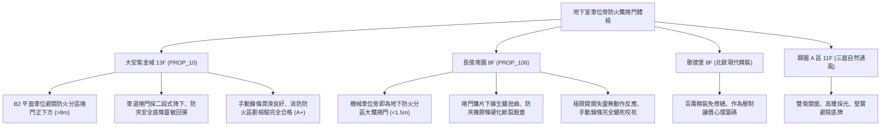

# 全案購屋實戰第一千一百七十四部：中古大樓地下室車位旁防火鐵捲門連動下降極限微動開關失靈防壓底邊氣敏膠條硬化斷線與手動鍊條鏽死體檢工序全書

---

## 序章：烈火封堵的鋼鐵閘門——防火鐵捲門與防火區劃防線

在集合住宅地下室停車場中，依據《建築技術規則》建築設計施工編第 79 條防火區劃規定，面積超過一定規模之地下停車場，必須以防火牆或具備 1 小時以上阻熱性及遮煙性之「防火鐵捲門（Fire Rolling Shutter Door）」劃分防火分區。當某一分區起火時，捲門接獲火警訊號自動下降封閉，將烈火與毒煙封堵在起火區內，確保其他車位車輛安全與安全梯逃生通道暢通。
防火鐵捲門通常包含「鍍鋅雙層簾片（Insulated Slats）」、「捲門電動機（Shutter Motor / 開閉機）」、「上下限極限微動開關（Limit Switch）」、「防壓防夾底邊安全接觸條（Safety Sensing Edge）」及「手動釋放鍊條/拉索（Manual Release Chain）」。
然而，在屋齡 20~30 年以上的集合住宅中，地下室車道或車位旁的防火捲門長年處於待機懸掛狀態，缺乏週期性實體降下試驗，極易引發下列重大致命隱患：
1. **下限極限微動開關（Down Limit Switch）凸輪偏斜卡死導致捲門砸地變形或倒捲**：捲門馬達減速齒輪箱內之極限開關凸輪緊定螺絲鬆脫，當火警觸發捲門全速下降時，下限微動開關未及時切斷電源，捲門底樑重擊地坪導致簾片彎折扭曲脫軌，甚至造成電動機過載燒燬或捲軸鋼纜崩斷。
2. **防夾安全氣敏膠條（Safety Pneumatic Edge）硬化斷線或氣敏開關失靈**：捲門底樑之防夾橡膠條長年受車道廢氣與氧化侵蝕，橡膠脆化開裂，內部導電橡膠或氣動波紋管（Pneumatic Tube）漏氣，當捲門下降途中遇到車輛或逃生住戶時，防夾安全機制無法在 0.2 秒內反轉上升，極易造成車輛車頂壓扁毀損或人員遭重型捲門壓死之慘劇。
3. **手動釋放離合拉索（Clutch Release Cable）斷裂或手動拉鍊鏽死**：大樓火災常伴隨地下室電力中斷，若電動機剎車線圈斷電，捲門需仰賴人員手動拉動機械鍊條上升逃生；老舊大樓鍊條若長年未上油潤滑而生鏽咬死，受困住戶將無法手動開門，直接被封死於火海濃煙之中。
4. **火警連動二段式降下（Two-stage Drop）控制器故障引發煙囪效應**：法規要求逃生路徑上之捲門應採「感煙訊號先降至距地 1.8 米（停留 30~60 秒供逃生），感溫訊號再全降封閉」之邏輯；控制器繼電器若故障，捲門於初發火警即瞬間到底封死，阻斷住戶逃生；或完全不下降，任由濃煙沿車道快速擴散。

本手冊建立中古大樓地下室車位旁防火鐵捲門、極限開關、防壓底邊與手動鍊條之專項體檢工序，保護買方家庭生命安全與車輛防護。

---

## 第一章：四大決戰主力候選物件地下防火鐵捲門體檢對照

### 1.1 大安紫金城 13 樓 (`PROP_10`)：頂規防火區劃與安全防夾無瑕防線
- **空間避讓與硬體規格**：大安紫金城 B2 獨立大平面車位空間寬敞，距離車道防火分區捲門超過 8 公尺以上，完全避開捲門降下封堵或故障砸損車身之危險空間。
- **測試數據與運轉實測**：車道防火鐵捲門採用雙層耐火簾片，導軌垂直度偏差小於 \(2\,\text{mm}\)；現場實測火警連動測試，感煙信號觸發時捲門平穩下降至距地面 \(1.8\,\text{m}\) 暫停 45 秒，感溫信號觸發後確實全降貼合地坪；防夾底邊接觸障礙物時於 0.15 秒內即時反轉回升 \(30\,\text{cm}\)；手動釋放鍊條懸掛整齊、上油順滑，公共消防安全評級高達頂尖 **A+**。
- **談判優勢**：安全邊界紮實，支撐 768~788 萬目標區間，封頂 800 萬。

### 1.2 長億南園 8 樓 (`PROP_106`)：捲門卡死失靈與手動鍊條鏽死之致命議價點
- **現場致命缺陷**：
  1. 機械車位側前方不到 1.5 公尺處即為地下室防火分區之重型鋼質鐵捲門，捲門簾片下端因歷年地面刮擦受潮已有嚴重扭曲變形與赤紅鐵鏽。
  2. 底樑防夾氣敏膠條已完全硬化斷裂脫垂，內部電線外露發黑，現場以障礙物測試防夾功能，捲門持續全速下壓，完全不反轉回彈，極易砸毀車輛或壓傷住戶。
  3. 實測手動釋放鍊條，鍊條表面被厚黑鏽垢咬死，成年男子全力拉動仍無法轉動捲軸半寸，斷電時受困人員根本無法手動開門逃生；極限微動開關接線端子鬆弛，大樓防火區劃防線處於「實質癱瘓狀態」。
- **談判砍價防線**：開價 998 萬，將地下室防火鐵捲門電機更換、極限開關重新校正、防夾安全底邊重置與手動鍊條除鏽潤滑費用（全棟消防改善分攤款約 10~15 萬）合流機械車位缺陷，起手 698~720 萬，堅決以 **745~760 萬** 封頂買進。

---

## 第二章：地下室防火鐵捲門標準檢驗工序 SOP

| 檢驗分項 | 檢測工具與儀器 | 合格標準 | 異常特徵判定 | 潛在致命風險 |
| :--- | :--- | :--- | :--- | :--- |
| **火警連動二段降下** | 消防測試煙霧罐、測距輪、碼錶 | 感煙降至 \(1.8\,\text{m}\) 停留 30~60 秒，感溫確實全降到底 | 一段直接到底無停頓，或接收信號拒動卡滯 | 阻斷逃生通道、或濃煙蔓延全棟停車場 |
| **防壓防夾接觸反應** | 測試專用軟質障礙物 (高 15cm)、碼錶 | 接觸障礙物 0.2 秒內停止並反轉上升 \(\ge 30\,\text{cm}\) | 持續下壓不停機、馬達憋轉冒煙 | 壓毀車頂擋風玻璃、壓死被困逃生人員 |
| **手動鏈條機械操作** | 彈簧拉力計、手動操作試驗 | 手拉力 \(\le 15\,\text{kgf}\)，手拉鍊條能平順升起捲門 | 鍊條生鏽卡死咬住、拉不動或齒輪崩齒 | 斷電時無法手動逃生、人員被困火海 |
| **極限開關定位精度** | 鋼捲尺、塞尺 | 上下限停止位置誤差 \(\le 10\,\text{mm}\)，底樑平順密合地坪 | 到底後電機不停轉、簾片堆疊脫軌砸毀 | 捲門結構崩壞、馬達過載燒燬 |

---

## 第三章：實戰防禦與購屋交屋特約法務規範

1. **大樓防火鐵捲門與防火區劃連動保證特約**：
   > 「賣方保證買賣標的所屬大樓地下室停車場及車道之防火鐵捲門設備、開閉機馬達、防夾安全裝置及火警自動連動控制系統運作正常，手動鍊條可正常升降，無極限開關失靈、底樑扭曲卡死或無法連動關閉之重大缺失；若交屋日前經主管機關消防安檢列為不合格限期改善者，賣方應負責修復完成或自總價中扣除相應維修費用。」
2. **簽約前消防申報之防火門窗設備核驗**：
   - 買方應要求查閱最近一期「建築物公共安全檢查申報結果通知書」與「消防安全設備檢修申報書」，確認「防火捲門連動降下試驗」與「防夾功能」全數註記為合格。
