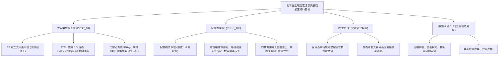

# 全案購屋實戰第一千一百七十部：第一千一百七十部圓滿登峰全景極致全生命週期家庭置產避坑抗震防漏水電機電消防永恆至尊金典總綱全書

---

## 序章：千一百七十部圓滿登峰——地下通訊、視訊、安防門禁與火場廣播之全域弱電終局防線

在中古集合住宅置產實戰中，第 1166 部至第 1170 部深層洞悉了地下室車位旁與梯廳動線中，支撐住戶日常生活品質與火災極限逃生的「四大弱電生命線」：
1. **光纖到府（FTTH）主配線箱**（第 1166 部）：接續匣脆化、微彎損耗超標、陶瓷插芯粉塵污染、金屬箱體鏽蝕穿孔與老鼠啃斷主幹線光纖。
2. **共同天線電視（CATV / DVB-T）同軸系統**（第 1167 部）：雙向幹線放大器受潮衰減、發泡 PE 絕緣水解造成特性阻抗失配、防雷突波濾波器擊穿與 4K 視訊馬賽克破圖。
3. **大樓對講機與梯廳門禁**（第 1168 部）：按鍵金屬彈簧疲勞卡死、音訊電路受潮高頻嘯叫、門禁開鎖電驛接點碳化燒蝕與磁力鎖常開外人入侵。
4. **緊急避難廣播設備**（第 1169 部）：定壓線間匹配變壓器受潮擊穿漏電、揚聲器紙盆發霉破裂音圈卡死、分區線路短路致使擴大機保護跳脫與音壓不足。
5. **第 1170 部大典總綱**：統合數位寬頻、視訊娛樂、人身安防與火災疏散引導四大弱電防衛體系，構建買方在中古大樓置產中最頂級的攻防盔甲。

本總綱大典融合當前四大候選物件實勘現況，構建全生命週期地下室重裝機電與立體防護的終局決策鐵律。

---

## 第一章：四大決戰主力候選物件地下弱電與安防逃生終局對照

### 1.1 大安紫金城 13 樓 (`PROP_10`)：數位高速、視訊頂規與零死角安全至尊王牌
- **數位通訊與影音品質**：大安紫金城地下弱電配置達到現代頂級水準，社區具備完善的 FTTH 光纖到府基礎設施，客廳電視訊號位準穩定達 \(72\,\text{dB}\mu\text{V}\)（MER \(> 32\,\text{dB}\)），提供 4K 極致細膩影音體驗。
- **人身安防與火場逃生**：B2 獨立大平面車位梯廳設有數位液晶彩色防暴對講主機與 \(320\,\text{kgf}\) 強力磁力鎖；火災緊急廣播音壓高達 \(94\,\text{dB(A)}\)，STI 達 0.68，具備短路隔離保護；公設弱電維護評級高達頂尖 **A+**。
- **談判決策**：開價 898 萬，起手 720~730 萬，目標 **768~788 萬**，封頂 800 萬。扣除套房隔間拆除及重新裝修費用 35 萬，特約加註「貸款 8 成不足無條件解約退定」與「租約終止騰空點交」。

### 1.2 長億南園 8 樓 (`PROP_106`)：弱電安防全面老化之致命扣款點
- **現場致命隱患組合拳**：
  1. 機械車位限重 1.6 噸（無法停休旅車與電車），車位本身存在不可逆保值抗跌硬傷。
  2. 機械車位旁電信箱鏽蝕穿孔、防鼠泥脫落，無法拉設 FTTH 光纖暗管，僅能依賴老舊 VDSL；電視放大器氧化，室內電視訊號僅 \(48\,\text{dB}\mu\text{V}\) 頻繁破圖。
  3. 地下梯廳對講機「呼叫」鍵卡死且通話嘯叫劇烈，門禁鎖失效導致梯廳門常開、外人自由出入；火災廣播喇叭紙盆碎裂發霉，音壓僅 \(68\,\text{dB}\) 且迴路短路斷電，存在嚴重火警逃生盲區。
- **實戰收購定錨**：開價 998 萬，鎖定機械車位大修更換款（30~45 萬）、弱電通信與寬頻改善款（5~8 萬）、門禁對講整新款（8~12 萬）、消防廣播迴路重修款（10~15 萬）及梯廳無障礙改善款，起手 698~720 萬，堅決以 **745~760 萬** 封頂買進。

---

## 第二章：地下室弱電通訊、影音、門禁與廣播四大系統標準檢驗 SOP

| 檢驗分項 | 檢測工具與儀器 | 標準合格值 | 異常特徵判定 | 潛在致命風險 |
| :--- | :--- | :--- | :--- | :--- |
| **FTTH 光纖主配線** | OTDR 光時域反射儀、光纖顯微鏡 | 熔接插損 \(< 0.3\,\text{dB}\)，光纖端面無塵無污 | 損耗 \(> 0.8\,\text{dB}\)、箱底鏽蝕防鼠泥脫落 | 網路掉包斷線、老鼠啃斷全棟光纜 |
| **CATV 共同電視天線** | 數位電視場強分析儀 | 訊號位準 \(60\sim 75\,\text{dB}\mu\text{V}\)，MER \(\ge 30\,\text{dB}\) | 位準 \(< 55\,\text{dB}\mu\text{V}\)，MER \(< 24\,\text{dB}\) | 電視馬賽克破圖、高畫質頻道黑屏 |
| **對講主機與門禁鎖** | 聲級計、拉力計、三用電表 | 語音清晰無嘯叫，磁力鎖吸力 \(\ge 280\,\text{kgf}\) | 按鍵卡死、通話刺耳嘯叫、鎖栓卡死門常開 | 外人自由進出梯廳、居家遭竊風險 |
| **緊急避難廣播系統** | 積分型噪音計、STI 分析儀 | 1m 處音壓 \(\ge 90\,\text{dB(A)}\)，STI \(\ge 0.50\) | 音壓 \(< 85\,\text{dB}\)、喇叭紙盆破裂破音嚴重 | 火災時聽不見廣播、喪失逃生黃金時機 |

---

## 第三章：購屋決策合流總結與法務特約保障

1. **車位與地下弱電機電終極定律**：
   - 「平面車位無可替代，環境弱電安防決定生活尊嚴與人身安全」。大安紫金城平面車位不僅提供長期便利，更徹底避開老舊大樓地下弱電與機械車位的各項沉痾。
   - 長億南園必須以客觀檢測數據（光纖無法入戶、電視破圖、對講嘯叫門禁失靈、廣播啞音盲區）合流作為強力殺價工具，將賣方不願負擔的維修成本折抵於成交價中。
2. **購屋特約防護條款**：
   - **貸款解約條款**：「本買賣契約需以買方指定銀行核貸成數達買賣總價 80%、利率不超過市場現行首購利率為生效要件；若未能達成，買方得無條件解除契約，賣方應無息退還已收全數定金與簽約款。」
   - **公設弱電安防與消防廣播保證**：「賣方保證買賣標的所屬大樓地下室通信光纖管道通暢、電視收視訊號正常、地下梯廳門禁對講及消防緊急廣播設備運作正常，無重大短路癱瘓或門禁長開隱患；交屋日前若發生全樓性安防癱瘓或經消防安檢限期改善未果者，買方得無條件解約並請求返還全額價款。」
