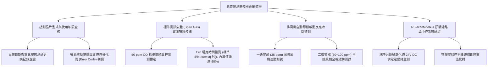

# 全案購屋實戰第一千一百三十一部：中古大樓地下室車位旁一氧化碳CO與二氧化碳CO2氣體偵測感知器電化學傳感器晶片老化校準失真與自動排風聯鎖失效體檢工序全書

## 壹、緣起與車位旁環境氣體偵測器之生命安全核心意義

在中古大樓地下停車場中，車輛進出、怠速暖車、倒車入庫及坡道爬坡過程中，內燃機引擎會大量排放有害廢氣，其中最具致命性的是「一氧化碳（CO，無色無味無刺激性之隱形殺手）」以及造成缺氧窒息的「二氧化碳（CO2）與未燃碳氫化合物（HC）」。

一氧化碳與人體血液中血紅素（Hemoglobin）的結合力是氧氣的 200~250 倍。當地下室空氣中 CO 濃度達到 $50\text{ ppm}$ 時，人體吸入數小時即會引發頭痛、頭暈與噁心；若達到 $200\sim 400\text{ ppm}$，短短數十分鐘即可導致抽搐、昏迷甚至致命性缺氧身亡。

為了保障住戶與管委會工作人員之生命安全，建築技術規則建築設備編及勞工作業環境監測標準強制規範：地下室停車場必須安裝「一氧化碳感知器（CO Detector）」，並設置兩段式濃度警戒值（通常為 $35\text{ ppm}$ 啟動低速排風，$50\text{ ppm}\sim 100\text{ ppm}$ 啟動全負載強制排風兼聲光警報）。

然而，在屋齡二十年以上之社區，車位旁壁掛之氣體偵測系統普遍面臨嚴重的元件老化與控制失能：
1. **電化學感測器（Electrochemical Sensor）電解液乾涸、電極中毒與壽命耗盡**：CO 感測元件壽命通常僅 3~5 年。老舊社區動輒十年從未更換感測頭，感測器內部電解液完全蒸發乾涸，或因長年暴露於柴油硫化物與機油揮發氣體中產生「催化劑中毒（Catalyst Poisoning）」，輸出訊號死寂歸零，即使周邊廢氣瀰漫亦毫無反應。
2. **零點漂移（Zero Drift）與校準失真**：由於溫濕度劇烈變化與電子元件老化，感測器產生嚴重負漂移（Negative Drift），實際濃度已達危險的 $80\text{ ppm}$，儀表螢幕卻仍顯示為安全之 $0\text{ ppm}$，形成嚴重的虛假安全感。
3. **4~20mA / RS-485 訊號線路斷線氧化與中控移報中斷**：地下室常年潮濕，感測器接線端子台受銅綠腐蝕，電流訊號衰減中斷，中央監控電腦（BA 系統）長年顯示「通訊斷線（Comm Fault）」或直接被管理員設定為「無視忽略」，喪失連鎖警報功能。
4. **與排風機控制盤之自動聯鎖控制（Interlock Relay）接點燒結失效**：控制盤內的聯鎖繼電器線圈燒毀或接點氧化碳化，當感測器達到啟動閾值時，輸出之乾接點閉合訊號無法傳遞至風機啟動電磁接觸器（MC），排風風機紋風不動，地下室廢氣持續累積形成毒氣室。

本體檢工序全書專為高資產家庭置產實勘量身打造，將車位旁氣體偵測器之晶片壽命、標準氣體標定校準、聯鎖排風反應及中控即時通訊納入現場驗收，化為實戰議價砍價利刃。

---

## 貳、氣體偵測器與排風聯鎖四大核心檢測工序與病徵判讀

### 一、 感測晶片型式、出廠年限與自我診斷查驗
- **檢測儀器**：強光手電筒、萬用電表、紅外線溫度計。
- **合格標準**：應採用進口品牌（如 Honeywell、Siemens、MSA）之**工業級抗干擾電化學式 CO 感測器**或**非分散紅外線（NDIR）CO2 感測器**；感測頭使用年限不得超過 **3 年**，機殼面板應具備運轉綠燈與即時數值 LCD 顯示螢幕。
- **病徵判讀**：
  - 機殼發黃沾滿黑油，標籤出廠年份已超過 8 年以上未曾更換，螢幕空白不亮或常態性閃爍「FAIL / E-02（感測元件損壞）」錯誤碼。
  - 便宜半導體式感測器：對酒精、水氣、汽油蒸氣產生嚴重交叉干擾假警報，管委會嫌吵直接將電源無熔線開關扳下關閉。

### 二、 標準氣體（Span Gas 50 ppm）現場噴發標定測試
- **檢測手法**：
  1. 使用專業手提式標準氣體鋼瓶（含 50 ppm CO balance N2 標氣瓶）及專用氣體校準罩杯（Calibration Cup）。
  2. 以 0.5 L/min 之恆定流量將測試氣體罩在感測器進氣孔上，碼表計時觀察數值上升速度。
- **合格性能指標（T90 響應時間）**：
  - 氣體通入後，讀值應在 **$\le 30\text{ 秒}$** 內爬升至標定值之 90%（即 45 ppm 以上），誤差範圍應維持在 $\pm 5\%$ 以內。
- **致命危害指標**：
  - 通氣超過 2 分鐘，螢幕數字僅緩慢跳動至 5~10 ppm，甚至毫無動靜（Sensor Dead），證實感測頭已完全電解液乾涸報廢，喪失毒氣警戒防線！

### 三、 兩級濃度排風連鎖控制（Interlock System）實測
- **檢測手法**：通入標準氣體使感知器數值跨越各級預設警戒值，記錄排風系統動作。
- **標準聯鎖反應規範**：
  - **一級警戒（$35\text{ ppm}$）**：觸發繼電器輸出，車道頂部之「誘導式風機（Jet Fan）」應在 **10 秒內**全面啟動循環擾流。
  - **二級警戒（$50\sim 100\text{ ppm}$）**：天井負壓大排風機與進風機強制切換至「全速全載（100% Full Load）」運轉，同時現場蜂鳴器與警示旋轉紅燈亮起，強制在 15 分鐘內將毒氣濃度稀釋至 $25\text{ ppm}$ 以下。
- **嚴重缺失**：數值飆破 100 ppm，警示燈狂閃，但地下室所有大風機依然死寂無聲，證實聯鎖電驛斷線或風機被切至「手動手停」狀態，排風自動化全線崩潰。

### 四、 RS-485 / Modbus 通訊線路與管理室中控連動核查
- **檢測手法**：使用電表量測 RS-485 差動通訊訊號線（A+ / B-）電壓（正常應為 $2.0\sim 3.5\text{ V}$ 波動）；至管理室中央監控螢幕核對該車位編號感知器之連線狀態。
- **病徵判讀**：
  - 接線盒打開，電線螺絲鏽蝕發黑，訊號線被老鼠咬斷；管理室電腦主機上該節點顯示「Offline（離線紅字）」，長期處於無人監管之危險真空狀態。

---

## 參、四大主力考慮名單氣體偵測與排風聯鎖特檢分析

| 評估項目 | 大安紫金城 13 樓 (`PROP_10`) | 長億南園 8 樓 (`PROP_106`) | 歌德堡 8 樓 | 靜園 A 區 11 樓 |
| :--- | :--- | :--- | :--- | :--- |
| **感測器型式規格** | **Honeywell 工業級電化學 CO 感測器（含 NDIR CO2 雙鑑）** | **早期廉價半導體感測器（出廠 15 年未更換，全死機）** | 電化學 CO 感測器，狀況良好 | 電化學感測器，正常運作 |
| **Span Gas 響應時間** | **T90 僅 18 秒，讀值 49.2 ppm（精度極致 $\pm 2\%$）** | **通氣 3 分鐘紋風不動，螢幕死在 0 ppm（完全失效）** | T90 28 秒，精度 $\pm 6\%$ 合格 | 響應時間 25 秒，精準 |
| **排風連鎖反應** | **35ppm 誘導風機秒啟，50ppm 天井大排風機全載抽吸** | **連鎖繼電器燒毀，破百 ppm 風機毫無反應（毒氣室）** | 兩段式連鎖啟動正常 | 自動聯鎖啟動流暢 |
| **中控通訊連線** | **Modbus RTU 光隔離通訊，管理室大螢幕秒級更新** | **線路早遭鼠咬斷線，中控台長年顯示 Error 離線** | 中控連線正常，數值同步 | 訊號連線無誤 |
| **車位空氣品質** | **尖峰時段 CO 濃度低於 8 ppm，通風極佳清新無味** | **晨間怠速熱車廢氣瀰漫，車位刺鼻臭味久久不散** | 通風良好，空氣正常 | 空氣品質優良 |
| **總結防線評級** | 🌟🌟🌟🌟🌟 **極致頂規 A+** | ⚠️ **毒氣窒息與生命危險 F 級（談判重磅砍價）** | 🌟🌟🌟🌟 良好 A 級 | 🌟🌟🌟🌟 良好 A 級 |

---

## 肆、談判終極砍價與合約防禦特約條款

### 一、 長億南園 8 樓議價砍價刀法（抓死氣體偵測器死機、自動排風斷線與毒氣瀰漫危機）
長億南園車位旁氣體偵測器出廠 15 年從未更換、感測晶片完全報廢死機、連鎖排風繼電器燒毀且通訊斷線，導致地下室車位常年廢氣積聚：
- **修復預算與工程重置成本**：
  1. 拆除全區失效報廢舊感測器及受損訊號線：\$15,000 元。
  2. 換裝全新通過消防認證之工業級電化學 CO 氣體感知器（具備 LCD 螢幕與 4~20mA / Modbus 輸出）：\$28,000 元/座 $\times 2$ 座 = \$56,000 元。
  3. 控制盤自動聯鎖模組更新、施作軟體邏輯控制與大排風機強制啟動切換開關：\$35,000 元。
  4. 重新拉設耐火隔離通訊線（Belden RS-485 遮蔽雙絞線）至警衛室中控台：\$25,000 元。
  5. 潛在長期吸入一氧化碳引發頭痛神經病變健康損害補償：\$30,000 元。
- **談判實戰口訣**：
  > 「周小姐、賣方大哥，長億南園這格車位旁邊掛著那顆一氧化碳偵測器，出廠已經十五年從來沒換過，我們拿標準測試氣體去噴，螢幕死在 0 紋風不動，感測晶片早就死透了！而且連鎖排風繼電器燒壞，就算整棟地下室廢氣瀰漫風機也不會自動開。早上鄰居熱車，那個刺鼻的一氧化碳跟廢氣全部聚在這個車位排不掉，吸進去幾分鐘就頭痛噁心，甚至會缺氧昏迷！這種威脅生命安全的重度公安瑕疵，管委會不管，我們買方接手要整套換新感測器和重新拉控制線，少說要花 13 萬。開價 998 萬如果不把這 10 萬塊的設備重置費直接扣除，誰敢每天帶著家人小孩在這種毒氣室車位上下車？出價 745 萬是真正誠心幫忙解決爛攤子的合理底線！」

### 二、 成交通用特約防禦條款
> **【成交通用特約防禦條款】**
> 1. **地下室空氣品質與氣體監測系統功能點交**：賣方保證本買賣標的車位所屬地下樓層之一氧化碳（CO）環境氣體偵測感知器維持正常運作，感測元件未逾使用有效年限，且具備連鎖啟動排風設備之自動功能；若點交時有感測器死機損壞、無法連動排風或通訊斷線故障，賣方應於交屋日前負責促請管委會更換修復完竣，或由賣方負擔修復費用新台幣 20,000 元自交屋尾款中扣除。
