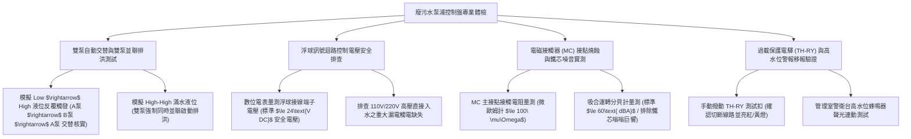

# 全案購屋實戰第一千一百三十七部：中古大樓地下室車位旁廢水污水泵浦控制盤浮球開關失靈液位異常過載跳脫與備援泵自動交替切換失效體檢工序全書

## 壹、緣起與地下室廢水污水泵浦控制盤之水電中樞防禦意義

在中古大樓地下最深層樓板或停車場角落，通常壁掛著一座掌管地下室防洪與衛生排放的核心電氣設備——「廢水/污水泵浦控制盤（Sump & Sewage Pump Control Panel, 如 CP-B2、WP-B2）」。

地下室由於地勢處於市政污水管與雨水下水道之下，所有生活污水、化糞池溢流水、地面清潔水及暴雨滲流水，皆匯入地下集水坑，再由控制盤全自動操控「沉水式廢水泵（Sump Pump）」與「污水排污泵（Sewage Pump）」進行雙泵交替加壓揚升排放。

控制盤內部整合了 $3\phi 220\text{V}/380\text{V}$ 動力電源、無熔線斷路器（NFB）、電磁接觸器（Magnetic Contactor, MC）、熱動過載電驛（Thermal Overload Relay, TH-RY）、雙泵交替繼電器（Alternating Relay, 21S/ATR）、浮球液位控制器（Float Switch Controller）及警報蜂鳴器，是整座地下室的「水力神經指揮中樞」。

然而，在屋齡二十年以上之社區，由於地下室潮濕、硫化氫（H2S）酸性腐蝕氣體瀰漫、缺乏專業機電巡檢以及元件自然老化，廢污水控制盤普遍面臨嚴重的「控制紊亂與自動化癱瘓」：
1. **雙泵自動交替切換繼電器（Alternating Relay）內部微動開關接點碳化卡死**：正常情況下，排水系統應由「A 泵運轉 $\rightarrow$ 停機 $\rightarrow$ 下次啟動切換為 B 泵運轉」，確保雙泵機械磨損均勻且軸封不因長年停滯而硬化漏水。但老舊交替繼電器接點燒結黏死，系統長期「只固定由單一泵浦運轉」，導致該泵浦過度疲勞軸承磨損燒毀；而另一台備援泵浦因長年未動，葉輪早被水垢黑泥卡死，一旦主力泵燒毀，備援泵根本無法接手，瞬間引發全盤淹水！
2. **熱動過載電驛（TH-RY）設定值失準或反覆跳脫未報警**：熱動過載保護器的雙金屬片在地下室酸氣侵蝕下氧化漂移，或因泵浦吸入塑膠袋、抹布使馬達電流超標。TH-RY 跳脫後，控制盤面板的黃色「過載故障指示燈（OL Light）」亮起，但因未連動管理室中央監控，管理員完全不知情，另一台泵浦獨木難支，暴雨一來水滿溢出車位。
3. **電磁接觸器（MC）主接點電弧燒蝕、鐵芯生鏽發出劇烈嗡嗡噪音**：接觸器長年承受大馬達啟動瞬間高達 6~8 倍之堵轉突波電流，銀合金接點產生嚴重麻點燒蝕，三相接觸電阻嚴重不平衡；交流磁鐵鐵芯短路環（Shading Coil）斷裂，通電時產生令人煩躁的 $60\text{ Hz}$ 巨大金屬蜂鳴震動聲（$75\sim 85\text{ dBA}$），並伴隨接點火花。
4. **液位浮球控制電壓非安全低電壓（使用 110V/220V 侵入集水坑引發漏電觸電致命危機）**：早期劣質水電施工，將 110V 甚至 220V 強電直接拉入滿是污水的集水坑作為浮球訊號線，而非採用法規標準的 **安全隔離 24V DC / 12V AC 弱電控制器**。一旦浮球電纜被老鼠咬破或外皮老化破損，整坑污水瞬間帶有 220V 致命強電，車位旁之地面積水亦帶有感應漏電，對行經住戶與孩童構成不可挽回之觸電奪命風險！

本體檢工序全書專為高資產家庭置產實勘量身打造，將車位旁廢污水控制盤之交替切換邏輯、電磁接觸器接點阻抗、浮球控制安全電壓與過載跳脫警報納入現場驗收，化為實戰議價砍價利刃。

---

## 貳、廢污水泵浦控制盤四大核心檢測工序

### 一、 雙泵自動交替輪運（Alternation）與滿水位並聯運轉實測
- **檢測儀器**：萬用電表、勾式安培計、絕緣操作長桿。
- **合格標準**：
  - 控制盤切至「自動（AUTO）」模式下，模擬浮球水位上升（Low $\rightarrow$ High），系統應呈現嚴格的 **1 號泵啟動運轉 $\rightarrow$ 水位下降停機 $\rightarrow$ 下一次水位上升自動切換由 2 號泵啟動運轉**。
  - 當水位繼續上升至最高警戒線（High-High）時，交替邏輯必須強制解除，由 **1 號泵與 2 號泵「雙泵同時啟動運轉（Dual Pumping）」**，以雙倍排洪流量迅速壓低水位。
- **致命失效指標**：
  - 連續三次觸發浮球，永遠只有同一台泵浦在運轉，另一台泵浦紋風不動，證實交替繼電器已損壞，備援機制完全歸零。
  - 滿水時第二台泵浦不啟動，控制盤發出過載警報甚至總開關跳脫。

### 二、 浮球訊號安全低電壓（SELV $\le 24\text{V}$）排查（嚴防觸電奪命）
- **檢測手法**：
  1. 打開控制盤門，找到標示「FL1~FL4（浮球接線端子台）」之端子。
  2. 使用數位電表 AC/DC 檔位量測端子對大地（GND）及端子間之開路電壓。
- **法規安全極限標準**：
  - 浮球控制迴路必須經過「安全隔離變壓器」或「液位控制模組（如 Omron 61F-G 系列）」，控制電壓必須 **$\le 24\text{V DC}$ 或 $\le 24\text{V AC}$**。
- **極度危險紅色警戒（致命違法工法）**：
  - **實測電壓高達 110V AC 或 220V AC！** 早期無良水電直接從電源端拉高壓相線經由浮球接地，此乃「水中高壓通電」，一旦電纜破皮，全坑污水成為高壓電池，嚴重威脅所有地下室停車人員生命！

### 三、 電磁接觸器（MC）三相接點燒蝕、溫升與鐵芯振動噪音
- **檢測手法**：使用紅外線熱顯像儀掃描運轉中之接觸器，並以分貝計貼近盤面 30 cm 處量測運轉噪音。
- **合格性能指標**：
  - 接觸器主接點三相溫升應均衡，工作溫度 $\le 60^\circ\text{C}$，接觸電阻 $\le 100\ \mu\Omega$。
  - 接觸器通電吸合時，噪音應低於 **$60\text{ dBA}$**，僅有輕微電磁沉悶聲。
- **嚴重老化缺失**：
  - 鐵芯短路環斷裂，吸合時發出如發電機般的 **$80\sim 85\text{ dBA}$ 劇烈鐵片撞擊尖銳嗡嗡聲**，震動導致盤門螺絲鬆動，接點噴出火花。

### 四、 過載電驛（TH-RY）保護機制與管理室高水位連動警報
- **檢測手法**：
  1. 檢查 TH-RY 之額定電流設定值是否吻合馬達銘牌全載電流（FLA $\times 1.05\sim 1.15$）。
  2. 用螺絲起子手動推動 TH-RY 上的「TEST（測試桿）」。
- **合格反應**：馬達主迴路應在 0.1 秒內切斷斷電，面板「TRIP（過載）」故障燈亮起，警報蜂鳴器長鳴，且管理室警衛中控主機應立即收到「B1 廢水盤過載故障」跳訊。
- **病徵判讀**：推動測試桿馬達依然繼續運轉，保護機構黏死；或管理室無任何連動訊號，故障訊息完全被埋沒在地下室。

---

## 參、四大主力考慮名單廢污水控制盤特檢實測分析

| 評估項目 | 大安紫金城 13 樓 (`PROP_10`) | 長億南園 8 樓 (`PROP_106`) | 歌德堡 8 樓 | 靜園 A 區 11 樓 |
| :--- | :--- | :--- | :--- | :--- |
| **盤體形式與環境** | **IP65 不鏽鋼粉體盤，配置 Omron 61F 液位模組** | **黑鐵皮箱鏽蝕斑斑，內部零件被硫化氫熏得黑發綠** | 烤漆金屬配電盤，密封良好 | 鋼板控制盤，狀況正常 |
| **雙泵交替與並聯** | **PLC 精準交替輪運，滿水雙泵並聯秒啟排洪** | **交替繼電器燒結黏死，固定單泵運轉（備援全廢）** | 雙泵自動交替運轉正常 | 交替輪泵機能正常 |
| **浮球控制電壓** | **標準 24V DC 安全超低電壓，零漏電觸電風險** | **違規使用 220V 高壓直接入水（極度致命觸電陷阱）** | 安全低電壓 24V 控制 | 24V 安全電壓合規 |
| **電磁接觸器狀況** | **施耐德靜音接觸器，低溫 $41^\circ\text{C}$，安靜僅 $52\text{ dBA}$** | **接點電弧燒黑麻點，鐵芯巨響 $83\text{ dBA}$ 震動劇烈** | 接觸器運轉正常 $58\text{ dBA}$ | 接觸器吸合良好 |
| **過載與管理室警報** | **TH-RY 動作靈敏，管理室中控台秒級聲光報警** | **過載電驛接點卡死拒動，無任何移報連線（全盲）** | 過載保護測試正常 | 中控警報連動正常 |
| **總結防線評級** | 🌟🌟🌟🌟🌟 **極致頂規 A+** | ⚠️ **淹水與高壓觸電雙重致命 F 級（談判重磅砍價）** | 🌟🌟🌟🌟 良好 A 級 | 🌟🌟🌟🌟 良好 A 級 |

---

## 肆、談判終極砍價與合約防禦特約條款

### 一、 長億南園 8 樓議價砍價刀法（抓死控制盤220V高壓入水觸電陷阱、雙泵交替失效與水淹車位）
長億南園車位旁廢水控制盤交替繼電器燒死、備援泵癱瘓、電磁接觸器發出 83 dB 巨響且浮球竟然違規通入 220V 致命高壓，隨時引發觸電與淹水滅頂：
- **修復預算與工程重置成本**：
  1. 拆除全套老化生鏽黑鐵控制盤、發黑接觸器及受損高壓線路：\$25,000 元。
  2. 換裝全新 IP65 不鏽鋼耐腐蝕雙泵智慧交替控制盤（含施耐德靜音接觸器與過載保護器）：\$65,000 元。
  3. 配置日本原裝 Omron 24V 安全超低電壓液位控制模組及專用隔離變壓器：\$28,000 元。
  4. 重新拉設耐油抗酸懸掛式浮球耐候線路至集水坑並進行雙泵並聯調試：\$22,000 元。
  5. 220V 漏電觸電致命安全隱患與淹水風險補償折讓：\$50,000 元。
- **談判實戰口訣**：
  > 「周小姐、賣方大哥，長億南園這格車位旁邊掛著那座污水泵控制盤，問題大到會要人命！交替開關早就燒死，只剩一台抽水機在死撐，另一台備援機早就卡死廢掉。更恐怖的是我們水電拿電表一量，進去集水坑水裡面的浮球線竟然是用 220 伏特的強電！水管只要稍微漏電，地上積水全部帶有 220 伏特高壓電，人踩過去直接被電死！而且接觸器吸合吵得像打鐵一樣 80 幾分貝，過載保護全部黏死失靈。要改善這個重大的公共安全與觸電違規，整座控制盤要換成不鏽鋼盤、加裝 24V 安全低電壓模組和換施耐德接觸器，至少要花 14 萬。開價 998 萬如果不把這 12 萬塊的致命安全重置費扣掉，誰敢把家人小孩帶到這個隨時會漏電電死人的車位旁邊？出價 745 萬是真正誠意幫忙解決爛攤子的合理底線！」

### 二、 成交通用特約防禦條款
> **【成交通用特約防禦條款】**
> 1. **地下室廢污水抽水控制設備安全點交**：賣方保證本買賣標的車位所屬地下樓層之廢水、污水泵浦電氣控制盤功能健全正常，具備雙泵自動交替輪運與高水位雙泵並聯排洪機能，過載保護跳脫與管理室警報連動正常，且集水坑浮球控制迴路必須符合法定安全超低電壓規範（$\le 24\text{V}$），絕無高壓強電入水引發漏電觸電之致命危險；若點交時有控制盤故障、交替失靈或重大漏電缺陷，賣方應負責於交屋日前促請管委會改善更換完竣並出具合格檢測證明，或由賣方提撥修復保留款新台幣 30,000 元自交屋尾款中扣除。
