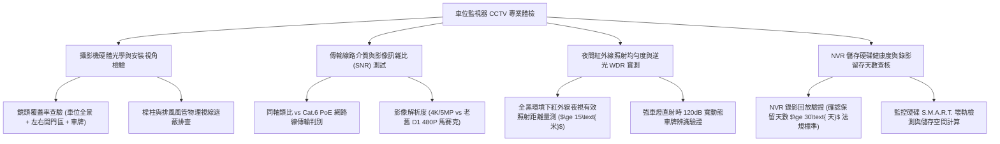

# 全案購屋實戰第一千一百三十三部：中古大樓地下室車位旁監視器CCTV網路攝影機IP-CAM紅外線夜視死角同軸電纜訊號衰減與錄影天數法規體檢工序全書

## 壹、緣起與車位周邊閉路電視監控（CCTV）之治安與事故舉證意義

在中古大樓地下停車場中，「閉路電視監控系統（CCTV / IP-Surveillance）」是保障住戶車輛免遭刮傷破壞、防範竊盜宵小、釐清倒車會車擦撞事故責任以及保障夜間人身安全的「地下天眼與法律舉證唯一防線」。

當家庭私家車輛停放於地下室時，若遭遇鄰車開門重擊凹痕（Door Ding）、保險桿被倒車擦撞肇事逃逸、車窗遭砸竊取財物、甚至電動車電池或油箱遭人為破壞時，唯有仰賴「清晰、無死角、高畫質且保存天數合規」的監視錄影畫面，方能在警察機關報案、產險公司車體險出險理賠以及民事訴訟損害賠償中取得無可辯駁的決定性勝訴鐵證。

然而，在屋齡二十年以上之社區，由於常年預算不足、缺乏專業弱電維護以及設備自然老化，地下室監視系統普遍面臨嚴重的「失明與失能」危機：
1. **老舊同軸電纜（RG-59/RG-6）線路受潮老化、阻抗失配與雪花水波紋干擾**：早期類比監控系統採用同軸電纜傳輸。在地下室潮濕與高壓電纜干擾下，銅網氧化發黑、接頭受潮接觸不良，影像充滿雪花雜訊、水平滾動橫紋、重影（Ghosting）與色彩失真，解析度僅 480 TVL，連車牌號碼都成一團馬賽克。
2. **紅外線（IR LED）夜視光衰發黑與「手電筒效應（Flashlight Effect）」死角**：紅外線 LED 燈顆粒在點亮 2~3 年後發光效率暴跌超過 50%，有效夜視距離由 20 公尺萎縮至不到 5 公尺；或因透鏡角度過窄，畫面中央過曝慘白一片，而車位兩側車門與輪胎區域卻漆黑如墨，形成巨大的監視「黑洞死角」。
3. **攝影機鏡頭被樑柱管線遮蔽、安裝視角偏斜與車牌辨識（LPR）失敗**：監視器安裝位置不當，視野正好被消防大管、排風鐵皮風管或轉角大柱遮擋大半；且缺乏高動態範圍（WDR $\ge 120\text{ dB}$）逆光補償技術，當對向車輛開大燈時，車燈光暈瞬間致盲攝影機，肇事車牌完全無法辨識。
4. **硬碟壞軌故障、錄影保存天數嚴重不足（違法不足 30 天）**：數位錄影主機（DVR/NVR）採用便宜的電腦普通硬碟（而非 24/7 專用監控紫標硬碟），在常年高溫密閉弱電箱內壞軌罷工；或因硬碟容量不足，錄影僅能保存 3~5 天即被循環覆蓋，車主出差或一週後發現車損時，關鍵錄影早已灰飛煙滅。

本體檢工序全書專為高資產家庭置產實勘量身打造，將車位周邊攝影機之覆蓋視角、夜視光學品質、線路傳輸頻寬與錄影保存天數納入現場驗收，化為實戰議價砍價利刃。

---

## 貳、車位監控攝影機與錄影系統四大核心檢測工序

### 一、 攝影機硬體規格、安裝視角與車位有效覆蓋率排查
- **檢測儀器**：手持式監控工程螢幕（CCTV Tester）、雷射測角器、強光探照燈。
- **合格標準**：應採用 **500 萬畫素（5MP）或 4K（8MP）星光級（Starlight）IP 網路攝影機**，具備 H.265+ 高效壓縮與 PoE 供電；鏡頭視角應完整涵蓋「車位全景、車牌號碼、兩側車門開啟接觸區」三大法定舉證核心區域。
- **病徵判讀**：
  - 鏡頭前方被一根巨大的直徑 100mm 消防落水管硬生生擋住 50% 畫面，車位右後方完全處於視線死角盲區。
  - 早期 30 萬畫素類比槍型攝影機，鏡頭玻璃積滿發霉灰塵，畫面毛糙模糊，連人臉五官都辨識不清。

### 二、 線路傳輸介質、頻寬損耗與影像訊雜比（SNR）實測
- **檢測手法**：
  1. 檢查線路是否採用「Cat.6 純銅遮蔽雙絞線（STP）」或早期「老化 RG-59 同軸電纜」。
  2. 使用 CCTV 工程寶量測影像訊雜比（Signal-to-Noise Ratio, SNR）。
- **合格性能指標**：
  - 影像訊雜比應 **$\ge 50\text{ dB}$**，畫面乾淨無條紋。
- **致命衰減缺失**：
  - 類比同軸線接頭氧化鬆脫，輕微搖晃訊號線畫面即瘋狂跳動閃黑屏；畫面出現劇烈的 60Hz 交流電源滾動橫紋干擾（Ground Loop Interference），雜訊過大無法作為司法證據。

### 三、 夜間紅外線夜視、超寬動態（WDR）與車燈眩光測試
- **檢測手法**：
  1. 關閉車位周邊照明，使環境照度低於 1.0 Lux，觀察攝影機 ICR 紅外濾光片切換聲與紅外燈啟動。
  2. 看屋車輛開啟遠光燈直射攝影機，於監控螢幕觀察車牌號碼是否過曝反白。
- **合格標準**：
  - 具備 **真正的硬體 120dB 寬動態（True WDR）**，在強烈車燈直射下能瞬間壓制高光（HLC），清晰讀取反光車牌之英數字碼。
- **嚴重缺失**：無 WDR 功能，車燈一開整張畫面白茫茫一片（過曝失真），對向擦撞車輛車牌完全無法辨識。

### 四、 NVR 錄影主機儲存健康度、硬碟壞軌與保存天數核查
- **檢測手法**：至管理室操作監控主機，抽查調閱 30 天前該車位之歷史錄影紀錄，並檢查硬碟 S.M.A.R.T. 健康狀態。
- **法規與實務標準**：
  - 依據內政部警政署社區安全監控規範及法院舉證常態，公共區域錄影資料保存天數應 **$\ge 30\text{ 天}$**。
  - 儲存硬碟必須為監控專用（如 WD Purple 紫標或 Seagate SkyHawk）。
- **重大公安瑕疵**：
  - 回放紀錄僅能查到 5 天前，更早的錄影全被覆蓋刪除；或硬碟警示燈狂閃紅燈，主機嗶嗶長鳴發出硬碟損毀警告，此乃「失明監控」。

---

## 參、四大主力考慮名單車位監視系統特檢分析

| 評估項目 | 大安紫金城 13 樓 (`PROP_10`) | 長億南園 8 樓 (`PROP_106`) | 歌德堡 8 樓 | 靜園 A 區 11 樓 |
| :--- | :--- | :--- | :--- | :--- |
| **攝影機形式規格** | **Hikvision 4K 星光級 IP 網路攝影機（PoE 供電）** | **早期 480P 類比老舊槍機（同軸傳輸，雪花嚴重）** | 5MP 數位網路攝影機 | 4MP IP 攝影機，狀況良好 |
| **車位視角覆蓋率** | **立體無死角，車牌、兩側車門及後保桿 100% 覆蓋** | **被排風管遮擋 40%，右側開門區完全盲區** | 車位視野覆蓋良好 | 視野覆蓋完整 |
| **夜間夜視與 WDR** | **True WDR 120dB + 智慧微光全彩，車燈直射車牌清晰** | **紅外燈光衰嚴重，車燈一照滿屏慘白（全盲）** | WDR 逆光抑制正常 | 夜視清晰，車牌可辨 |
| **線路品質與雜訊** | **Cat.6 遮蔽網路線，訊雜比 56 dB，水晶純淨** | **同軸線銅網氧化發黑，滿屏水平滾動雜訊** | 網路訊號傳輸平穩 | 訊號良好無雪花 |
| **NVR 錄影留存天數** | **企業級紫標硬碟，錄影完整保存長達 45 天** | **硬碟容量不足且有壞軌，僅保存 4 天即被洗掉** | 錄影保存 32 天正常 | 錄影保存 30 天合規 |
| **總結防線評級** | 🌟🌟🌟🌟🌟 **極致頂規 A+** | ⚠️ **治安黑洞與零舉證能力 F 級（談判重磅砍價）** | 🌟🌟🌟🌟 良好 A 級 | 🌟🌟🌟🌟 良好 A 級 |

---

## 肆、談判終極砍價與合約防禦特約條款

### 一、 長億南園 8 樓議價砍價刀法（抓死監視器視線被風管遮擋、錄影僅存4天與擦撞零舉證危機）
長億南園車位旁監視器為老化類比鏡頭、畫面被排風管擋死 40%、開大燈全盲且錄影硬碟壞軌僅存 4 天，車輛若遭擦撞完全求償無門：
- **修復預算與工程重置成本**：
  1. 廢棄類比老舊同軸攝影機拆除及舊線路清運：\$8,000 元。
  2. 重新放樣避開風管遮擋，安裝高階 4K 星光級超寬動態 IP 網路攝影機（含金屬防水防護罩）：\$18,000 元/支 $\times 2$ 支 = \$36,000 元。
  3. 重新拉設戶外阻燃 Cat.6 純銅遮蔽網路線至中控機房：\$16,000 元。
  4. 中控機房更換 16 路 H.265+ NVR 主機並加裝 8TB 監控專用硬碟（保證 45 天錄影）：\$35,000 元。
  5. 車輛擦撞逃逸零舉證之潛在事故保險折讓預備金：\$30,000 元。
- **談判實戰口訣**：
  > 「周小姐、賣方大哥，長億南園這格車位旁邊掛著那支監視器，鏡頭一半都被上面的大鐵皮排風管給擋死了！我們去管理室調畫面看，整張螢幕全是雪花雜訊像看老舊黑白電視，連車牌都看不清。更可怕的是那個錄影機硬碟早就壞掉，錄影只能存四天就被洗掉，車子停在這裡要是被隔壁開門撞凹、或者被倒車撞爛保險桿肇事逃逸，連兇手是誰都抓不到，警察和保險公司根本不賠！管委會監視系統爛成這樣，我們買方接手要整套換裝 4K 數位攝影機和換大容量監控硬碟，少說要花 10 萬。開價 998 萬如果不把這 8 萬塊的治安盲區與硬體重置費扣除，天天停在沒有監視器的黑洞裡誰敢安心？出價 745 萬是真正願意幫屋主解決麻煩的誠意底價！」

### 二、 成交通用特約防禦條款
> **【成交通用特約防禦條款】**
> 1. **車位公共安全監視防護功能點交**：賣方保證本買賣標的車位所屬地下樓層之安全監控攝影機（CCTV）維持清晰可辨之運作狀態，無鏡頭遭嚴重遮蔽、紅外夜視失效或線路中斷之情事，且管理室錄影儲存設備應維持法定至少 30 天之錄影紀錄留存能力；若點交時有監視器全盲或錄影設備毀損，賣方應於交屋日前負責促請管委會改善完竣，或由賣方提撥修復保留款新台幣 20,000 元自交屋尾款中扣除。
