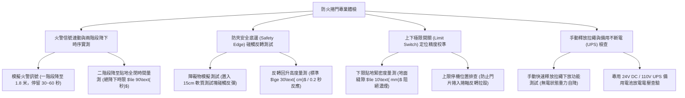

# 全案購屋實戰第一千一百三十九部：中古大樓地下室車位旁防火捲門煙霧感知器防夾裝置下限極限開關失靈與連動降下卡死體檢工序全書

## 壹、緣起與車位旁防火鐵捲門之防火區劃與壓車奪命防線意義

在中古大樓地下停車場中，由於面積動輒數千平方公尺且停滿高火災載重車輛，建築技術規則總則編第七十九條強制規範：每超過 $1500\text{ m}^2$（有自動撒水設備者得加倍為 $3000\text{ m}^2$）必須以具備 1 小時以上防火時效及阻熱性之防火牆或「防火捲門（Fire Rolling Shutter）」劃分「防火區劃（Fire Compartment）」。

防火捲門橫跨於地下車道、主通道或車位分區之間。平時捲收於天花板捲門箱內，維持車輛通行順暢；當火警發生時，接收火警信號或自備感知器訊號，分兩階段（先降至 1.8 公尺供人員逃生，隨後全降貼地）強制放下，形成一堵阻絕千度火舌與致命濃煙的垂直鋼鐵封鎖牆。

然而，在屋齡二十年以上之社區，由於缺乏定期帶載放降測試、車位旁潮濕生鏽、馬達煞車來令片碳化老化，防火捲門普遍陷入極其凶險的「連動卡死」或「防夾失靈壓扁車輛與人體」的雙重致命危機：
1. **導軌（Guide Rails）變形鏽蝕與門片出軌卡死在半空中**：重達數百公斤的鍍鋅鋼製或複合防火布門片，長年受地下室潮氣侵蝕，側邊導向滑槽（滾輪導軌）長滿厚重紅鏽或遭車輛碰撞凹陷。當火警連動釋放時，門片在重力下垂降至一半，因兩側阻力不均產生嚴重偏斜卡死（Jammed），下方形成巨大開口，濃煙與烈焰瞬間穿越防火區劃燒毀全區車輛！
2. **防夾安全安全底邊（Safety Edge / Optical Sensor）失效引發「重力切斷與壓扁車頂」**：防火捲門底部必須配備「氣壓式防夾膠條」或「紅外線對射感應器」。當捲門降下過程中碰觸到行經車輛或逃生住戶時，必須在 **$\le 0.2\text{ 秒}$** 內瞬間反轉回升至少 30 公分。老舊捲門之防夾膠條早已水解破裂或內部導電膠老化，當車輛行經時捲門持續以數百公斤重力下壓，直接將車頂、天窗與擋風玻璃硬生生壓碎削平，甚至造成住戶慘遭輾壓重傷。
3. **下限極限開關（Limit Switch）齒輪磨損與馬達持續空轉燒毀**：控制捲門上下定位之極限開關齒輪塑膠老化崩齒，當門片已降至地面時，極限開關未及時切斷電源，捲門馬達持續瘋狂向下施壓，導致鏈條繃斷、捲軸齒輪崩裂，馬達線圈在高溫堵轉中引燃天花板電線起火！
4. **火警連動釋放器（Fire Release Device）電磁鐵殘磁卡死或煙霧感知器盲區**：捲門箱旁之獨立光電式煙霧感知器老化積灰，火災時無反應；或連動釋放器內部之電磁線圈受地下室高溫產生「殘磁（Residual Magnetism）」，通電解除卡扣時鐵芯黏住無法釋放重力煞車，捲門完全拒動，使防火區劃全面形同虛設。

本體檢工序全書專為高資產家庭置產實勘量身打造，將車位旁防火捲門之兩階段降下時序、防夾反轉靈敏度、手動釋放機構與極限開關定位納入現場驗收，化為實戰議價砍價利刃。

---

## 貳、防火捲門與防夾控制系統四大核心檢測工序

### 一、 火警訊號連動與「兩階段降下（Two-stage Drop）」時序實測
- **檢測儀器**：煙霧測試噴劑（Smoke Tester）、碼表、高精度雷射測距儀。
- **合格標準（CNS 14803 防火捲門標準規範）**：
  - **第一階段降下**：接收煙霧感知器信號後，捲門應在 **$\le 5\text{ 秒}$** 內啟動，平穩降至距離地坪 **$1.8\text{ 米}\pm 0.1\text{ 米}$** 處停滯。
  - **中途停滯時間**：維持停留 **$30\sim 60\text{ 秒}$**，提供地下室人員與逃生車輛黃金疏散時間。
  - **第二階段降下**：中途停滯結束或熱感知器（$70^\circ\text{C}$）觸發後，捲門應平穩降至地面完全貼合，全行程降下速度應在 **$0.1\sim 0.2\text{ m/s}$** 範圍內，總時間不得超過 $90\text{ 秒}$。
- **致命卡死缺失**：信號送出後捲門劇烈震動伴隨刺耳摩擦聲，降至 1 公尺處歪斜卡在導軌中，馬達空轉燒焦，防火區劃徹底崩塌。

### 二、 防夾安全底邊（Safety Edge）碰觸反轉保護實測
- **檢測手法**：
  1. 在捲門降下路徑中央，放置一塊高度 15 公分之彈性發泡測試塊（模擬車頂或人體）。
  2. 觀察捲門下底橫樑接觸測試塊時之反應。
- **合格性能指標**：
  - 碰觸瞬間施加於物體之衝擊力應 **$\le 150\text{ N}$（約 15 kgf）**。
  - 控制系統必須在 **$\le 0.2\text{ 秒}$** 內瞬間停止下降，並自動反轉向上回升 **$\ge 30\text{ 公分}$**，發出警示蜂鳴聲，隨後重新計時下放。
- **嚴重壓扁車頂缺失**：
  - 碰觸測試塊時完全無反轉動作，重型門片以數百公斤重力直接將測試塊壓扁碎裂，甚至馬達持續向下擠壓，證實防夾系統完全失效！

### 三、 上下極限行程開關（Limit Switch）精度與地坪密合度
- **檢測手法**：觀察捲門全閉貼地及全開頂部停機位置。
- **標準規範**：
  - **全閉下限**：底座耐高溫阻燃橡膠密封條應緊密壓貼地面，微縫隙應 **$\le 10\text{ mm}$**，防止地面濃煙流竄。
  - **全開上限**：底橫樑應完全收縮進入天花板開口上方，下緣與車道淨高應維持在 **$\ge 2.2\text{ 米}$**，嚴禁懸吊在車道半空中妨礙休旅車進出。
- **病徵判讀**：門片壓到底後馬達不停轉，鏈條發出「喀喀喀」跳齒暴響；或開門時直接將底樑捲入箱內扯爛外殼。

### 四、 無電狀態手動釋放機構（Manual Release）與 UPS 備援電池
- **檢測手法**：
  1. 切斷捲門專用電源開關。
  2. 於車位旁拉動標示「火警手動釋放」之鋼索拉環。
- **合格標準**：捲門應利用自身門片重力，在離心調速器限速保護下，平穩滑順地自天花板降至地面，速度均勻無爆衝。
- **病徵判讀**：用力拉動鋼索拉環，內部卡死毫無動靜；或專用 UPS 蓄電池早已漏液膨脹斷電，斷電時捲門完全喪失任何動作能力。

---

## 參、四大主力考慮名單防火捲門特檢實測分析

| 評估項目 | 大安紫金城 13 樓 (`PROP_10`) | 長億南園 8 樓 (`PROP_106`) | 歌德堡 8 樓 | 靜園 A 區 11 樓 |
| :--- | :--- | :--- | :--- | :--- |
| **防火捲門型式** | **雙軌雙簾複合阻熱型防火捲門（2小時阻熱，UL認證）** | **早期單層鐵皮防火捲門（導軌嚴重鏽蝕變形凹陷）** | 鋼製防火捲門，運作平穩 | 防火捲門，狀況良好 |
| **兩階段降下時序** | **精準於 1.8 米停留 45 秒，二階段全降貼地密合** | **觸發後歪斜卡在 1.2 米處動彈不得（防火分區崩潰）** | 兩階段降下動作順暢 | 降下動作合規 |
| **防夾反轉安全測試** | **碰觸 15cm 測試塊 0.15 秒瞬間回彈 40cm，零車損** | **無任何防夾機構，直接將測試塊壓碎（壓扁車頂大凶）** | 防夾反轉靈敏正常 | 防夾接觸反轉良好 |
| **下限密合度與縫隙** | **地面阻燃矽膠密封條完整貼合，縫隙僅 3 mm** | **門片底樑扭曲，地面留有 80 mm 大空隙（濃煙狂灌）** | 地面縫隙小於 10 mm 合格 | 地面密合良好 |
| **手動釋放與 UPS** | **手動拉繩重力平穩下放，Panasonic UPS 電池飽滿** | **手動鋼索鏽斷脫落，UPS 電池鼓包漏液完全斷電** | 手動釋放正常，電池良好 | 手動釋放功能正常 |
| **總結防線評級** | 🌟🌟🌟🌟🌟 **極致頂規 A+** | ⚠️ **火災封鎖崩潰與壓扁車頂高危 F 級（談判重磅砍價）** | 🌟🌟🌟🌟 良好 A 級 | 🌟🌟🌟🌟 良好 A 級 |

---

## 肆、談判終極砍價與合約防禦特約條款

### 一、 長億南園 8 樓議價砍價刀法（抓死車位旁防火捲門卡死半空、防夾失效壓扁車頂與火災煙囪效應）
長億南園車位旁防火區劃捲門導軌鏽蝕卡死在 1.2 米半空中、防夾系統全廢會直接壓毀車頂、底樑大洞濃煙狂灌且手動鋼索鏽斷：
- **修復預算與工程重置成本**：
  1. 拆除受損變形之廢棄捲門門片、生鏽導軌及老化捲門機：\$30,000 元。
  2. 換裝全新符合 CNS 14803 規範之 2 小時阻熱型防火複合捲門（含雙側耐磨導軌及抗風壓輪）：\$110,000 元。
  3. 安裝氣壓式防夾安全底邊、紅外線對射防夾感測器及微電腦兩階段下降控制主機：\$35,000 元。
  4. 配置消防專用智能 UPS 不斷電系統（含 24V 重負荷防爆蓄電池組）：\$20,000 元。
  5. 潛在防火分區失效火災全毀與壓毀車輛車體險自負額折讓：\$50,000 元。
- **談判實戰口訣**：
  > 「周小姐、賣方大哥，長億南園這格車位旁邊正對著地下室最重要的防火區劃鐵捲門，我們現場一做火警測試，門片降到一半直接卡在導軌上動彈不得，歪斜得像要掉下來！而且底下放東西測試，捲門竟然完全不會反彈回升，直接硬壓到底把東西壓碎，這要是車子開過去或小孩子走過去，整輛百萬休旅車車頂天窗當場被切斷壓扁，連命都沒有！更要命的是門片底下一條大縫隙，萬一隔壁車位起火，濃煙直接灌滿整座地下室。換裝合格的 2 小時阻熱防火捲門和防夾控制系統，管委會要花將近 20 萬。開價 998 萬如果不把這 15 萬塊的致命公共安全隱患扣掉，每天開車經過這座隨時會砸下來壓扁車頂的鐵捲門誰敢安心？出價 745 萬是真正願意幫屋主承擔風險的誠意底價！」

### 二、 成交通用特約防禦條款
> **【成交通用特約防禦條款】**
> 1. **地下室防火區劃捲門設施安全點交**：賣方保證本買賣標的車位所屬地下樓層及出入主要動線之防火捲門系統運轉功能完整正常，接收火警訊號時能平穩兩階段降下完全貼合地面，具備靈敏之碰觸反轉防夾安全保護機制（$\le 0.2\text{ 秒}$ 內反轉回升），手動釋放機構及不斷電蓄電池功能健全，無導軌變形卡死或防夾失效危及人車安全之情事；若點交時有捲門故障卡死或防夾失靈重大缺陷，賣方應負責於交屋日前促請管委會改善修復完竣並出具專業消防設備師檢測合格證明，或由賣方提撥修復保留款新台幣 40,000 元自交屋尾款中扣除。
