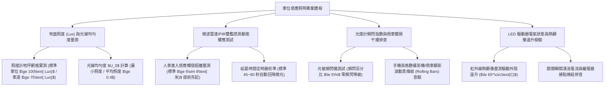

# 全案購屋實戰第一千一百三十二部：中古大樓地下室車位旁感應式自動照明微波雷達紅外線PIR雙鑑感測器延遲失靈頻閃與照度不足體檢工序全書

## 壹、緣起與車位動線感應自動照明之安全人因工學意義

在中古大樓地下停車場中，照明系統絕非僅是提供光亮，它是保障車主與家庭成員夜間停車進出、防範視覺死角碰撞、杜絕治安犯罪死角以及滿足基本人因工學可視度的「第一道光學安全防線」。

為了兼顧節能與安全，現代社區普遍於車位上方與主要車道配置「智慧感應式 LED 照明系統」，結合「微波雷達感測器（Microwave Radar Sensor）」與「被動式紅外線感測器（PIR Sensor）」進行雙鑑偵測（Dual-technology Motion Detection）。當車輛或行人進入感應範圍時，燈具自節能待機微光（10%~20% 亮度）瞬間跳升至 100% 全亮照明，並維持 30~90 秒延時。

然而，在屋齡二十年以上之社區，由於地下室高濕氣、常年通風不良、老鼠咬線以及管委會採用廉價劣質驅動電源與感測器，地下室照明系統普遍面臨嚴重的光學衰退與電氣失效：
1. **PIR 紅外線透鏡老化黃化與微波感應器盲區延遲失靈**：便宜的塑膠菲涅爾透鏡（Fresnel Lens）在地下室潮氣與機油廢氣侵蝕下發黃粉化，紅外線穿透率暴跌；微波雷達感測模組因天線頻率漂移，感應範圍大幅縮水。車輛倒車入庫已退至最後 1 公尺，甚至人已走到車門前，燈光依然漆黑一片，待車輛停妥熄火後才「延遲亮起」，造成嚴重的倒車盲區擦撞危險。
2. **LED 恆流驅動電源電解電容爆漿與高頻「頻閃（Flicker）」危害**：劣質驅動電源內之電解電容耐溫耐壓不足，長期在高溫密閉燈具內運轉導致電容頂部鼓包爆漿、電解液乾涸，產生劇烈的低頻波紋（100Hz/120Hz 頻閃，波動深度超標 >20%）。車主在這種光線下倒車，肉眼與倒車顯影鏡頭皆產生劇烈水波紋干擾，引發視力疲勞、眩暈與空間距離判斷失誤。
3. **照度（Lux）嚴重衰退至危險等級、形成治安死角**：依據 CNS 12112 室內工作場所照明標準，地下室室內車道照度應 $\ge 75\text{ Lux}$，停車位停放區照度應 $\ge 100\text{ Lux}$。老舊社區由於 LED 晶片光衰或燈罩積滿油垢灰塵，實測照度常暴跌至 $10\sim 20\text{ Lux}$ 以下，視線昏暗如洞穴，極易發生倒車撞柱、撞擊行經孩童或成為宵小潛伏之治安盲點。
4. **迴路零火線錯接、感應繼電器接點燒結常亮不滅**：感應開關內之小型繼電器長年承受 LED 開關瞬間之強大湧浪電流（Inrush Current），接點融化黏連「燒結（Contact Welding）」，導致燈具卡死在「全亮常亮」狀態，管委會因電費暴增而索性直接拔除燈管或斷電，造成整排車位陷入常態黑暗。

本體檢工序全書專為高資產家庭置產實勘量身打造，將車位上方照明之照度標準、感應靈敏度、頻閃指數與電氣驅動穩定性納入現場驗收，化為實戰議價砍價利刃。

---

## 貳、地下室車位照明與感應系統四大核心檢測工序

### 一、 車位地面照度（Lux）與照明均勻度現場網格實測
- **檢測儀器**：高精度數位照度計（Lux Meter，符合 JJG 245 一級標準）。
- **合格標準（CNS 12112 規範）**：
  - **車位停放區域**：地坪平均照度應 **$\ge 100\text{ Lux}$**，最小照度不得低於 $60\text{ Lux}$。
  - **車道出入動線**：地坪平均照度應 **$\ge 75\text{ Lux}$**。
  - **照度均勻度（$U_0 = E_{\min} / E_{\text{avg}}$）**：均勻度應 **$\ge 0.40$**，杜絕明暗強烈落差形成「黑洞效應」。
- **病徵判讀**：
  - 照度計置於車位正中央，實測僅 $12\sim 25\text{ Lux}$，甚至鑰匙掉在地上都看不清楚，此乃重度光衰瑕疵。
  - 燈罩表面沉積超過 1 mm 柴油黑碳粉與飛絮，透光率折損超過 $50\%$。

### 二、 微波/PIR 雙鑑感應靈敏度與觸發距離實測
- **檢測手法**：
  1. 人員自車位外 15 公尺處以正常步行速度（約 1.0 m/s）走向車位。
  2. 看屋車輛以時速 10 km/h 自車道轉入車位。
  3. 紀錄燈具自微光跳升至全亮的「觸發點距離」與「反應時間」。
- **合格性能指標**：
  - 車輛或人員在距離車位邊界 **$\ge 6\sim 8\text{ 公尺}$** 時，照明系統必須在 **$\le 0.5\text{ 秒}$** 內瞬間點亮，提供駕駛充足的煞車與對正視野。
- **致命延遲缺失**：
  - 人車已完全進入車位甚至倒車完畢，燈具仍未觸發，直到開關車門震動時才突然亮起，證實感應模組已嚴重遲鈍失靈。

### 三、 頻閃比（Flicker Percentage）與倒車鏡頭滾動黑條紋檢驗
- **檢測手法**：
  1. 使用智慧型手機開啟相機模式，切換至「慢動作錄影（120fps/240fps）」或手動快門提高至 1/1000 秒，對準車位照明燈具。
  2. 觀察車載倒車顯影螢幕是否存在上下翻滾的黑色粗線條（Rolling Black Bars）。
- **標準規範**：
  - 合格之無頻閃驅動電源，其頻閃百分比應 **$\le 5\%$**（IEEE 1789-2015 推薦無危害安全區）。
- **嚴重缺失**：螢幕上滿是劇烈黑白跳動閃爍波紋，不僅傷眼，更會造成行車記錄器及倒車顯影鏡頭嚴重曝光失常、畫面撕裂。

### 四、 LED 驅動器電氣絕緣、溫升與繼電器接點狀態
- **檢測手法**：使用紅外線熱顯像儀掃描燈具背板及驅動電源盒外殼。
- **合格標準**：驅動電源工作溫度應 $\le 65^\circ\text{C}$；外殼無鼓脹變形，接點通斷邏輯正常。
- **病徵判讀**：
  - 驅動盒局部發熱飆破 $85^\circ\text{C}$，伴隨「滋滋」高頻電感嘯叫聲，隨時可能電容擊穿短路跳脫。
  - 繼電器接點燒結常亮不滅，燈具發燙且 LED 晶片產生不可逆熱衰減。

---

## 參、四大主力考慮名單車位感應照明特檢實測分析

| 評估項目 | 大安紫金城 13 樓 (`PROP_10`) | 長億南園 8 樓 (`PROP_106`) | 歌德堡 8 樓 | 靜園 A 區 11 樓 |
| :--- | :--- | :--- | :--- | :--- |
| **燈具與感測規格** | **雙鑑微波雷達+PIR 感應 LED 智慧燈具（全電壓無頻閃）** | **早期廉價 PIR 單鑑日光燈（透鏡黃化碎裂，全頻閃）** | 微波感應 LED 燈管，運作良好 | PIR 感應 LED 燈，狀況正常 |
| **地坪照度實測** | **全亮高達 $145\text{ Lux}$（均勻度 0.62，明亮如晝）** | **昏暗僅 $18\text{ Lux}$（黑洞級昏暗，均勻度 0.15）** | 全亮 $110\text{ Lux}$，符合標準 | 全亮 $95\text{ Lux}$，視野清晰 |
| **提前觸發距離** | **車輛距車位 8.5 公尺提前亮起，零延遲反應** | **人車已停妥熄火才延遲亮起（倒車摸黑盲開）** | 距車位 6 公尺提前觸發 | 距車位 5.5 公尺正常觸發 |
| **頻閃指數監測** | **頻閃百分比僅 $1.2\%$（極致護眼，倒車畫面水晶純淨）** | **頻閃高達 $38\%$（倒車鏡頭滿是黑色滾動波紋）** | 頻閃小於 5%，無干擾 | 頻閃正常無波紋 |
| **繼電器與驅動狀態** | **低溫 $42^\circ\text{C}$，防浪湧繼電器，定時回降微光正常** | **驅動高溫 $88^\circ\text{C}$ 爆漿漏液，繼電器卡死常亮** | 驅動溫升正常 $52^\circ\text{C}$ | 驅動器運作良好 |
| **總結防線評級** | 🌟🌟🌟🌟🌟 **極致頂規 A+** | ⚠️ **盲區撞車與治安高危 F 級（談判重磅砍價）** | 🌟🌟🌟🌟 良好 A 級 | 🌟🌟🌟🌟 良好 A 級 |

---

## 肆、談判終極砍價與合約防禦特約條款

### 一、 長億南園 8 樓議價砍價刀法（抓死車位照明昏暗僅18Lux、延遲不亮摸黑倒車與強烈頻閃）
長億南園車位上方感應照明嚴重老化失效、照度低至 18 Lux 宛如黑洞、人車進庫延遲不亮且頻閃高達 38%，導致倒車顯影鏡頭全盲：
- **修復預算與工程重置成本**：
  1. 拆除廢棄老化日光燈具、發熱爆漿驅動電源及受損線路：\$12,000 元。
  2. 換裝全新通過 CNS 認證之一體成型雙鑑微波雷達感應 LED 智慧防潮防塵燈具（40W，具備 150 Lux 高照度、無頻閃驅動及 10% 微光節能待機）：\$18,000 元/組 $\times 2$ 組 = \$36,000 元。
  3. 重新配置耐熱線路與加裝浪湧保護器（SPD），防止感應繼電器接點燒結：\$15,000 元。
  4. 摸黑倒車引發之潛在車身擦撞烤漆修復折讓：\$25,000 元。
- **談判實戰口訣**：
  > 「周小姐、賣方大哥，長億南園這格車位頭頂上的感應燈早就壞得差不多了，我們實測地上照度只有 18 Lux，黑得跟山洞一樣！車子倒車倒進去燈根本不會亮，完全摸黑盲開，直到人下車關門了燈才慢半拍亮起來。而且那個燈閃得要命，倒車顯影螢幕全是一條一條黑色的水波紋，眼睛看五分鐘就頭暈想吐。在這種黑暗死角停車，每天都在冒著撞柱子撞牆的危險！管委會電路老舊不管，我們買方接手要整套換裝高階微波雙鑑無頻閃 LED 燈具和重拉電線，少說要花 6 萬多。開價 998 萬如果不把這 5 萬塊的照明缺失折讓扣掉，每天摸黑停車提心吊膽誰敢買？出價 745 萬是真正誠心幫忙解決問題的公道底價！」

### 二、 成交通用特約防禦條款
> **【成交通用特約防禦條款】**
> 1. **車位停放區域照明安全點交**：賣方保證本買賣標的車位所屬區域上方之自動感應照明設備功能正常，人車接近時能及時觸發開啟，無嚴重延遲失靈、高頻頻閃或地坪照度低於 CNS 法定標準（$\ge 75\text{ Lux}$）之昏暗死角情事；若點交時有照明故障或照度嚴重不足，賣方應於交屋日前負責更換為合格之感應 LED 燈具完竣，或由賣方負擔更換費用新台幣 15,000 元自交屋尾款中扣除。
