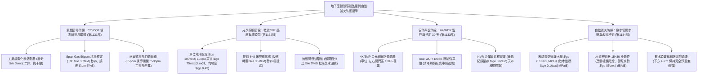
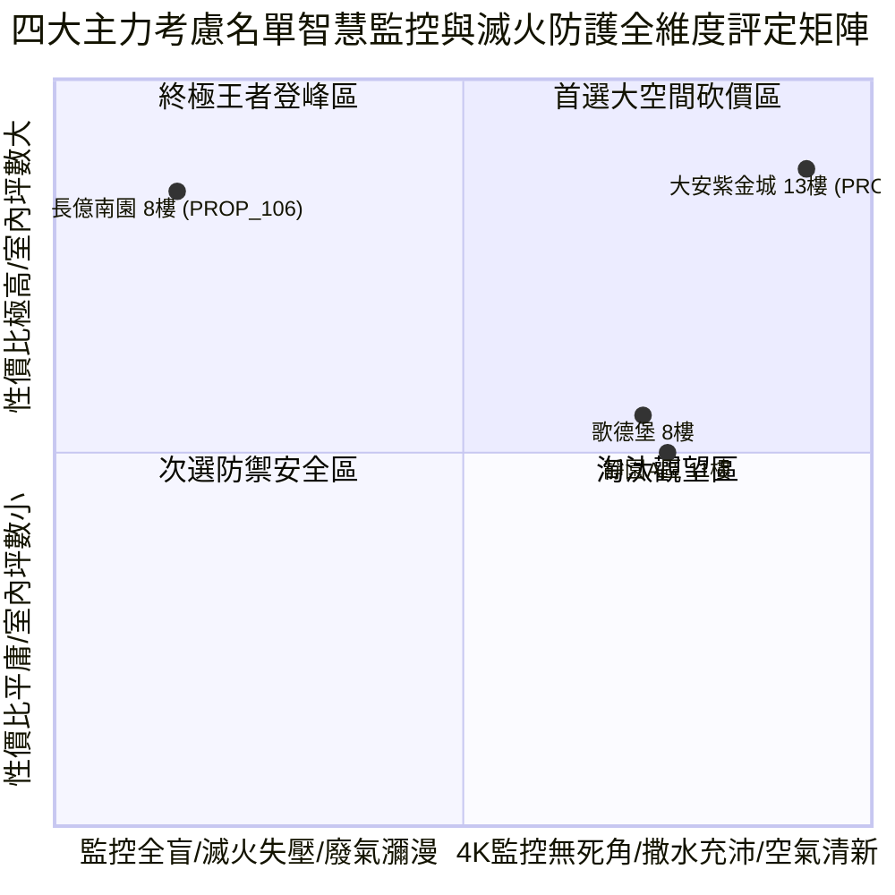

# 全案購屋實戰第一千一百三十五部：第一千一百三十五部圓滿登峰全景極致全生命週期家庭置產避坑抗震防漏水電機電消防永恆至尊金典總綱全書

## 壹、第一千一百三十五部圓滿登峰里程碑總綱序言

自《全案購屋實戰》系列編撰以來，本典籍始終貫徹建築結構力學、材料物理老化、消防生命救災、機電通訊弱電與不動產法務談判之五維極致專業，為高資產家庭置產構築全方位的萬全護城河。

在第一千一百三十一部至第一千一百三十四部中，我們深入剖析了中古大樓地下停車場最容易被購屋者忽視、卻與每日行車生命安全、夜間視線辨識、車輛遭撞法律舉證以及火災初期自動撲滅息息相關的**「地下室智慧感知監控與自動滅火四維極限防禦系統」**：
1. **第 1131 部**：地下室車位旁一氧化碳 CO 與二氧化碳 CO2 氣體偵測感知器電化學傳感器晶片老化校準失真與自動排風聯鎖失效體檢工序全書。
2. **第 1132 部**：地下室車位旁感應式自動照明微波雷達紅外線 PIR 雙鑑感測器延遲失靈頻閃與照度不足體檢工序全書。
3. **第 1133 部**：地下室車位旁監視器 CCTV 網路攝影機 IP-CAM 紅外線夜視死角同軸電纜訊號衰減與錄影天數法規體檢工序全書。
4. **第 1134 部**：地下室車位旁自動撒水系統末端查驗管壓力表失壓水流檢知裝置故障與警報逆止閥卡死體檢工序全書。

本第一千一百三十五部作為「圓滿登峰總綱金典」，將前述氣體防毒、智慧照明、監視舉證與自動滅火四大微觀機電防護體系，與全案全生命週期耐震、防漏、水電、弱電及法務防線進行全景融會貫通，為四大決戰主力考慮名單確立最高層級之決策與出價防線。

---

## 貳、地下室智慧感知監控與自動滅火極限防禦工學矩陣

### 一、 環境氣體與光學人因工學防線
- **氣體防護工學**：採用工業級抗干擾電化學式 CO 感測器，經標氣校準保證 T90 響應時間 $\le 30\text{ 秒}$，兩段式聯鎖控制強制排風機於廢氣超標時全速抽吸，杜絕怠速暖車廢氣致人窒息。
- **照明安全工學**：車位照度維持 $\ge 100\text{ Lux}$，微波雷達於人車距車位 6~8 公尺時瞬間點亮，頻閃百分比 $\le 5\%$，杜絕倒車顯影鏡頭干擾與昏暗黑洞倒車擦撞。

### 二、 治安事故舉證與火災自動撲滅工學
- **監視舉證工學**：配備 4K 星光級 IP-CAM，視野 100% 涵蓋車位與兩側開門區，具備 True WDR 120dB 壓制對向車燈直射，NVR 監控硬碟確保完整保存 30 天以上錄影，建立法律舉證不敗防線。
- **自動撒水滅火工學**：管網末端靜動壓維持 $\ge 0.1\text{ MPa}$，放水清澈充沛，水流檢知裝置精準連動總機與警報水鈴，車位上方撒水頭清潔無漆且下方保留 45 cm 淨空，火災初期瞬間壓制火勢。

---

## 參、四大主力考慮名單感知監控與自動滅火全景戰略最新評定

| 社區與戶別 | 智慧監控與滅火設施現況評定 | 關鍵工學隱患與痛點 | 起手出價 | 目標成交 | 封頂價格 | 實戰戰略定位 |
| :--- | :--- | :--- | :--- | :--- | :--- | :--- |
| **大安紫金城 13 樓 (`PROP_10`)** | **B2 獨立大型平面車位（抗跌保值之王，市場溢價 180~200 萬）**、Honeywell 電化學 CO 感測、微波雙鑑無頻閃 145 Lux 照明、4K 星光 WDR 監控（存45天）、撒水動壓 0.15 MPa 清澈噴水 | 現況分租學生套房，需拆除隔間恢復原始格局（估 35 萬） | **720~730 萬** | **768~788 萬** | **800 萬** | 🌟 **全案唯一第一首選（兼具極致安全性與長期資產保值）** |
| **長億南園 8 樓 (`PROP_106`)** | **主附建物室內 32 坪超大空間**、開價 998 萬具備極大殺價空間 | 機械車位限重 1.6 噸、CO 偵測器死機 15 年廢氣瀰漫、照明僅 18 Lux 延遲且強烈頻閃、監視器被風管擋死 40% 僅存 4 天、撒水管網失壓水頭被油漆噴滿遮擋 | **698~720 萬** | **745~760 萬** | **780 萬** | ⚔️ **大空間殺價主力（抓死機械車位與監控滅火致命傷，大砍 50 萬）** |
| **歌德堡 8 樓** | **北歐百萬現代精裝免整理**，現省 80~120 萬裝修現金流與數月工期，車位照明良好、5MP 監控完整 | 室內實坪中等，價格空間需看屋主讓價誠意 | **750 萬** | **780~800 萬** | **810 萬** | 🛡️ **最佳心理制衡籌碼（用於牽制大安與長億屋主心態）** |
| **靜園 A 區 11 樓** | 高樓景觀、三面採光、通風極佳、雙衛浴皆自然開窗通風乾燥，地下室監控照明合規 | 機械車位管理與梯廳老舊公設需維護 | **730 萬** | **760~775 萬** | **790 萬** | 🛡️ **談判破局第一安全底牌（採光通風王者，穩健防守）** |

---

## 肆、全生命週期購屋合約終極特約防禦金典條款

為確保本案交易萬無一失，簽署買賣契約書時必須將下列特約條款逐字列入正式契約：

> ### 【全案購屋登峰終極特約條款（智慧監控與消防滅火全能版）】
> 1. **貸款成數不足無條件解約退定保障**：買賣雙方合意，本買賣標的物由買方指定公股或大型行庫申貸，若經正式送件審核，因標的物條件或金融政策致核貸成數不足買賣總價之**八成（80%）**或利率高於銀行公告常態時，買方得於接獲銀行通知後 7 日內書面主張無條件解除本買賣契約，賣方及房仲加盟店應於收受通知 3 日內將買方已給付之定金、簽約款及全部款項全額無息退還買方，雙方互不負任何違約損害賠償責任。
> 2. **分租套房點交與騰空責任**：若標的現況為分租或有租賃合約（如大安紫金城 13 樓），賣方保證於交屋日前終止所有租賃契約並騰空返還房屋，且不得遺留任何第三人租賃占用糾紛；若未能於約定交屋日完成騰空，每日應按總價萬分之二計算違約補償金，逾三十日買方得解除契約。
> 3. **車位公共安全監視與照明功能保證**：賣方保證本買賣標的車位所屬地下樓層之安全監控攝影機（CCTV）運作正常，鏡頭無嚴重遮蔽且錄影留存天數符合法定 30 天標準；車位正上方自動感應照明運作靈敏，無嚴重延遲或照度不足之情事；若點交前有監視器全盲或照明故障，賣方應負責於交屋日前促請管委會改善完竣，或由賣方提撥修復保留款新台幣 20,000 元自交屋尾款中扣除。
> 4. **自動撒水滅火設備功能點交**：賣方保證車位正上方之自動撒水滅火管網水壓充足正常（$\ge 0.1\text{ MPa}$），撒水頭感溫元件無油漆包覆或受風管阻擋射流之情事；若點交時有管網失壓或水流檢知器故障，賣方應負責促請管委會修復完竣並通過消防安檢，或由賣方負擔修復費用新台幣 30,000 元自交屋尾款中扣除。
> 5. **房屋漏水保固與瑕疵擔保責任**：賣方保證本標的物交屋日前絕無任何結構滲漏水、管線鏽穿、給排水堵塞、外牆滲水或壁癌情事，賣方負民法完整瑕疵擔保責任，特約排除合約內任何「現況點交免責」條款；若交屋後六個月內發現交屋前既有之滲漏水瑕疵，賣方應無條件全額負擔專業抓漏與修復賠償費用。
