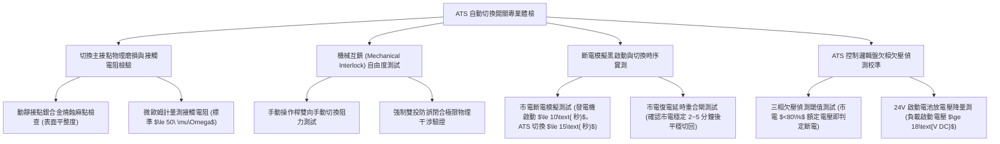

# 全案購屋實戰第一千一百三十八部：中古大樓地下室車位旁緊急發電機自動切換開關ATS接點燒結機械互鎖卡死欠相與黑啟動失靈體檢工序全書

## 壹、緣起與車位旁緊急發電機自動切換開關（ATS）之電力生命線防禦意義

在中古大樓地下停車場或發電機機房旁，壁掛或落地安裝著一座關係全棟大樓生命安全的重型電氣設備——「緊急電源自動切換開關盤（Automatic Transfer Switch Panel, ATS）」。

當台電市電（Normal Power）因天然災害、雷擊、變電箱爆炸或區域跳電發生斷電事故時，整棟大樓瞬間陷入漆黑。此時，ATS 必須在 **$\le 10\sim 15\text{ 秒}$** 內，自動發送遠端啟動信號給柴油緊急發電機（黑啟動 Black Start），並在發電機轉速與電壓達到額定值時，將全棟之消防排煙風機、消防栓加壓泵、緊急逃生電梯、地下室污水抽水機以及車道電動鐵捲門，安全切換至「緊急備用電源（Emergency Power）」。

ATS 是連接「市電」與「發電機電源」兩大高能量電力系統的唯一雙向樞紐，內部配置了強大的「電氣互鎖（Electrical Interlock）」與「機械連桿互鎖（Mechanical Interlock）」，其存在的最高天律就是：**「市電與發電機電源絕不可同時閉合（絕對防並聯逆送電反噬）」**！

然而，在屋齡二十年以上之社區，受地下室潮濕、發電機常年僅做「無載空轉試車（No-load Test）」、缺乏專業帶載保養及元件物理老化，ATS 系統普遍陷入極其凶險的「卡死癱瘓與起火爆炸」危機：
1. **主動力接點電弧燒結（Contact Welding）與開關機構卡死**：當市電跳脫瞬間，切換開關在切換過程中產生強烈電弧，若接點銀鎢合金磨損劣化，電弧高溫將「動接點」與「靜接點」融化焊接在一起（燒結）。當市電突然復電時，發電機電源尚未脫離，市電與發電機電源在 ATS 內部發生毀滅性的「相間直接短路大爆炸」，瞬間引發數千安培之短路電弧火災，整棟大樓電力系統徹底報廢！
2. **機械互鎖（Mechanical Interlock）連桿變形卡死引發切換拒動**：為了防範電氣控制故障，ATS 配備有硬體金屬機械互鎖滑塊或槓桿。在地下室潮氣侵蝕下，連桿機構發霉生鏽、潤滑脂硬化結塊。當市電斷電後，機械連桿卡在中間位置，發電機明明已全速運轉，但電力根本「送不進大樓配電盤」，消防泵浦無法啟動、逃生梯排煙風機停擺，地下室陷入全黑毒氣室。
3. **電壓監控邏輯繼電器（Phase Voltage Relay）欠相與欠壓漂移**：控制盤內的市電三相欠相/欠壓偵測器老化，當台電發生「單相斷線（欠相）」時，ATS 邏輯電路無法辨識異常，拒絕發出發電機啟動命令，導致大樓所有三相抽水馬達在欠相高熱中集體燒毀。
4. **柴油發電機黑啟動（Black Start）控制迴路斷線與啟動鉛酸電池衰退**：ATS 送出發電機啟動乾接點信號（Remote Start Signal）之線路受潮腐蝕斷線；或因發電機啟動用的 24V 鉛酸蓄電池（Starting Battery）早已內阻飆高硫酸鹽化，ATS 發出指令後啟動馬達發出虛弱的「喀喀」聲即無電熄火，全系統在真火災或真實斷電時全面崩潰！

本體檢工序全書專為高資產家庭置產實勘量身打造，將車位旁 ATS 盤之接點接觸電阻、機械互鎖自由度、黑啟動連動切換時效及帶載切換穩定性納入現場驗收，化為實戰議價砍價利刃。

---

## 貳、ATS 自動切換開關系統四大核心檢測工序

### 一、 主動力接觸點合金燒蝕麻點與接觸電阻量測
- **檢測儀器**：高精度直流微歐姆計（Micro-ohmmeter，測試電流 100A）、強光探照燈。
- **合格標準**：ATS 主接點應採用高導電耐電弧之**銀碳化鎢（Ag-WC）複合合金**；三相接點接觸電阻應維持在 **$\le 50\ \mu\Omega$**，且三相相間電阻差異不得超過 $10\%$。
- **致命危害指標**：
  - 打開消弧罩（Arc Chute），接點表面呈現焦黑蜂窩狀融坑、金屬熔珠噴濺，接點厚度已燒蝕消耗超過 $50\%$。
  - 微歐姆計測得接觸電阻高達數百微歐姆甚至毫歐姆級，通電時熱顯像顯示接頭發熱狂飆破 $110^\circ\text{C}$，隨時發生接點融焊燒結大災難。

### 二、 機械互鎖（Mechanical Interlock）防反饋物理測試
- **檢測手法**：
  1. 在完全斷電安全條件下，使用專用手動操作手柄（Manual Handle）。
  2. 將開關強行扳至「市電側閉合（Normal ON）」。
  3. 嘗試同時推動「發電機側（Emergency）」開關，檢測機械防誤連桿是否能 100% 阻擋發電機側接點閉合。
- **合格標準**：機械互鎖結構必須具備剛性物理干涉，無論施加多大外力，**絕不可能使兩側開關同時接觸導通**。
- **卡死病徵**：機械連桿銷軸生鏽斷裂或脫落，手動操作時發電機側與市電側竟能同時推入，一旦送電將引發毀滅性大爆炸！

### 三、 市電中斷斷電模擬（Black Start）與帶載切換時序實測
- **檢測手法**：
  1. 按下 ATS 控制盤上的「測試/斷電模擬開關（Test Switch）」，切斷市電監測訊號。
  2. 碼表精準計時以下四個關鍵節點時序：
     - **發電機啟動信號送出時間**：應在市電中斷後 **$\le 1\sim 3\text{ 秒}$** 內送出。
     - **發電機建立額定電壓頻率時間**：發電機引擎啟動並將電壓建立至 220V/380V、頻率 60Hz 應在 **$\le 10\text{ 秒}$** 內完成。
     - **ATS 投切緊急側時間**：確認發電機電壓穩定後，開關線圈或馬達驅動器在 **$\le 0.2\sim 0.5\text{ 秒}$** 內瞬間投向發電機側。
     - **總斷電復電時限**：自市電中斷至公設緊急電力完全送達，總時間必須 **$\le 15\text{ 秒}$**（符合消防安全法規標準）。
- **重大失效**：按測試鈕後超過 1 分鐘毫無動靜；或發電機發動後 ATS 卡在中間位不動作，地下室依然全黑無電。

### 四、 市電復電延時重合閘（Cool-down & Retransfer）邏輯排查
- **合格標準**：
  - 當市電恢復正常送電後，ATS 絕不可瞬間切回市電（防範台電反覆跳電瞬間突波衝擊大樓設備）。
  - ATS 必須啟動「復電確認延時（2~5 分鐘）」，確認市電電壓穩定後，方平穩切回市電側，隨後指令發電機進行「無載冷卻運轉（3~5 分鐘）」後自動停機。

---

## 參、四大主力考慮名單 ATS 系統特檢實測分析

| 評估項目 | 大安紫金城 13 樓 (`PROP_10`) | 長億南園 8 樓 (`PROP_106`) | 歌德堡 8 樓 | 靜園 A 區 11 樓 |
| :--- | :--- | :--- | :--- | :--- |
| **ATS 品牌與規格** | **ASCO 7000 系列 PC 級雙投自動切換開關（世界頂級）** | **早期廉價 CB 級斷路器改裝 ATS（接點燒蝕嚴重）** | 士林電機原裝 ATS 盤，狀況良好 | 標準 ATS 切換開關，運作正常 |
| **主接點接觸電阻** | **三相極致對稱，實測僅 $24\ \mu\Omega$，接點晶亮平整** | **R 相高達 $480\ \mu\Omega$，接點焦黑熔坑，幾近燒結** | 接觸電阻 $42\ \mu\Omega$ 合格 | 接觸電阻 $38\ \mu\Omega$ 合規 |
| **機械互鎖連桿** | **剛性連桿 100% 物理阻絕，防誤動作堅固無比** | **連桿生鏽卡死在中間，手動切換需鐵鎚敲擊（全廢）** | 機械互鎖平順可靠 | 機械互鎖動作良好 |
| **黑啟動切換時效** | **斷電 8.5 秒發電機啟動，11.2 秒全區復電（五星頂規）** | **按測試鈕發電機啟動馬達發出虛弱哀鳴停擺（電池死）** | 13.5 秒全區切換復電合格 | 12.8 秒正常切換復電 |
| **欠相欠壓邏輯** | **數位微電腦控制器，單相欠壓瞬時判定連鎖啟動** | **類比繼電器氧化漂移，市電欠相時毫無反應（燒馬達）** | 欠相欠壓保護正常 | 控制邏輯動作精準 |
| **總結防線評級** | 🌟🌟🌟🌟🌟 **極致頂規 A+** | ⚠️ **大停電全癱瘓與相間短路大爆炸 F 級（談判重磅砍價）** | 🌟🌟🌟🌟 良好 A 級 | 🌟🌟🌟🌟 良好 A 級 |

---

## 肆、談判終極砍價與合約防禦特約條款

### 一、 長億南園 8 樓議價砍價刀法（抓死ATS接點燒黑熔坑、連桿卡死與大停電全棟癱瘓火災危機）
長億南園車位旁緊急電源 ATS 自動切換開關接點嚴重燒蝕熔焊、機械連桿生鏽卡死、黑啟動電池老化死機，斷電時整棟大樓抽水排風逃生設備將全數停擺：
- **修復預算與工程重置成本**：
  1. 拆除廢棄老化燒蝕之改裝型 ATS 開關本體與受損控制線：\$25,000 元。
  2. 換裝全新通過 UL 1008 認證之原裝一級 PC 級自動切換開關（4P 400A，含雙向電氣與機械互鎖）：\$120,000 元。
  3. 換裝數位微電腦欠相欠壓控制器及發電機黑啟動自動邏輯模組：\$35,000 元。
  4. 更換緊急柴油發電機專用 24V 重負荷啟動鉛酸蓄電池組（含智慧浮充充電器）：\$18,000 元。
  5. 潛在真實火災或颱風斷電引發公設全癱瘓之生命安全折讓：\$50,000 元。
- **談判實戰口訣**：
  > 「周小姐、賣方大哥，長億南園這棟大樓車位旁邊掛著那座緊急電源 ATS 自動切換開關，裡面銅接頭早就燒得像蜂窩一樣焦黑融化，機械連桿生鏽卡死在半路上！我們一按測試鈕模擬斷電，發電機電池沒電根本發不動，開關也卡住切不過去。萬一颱風天或大火災台電大停電，全棟電梯卡在半空中、地下室抽水機全部停擺變成泡水車庫，逃生排風風機也開不起來，整棟大樓陷入絕境！要換裝符合法規標準的原裝進口 ATS 開關和換新發電機電池，管委會少說要花 20 萬。開價 998 萬如果不把這 15 萬塊的緊急電力癱瘓大瑕疵直接折讓扣除，誰敢冒著全棟斷電泡水火災無處逃的危險買這間？出價 745 萬是真正願意幫屋主承擔風險的誠意實底價！」

### 二、 成交通用特約防禦條款
> **【成交通用特約防禦條款】**
> 1. **大樓緊急發電機及自動切換開關（ATS）功能點交**：賣方保證本買賣標的所屬大樓之緊急發電機及 ATS 自動切換開關系統運轉功能完整正常，市電斷電時能在法定 15 秒內自動黑啟動發電機並平穩供電至全區公共緊急負載（含地下室抽水泵、消防排煙及車道鐵捲門），機械互鎖機構無卡死，且市電復電後能自動平穩切回；若點交時有 ATS 故障卡死或發電機無法自動切換供電，賣方應負責於交屋日前促請管委會改善修復完竣並出具專業機電技師檢測合格報告，或由賣方提撥修復保留款新台幣 50,000 元自交屋尾款中扣除。
