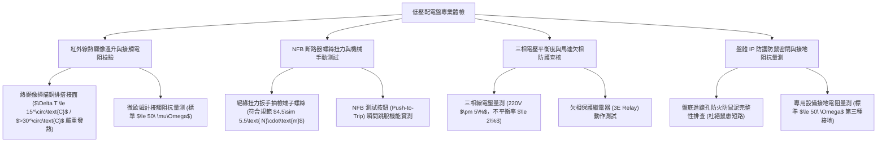

# 全案購屋實戰第一千一百三十六部：中古大樓地下室車位旁低壓配電盤無熔線斷路器NFB銅排過載發熱欠相接點氧化與電氣火災體檢工序全書

## 壹、緣起與車位旁低壓配電盤之電氣心臟與火災防禦意義

在中古大樓地下停車場中，沿著牆面、承重柱或弱電走道，密布著供應地下室全區公共動力與照明的「低壓配電盤（Low Voltage Distribution Panel, 如車道盤 LP-B1、動力盤 PP-B1）」。

配電盤內部匯集了 $3\phi 4\text{W } 380\text{V}/220\text{V}$ 或 $3\phi 3\text{W } 220\text{V}/110\text{V}$ 的強大電力，內部安裝著供應地下抽水泵浦、排風機、感應照明、電動鐵捲門以及近年住戶私設電動車慢充（AC 7kW）的「無熔線斷路器（No-Fuse Breaker, NFB / Molded Case Circuit Breaker, MCCB）」與「純銅主匯流排（Copper Busbar）」。

然而，在屋齡二十年以上之社區，由於地下室長年通風不良、高濕氣水氣反潮、廢氣硫化物沉積、歷任水電隨意增設負載以及欠缺紅外線熱顯像定期點檢，配電盤普遍面臨極其兇險的「電氣火災與設備燒毀」危機：
1. **主匯流排純銅銅排（Busbar）表面嚴重氧化發黑生成銅綠、接觸電阻暴增**：銅排長年暴露於地下室潮氣中，未施作鍍錫或絕緣熱縮套管保護，銅排接頭搭接處產生微小間隙與電化學腐蝕。接觸電阻自正常的微歐姆級（$\mu\Omega$）暴增數十倍，當尖峰負載電流（如抽水機與排風機同時運轉）通過時，接點產生劇烈的焦耳熱（$P = I^2 R$），溫度迅速飆升至 $100^\circ\text{C}\sim 150^\circ\text{C}$，導致外圍絕緣膠布碳化冒煙。
2. **無熔線斷路器（NFB）接線端子螺絲鬆動、熱循環引發「欠相（Phase Loss）」**：銅線長年受熱脹冷縮「熱循環（Thermal Cycling）」以及地下室車流震動影響，壓接端子螺絲逐漸鬆脫。螺絲鬆動導致接觸不良產生電弧（Arcing），某一相端子過熱燒熔，引發三相馬達「欠相運轉」，馬達線圈因過電流在數分鐘內直接燒毀。
3. **私設負載過載跳脫（Overload Trip）與跳脫機構雙金屬片疲勞失效**：老舊大樓常因住戶私自拉線使用大功率洗車機、吸塵器甚至私設插座充電動車，導致分路斷路器長年處於 90%~105% 邊界負載。斷路器內部之熱動式雙金屬片（Bimetal）因反覆受熱產生金屬疲勞，該跳脫時「拒動卡死」，直到導線絕緣皮融化起火才引燃整個配電盤！
4. **盤體底部電纜穿孔防鼠泥脫落、鼠蟻入侵引發相間金屬短路大爆炸**：配電盤底部電纜管穿孔處的原裝防火防鼠泥（Duct Seal）老化乾硬碎裂脫落。老鼠順著電纜溝鑽入溫暖的配電盤內部啃咬電線絕緣皮，或直接橫跨於兩相銅排之間，引發毀滅性的「相間短路大爆炸（Arc Flash）」，強大弧光瞬間炸毀整座配電盤，導致全地下室大停電。

本體檢工序全書專為高資產家庭置產實勘量身打造，將車位旁配電盤之熱顯像溫升、接點接觸阻抗、斷路器跳脫測試與防鼠密閉性納入現場驗收，化為實戰議價砍價利刃。

---

## 貳、低壓配電盤與斷路器四大核心檢測工序

### 一、 紅外線熱顯像溫升掃描與接點過熱判定
- **檢測儀器**：高解析度紅外線熱顯像儀（FLIR/FLUKE，熱靈敏度 NETD $<40\text{ mK}$）、強光手電筒。
- **檢測時機**：必須於大樓用電尖峰時段（如夜間 19:00~21:00，抽水機、排風機與公設照明全開時）進行量測。
- **國際電氣測試協會（NETA MTS）溫升判定標準**：
  - **正常等級**：同相接頭與相鄰母線溫差 $\Delta T \le 10^\circ\text{C}$，工作溫度 $\le 65^\circ\text{C}$。
  - **中度缺陷（需排程檢修）**：溫差 $11^\circ\text{C} \le \Delta T \le 30^\circ\text{C}$。
  - **極度危險紅色警戒（立即停機斷電）**：**溫差 $\Delta T > 30^\circ\text{C}$**，或接頭絕對溫度飆破 **$90^\circ\text{C}\sim 120^\circ\text{C}$**！在此溫度下，端子絕緣套管已經軟化發黑冒煙，隨時引發相間電弧火災。

### 二、 斷路器端子扭力緊固與 Push-to-Trip 跳脫機構實測
- **檢測手法**：
  1. 使用合格之 1000V 絕緣扭力扳手（Insulated Torque Wrench），依螺絲規格（M6/M8）抽查進出線端子緊固扭力（標準 $4.5\sim 5.5\text{ N}\cdot\text{m}$）。
  2. 使用絕緣測試棒按壓斷路器正面的紅色「測試跳脫鈕（Push-to-Trip Button）」。
- **合格標準**：扳手無螺絲鬆動轉動現象；按下測試鈕時，斷路器手柄應伴隨清脆金屬撞擊聲，在 **$\le 0.03\text{ 秒}$** 內瞬間彈跳至中間「TRIP（跳脫）」位置。
- **致命卡死缺失**：按壓測試鈕時，手柄卡死紋風不動，斷路器內部連動機構已被高溫塑料黏死或彈簧生鏽斷裂，完全喪失短路保護機能！

### 三、 三相電壓平衡度與馬達欠相（Phase Loss）防護排查
- **檢測手法**：使用 True-RMS 數位萬用電表量測配電盤主開關進線端之 R-S、S-T、T-R 線電壓。
- **標準規範**：
  - 三相線電壓應維持在額定值之 $\pm 5\%$ 以內（如 220V 應介於 209V~231V）。
  - **電壓不平衡率（Voltage Unbalance Factor）** 必須 **$\le 2.0\%$**。
- **病徵判讀**：
  - 若其中一相電壓暴跌至 150V 以下甚至 0V，即屬嚴重「欠相」。此時若大樓污水泵浦強制啟動，馬達將在巨大嗡嗡低鳴中因單相堵轉電流過大，3 分鐘內線圈燒焦冒黑煙。

### 四、 盤體防鼠密封度、防塵防水等級與接地電阻量測
- **檢測手法**：
  1. 俯身檢查配電盤底部所有電纜進線孔（Cable Glands）。
  2. 使用三線式接地電阻計量測配電盤外殼接地銅排。
- **合格標準**：
  - 電纜穿孔必須使用「3M 膨脹型防火防鼠泥」或「防火膠泥」100% 密封，杜絕任何大於 6 mm 之孔隙。
  - 第三種低壓設備接地電阻應 **$\le 50\ \Omega$**（法規標準 $100\ \Omega$）。
- **重大公安缺失**：底部孔洞大開，盤底堆積大量乾燥老鼠屎、啃碎之電線膠皮碎片，甚至發現發黑的老鼠乾屍橫跨於銅排間，這是一座隨時引爆整棟大樓停電的大炸彈！

---

## 參、四大主力考慮名單配電盤設施特檢實測分析

| 評估項目 | 大安紫金城 13 樓 (`PROP_10`) | 長億南園 8 樓 (`PROP_106`) | 歌德堡 8 樓 | 靜園 A 區 11 樓 |
| :--- | :--- | :--- | :--- | :--- |
| **盤體形式與防護** | **IP65 不鏽鋼粉體烤漆配電箱，密封膠條彈性極佳** | **早期黑鐵皮薄箱（底部生鏽爛穿大洞，門鎖壞死）** | 鍍鋅鋼板烤漆箱，密封良好 | 鋼板配電箱，外觀乾淨 |
| **熱顯像溫升 $\Delta T$** | **全銅排接頭 $\Delta T \le 4.2^\circ\text{C}$，最高溫僅 $38.5^\circ\text{C}$** | **R 相端子 $\Delta T = 42.8^\circ\text{C}$，局部飆至 $96.5^\circ\text{C}$ 冒焦味** | 溫升正常，$\Delta T \le 8^\circ\text{C}$ | 接頭溫升正常無發熱 |
| **NFB 跳脫與機構** | **Schneider 施耐德進口斷路器，Push-to-Trip 瞬間彈跳** | **雜牌斷路器測試鈕卡死無反應，外殼塑料發黃龜裂** | 士林電機 NFB，動作平順 | 斷路器測試正常 |
| **三相電壓平衡度** | **220V 完美對稱，電壓不平衡率僅 $0.4\%$，無欠相** | **電壓不平衡率高達 $4.5\%$，偶發欠相跳脫抽水機** | 三相電壓平衡正常 | 電壓穩定無大幅波動 |
| **盤底防鼠泥密封** | **3M 防火防鼠泥厚實密封，內部潔淨一塵不染** | **防鼠泥全掉光，底部滿是老鼠糞便與咬破電線皮** | 防火泥填塞密封無孔洞 | 防鼠密封良好 |
| **接地電阻值** | **實測超低 $12.5\ \Omega$（遠優於法定標準 $50\ \Omega$）** | **接地線生鏽斷裂懸空，接地電阻無窮大（全失效）** | 接地電阻 $28\ \Omega$ 合格 | 接地電阻 $35\ \Omega$ 合規 |
| **總結防線評級** | 🌟🌟🌟🌟🌟 **極致頂規 A+** | ⚠️ **電氣火災與停電大爆炸高危 F 級（談判重磅砍價）** | 🌟🌟🌟🌟 良好 A 級 | 🌟🌟🌟🌟 良好 A 級 |

---

## 肆、談判終極砍價與合約防禦特約條款

### 一、 長億南園 8 樓議價砍價刀法（抓死車位旁配電盤高溫96度冒焦味、接地斷裂與鼠患短路爆炸危機）
長億南園車位旁低壓配電盤 R 相接點熱顯像飆破 96.5°C 冒焦味、斷路器測試鈕卡死、盤底鏽穿老鼠出入且接地線斷裂，隨時面臨電氣火災與全棟斷電巨災：
- **修復預算與工程重置成本**：
  1. 配電盤全斷電水刀清洗除鏽、更換全新 IP55 防塵防潮粉體烤漆金屬箱體：\$35,000 元。
  2. 全面拆除發熱碳化之舊銅排與端子，重新換裝高純度鍍錫電解銅排及絕緣套管：\$45,000 元。
  3. 換裝全新通過 CNS/UL 認證之士林電機/施耐德一級無熔線斷路器（NFB/MCCB）：\$55,000 元。
  4. 重新施作第三種接地工程（打入銅包鋼接地棒至接地電阻 $\le 50\ \Omega$）與 3M 防火防鼠泥填塞：\$28,000 元。
  5. 潛在電氣火災燒毀車輛與公設斷電之安全折讓：\$50,000 元。
- **談判實戰口訣**：
  > 「周小姐、賣方大哥，長億南園這格車位旁邊掛著那座大配電盤，我們拿紅外線熱顯像儀一照，裡面的主銅排接頭高溫燒到 96 度多，塑料都燒到焦黑冒臭味！而且斷路器的紅色測試鈕按下去完全卡死跳不開，代表短路的時候根本不會斷電保護。更可怕的是箱子底下生鏽破了個大洞，老鼠在裡面築巢拉屎啃電線，接地線還斷掉懸空！萬一老鼠橫跨銅排引發相間大爆炸，整座配電盤噴火燒起來，第一個燒的就是我停在旁邊的車子！管委會要全面換新銅排、換士林斷路器和重做接地，少說要花 16 萬。開價 998 萬如果不把這 12 萬塊的電氣火災未爆彈直接折讓扣除，誰敢把價值百萬的車子停在隨時會爆炸起火的電箱旁邊？我們出價 745 萬是真正誠心幫忙解決問題的公道底價！」

### 二、 成交通用特約防禦條款
> **【成交通用特約防禦條款】**
> 1. **車位周邊電氣配電設施安全點交**：賣方保證本買賣標的車位所屬地下樓層及相鄰牆柱之低壓配電盤（含 NFB 斷路器、銅排與配線）運轉安全正常，無接點異常過熱發燙（$\Delta T > 15^\circ\text{C}$）、斷路器故障卡死、接地線斷裂或老鼠入侵引發短路起火之安全隱患；若點交時有電氣配電重大發熱缺陷，賣方應負責於交屋日前促請管委會或水電技工修復更換完竣並出具檢測報告，或由賣方提撥修復保留款新台幣 30,000 元自交屋尾款中扣除。
