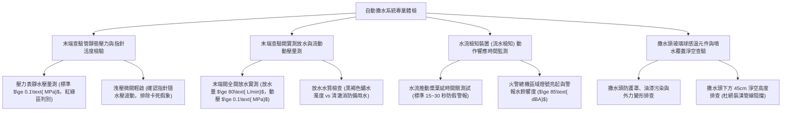

# 全案購屋實戰第一千一百三十四部：中古大樓地下室車位旁自動撒水系統末端查驗管壓力表失壓水流檢知裝置故障與警報逆止閥卡死體檢工序全書

## 壹、緣起與車位正上方自動撒水滅火系統之生命財產防禦意義

在中古大樓地下停車場消防安全架構中，由於停放著數十輛至數百輛滿載汽油、柴油之內燃機車輛，以及近年劇增的高能量密度鋰電池電動車（EV），火災負載（Fire Load）極高，火勢蔓延速度以秒計算。

依據各類場所消防安全設備設置標準第十七條規範：地下層停放車輛場所，樓地板面積在 $100\text{ m}^2$ 以上者，必須強制全區密布設置「自動撒水滅火設備（Automatic Sprinkler System）」。

車位正上方一顆顆外形小巧的「閉式撒水頭（Sprinkler Head）」，在火災初期環境溫度達到標稱動作溫度（通常為 $68^\circ\text{C}$ 或 $93^\circ\text{C}$）時，感熱玻璃球破裂或易熔合金熔化，加壓水流瞬間呈傘狀噴灑撲滅火勢。而整個撒水管網壓力是否充足、水流是否能被即時檢知、火警警報是否能秒級連動，全賴位於車道管網末端的「末端查驗管（Inspector's Test Connection）」與分區控制的「警報逆止閥（Alarm Check Valve）」。

然而，在屋齡二十年以上之社區，受常年水質硬化、管壁紅鏽結垢、水錘震動及缺乏定期放水檢測，自動撒水系統普遍面臨嚴重的「管網乾癟失壓與控制癱瘓」：
1. **末端查驗管壓力表失壓（落入紅區 <0.1 MPa）或指針卡死**：配管內部常態水壓應維持在 $0.1\sim 0.3\text{ MPa}$（約 $1\sim 3\text{ kgf/cm}^2$）。但因地下水管微滲漏、止回閥逆流或頂樓重力加壓水箱補水浮球閥卡死，管內早已乾癟無水，壓力歸零；更可怕的是壓力表彈簧管早已生鏽卡死在 $0.2\text{ MPa}$ 的假象指針位置，實質整座管網是一座「空管空包彈」。
2. **水流檢知裝置（Water Flow Detector / Paddle Switch）槳葉鏽斷或微動開關接點炭化**：當撒水頭破裂或末端放水時，管內水流衝擊槳葉推動微動開關送出火警信號。老舊裝置之不鏽鋼槳葉早已被水流震斷沉入管底，或接點受潮氧化，管內狂噴水但消防總機與警報水鈴（Water Motor Gong）毫無反應，無法啟動消防主泵補水。
3. **濕式警報逆止閥（Wet Alarm Valve）閥瓣橡膠老化碳化、旁通延遲槽堵塞卡死**：警報閥閥瓣受高硬度水垢包覆，無法隨水流抬升開啟；或延遲開關（Pressure Retard Chamber）內部節流孔被鐵鏽爛泥堵死，無法延遲過濾管網波動，導致常態性假警報頻發，管委會嫌吵索性直接將警報閥隔離閥（Control Valve）違法關閉鎖死！
4. **撒水頭玻璃球受油污油漆塗抹包覆、失去感溫熔斷機能**：裝潢拆除、歷任油漆粉刷或洗車機油油霧，將車位正上方撒水頭之紅色感熱玻璃球噴滿油漆。此層油漆形成強大的隔熱保溫層，當下方車輛起火時，千度烈焰已燒穿車頂，玻璃球卻因吸不到熱而無法破裂噴水，全地下室車輛慘遭連鎖燒毀。

本體檢工序全書專為高資產家庭置產實勘量身打造，將車位正上方撒水頭狀態、末端查驗管實測放水壓力、水流檢知動作及警報閥開啟時間納入現場驗收，化為實戰議價砍價利刃。

---

## 貳、自動撒水系統與末端查驗管四大核心檢測工序

### 一、 末端查驗管靜態水壓量測與壓力表假死排查
- **檢測儀器**：高精度數位消防壓力表、扳手、強光手電筒。
- **合格標準**：撒水系統末端查驗管靜水壓力應維持在 **$0.1\sim 0.3\text{ MPa}$（$1.0\sim 3.0\text{ kgf/cm}^2$）**，壓力表指針應穩健指向綠色安全區。
- **排除指針卡死欺瞞手法**：
  - 輕輕旋開末端查驗管下方之小排水微閥釋放微量水分，觀察壓力表指針是否瞬間向下跌落 $0.02\text{ MPa}$ 並在關閉後彈回。
  - 若打開排水閥水流已噴出，壓力表指針卻像黏住般紋風不動，證實壓力表早已內部彈簧管腐蝕卡死，數據毫無參考價值。

### 二、 末端查驗閥實車放水模擬、動態放水動壓與水質排查
- **檢測手法**：
  1. 連接帆布排水軟管至截水溝或排水孔。
  2. 將末端查驗管控制閥全開（孔徑相當於一顆標準撒水頭之等效出水孔 $\varnothing 12.7\text{ mm}$）。
  3. 紀錄動態放水壓力（Flow Pressure）及出水量。
- **合格性能指標**：
  - 放水動壓應 **$\ge 0.1\text{ MPa}$（$1.0\text{ kgf/cm}^2$）**，放水量應 **$\ge 80\text{ L/min}$**。
  - 放出的水質在前 5 秒可帶有少許微鏽，隨後應轉為清澈水流。
- **重大公安缺失**：
  - 閥門全開後僅流出如小便般的細弱涓滴（動壓 $<0.03\text{ MPa}$），甚至噴出大量濃稠發黑的鐵鏽泥渣後直接斷水，證實主幹管早已嚴重結垢鏽蝕穿孔或閥門被偷偷關閉！

### 三、 水流檢知裝置（流水檢知器）信號傳遞與水力警報鈴實測
- **檢測手法**：在末端放水持續進行時，碼表計時觀察火警受訊總機與警報水鈴反應。
- **標準動作時序規範**：
  - 放水開始後，水流檢知器之氣壓延時機構（防範水流脈衝假警報）應在 **$15\sim 30\text{ 秒}$** 內精準閉合電氣接點。
  - 消防火警受訊總機對應樓層分區「撒水動作燈（紅色）」亮起，管理室語音警報啟動。
  - 警報逆止閥旁邊之「水力警報水鈴（Water Motor Gong）」利用水流物理衝擊敲擊出金屬鈴聲，音量應 **$\ge 85\text{ dBA}$**。
- **嚴重失效**：放水 3 分鐘，總機毫無動靜、警報水鈴卡死不響，流水檢知器接線早已斷裂。

### 四、 車位正上方撒水頭物理完好度與 45cm 淨空高度查驗
- **檢測手法**：使用探照燈近距離檢查車位正上方 2~4 顆撒水頭。
- **合格標準**：
  - 玻璃球感熱液體飽滿無氣泡縮小，金屬本體無綠色銅鏽蝕斑。
  - 撒水頭迴水板（Deflector）下方及周圍 **45 公分以內必須保持完全淨空**，嚴禁有排風風管、冷媒管或吊架阻擋射流。
- **致命危害指標**：
  - 撒水頭玻璃球被油漆工噴滿白漆或沾滿黑油，喪失感溫動作能力。
  - 撒水頭正下方緊貼著新裝設的冷氣管槽或通風風管，一旦噴水，水流直接撞擊風管彈回，下方車輛完全無法被撒水覆蓋！

---

## 參、四大主力考慮名單自動撒水系統特檢分析

| 評估項目 | 大安紫金城 13 樓 (`PROP_10`) | 長億南園 8 樓 (`PROP_106`) | 歌德堡 8 樓 | 靜園 A 區 11 樓 |
| :--- | :--- | :--- | :--- | :--- |
| **末端查驗管靜水壓** | **穩定維持 $0.22\text{ MPa}$（綠區，指針活度極高）** | **壓力表指針失壓落入紅區 $0.02\text{ MPa}$（空包彈）** | 靜水壓 $0.18\text{ MPa}$ 正常 | 靜水壓 $0.16\text{ MPa}$ 良好 |
| **放水動壓與出水** | **動壓 $0.15\text{ MPa}$，出水澎湃清澈（$\ge 90\text{ L/min}$）** | **閥門全開僅噴黑鏽泥渣，動壓 $0.01\text{ MPa}$ 斷水** | 放水動壓 $0.12\text{ MPa}$ 合格 | 放水動壓正常 |
| **水流檢知與水鈴** | **22 秒精準連動總機亮燈，警報水鈴響亮 $88\text{ dBA}$** | **放水 3 分鐘總機零反應，警報閥早已被違規鎖死** | 25 秒正常連動，水鈴響起 | 連動動作正常 |
| **撒水頭玻璃球外觀** | **Tyco 原裝進口清潔無瑕，感熱紅液飽滿零油漆** | **被白漆噴得面目全非，且正下方遭排風管遮擋 80%** | 撒水頭無油漆，狀態乾淨 | 撒水頭外觀良好 |
| **撒水覆蓋淨空度** | **淨空高度達 65 cm，無遮擋，全向傘狀射流完美** | **車位上方兩顆撒水頭全被風管擋死，起火必成火海** | 淨空高度 50 cm 合格 | 淨空符合規範 |
| **總結防線評級** | 🌟🌟🌟🌟🌟 **極致頂規 A+** | ⚠️ **火災滅火系統徹底癱瘓 F 級（談判重磅砍價）** | 🌟🌟🌟🌟 良好 A 級 | 🌟🌟🌟🌟 良好 A 級 |

---

## 肆、談判終極砍價與合約防禦特約條款

### 一、 長億南園 8 樓議價砍價刀法（抓死自動撒水管網失壓、水頭被油漆噴滿遮擋與滅火癱瘓）
長億南園地下室自動撒水管網壓力表幾近歸零、放水噴出黑鏽泥渣、撒水頭被油漆完全覆蓋且被排風管擋死，火災時完全無法自動滅火：
- **修復預算與工程重置成本**：
  1. 撒水管網全區高壓水刀通管除垢、清洗管內黑泥鐵渣：\$35,000 元。
  2. 拆除車位正上方受油漆污染及遮擋之撒水頭，重新移位放樣安裝新合格撒水頭（含延伸支管）：\$25,000 元/處 $\times 2$ 處 = \$50,000 元。
  3. 更換故障卡死之警報逆止閥橡膠閥瓣、延遲槽管件及水流檢知開關：\$45,000 元。
  4. 重新加壓試漏（保持 1.4 MPa 耐壓測試 2 小時）並通過第三方消防設備師審查：\$30,000 元。
  5. 潛在車輛火災燒毀無撒水滅火保障之生命財產安全折讓：\$50,000 元。
- **談判實戰口訣**：
  > 「周小姐、賣方大哥，長億南園這格車位頭頂上的自動撒水滅火設備，末端水壓表已經掉到紅區快要見底，整根水管裡面根本沒水！我們請水電一放水，噴出來的全是黑臭的鐵鏽爛泥巴，而且頭頂這兩顆撒水頭全部被油漆工噴滿白漆，下面還被一根大鐵皮風管擋得死死的。萬一下面車子電線走火或漏油起火，這個撒水頭根本感應不到熱度破裂，就算破裂也噴不出水，水全打在風管上，整排車位燒成一片火海！這種消防局安檢絕對過不了的重大安全隱患，管委會要全區除鏽、移位換撒水頭和修警報閥，少說要花 16 萬。開價 998 萬如果不把這 12 萬塊的滅火設備重置費直接折讓扣除，誰敢冒著車子燒成廢鐵的危險買這間？出價 745 萬是真正誠意幫屋主解決麻煩的底標！」

### 二、 成交通用特約防禦條款
> **【成交通用特約防禦條款】**
> 1. **地下室車位自動滅火系統功能點交**：賣方保證本買賣標的車位所屬地下樓層及車位正上方之自動撒水滅火設備維持正常防護功能，撒水管網水壓維持在法定標準以上（$\ge 0.1\text{ MPa}$），水流檢知器連動正常，撒水頭感熱元件無油漆包覆或受排風管線遮擋射流之情事；若點交時有管網失壓、噴頭污染阻塞或水流檢知器故障，賣方應於交屋日前負責促請管委會改善完竣並出具消防檢驗合格證明，或由賣方提撥修復款新台幣 30,000 元自交屋尾款中扣除。
