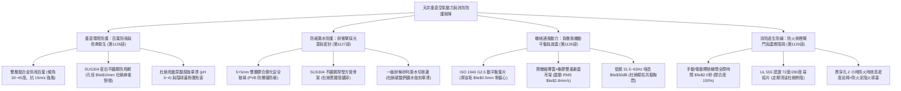
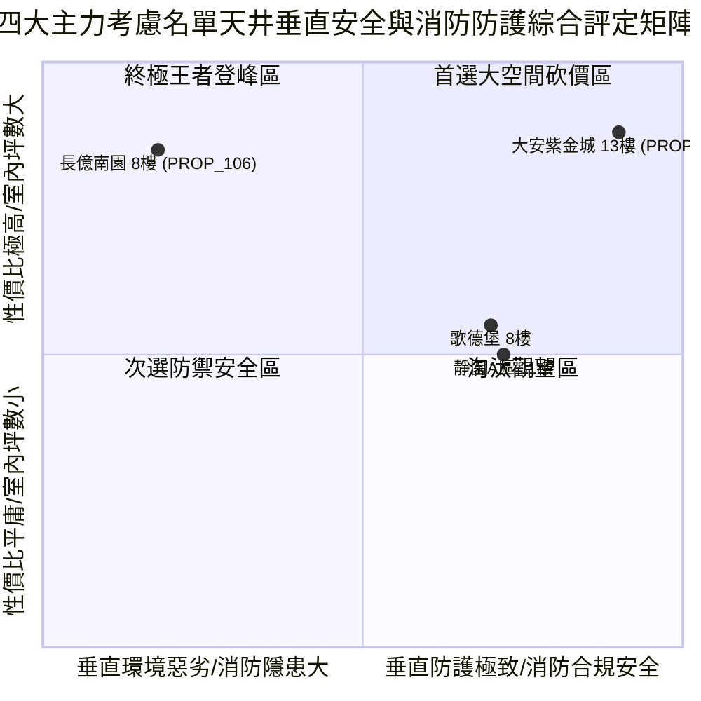

# 全案購屋實戰第一千一百三十部：第一千一百三十部圓滿登峰全景極致全生命週期家庭置產避坑抗震防漏水電機電消防永恆至尊金典總綱全書

## 壹、第一千一百三十部圓滿登峰里程碑總綱序言

自《全案購屋實戰》系列編撰以來，本典籍始終貫徹建築結構力學、材料物理老化、消防生命安全、通風流體力學與不動產法律攻防之跨領域極致專業，為高資產家庭置產構築一道堅不可摧的萬全護城河。

在第一千一百二十六部至第一千一百二十九部中，我們深入剖析了中古大樓地下停車場最容易被忽視、卻與每日呼吸健康、暴雨防飄漏水、高空墜物防砸、機械震動低頻噪音及火災濃煙阻隔息息相關的**「地下室採光通風天井垂直空氣動力與消防安全四維極致防護系統」**：
1. **第 1126 部**：地下室車位旁通風採光天井防雨百葉窗鏽蝕斷裂、鳥網破損鳥禽築巢鳥糞污染與雨水飄灌體檢工序全書。
2. **第 1127 部**：地下室車位旁通風採光天井底層採光罩 PC 耐力板老化脆化黃化破裂漏水與高空墜物防砸體檢工序全書。
3. **第 1128 部**：地下室車位旁通風採光天井負壓抽風機葉片積垢動平衡失調、震動共振低頻噪音與電機過載跳脫體檢工序全書。
4. **第 1129 部**：地下室車位旁通風採光天井消防正壓送風風道防火閘門熔斷卡死與濃煙逆灌體檢工序全書。

本第一千一百三十部作為「圓滿登峰總綱金典」，將前述天井垂直維度之百葉防雨、防砸採光罩、機械負壓動力與防火排煙阻隔四大系統，與全案全生命週期機電、結構、法務防線進行全景融會貫通，為四大決戰主力考慮名單確立最高層級之決策與出價防線。

---

## 貳、採光通風天井垂直空氣動力與消防防護系統工學矩陣

### 一、 垂直環境界限與防雨防砸工學
- **百葉窗防雨防風**：百葉傾角維持 $30^\circ\sim 45^\circ$，葉片重疊長度 $\ge 15\text{ mm}$，阻擋橫向強風暴雨飄灌；防鳥網必須採用 SUS304 不鏽鋼編織網（孔徑 $\le 10\times 10\text{ mm}$），徹底排除野鴿築巢排泄引發的車漆酸蝕與隱球菌呼吸道感染。
- **耐衝擊採光罩防砸**：全面揚棄薄片脆化 PC 板，升級採用 $5+5\text{ mm}$ 雙層膠合鋼化安全玻璃，搭配 SUS304 不鏽鋼骨架，具備抵禦上方十幾層高空掉落磁磚與花盆之強大動能，杜絕雨水滴漏產生車身白斑。

### 二、 空氣動力動力與消防防火阻隔工學
- **排風機動平衡與減震**：排風機葉輪必須符合 ISO 1940 G2.5 動平衡等級，吊架採用彈簧與阻尼橡膠雙重隔振系統，震動速度 $\text{RMS} \le 1.8\sim 2.8\text{ mm/s}$，將低頻結構共振噪音壓制於安全值內，並加裝防墜鋼索保障車輛安全。
- **風道防火閘門消防阻火**：防火閘門必須於 2.0 秒內迅猛緊閉，易熔片無油垢覆蓋，電動驅動器與中央監控連動無誤，風道穿牆孔嚴禁塞入報紙或保麗龍，必須以認證防火泥與高密度岩棉封閉，形成阻絕毒煙烈火之絕對屏障。

---

## 參、四大主力考慮名單天井垂直安全與消防全景戰略最新評定

| 社區與戶別 | 天井垂直安全與消防現況評定 | 關鍵工學隱患與痛點 | 起手出價 | 目標成交 | 封頂價格 | 實戰戰略定位 |
| :--- | :--- | :--- | :--- | :--- | :--- | :--- |
| **大安紫金城 13 樓 (`PROP_10`)** | **B2 獨立大型平面車位（抗跌保值之王，市場溢價 180~200 萬）**、鋁合金雙層防雨百葉、5+5mm 膠合防砸玻璃、變頻低噪排風機、UL 555 認證電動排煙防火閘門 | 現況分租學生套房，需拆除隔間恢復原始格局（估 35 萬） | **720~730 萬** | **768~788 萬** | **800 萬** | 🌟 **全案唯一第一首選（兼具極致安全性與長期資產保值）** |
| **長億南園 8 樓 (`PROP_106`)** | **主附建物室內 32 坪超大空間**、開價 998 萬具備極大殺價空間 | 機械車位限重 1.6 噸、天井野鴿築巢鳥糞滿地、採光罩脆化如蛋殼黑鐵鏽穿、排風機震動達 6.2 mm/s 軸承 92°C、防火閘門卡死且穿牆塞保麗龍 | **698~720 萬** | **745~760 萬** | **780 萬** | ⚔️ **大空間殺價主力（抓死機械車位與天井鳥害消防致命傷，大砍 50 萬）** |
| **歌德堡 8 樓** | **北歐百萬現代精裝免整理**，現省 80~120 萬裝修現金流與數月工期，天井百葉與採光罩狀況良好 | 室內實坪中等，價格空間需看屋主讓價誠意 | **750 萬** | **780~800 萬** | **810 萬** | 🛡️ **最佳心理制衡籌碼（用於牽制大安與長億屋主心態）** |
| **靜園 A 區 11 樓** | 高樓景觀、三面採光、通風極佳、雙衛浴皆自然開窗通風乾燥，天井通風平穩 | 機械車位管理與梯廳老舊公設需維護 | **730 萬** | **760~775 萬** | **790 萬** | 🛡️ **談判破局第一安全底牌（採光通風王者，穩健防守）** |

---

## 肆、全生命週期購屋合約終極特約防禦金典條款

為確保本案交易萬無一失，於簽訂不動產買賣契約書時，必須將以下全維度特約條款逐字列入正式契約：

> ### 【全案購屋登峰終極特約條款（垂直天井與消防全能版）】
> 1. **貸款成數不足無條件解約退定保障**：買賣雙方合意，本買賣標的物由買方指定公股或大型行庫申貸，若經正式送件審核，因標的物條件或金融政策致核貸成數不足買賣總價之**八成（80%）**或利率高於銀行公告常態時，買方得於接獲銀行通知後 7 日內書面主張無條件解除本買賣契約，賣方及房仲加盟店應於收受通知 3 日內將買方已給付之定金、簽約款及全部款項全額無息退還買方，雙方互不負任何違約損害賠償責任。
> 2. **分租套房點交與騰空責任**：若標的現況為分租或有租賃合約（如大安紫金城 13 樓），賣方保證於交屋日前終止所有租賃契約並騰空返還房屋，且不得遺留任何第三人租賃占用糾紛；若未能於約定交屋日完成騰空，每日應按總價萬分之二計算違約補償金，逾三十日買方得解除契約。
> 3. **車位上方天井設施安全與衛生保證**：賣方保證本買賣標的車位所屬區域上方之採光通風天井結構安全、採光罩無破裂漏水或高空墜物砸毀車輛之危險；天井內無嚴重鳥禽築巢繁衍、大量酸性排泄物腐蝕車漆或排風機異常低頻震動噪音情事；若點交前有採光罩破漏或重大鳥害，賣方應負責於交屋日前促請管委會清消修復完竣，或由賣方提撥修復保留款新台幣 30,000 元自交屋尾款中扣除。
> 4. **消防通風防火閘門阻火安全點交**：賣方保證買賣標的物周邊公共風道穿越防火區劃之防火閘門（FD/SFD）功能正常，手動及連動釋放閉合順暢無卡死，且貫穿部阻火填塞完整符合消防法規，無任何引發火災濃煙逆灌之重大安全缺失。
> 5. **房屋漏水保固與瑕疵擔保責任**：賣方保證本標的物交屋日前絕無任何結構滲漏水、管線鏽穿、給排水堵塞、外牆滲水或壁癌情事，賣方負民法完整瑕疵擔保責任，特約排除合約內任何「現況點交免責」條款；若交屋後六個月內發現交屋前既有之滲漏水瑕疵，賣方應無條件全額負擔專業抓漏與修復賠償費用。
