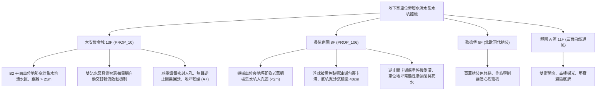

# 全案購屋實戰第一千一百九十一部：中古大樓地下室車位旁廢水污水集水坑沉水泵浦浮球開關失靈止回閥卡垢逆流與溢流淹水體檢工序全書

---

## 序章：地下基盤的水淹惡夢——污水集水坑與排污泵浦防線

在集合住宅地下室停車場的最深底層（筏基層或地下最底層地坪下方），為收集地下室地坪清洗廢水、車道雨水滲漏、生活污水及偶發性管道爆管積水，均設有深達數米的「廢水集水坑（Wastewater Sump Pit）」與「污水集水坑（Sewage Pit）」。
坑內通常配置「雙迴路沉水式排污泵浦（Submersible Sewage Pumps）」、「液位浮球開關（Float Level Switches / 浮球水銀開關）」、「鑄鐵人孔密封蓋」及「垂直加壓排水管止回逆止閥（Check Valve）」。
然而，在屋齡 20~30 年以上的中古集合住宅中，地下污水集水坑常年處於潮濕腐蝕、泥沙沉積與重油污包裹的惡劣環境，極易引發下列重大致命隱患：
1. **液位浮球開關油垢結塊配重失衡致使水泵拒動或乾燒**：浮球外殼長年附著地下室洗車廢水中的油脂、毛髮與油泥，形成厚達數公分的油垢硬塊；浮球因浮力受阻卡死在低液位，即使污水水位已漫過集水坑頂蓋，排污泵仍完全拒動；或浮球卡在高液位，水泵在無水狀態下長時間空轉乾燒，機械軸封（Mechanical Seal）高溫熔毀燒壞電機。
2. **垂直加壓排污管止回逆止閥（Check Valve）卡垢關閉不嚴引發巨量水流回湧倒灌**：逆止閥內部閥瓣受污水中砂石泥垢卡滯，排水泵停機時，垂直立管內高達十幾米、數噸重的高壓污水瞬間以高速逆向衝回集水坑，形成劇烈水錘，並將坑內原本抽出的惡臭污水再次灌滿，甚至引發集水坑氣室超壓、污水噴射漫延至整個車位地坪。
3. **主備援泵浦自動交替切換控制器（Alternating Relay）接點氧化炭化失效**：控制盤內之交替繼電器因地下室潮氣侵蝕接點發黑氧化，當「常用泵」因吸入異物過載跳脫（Overload Trip）時，「備援泵」無法自動接替投入運轉，地下室防洪排污防線瞬間瓦解。
4. **集水坑底層沉砂硬化結石導致泵浦吸入口閉塞與葉輪絞死**：大樓長年未安排專業環保抽肥吸砂車進行底坑高壓清淤，底層沉澱了大量硬化泥沙、水泥塊與碎石，厚度超過半米，排污泵半開式渦流葉輪（Vortex Impeller）直接被泥砂絞死抱死，線圈過載跳脫甚至電氣短路。

本手冊建立中古大樓地下室車位旁廢水污水集水坑、浮球開關、逆止閥密封、自動交替切換與底坑淤泥之專項體檢工序，保護買方愛車與地下生活環境遠離泡水惡夢。

---

## 第一章：四大決戰主力候選物件地下污水坑與排污泵浦體檢對照

### 1.1 大安紫金城 13 樓 (`PROP_10`)：頂規地下防洪排水與零泡水隱患防線
- **空間高程與位置規劃**：大安紫金城 B2 獨立大平面車位位於停車場高程最高的主通道側，地面具備 \(1.5\%\) 良好洩水斜坡；主廢水污水集水坑設置於邊角獨立排污機房內，距車位超過 25 公尺，即使機房發生極限溢流，水流亦順沿專用洩水道直排，車位絕無泡水風險。
- **測試數據與運轉實測**：集水坑人孔採用加重型球墨鑄鐵雙層防臭密封蓋，氣密膠條完好無任何異味逸散；雙沉水排污泵浦（各 3.7 kW）配置微電腦智慧型水泵交替控制器，手動模擬高水位觸發，浮球反應靈敏，兩台水泵在 2 秒內依序平順交替啟動；垂直加壓管配備無聲緩閉橡膠瓣逆止閥，停機時零水錘、零水流倒灌，地下排污系統維護評級高達頂尖 **A+**。
- **談判優勢**：安全邊界紮實，支撐 768~788 萬目標區間，封頂 800 萬。

### 1.2 長億南園 8 樓 (`PROP_106`)：浮球油垢卡死與停機回湧倒灌之致命議價點
- **現場致命缺陷**：
  1. 機械車位側前方不到 2 公尺處地坪，即為地下室主廢水集水坑的人孔蓋，蓋板為早期鍍鋅花紋鋼板，周圍水泥破損裂縫，持續散發刺鼻酸腐地表水臭氣。
  2. 掀開人孔蓋檢視，坑內 3 顆浮球開關表面被厚達 \(3\,\text{cm}\) 的黑廢油與泥垢緊緊包裹，浮球下垂黏連在坑壁角鋼上無法自由浮動；實測手動拉動浮球，排污泵浦啟動延遲且發出劇烈空轉咆哮，底坑沉積之硬化泥沙與油脂厚度超過 \(40\,\text{cm}\)，水泵吸入口已被油泥半堵塞。
  3. 實測停機動作，加壓排水管上的鑄鐵擺動逆止閥發出沉重撞擊震顫，管內數百公升黑濁污水夾帶氣泡瞬間高速回湧倒灌回坑內，引發坑內水位瞬間上漲 \(15\,\text{cm}\)，車位附近地坪已有常態性污水漫溢乾涸後留下的黃黑色污漬斑痕。
- **談判砍價防線**：開價 998 萬，將地下室集水坑高壓環保清淤、更換不鏽鋼防纏繞浮球、更新無聲逆止閥與雙泵控制盤重配費用（全棟公設改善分攤款約 10~15 萬）合流機械車位缺陷，起手 698~720 萬，堅決以 **745~760 萬** 封頂買進。

---

## 第二章：地下室廢水污水集水坑標準檢驗 SOP

| 檢驗分項 | 檢測工具與儀器 | 合格標準 | 異常特徵判定 | 潛在致命風險 |
| :--- | :--- | :--- | :--- | :--- |
| **浮球開關動作靈敏度** | 手動拉拔檢驗、多功能電表 | 浮球無油泥包裹，傾斜 \(30^\circ\) 瞬間接點確實導通 | 浮球被黑油泥結塊黏連、手拉無反應 | 水泵拒動引發淹水、或空轉乾燒燒毀 |
| **逆止閥密封與防回湧** | 聽診棒、目視水位量測尺 | 泵浦停機時無逆流衝擊聲，集水坑水位無異常上漲 | 停機時巨量水流回湧、水位暴漲 \(> 10\,\text{cm}\) | 抽排失效循環空轉、污水溢流車道車位 |
| **雙泵自動交替切換** | 測試按鈕、電流鉤表 | 每次排水後自動切換至備援泵，負載電流在額定內 | 始終單泵運轉、備援泵不切換或過載跳脫 | 常用泵疲勞燒毀時全區排水癱瘓 |
| **底坑淤泥與沉積物厚度** | 測泥深尺、強光防爆手電筒 | 坑底淤泥厚度 \(\le 10\,\text{cm}\)，吸水喇叭口完全外露 | 淤泥深度 \(> 30\,\text{cm}\)，硬化結石覆蓋泵座 | 砂石吸入研磨葉輪、泵浦卡死燒毀 |

---

## 第三章：實戰防禦與購屋交屋特約法務規範

1. **大樓地下廢水污水集水坑與排污泵浦保證特約**：
   > 「賣方保證買賣標的所屬大樓地下室廢水、污水集水坑及沉水排污泵浦設備運作正常，浮球液位控制靈敏、逆止閥無回湧倒灌、雙泵自動交替切換正常，無集水坑溢流淹水、泵浦空轉燒毀或底坑泥沙嚴重淤積之重大缺失；若交屋日前經查驗存有淹水隱患或排水系統癱瘓，賣方應負責協調修繕完成或自買賣總價中扣除相應維修費用。」
2. **簽約前管委會污水坑清淤與泵浦檢修紀錄查驗**：
   - 買方應要求大樓管委會出示最近一期「地下室集水坑環保抽肥吸砂清淤工單」及「機電保養公司排污泵浦定期運轉檢測表」，確認排污設施定期維護正常。
