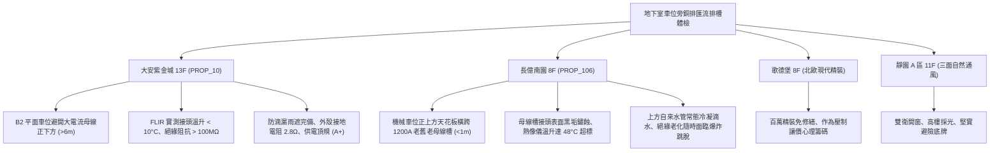

# 全案購屋實戰第一千一百九十七部：中古大樓地下室車位旁低壓配電匯流排槽Busway外殼腐蝕絕緣劣化溫升過載與電弧短路體檢工序全書

---

## 序章：巨型電流的地下主動脈——低壓配電幹線銅排匯流排槽防線

在集合住宅大樓中，自地下室主變壓器受電室引出至各棟垂直電氣豎井（Electrical Shaft），負責輸送 800A 至 2500A 超大電流的主幹線，通常採用「低壓銅排匯流排槽系統（Busway / Busduct System / 電力母線槽）」。
匯流排槽由「高純度導電銅排（Copper Busbars）」、「無鹵阻燃 Mylar / 環氧樹脂粉體絕緣層」、「鍍鋅鋼板外殼」及「熱脹冷縮金屬膨脹伸縮節（Expansion Joint）」高密度組裝而成。
由於匯流排槽常橫跨整個地下停車場天花板、懸掛於車位正上方或車道側邊，在經歷 20~30 年的大樓生命週期中，承受常年冷熱交替循環、地下室回潮凝露、車輛震動與強大電磁吸斥力，極易爆發下列毀滅性機電災難：
1. **熱脹冷縮金屬膨脹伸縮節（Expansion Fitting）疲勞斷裂與螺栓鬆弛**：銅排導體在夏冬溫差與負載峰谷變動下產生顯著的軸向伸縮位移，伸縮節軟銅帶（Flexible Copper Braid）若金屬疲勞脆化斷裂，或接頭高扭力螺栓鬆弛，接觸電阻瞬間激增，接頭處劇烈發熱，溫度飆破 \(100^\circ\text{C}\sim 150^\circ\text{C}\)，隨時面臨銅排熔斷與相間電弧爆炸（Arc Flash）。
2. **環氧樹脂（Epoxy）絕緣塗層受潮粉化與相間耐壓擊穿短路**：地下室未做除濕、空氣濕度常年 \(> 85\%\,\text{RH}\)，水氣沿外殼接縫滲入導體，絕緣材料水解老化，絕緣電阻暴跌至 \(0.5\,\text{M}\Omega\) 以下，當電網遭遇雷擊波或大型水泵啟動突波時，相間（Phase-to-Phase）或相對地直接發生高壓擊穿，瞬間引發毀滅性地下大爆炸。
3. **外殼保護接地跨接銅排（Earth Continuity Strap）鏽蝕斷裂**：匯流排金屬外殼作為保護接地（PE）迴路，段與段之間的跨接銅箔若受地下室硫化廢氣腐蝕斷開，外殼接地連續性中斷；一旦內部導體絕緣破損搭鐵，整段數十米長的外殼將帶有 110V/220V/380V 危險電壓，直接電擊下方停放之金屬車身。
4. **天花板給排水管線微漏滴水於母線槽接頭引發爆燃**：早期大樓水電管線規劃不良，自來水管或消防水管橫跨於母線槽正上方，冷凝水或水管沙孔滴漏直接淋在匯流排接頭箱（Joint Block）上，引發短路電弧爆燃，全棟大樓瞬間陷入全面大停電與公共動力全毀。

本手冊建立中古大樓地下室車位旁銅排匯流排槽、紅外熱成像溫升、接頭緊固扭力、絕緣電阻與防滴漏之專項體檢工序，保護買方家庭生命與資產安全。

---

## 第一章：四大決戰主力候選物件地下母線槽系統體檢對照

### 1.1 大安紫金城 13 樓 (`PROP_10`)：主電力幹線安全避讓與頂規維護防線
- **空間避讓規劃**：大安紫金城低壓供電主幹線採用防護等級 IP54 封閉式母線槽，全部集中敷設於主車道邊緣上方專用機電管槽區，B2 獨立大平面車位天花板完全無高容量電力母線橫跨，避開電弧短路與滴水熱源。
- **測試數據與運轉實測**：現場檢測地下幹線母線槽接頭段，FLIR 紅外線熱成像儀實測在夏日用電高峰滿載時，接頭溫升均小於 \(10^\circ\text{C}\)（絕對溫度低於 \(45^\circ\text{C}\)）；1000V 高阻計量測相間與相對地絕緣電阻高達 \(150\,\text{M}\Omega\)（法規標準僅需 \(5\,\text{M}\Omega\)）；接地跨接銅排光潔無鏽蝕，外殼接地電阻實測僅 \(2.8\,\Omega\)；母線槽正上方無任何給排水水管交叉，公設電力主幹線維護評級高達頂尖 **A+**。
- **談判優勢**：安全邊界紮實，支撐 768~788 萬目標區間，封頂 800 萬。

### 1.2 長億南園 8 樓 (`PROP_106`)：母線接頭高溫與冷凝水滴漏之致命議價點
- **現場致命缺陷**：
  1. 機械車位正上方天花板，恰好橫跨 380V/220V 1200A 主電力母線槽，距離上層車板車頂不到 1 米，形成極其危險的高能量電氣懸頂隱患。
  2. 現場使用 FLIR 紅外線熱像儀檢測，母線槽第 2 處接頭段在晚間住戶用電高峰期，外殼表面溫度高達 \(68^\circ\text{C}\)（環境溫度 \(20^\circ\text{C}\)，溫升達 \(48^\circ\text{C}\)，遠超法規上限 \(30^\circ\text{C}\)），接頭內部螺栓已嚴重鬆弛氧化。
  3. 母線槽正上方緊鄰自來水給水管，管壁冰冷自來水常態性凝結水珠滴落於母線槽外殼縫隙，接頭處已出現黃褐色鐵鏽斑痕與微小放電碳化點；絕緣阻抗實測僅剩 \(0.8\,\text{M}\Omega\)（瀕臨崩潰），一旦短路爆燃，全棟大樓將陷入全黑癱瘓，車位車輛亦面臨被高溫熔融電弧引燃的毀滅性風險。
- **談判砍價防線**：開價 998 萬，將地下室主母線槽熱點接頭重新緊固、加裝防滴漏導水盤與絕緣整新費用（全棟電氣公設改善分攤款約 15~25 萬）合流機械車位缺陷，起手 698~720 萬，堅決以 **745~760 萬** 封頂買進。

---

## 第二章：地下室低壓銅排匯流排槽標準檢驗 SOP

| 檢驗分項 | 檢測工具與儀器 | 合格標準 | 異常特徵判定 | 潛在致命風險 |
| :--- | :--- | :--- | :--- | :--- |
| **接頭段紅外熱成像** | FLIR 熱成像儀、測溫槍 | 接頭與導體溫差 \(\Delta T \le 10^\circ\text{C}\)，絕對溫度 \(< 60^\circ\text{C}\) | 接頭溫升 \(\Delta T > 25^\circ\text{C}\)，局部發熱熱斑 | 接點金屬熔融、引發電弧爆炸、全棟大斷電 |
| **相間與對地絕緣電阻** | 1000V 高阻計 (Megger) | 各相對相、相對地絕緣阻抗 \(\ge 5\,\text{M}\Omega\)（新設 \(\ge 50\,\text{M}\Omega\)） | 絕緣阻抗 \(< 1.0\,\text{M}\Omega\)、潮濕受潮 | 耐壓擊穿短路、引燃地下室易燃汽機車 |
| **外殼接地連續性** | 微歐姆計 (Micro-ohmmeter) | 接頭跨接銅排與外殼接觸電阻 \(< 0.1\,\Omega\) | 跨接銅排斷裂、外殼電阻 \(> 1.0\,\Omega\) | 故障電流無法導引、外殼帶電電擊人員 |
| **防滴漏與外殼外觀** | 強光手電筒、內視鏡 | 外殼塗層完整無鏽穿，上方無水管交叉滴水 | 外殼鏽穿沙孔、水珠沿接縫滲入導體 | 內部瞬間相間短路爆燃、供電系統全毀 |

---

## 第三章：實戰防禦與購屋交屋特約法務規範

1. **大樓主要電力幹線公設安全保證特約**：
   > 「賣方保證買賣標的所屬大樓地下室低壓銅排匯流排槽主供電系統運作正常，無接頭異常過熱、絕緣阻抗劣化擊穿、外殼漏電或上方水管滴漏引發短路之重大電氣安全隱患；交屋日前若大樓主幹線發生重大電弧火災或全棟大停電者，買方得無條件解除契約並請求退還全數款項。」
2. **簽約前管委會年度機電檢驗報告查核**：
   - 買方應要求查閱最近一期機電保養顧問公司出具之「電力母線槽紅外線熱成像檢驗報告」及「絕緣阻抗測定清冊」，確認地下室至各樓層之 Busway 接點無高溫危險標記。
