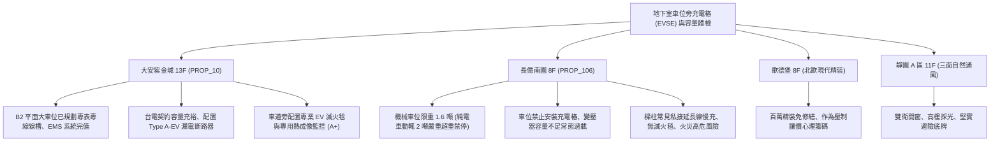

# 全案購屋實戰第一千一百九十三部：中古大樓地下室車位旁電動車充電樁EMS能源管理系統動態負載平衡失靈私設飛線偷電跳脫與鋰電池熱失控滅火體檢工序全書

---

## 序章：新能源時代的地下火藥庫——充電樁 EMS 與電動車消防防線

隨著電動汽車（EV）普及率急遽攀升，集合住宅地下室停車場普遍面臨住戶申請安裝「家用充電樁（EVSE / AC 慢充 7kW~11kW / DC 快充）」的強烈需求。
然而，20~30 年前的中古集合住宅在興建之初，其地下室總受電變壓器容量（KVA）與主電力母線，僅規劃傳統燃油車照明與抽水泵動力負載，完全未預留電動車數百安培的充電容量。
為解決變壓器過載跳脫問題，現代化大樓多強制要求引進「充電樁專用電錶（專表專線）」搭配「EMS 智慧能源管理系統（Energy Management System）」，實施動態負載平衡（Dynamic Load Balancing）。
然而，在管理鬆散或機電老化的中古大樓中，缺乏專業管理極易演變成地下室最可怕的公共安全危機：
1. **EMS 智慧能源管理系統動態調節失靈致使變壓器主斷路器（ACB）過載跳脫**：EMS 控制主機因地下室通訊斷線、電流互感器（CT）採樣漂移，當深夜數十台電動車同時全速充電、總電流超過變壓器安全極限時，EMS 無法在 0.5 秒內自動降流或輪流充電，致使大樓總配電盤空氣斷路器（ACB）瞬間過載跳脫，全棟陷入大停電。
2. **住戶私設飛線（Extension Cord）自車位照明箱偷電引發電線起火**：部分住戶為省下數萬元專線施工費，私自從車位旁公共插座或照明分電盤私拉花線、延長線對電動車慢充；照明迴路僅設計 15A~20A 負載，在長時間承受 16A~32A 連續滿載高溫下，PVC 電線外皮炭化分解，直接引燃地下室電氣火災。
3. **未設置獨立專用漏電斷路器（RCBO Type B / Type A-EV）引發直流漏電失靈**：電動車車載充電機（OBC）若發生直流漏電，傳統 AC 型或普通 A 型漏電斷路器會因直流偏磁（DC Saturation）而「磁飽和鎖死拒動」，漏電電流高達數十毫安培仍不跳脫，取車住戶碰觸充電槍或車身時面臨致命觸電危險。
4. **電動車動力鋰電池熱失控（Thermal Runaway）引發爆燃與缺乏專用滅火毯防護**：地下室若未配置耐千度高溫之「電動車專用防火滅火毯（EV Fire Blanket）」與高壓底盤滅火噴針，鋰電池包一旦內部短路熱失控，燃燒溫度高達 \(1000^\circ\text{C}\sim 1200^\circ\text{C}\) 並釋放劇毒氟化氫（\(HF\)）毒氣，傳統自來水或乾粉滅火器根本無法撲滅，相鄰停放之數十輛汽車將在數分鐘內陷入毀滅性連鎖火海。

本手冊建立中古大樓地下室車位旁充電樁 EMS 系統、配電容量、漏電斷路器與鋰電池火災應急防護之專項體檢工序，捍衛買方家庭生命財產安全。

---

## 第一章：四大決戰主力候選物件地下充電樁與電氣容量體檢對照

### 1.1 大安紫金城 13 樓 (`PROP_10`)：專表專線頂規 EMS 與綠能電車無障礙防線
- **電力容量與設施規劃**：大安紫金城社區管委會具備前瞻治理視野，地下停車場已由台電完成「電動車專表專線（專用電表箱與鍍鋅金屬線槽）」整體規劃，導入 EMS 智慧能源管理系統，契約容量充裕，住戶可合法申請安裝 11kW 智慧充電樁。
- **測試數據與安防配置**：B2 獨立大平面車位空間寬敞、承重無上限（休旅車與重型電動車隨意停放）；充電分路配置 Type A-EV（具備 \(6\,\text{mA}\) 直流漏電偵測）高靈敏斷路器；車道旁消防箱特別配置通過歐盟 EN 1869 認證之專業大型電動車滅火毯（尺寸 \(6\,\text{m}\times 8\,\text{m}\)，耐溫 \(1300^\circ\text{C}\)），公共電氣綠能與安防評級高達頂尖 **A+**。
- **談判優勢**：完整接軌未來 20 年純電車時代，享有極高資產保值溢價，支撐 768~788 萬目標區間，封頂 800 萬。

### 1.2 長億南園 8 樓 (`PROP_106`)：電車禁停、容量爆表與私拉飛線之致命議價點
- **現場致命缺陷**：
  1. 該戶配置之機械升降車位，承重極限標稱僅 1.6 噸；而現代主流純電動車（如 Tesla Model 3/Y、BMW i4 等）車重動輒 1.9 至 2.2 噸以上，若停入該機械車位，載車板鋼樑直接超載降伏彎曲、滾子鏈條隨時面臨斷裂墜車，長億南園管委會規約已明文「全面禁止純電車停放於機械車位」。
  2. 大樓變壓器為 25 年前老舊油浸式變壓器，夏季夜間全棟冷氣全開時負載率已達 \(92\%\)，電力容量完全飽和，台電禁止該社區增設充電樁專表專線；住戶若換購電動車，在自家車位完全無法充電。
  3. 現場勘查發現，鄰近柱面有住戶私自拆開公設壁插、懸掛廉價延長線替油電車充電，導線表面發燙（熱像儀測得 \(55^\circ\text{C}\)），且地下室未配備任何電動車專用滅火設備，一旦鋰電池起火，機械車位將直接化為立體立體燃燒鐵籠。
- **談判砍價防線**：開價 998 萬，將機械車位無法停放電車之轉手折價、公設電氣容量不足與私拉電線整改費用（實質折損資產價值約 25~35 萬）合流機械車位缺陷，起手 698~720 萬，堅決以 **745~760 萬** 封頂買進。

---

## 第二章：地下室電動車充電樁與配電安全標準檢驗 SOP

| 檢驗分項 | 檢測工具與儀器 | 合格標準 | 異常特徵判定 | 潛在致命風險 |
| :--- | :--- | :--- | :--- | :--- |
| **變壓器容量與 EMS 調節** | 智能電表後台、CT 電流鉤表 | 總負載在變壓器容量 \(80\%\) 內，EMS 於超載時 0.5 秒降流 | 負載率 \(> 95\%\)、EMS 無動態降流功能 | 總配電盤 ACB 跳脫、全棟大斷電 |
| **充電分路漏電保護** | 專業 EVSE 測試儀 (含 DC 6mA 注入) | 具備 Type A-EV 或 Type B 斷路器，6mA DC 0.3 秒內跳脫 | 採用普通 AC 型斷路器、DC 漏電時拒動鎖死 | 取車碰觸車身電擊傷亡、設備漏電燒燬 |
| **車位承重與純電車重** | 車輛行車執照、車位限重標牌 | 車輛總重 \(\le\) 車位結構標稱載重（平面車位無上限） | 車重（如 2.1 噸）遠超機械限重（1.6 噸） | 機械鋼樑彎曲變形、鏈條崩斷翻車砸爛 |
| **應急滅火毯與消防措施** | 尺寸丈量、耐溫認證標籤檢驗 | 配置 EN 認證高溫防滅火毯（\(\ge 6\times 8\,\text{m}\)，耐溫 \(1000^\circ\text{C}\)） | 無任何專用滅火毯、僅配備普通乾粉滅火器 | 鋰電池熱失控無法控制、波及全場車輛 |

---

## 第三章：實戰防禦與購屋交屋特約法務規範

1. **大樓車位電氣容量與電動車充電裝設保證特約**：
   > 「賣方保證買賣標的所屬大樓地下室停車場具備合法申請設置電動車充電樁之條件或已具備專表專線規劃，無管委會永久禁裝充電設備、變壓器容量長期爆表或公設電路私設飛線跳脫之重大安全爭議；若買賣標的車位為機械車位者，賣方保證明確揭露限重限高標準，無隱匿結構超載風險。」
2. **簽約前管委會規約之充電樁管理辦法查核**：
   - 買方應要求查閱社區「公寓大廈規約」中關於「電動車充電設備裝設管理辦法」及「用電安全責任切結書」，確認是否允許裝設自用充電樁及施工規範。
