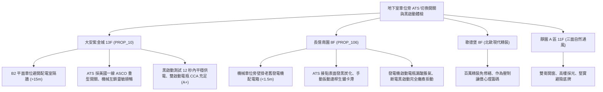

# 全案購屋實戰第一千一百九十二部：中古大樓地下室車位旁緊急發電機自動切換開關ATS機械互鎖卡死接點電弧燒結欠相與黑啟動失靈體檢工序全書

---

## 序章：生死交替的零點幾秒——自動切換開關 ATS 與黑啟動防線

在集合住宅大樓中，當遭遇強烈地震、颱風雷擊或台電電網突發大停電時，如何將大樓消防栓泵、自動撒水泵、排煙風機、緊急照明及緊急昇降機的供電來源，從「台電常規市電」瞬間切換至「柴油緊急發電機」，全靠安裝於地下發電配電室之「自動電源切換開關（Automatic Transfer Switch, ATS / 雙電源自動轉換開關）」。
ATS 本體由「常規市電側斷路器/接觸器」、「緊急發電機側斷路器/接觸器」、「機械與電氣雙重互鎖機構（Mechanical & Electrical Interlock）」及「微電腦 ATS 智能控制器」精密咬合構成。
依據消防法規與建築電氣標準，台電斷電時，發電機必須在 15 秒內完成「黑啟動（Black Start / 自體蓄電池啟動建壓）」並平穩投電，ATS 必須在 0.2 秒內完成切換且絕不允許發生市電與發電機兩路電源「逆向並聯短路（Reverse Backfeed）」。
然而，在屋齡 20~30 年以上的中古集合住宅中，地下室潮濕、發電機長年僅空載試車且 ATS 未曾實施全載切換試驗，極易引發下列毀滅性機電災難：
1. **機械連桿互鎖機構（Mechanical Interlock）受潮生鏽卡死導致切換拒動**：ATS 內部的鋼質滑動凸輪與互鎖連桿在地下室水氣與油污侵蝕下生鏽卡死；當台電斷電發電機建壓完畢後，切換驅動馬達扭力不足以克服生鏽卡滯，開關卡死在中間斷開位置，全棟大樓陷入一片死寂，所有消防排煙與滅火設施完全癱瘓。
2. **切換銅接點銀合金塗層受電弧燒蝕碳化引發欠相（Single-Phasing）**：ATS 在歷次切換或過載時產生的強烈電弧，使三相銅排接觸面嚴重燒蝕凹坑、氧化碳化；當切換至發電機側時，其中一相接點因接觸電阻過大無法導通，輸出電壓嚴重不平衡，導致地下室所有三相 380V/220V 消防水泵馬達在欠相狀態下通電，線圈電流暴增數倍，在數分鐘內全部憋燒燒毀。
3. **主接點金屬熔焊黏連（Contact Welding）引發雙電源相撞短路大爆炸**：若電氣與機械互鎖雙重失效，市電側接觸器因電弧高溫使銅接點瞬間熔化黏連在一起無法彈開；當發電機電源強行投入時，兩路異步異相交流電直接正碰，爆發千安培級毀滅性電弧短路爆炸，配電盤炸飛、引發全地下室電氣大火。
4. **柴油發電機啟動鉛酸蓄電池（Starting Battery）失水硫化致使黑啟動瞬間熄火**：發電機專屬啟動電瓶長年處於高溫浮充，電解液乾涸、內阻暴增；當停電瞬間發電機啟動馬達（Cranking Motor）索取 400A~800A 瞬時啟動大電流時，電瓶電壓瞬間雪崩跌破 6V，啟動馬達發出「喀喀」微弱跳動聲，柴油引擎根本無法盤車起轉，黑啟動徹底失敗。

本手冊建立中古大樓地下室車位旁 ATS 自動切換開關、接點熱成像、機械互鎖動作、發電機黑啟動與電瓶內阻之專項體檢工序，捍衛買方家庭生命財產與公設供電安全。

---

## 第一章：四大決戰主力候選物件地下 ATS 切換系統與黑啟動體檢對照

### 1.1 大安紫金城 13 樓 (`PROP_10`)：ATS 頂規雙重互鎖與極速黑啟動防線
- **開關規格與維護品質**：大安紫金城地下主配電室採用國際頂級品牌（美國 ASCO 或同級）PC 級重型自動切換開關（ATS），具備高短路耐受電流（Withstand Rating）與極速單電機快速驅動機構，實體機械互鎖機構光潔無鏽。
- **測試數據與運轉實測**：現場實施台電市電斷電模擬試驗，切斷市電後，柴油發電機在 3.5 秒內完成盤車點火黑啟動，8 秒內電壓頻率達到穩態（\(220\,\text{V}/60\,\text{Hz}\)），ATS 在第 11 秒精準快速切換投入供電，全過程平穩無電弧閃爍；FLIR 熱成像儀實測滿載接點溫升小於 \(6^\circ\text{C}\)；發電機配備雙組免維護鉛酸啟動電瓶，冷啟動電流（CCA）實測健康度達 \(95\%\)，緊急動力供電系統評級高達頂尖 **A+**。
- **談判優勢**：公設生命安防設施無懈可擊，支撐 768~788 萬目標區間，封頂 800 萬。

### 1.2 長億南園 8 樓 (`PROP_106`)：ATS 接點燒黑卡死與黑啟動徹底癱瘓之致命議價點
- **現場致命缺陷**：
  1. 機械車位旁立柱上懸掛早期老舊發電機控制配電箱，內部 ATS 為早期接觸器組裝型式，接點表面佈滿黑色電弧燒蝕凹坑與碳化粉塵，接觸電阻實測飆高達 \(0.15\,\Omega\)。
  2. 現場斷電檢視機械互鎖連桿，連桿關節處長滿赤紅鐵鏽，手動扳動釋放把手卡死咬住，切換機構根本無法靈活動作；一旦市電中斷，ATS 極易卡死在分斷位置或造成接點粘連相撞。
  3. 檢視發電機機房啟動蓄電池，兩顆 12V 100Ah 鉛酸電瓶外殼已嚴重鼓包脹氣，正負極柱覆蓋厚重白色硫酸鉛腐蝕結晶；以電瓶分析儀測試 CCA 僅剩不到原標稱的 \(20\%\)，現場嘗試黑啟動測試，發電機啟動馬達僅發出兩聲無力「喀喀」響隨即熄火停擺，大樓緊急應急供電防線處於「實質癱瘓狀態」。
- **談判砍價防線**：開價 998 萬，將地下室發電機 ATS 切換開關更換為 PC 級一體化防爆開關、更換專用啟動電池組與發電機油路大修費用（全棟公設改善分攤款約 12~18 萬）合流機械車位缺陷，起手 698~720 萬，堅決以 **745~760 萬** 封頂買進。

---

## 第二章：地下室 ATS 自動切換開關與黑啟動標準檢驗 SOP

| 檢驗分項 | 檢測工具與儀器 | 合格標準 | 異常特徵判定 | 潛在致命風險 |
| :--- | :--- | :--- | :--- | :--- |
| **黑啟動與供電時間** | 碼錶、電壓頻率多功能表 | 市電中斷後 15 秒內發電機平穩建壓投電完畢 | 啟動時間 \(> 30\,\text{s}\)、頻繁重啟或完全拒動 | 消防排煙泵浦斷電停擺、延誤滅火 |
| **ATS 接點紅外熱成像** | FLIR 熱成像儀、微歐姆計 | 滿載接點溫差 \(\Delta T \le 8^\circ\text{C}\)，接觸電阻 \(< 100\,\mu\Omega\) | 接點溫升 \(\Delta T > 25^\circ\text{C}\)，接點表面焦黑坑洞 | 接點高溫熔焊黏連、引起相間短路大爆炸 |
| **機械與電氣互鎖功能** | 手動操作扳手、斷電模擬裝置 | 兩側電源絕不同時閉合，機械鎖定死點清晰可靠 | 機械連桿生鏽卡滯、能手動同時按下兩路接點 | 雙電源相撞電弧爆炸、摧毀主變壓器 |
| **啟動電瓶 CCA 與內阻** | 專業蓄電池電導內阻測試儀 | 電瓶健康度 \(\text{SOH} \ge 80\%\)，內阻符合原廠規範 | 電瓶鼓包脹氣、極柱長滿白綠粉末、CCA \(< 50\%\) | 停電時無法盤車啟動、黑啟動徹底失敗 |

---

## 第三章：實戰防禦與購屋交屋特約法務規範

1. **大樓緊急發電機與 ATS 切換供電保證特約**：
   > 「賣方保證買賣標的所屬大樓地下室緊急發電機系統、自動切換開關（ATS）及啟動蓄電池設備運作正常，具備市電中斷後 15 秒內黑啟動自動切換供電機能，機械互鎖完好、無接點燒結黏連、欠相運轉或電瓶失效之重大電氣安全缺失；若交屋日前經消防或公安安檢列為重大不合格限期改善者，賣方應負責協調修繕完成或自買賣總價中扣除相應維修費用。」
2. **簽約前管委會發電機全載切換試車清冊查驗**：
   - 買方應要求大樓管委會提供近一期「緊急發電機定期帶載運轉紀錄」及「ATS 自動切換動作測試工單」，確認停電切換鏈條經實地演練合格。
