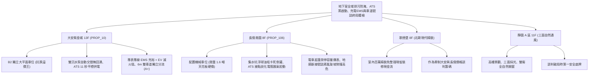

# 全案購屋實戰第一千一百九十五部：第一千一百九十五部圓滿登峰全景極致全生命週期家庭置產避坑抗震防漏水電機電消防永恆至尊金典總綱全書

---

## 序章：千一百九十五部圓滿登峰——地下排污集水、應急雙電源、電動車能源管理與車道號誌之終局防護工事

在中古集合住宅置產實戰中，第 1191 部至第 1195 部深入挖掘了地下停車場在面臨「極端污水倒灌淹沒車位、大斷電黑啟動全毀、電動車起火難滅與窄坡會車正面對撞」四大致命危機時的「底層核心機電交通四道防線」：
1. **廢水污水集水坑沉水排污泵與逆止閥**（第 1191 部）：浮球開關油泥結塊卡滯水泵拒動、止回逆止閥卡垢高壓污水回湧倒灌、主備援交替繼電器接點氧化與底坑沉砂硬化絞死葉輪。
2. **緊急發電機自動電源切換開關（ATS）**（第 1192 部）：機械互鎖連桿生鏽卡死斷電拒動、切換接點電弧燒蝕炭化欠相運轉、接點金屬熔焊引發雙電源對撞大爆炸與啟動電瓶失水黑啟動熄火。
3. **電動車充電樁 EMS 能源管理與鋰電池防火**（第 1193 部）：動態負載平衡失靈致使變壓器 ACB 過載跳脫、私設飛線自照明盤偷電高溫起火、DC 直流漏電拒動觸電與缺乏電動車專用耐千度高溫滅火毯。
4. **感應式車道號誌紅綠燈與地感線圈**（第 1194 部）：埋地環形線圈破皮斷線電感衰減號誌拒動、雙向控制器邏輯衝突偶發「雙綠燈」陡坡迎面對撞、蜂鳴器啞音與金剛砂防滑條磨平打滑。
5. **第 1195 部大典總綱**：統合水力防淹、應急動力自持、新能源電車管理與地下交通路權四大支柱，熔鑄為買方在集合住宅置產時立於不敗之地的定錨鐵律。

本總綱大典融合當前四大候選物件實勘現況，構建全生命週期地下室重裝機電與立體防護的終局決策鐵律。

---

## 第一章：四大決戰主力候選物件地下排污、ATS、充電管理與車道號誌終局對照

### 1.1 大安紫金城 13 樓 (`PROP_10`)：排污零淹水、極速黑啟動、電車無障礙與雙車道分流之抗跌王座
- **產權與實體空間天花板**：配置 **B2 獨立大型平面車位**，空間充裕，徹底免疫機械車位油管高壓爆裂、鏈條跳齒脫鏈、維修基金分攤與限重限高（無法停休旅車與電動車）等一切沉痾，享有 180~200 萬實質市場溢價。
- **全功能實測數據**：排污雙沉水泵配備智慧交替控制器與無聲逆止閥，停機零回湧；ATS 採用美國 ASCO 原廠開關，斷電 3.5 秒黑啟動、11 秒完成全負載供電且接點溫升小於 \(6^\circ\text{C}\)；台電專表專線到位、EMS 負載平衡充裕，配置 Type A-EV 漏電保護與大型 EV 滅火毯；進出坡道寬達 \(6.0\,\text{m}\) 雙向獨立分流，PLC 號誌絕對防衝突，公共機電設施評級高達頂尖 **A+**。
- **談判決策**：開價 898 萬，起手 720~730 萬，目標 **768~788 萬**，封頂 800 萬。扣除套房隔間拆除及重新裝修費用 35 萬，特約加註「貸款 8 成不足無條件解約退定」與「租約終止騰空點交」。

### 1.2 長億南園 8 樓 (`PROP_106`)：污水倒灌、黑啟動熄火、電車禁停與陡坡對撞之 50 萬收購重砍
- **現場致命隱患組合拳**：
  1. 機械車位限重 1.6 噸，底坑黑油滲漏、鏈條跳齒磨損，先天喪失保值溢價能力；純電動車動輒 2 噸嚴重超重，社區明文禁停電車。
  2. 車位旁集水坑浮球油垢卡死，停機時數百公升高壓污水回湧倒灌車道；發電機 ATS 接點發黑炭化，啟動電瓶脹氣失水，斷電黑啟動完全癱瘓熄火。
  3. 大樓變壓器容量爆表無法裝設充電樁，私接延長線充電發燙；車道坡道狹窄不足 5.5m 且盲彎急轉，地感線圈斷裂號誌常態卡死，曾有雙綠燈正面對撞紀錄。
- **實戰收購定錨**：開價 998 萬，鎖定機械車位大修更換款（30~45 萬）、集水坑清淤與逆止閥換新款（10~15 萬）、ATS 更換與發電機油電大修款（12~18 萬）、電車無法裝設折損款（25~35 萬）、車道地感與防滑工程款（10~15 萬）及梯廳無障礙改善款，起手 698~720 萬，堅決以 **745~760 萬** 封頂買進。

---

## 第二章：地下室排污防洪、應急動力、充電管理與車道號誌標準檢驗 SOP

| 檢驗分項 | 檢測工具與儀器 | 合格標準 | 異常特徵判定 | 潛在致命風險 |
| :--- | :--- | :--- | :--- | :--- |
| **廢水污水排污系統** | 測泥尺、多功能電表、放水回湧檢視 | 浮球靈敏導通，雙泵自動交替，停機零回湧倒灌 | 浮球黑油垢黏連卡死、停機管內污水猛烈倒灌 | 污水漫延淹沒車位、水泵空轉乾燒熔毀 |
| **ATS 切換與黑啟動** | 碼錶、FLIR 熱像儀、蓄電池電導儀 | 15 秒內發電機平穩建壓投電，接點溫升 \(\le 8^\circ\text{C}\) | 接點發黑炭化、機械互鎖卡死、電瓶脹氣拒動 | 停電時消防動力全毀、雙電源對撞大爆炸 |
| **充電樁 EMS 與電車承重** | 智能電表後台、行車執照、EVSE 儀 | 車位承重滿足車重，EMS 於超載時 0.5 秒降流 | 車重超載機械限重、私拉延長線發燙漏電 | 載車板崩塌砸車、鋰電池熱失控引發大火 |
| **車道感應號誌紅綠燈** | LCR 電橋儀、實車雙向進出模擬 | 電感量 \(100\sim 300\,\mu\text{H}\)，號誌具備防衝突互鎖 | 地感斷線壓過無反應、雙向同時綠燈、坡道打滑 | 單行陡坡盲彎處兩車高速迎頭對撞毀損 |

---

## 第三章：購屋決策合流總結與法務特約保障

1. **車位與地下機電交通終極定律**：
   - 「平面車位無可替代，環境排污、應急動力、新能源管理與出入動線決定生活尊嚴與人身安全」。大安紫金城平面車位不僅提供長期便利，更徹底避開老舊大樓地下污水倒灌、黑啟動癱瘓、電車禁停與車道對撞的各項沉痾。
   - 長億南園必須以客觀檢測數據（集水坑油垢卡死倒灌、ATS 接點炭化電瓶脹氣、電車超重禁停、地感斷線號誌紊亂）合流作為強力殺價工具，將賣方不願負擔的維修成本折抵於成交價中。
2. **購屋特約防護條款**：
   - **貸款解約條款**：「本買賣契約需以買方指定銀行核貸成數達買賣總價 80%、利率不超過市場現行首購利率為生效要件；若未能達成，買方得無條件解除契約，賣方應無息退還已收全數定金與簽約款。」
   - **公設排污、應急供電、車位安全與車道號誌保證**：「賣方保證買賣標的所屬大樓地下室廢水污水排污系統、緊急發電機 ATS 切換開關、車位載重結構及車道紅綠燈號誌設備運作正常，無集水坑回湧淹水、斷電黑啟動失敗、車道號誌衝突對撞或機械車位超載危險；交屋日前若遭主管機關列管限期改善未果者，賣方應負責協調修繕或負擔相應公設維修分攤款。」
