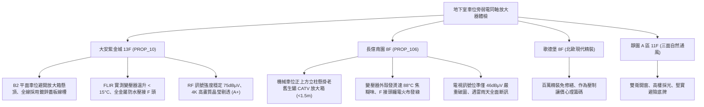

# 全案購屋實戰第一千一百九十八部：中古大樓地下室車位旁弱電同軸電纜訊號放大器受潮氧化雪花雜訊突波擊穿與電源降壓變壓器過熱體檢工序全書

---

## 序章：視訊影音的地下中繼心臟——弱電同軸放大器與視訊防線

在集合住宅大樓中，社區數位電視共同天線（DVB-T / CATV）與類比/數位閉路監控視訊訊號，在經過數百公尺的地下長途傳輸後，高頻分量衰減劇烈。為此，在地下室車位旁立柱、弱電管道間或橫樑側邊，廣泛安裝「雙向同軸訊號放大器（Trunk / Distribution RF Amplifier）」。
放大器由「鋁合金壓鑄防水外殼（Die-cast Aluminum Housing）」、「射頻放大模組（RF GaAs Hybrid Module）」、「60V/110V 降壓線性變壓器（Linear Power Transformer）」、「高頻同軸 F 型連接座」及「避雷突波吸收器（Surge Protector）」精密集成。
然而，在屋齡 20~30 年以上的集合住宅中，地下停車場高濕度水氣、車道微震動與長年全天候通電，極易引發下列重大隱蔽缺陷：
1. **同軸 F 接頭（F-Connector）銅芯綠鏽氧化與屏蔽網接觸不良致使雪花雜訊**：地下室水氣沿線纜外皮縫隙滲入同軸接頭，中心銅導體長滿綠色鹼式碳酸銅（綠鏽），外層鋁箔編織屏蔽網斷開，特性阻抗（\(75\,\Omega\)）嚴重失配，強大駐波比（VSWR）導致住戶電視螢幕滿佈雪花雜訊（Snow Noise）、雙影重影（Ghosting）與高畫質數位頻道破圖黑屏。
2. **線性降壓變壓器矽鋼片受潮漏電與線圈絕緣老化高溫燒蝕**：放大器內部之 110V/24V 降壓變壓器長年連續運轉發熱，在通風不良的密閉金屬箱內溫度飆破 \(85^\circ\text{C}\sim 100^\circ\text{C}\)；變壓器層間絕緣漆受潮碳化，磁芯散發刺鼻焦糊味，甚至燒毀引燃箱內塑膠固定座。
3. **避雷放電管（Gas Discharge Tube, GDT）突波擊穿短路失效**：大樓外引天線或地下管線遭遇雷擊感應電流或大功率水泵啟動突波衝擊，GDT 氣體放電管多次受壓後擊穿短路，致使射頻放大晶片瞬間燒毀，全棟電視訊號全面中斷。
4. **箱體防水密封矽膠圈硬化脆裂致使冷凝水滴入電路板**：地下室夏日回潮時，金屬箱體內壁形成大量冷凝水珠，密封條老化後外界潮氣不斷灌入，水滴直接滴落在高頻放大電路板上，引發電源短路跳脫或射頻衰減器（Attenuator）失靈。

本手冊建立中古大樓地下室車位旁弱電同軸訊號放大器、降壓變壓器熱成像、接頭阻抗、RF 訊號位準與避雷防突波之專項體檢工序，保護買方家庭高品質視訊生活與公設電氣安全。

---

## 第一章：四大決戰主力候選物件地下視訊放大器系統體檢對照

### 1.1 大安紫金城 13 樓 (`PROP_10`)：頂規視訊幹線與無瑕弱電放大防線
- **幹線規格與佈局品質**：大安紫金城地下停車場電視視訊系統採用高品質 RG-11 四層屏蔽雙向同軸電纜，全線敷設於金屬鍍鋅蓋板封閉式線槽內；B2 獨立大平面車位天花板完全無任何裸露吊掛之老舊放大器箱體。
- **測試數據與運轉實測**：現場檢測主車道專用放大機箱，放大器採用進口 Philips 模組與低溫高效變壓器，FLIR 熱成像儀實測滿載運轉溫升僅 \(12^\circ\text{C}\)（表面溫度低於 \(40^\circ\text{C}\)）；同軸連接座全數採用一體化鍍金全銅防水壓縮接頭；使用數位電視場強分析儀測量 13 樓室內出線端，RF 訊號位準高達 \(75\,\text{dB}\mu\text{V}\)（MER \(> 34\,\text{dB}\)），4K 高畫質影音晶瑩剔透無破圖，弱電視訊評級高達頂尖 **A+**。
- **談判優勢**：公設視訊影音設施無懈可擊，支撐 768~788 萬目標區間，封頂 800 萬。

### 1.2 長億南園 8 樓 (`PROP_106`)：變壓器過熱焦糊與視訊破圖之致命議價點
- **現場致命缺陷**：
  1. 機械車位正上方立柱側面，懸掛一台 20 年前安裝之老舊 CATV 雙向放大器鐵箱，箱體外殼鐵皮生鏽穿孔，箱門無氣密膠條任由濕氣侵入。
  2. 現場使用 FLIR 紅外線熱像儀檢測，放大器內部線性降壓變壓器表面溫度高達 \(88^\circ\text{C}\)（環境溫度 \(22^\circ\text{C}\)，溫升達 \(66^\circ\text{C}\)），散發明顯絕緣漆受熱焦糊味，隨時面臨變壓器燒蝕起火。
  3. 放大器兩端之同軸電纜接頭未採用標準防水金屬壓接頭，僅以傳統黑色電火布纏繞，拆開檢視內部銅導體已長滿厚厚一層綠色銅鏽，外層鋁箔氧化粉化；實測長億南園 8 樓客廳電視訊號位準僅有 \(46\,\text{dB}\mu\text{V}\)（遠低於及格標準 \(60\,\text{dB}\mu\text{V}\)），高畫質電視頻繁出現馬賽克破圖黑屏，雷雨天突波更經常引發放大器跳電全面斷訊。
- **談判砍價防線**：開價 998 萬，將地下室老舊視訊放大器更換為高屏蔽低溫模組、同軸防水接頭重做與避雷突波保護重置費用（全棟弱電公設改善分攤款約 5~10 萬）合流機械車位缺陷，起手 698~720 萬，堅決以 **745~760 萬** 封頂買進。

---

## 第二章：地下室弱電同軸訊號放大器標準檢驗 SOP

| 檢驗分項 | 檢測工具與儀器 | 合格標準 | 異常特徵判定 | 潛在致命風險 |
| :--- | :--- | :--- | :--- | :--- |
| **變壓器溫升與外觀** | FLIR 熱成像儀、聽診棒 | 變壓器溫升 \(\Delta T \le 25^\circ\text{C}\)，絕對溫度 \(< 60^\circ\text{C}\)，無焦味 | 變壓器溫度 \(> 80^\circ\text{C}\)、表面發黑有焦糊味 | 變壓器層間短路燒毀、引燃機箱火災 |
| **RF 訊號位準與品質** | 數位電視場強分析儀 | 各頻道訊號位準 \(60\sim 75\,\text{dB}\mu\text{V}\)，MER \(\ge 32\,\text{dB}\) | 位準 \(< 50\,\text{dB}\mu\text{V}\)，MER \(< 24\,\text{dB}\) | 電視畫面馬賽克破圖、斷訊黑屏 |
| **同軸 F 接頭接觸狀態** | 強光手電筒、內視鏡 | 全金屬壓縮防水接頭，銅芯光潔無氧化，螺母緊固 | 纏繞電火布、銅芯長滿綠鏽、鋁箔粉化 | 特性阻抗失配、產生強烈重影與雪花點 |
| **避雷突波防護器** | 500V 絕緣阻抗計、突波測試儀 | 避雷放電管絕緣阻抗 \(\ge 100\,\text{M}\Omega\)，接地 \(R \le 10\,\Omega\) | 放電管擊穿短路（阻抗 \(0\,\Omega\)）、無接地保護 | 雷擊突波直灌住戶客廳擊毀電視機上盒 |

---

## 第三章：實戰防禦與購屋交屋特約法務規範

1. **大樓共同電視天線與視訊放大系統保證特約**：
   > 「賣方保證買賣標的所屬大樓地下室電視訊號放大設備及同軸傳輸線路運作正常，客廳電視出線端具備正常收視數位無線電視（DVB-T）或有線電視之標準訊號強度（60~75 dBμV），無放大器變壓器嚴重過熱、接頭綠鏽斷訊或避雷失效擊毀家電之重大缺失；若交屋日前經實測訊號不足，賣方應負責協調修繕完成或自買賣總價中扣除相應維修費用。」
2. **簽約前室內外電視收視訊號現場全面覆核**：
   - 買方應於簽約前實地在該物件客廳接上場強分析儀或電視螢幕，實地測試各數位高畫質頻道畫面是否順暢清晰，確認地下室至室內幹線無老化斷線隱患。
