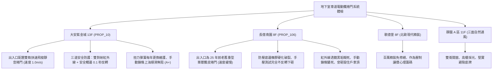

# 全案購屋實戰第一千一百九十六部：中古大樓地下室車位旁電動車道鐵捲門防壓安全底邊敏銳度衰退紅外線對射被油污遮擋手動鍊條卡死與扭力彈簧金屬疲勞體檢工序全書

---

## 序章：社區咽喉的重裝鐵閘——車道電動鐵捲門之出入安全防線

在集合住宅地下室停車場中，車道出入口之「電動車道鐵捲門（Vehicle Access Rolling Shutter Door / 快速鋁合金捲門）」是大樓管制外部可疑車輛、防範宵小闖入與防阻豪雨強風的第一道實體防線。
每日承受全棟數十至數百輛汽機車頻繁進出（日均啟閉次數高達 300~800 次），其運行頻率與機械負荷遠超一般住宅鐵捲門。
一套合規的車道鐵捲門主要由「加厚鋁合金/不鏽鋼簾片（Curtain Slats）」、「專用大功率開閉機馬達（Shutter Motor）」、「左右抗拉扭力彈簧（Torsion Balance Springs）」、「防壓安全底邊（Safety Pneumatic / Conductive Rubber Edge）」、「出入口對射式紅外線感應器（Photocell Safety Sensors）」及「停電緊急手動釋放鍊條（Manual Release Chain）」構成。
然而，在屋齡 20~30 年以上的中古集合住宅中，車道鐵捲門長年處於高頻運轉與缺乏原廠級大修，極易引發下列重大致命危機：
1. **防壓安全底邊（Sensing Edge）氣敏膠條硬化斷線與防砸反轉失靈**：捲門底樑之防夾橡膠條長年受地面泥水浸泡、車輪重壓與氧化侵蝕，內部氣動波紋管破裂漏氣或導電橡膠炭化斷線。當捲門在下降過程中，若下方有出庫車輛因坡道會車停滯或行人通過時，安全底邊無法在 0.15 秒內觸發反轉上升，重達數百公斤的鐵捲門底樑將以巨大衝擊力直接砸穿汽車車頂、砸碎後擋風玻璃，甚至將幼童壓成重傷致死。
2. **對射式紅外線光電開關（Infrared Beam Sensors）被車輛尾氣油污覆蓋失焦盲區**：車道兩側立柱離地 30~50 公分處安裝的對射紅外線，鏡頭表面被汽柴油廢氣黑油煙及蜘蛛網嚴重糊死，光束穿透率暴跌；遇到不同反射率之車身烤漆（如消光黑或深色車）時，光電開關無法感知車輛存在，捲門強行關閉下砸。
3. **平衡扭力彈簧（Torsion Springs）金屬疲勞斷裂致使捲軸失衡崩塌**：輔助馬達拉升捲門重量的扭力彈簧，在歷經數十萬次扭轉循環後產生微觀疲勞裂紋。一旦彈簧猝然斷裂，捲門重力全部轉嫁至開閉機齒輪箱，減速機瞬間崩齒，重型捲門如斷頭台般瞬間失控自由落體墜落砸毀車輛。
4. **停電手動釋放鍊條（Manual Chain）生鏽卡死與離合器打滑**：颱風或大地震引發大樓斷電時，若發電機未即時啟動，住戶逃生需靠手拉鍊條將捲門升起；老舊大樓鍊條長年暴露於出入口風雨中赤紅生鏽咬死，成年男子全力拉動仍紋絲不動，大樓車道出口完全被封死，住戶愛車被活活困在地下室。

本手冊建立中古大樓地下室車道電動鐵捲門、防壓底邊敏銳度、光電防夾、扭力彈簧與手動鍊條之專項體檢工序，保護買方家庭生命財產與愛車出入安全。

---

## 第一章：四大決戰主力候選物件地下車道鐵捲門系統體檢對照

### 1.1 大安紫金城 13 樓 (`PROP_10`)：快速飛梭靜音防砸頂規車道門防線
- **門體規格與運行速度**：大安紫金城地下停車場出入口全面升級為進口「快速靜音螺旋飛梭捲門（High-Speed Spiral Door）」，採用加厚發泡聚氨酯雙層鋁合金門板，啟閉速度高達 \(1.0\,\text{m/s}\)（傳統鐵捲門僅 \(0.15\,\text{m/s}\)），大幅縮短車輛等待時間，徹底避免尾隨入侵。
- **測試數據與安防實測**：車道門配備「三重主被動防夾安全機制」：門體兩側設置高低雙組紅外線對射光電網，底樑配置無線氣敏導電橡膠防碰底邊；現場使用模擬障礙物測試，底邊接觸障礙物瞬間在 0.1 秒內極速反轉回升至頂部；左右高強度扭力彈簧維持完整預緊度，運轉噪音低於 \(50\,\text{dB}\)；停電手拉鍊條順暢無阻（手拉力小於 \(12\,\text{kgf}\)），車道出入門禁設施維護評級高達頂尖 **A+**。
- **談判優勢**：出入安全無死角，支撐 768~788 萬目標區間，封頂 800 萬。

### 1.2 長億南園 8 樓 (`PROP_106`)：防壓底邊失靈、手動卡死與砸車前科之致命議價點
- **現場致命缺陷**：
  1. 長億南園地下車道出入口仍為 25 年前安裝之重型鍍鋅鐵皮捲門，開閉機運轉時發出如拖拉機般的刺耳金屬摩擦劇烈噪聲（噪聲高達 \(79\,\text{dB}\)）。
  2. 底樑防壓安全氣敏膠條已完全硬化斷裂脫垂，現場以軟質測試箱置於地面測試防夾反轉功能，捲門下壓時完全不停止、不反轉，持續強行下壓將測試箱直接壓扁切碎；且立柱紅外線光電感應器鏡頭被黑色油泥微粒覆蓋，光束嚴重衰減失效。
  3. 查閱管委會會議紀錄，該車道鐵捲門去年曾發生下限開關失靈猛烈下砸，直接砸凹一位住戶休旅車後車頂與後擋風玻璃，引發激烈管委會賠償糾紛；且手動釋放鍊條長滿赤紅鐵鏽，手拉完全卡死咬住，斷電時車輛根本無法出入。
- **談判砍價防線**：開價 998 萬，將地下室車道鐵捲門全面汰換為快速靜音防夾捲門、更新雙重紅外線對射與手動機構費用（全棟公設改善分攤款約 12~18 萬）合流機械車位缺陷，起手 698~720 萬，堅決以 **745~760 萬** 封頂買進。

---

## 第二章：地下室車道電動鐵捲門標準檢驗 SOP

| 檢驗分項 | 檢測工具與儀器 | 合格標準 | 異常特徵判定 | 潛在致命風險 |
| :--- | :--- | :--- | :--- | :--- |
| **防壓安全底邊反轉響應** | 測試專用軟質障礙物 (高 15cm)、碼錶 | 接觸障礙物 0.15 秒內停止並反轉回升 \(\ge 50\,\text{cm}\) | 持續下壓不停機、障礙物被壓扁破壞 | 砸毀汽車車頂、砸死壓傷通過之幼童住戶 |
| **對射紅外線遮光檢測** | 遮光測試板 (直徑 10cm)、強光電筒 | 阻斷光束瞬間（\(< 0.1\,\text{s}\)）捲門即刻停止並反轉 | 遮光無反應繼續下降、透鏡被黑油泥覆蓋 | 車輛駛經途中被捲門砸穿後車廂 |
| **停電手動拉鍊操作力** | 彈簧拉力計、手動操作試驗 | 手拉力 \(\le 15\,\text{kgf}\)，手動拉動能平順升起捲門 | 鍊條生鏽咬死卡死、手拉紋絲不動 | 斷電時大樓車道封死、愛車受困地下室 |
| **扭力彈簧外觀與平衡** | 內視鏡、探傷劑、扭力測量儀 | 彈簧表面無裂紋、無斷裂，斷電手動開門門扇不自由下墜 | 彈簧出現疲勞微裂紋、鏽蝕嚴重、門扇瞬間墜落 | 彈簧猝斷齒輪崩裂、重型捲門墜落砸扁車輛 |

---

## 第三章：實戰防禦與購屋交屋特約法務規範

1. **大樓車道電動鐵捲門安全防夾保證特約**：
   > 「賣方保證買賣標的所屬大樓地下室車道電動鐵捲門設備運作正常，防壓安全底邊及紅外線對射防夾感測靈敏，具備阻礙即刻反轉功能，手動釋放鍊條無生鏽卡死，無開閉機馬達過熱跳脫、扭力彈簧斷裂或曾砸毀車輛之重大安全缺失；若交屋日前經查驗存有砸車壓人隱患，賣方應負責協調修繕完成或自買賣總價中扣除相應維修費用。」
2. **簽約前管委會鐵捲門保養單據與事故紀錄查驗**：
   - 買方應要求大樓管委會提供近一年「車道電動鐵捲門定期維護保養單據」及「住戶出入公共意外責任險保單」，確認捲門定期受檢且安全底條功能正常。
