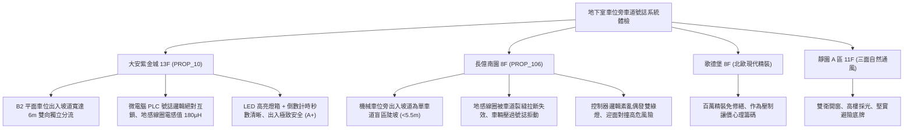

# 全案購屋實戰第一千一百九十四部：中古大樓地下室車位旁感應式車道號誌紅綠燈雙向車道控制器微波地感線圈衰減與主機邏輯衝突體檢工序全書

---

## 序章：地下車道的交通交警——車道號誌紅綠燈與地感線圈防線

在集合住宅地下室停車場中，由於受限於建築基地與開挖成本，車道出入口往往規劃為「單車道雙向通行（Single Lane Bidirectional Traffic）」或進出坡道盲區轉彎處。
為確保出庫與入庫車輛不發生在陡坡上迎面對撞或卡死於車道斜坡上，全靠安裝於車道兩端之「感應式車道紅綠燈號誌系統（Traffic Signal Control System）」掌控通行路權。
一套標準車道號誌控制系統由「埋設於地坪下方之環形地感線圈（Inductive Vehicle Loop Sensor）」、「微波雷達/紅外線車輛偵測器」、「雙向號誌微電腦邏輯主機（Bidirectional Signal Controller）」及「LED 紅綠燈箱/倒數計時顯示器」精密連動構成。
然而，在屋齡 20~30 年以上的中古集合住宅中，地下車道長期承受重車反覆碾壓、地坪環氧樹脂磨損與潮濕水氣侵蝕，極易爆發下列重大致命碰撞危機：
1. **埋地環形地感線圈（Loop Detector Coil）絕緣破皮搭鐵與電感量衰減**：環形線圈長年承受車輛輪胎重壓與地坪熱脹冷縮微裂縫拉扯，線圈外皮 PVC 破損搭鐵，電感量（Inductance \(L\)）大幅偏移基準值（正常應在 \(100\sim 300\,\mu\text{H}\) 之間），致使車輛壓過線圈時車輛檢測器（Vehicle Detector Module）完全無反應；出庫車輛進入車道斜坡時未能觸發號誌，對向車輛看到常態綠燈高速駛入，在狹窄盲區斜坡上迎頭對撞。
2. **雙向車道控制器（Traffic Controller）邏輯晶片受潮死機引發「雙向同時綠燈」或「永久雙紅燈」**：控制器微處理器（MCU）長年處於地下室濕熱環境，內部電容老化漏液、控制繼電器觸點炭化黏連，致使進出兩側車道燈箱同時亮起綠燈，兩端駕駛人同時踩油門加速衝入單行斜坡，在陡坡中央直接正面重擊撞毀車頭。
3. **車道號誌警示蜂鳴器（Audio Alarm Buzzer）壓電片碎裂啞音或夜間擾民**：車輛進出時應同步發出「嗶嗶」高分貝聲響警示步道行人；老舊蜂鳴器受潮氧化碎裂啞音，導致行人未察覺車輛衝出而遭撞擊骨折；或光敏定時控制器失效，深夜凌晨仍發出 \(85\,\text{dB}\) 刺耳警報，引發低樓層住戶集體神經衰弱抗議。
4. **斜坡防滑地坪（Epoxy / 金剛砂）標線磨損剝落與車道反光導標脫落**：車道號誌配合之地面停止線、導向箭頭磨損模糊，斜坡防滑條磨平，雨天輪胎打滑煞車距離暴增，即使看到紅燈亦無法及時煞停，直衝對撞車道鐵捲門或對向來車。

本手冊建立中古大樓地下室車位旁感應式車道號誌系統、地感線圈電感量、控制器邏輯判定與蜂鳴聲壓之專項體檢工序，保護買方家庭生命財產與愛車出入安全。

---

## 第一章：四大決戰主力候選物件地下車道號誌與出入安全體檢對照

### 1.1 大安紫金城 13 樓 (`PROP_10`)：寬幅雙車道分流與智慧號誌頂規防線
- **車道幾何與動線優勢**：大安紫金城地下停車場進出坡道採寬幅 \(6.0\,\text{m}\) 雙向獨立車道規劃，進出庫車流各自獨立分流，先天上徹底消除單行陡坡會車摩擦與會車倒退難題；B2 獨立大平面車位倒車出庫動線平整開闊。
- **測試數據與運轉實測**：車道轉彎盲區設置之智慧 LED 紅綠燈號誌系統，採用工業級 PLC 邏輯控制器，具備硬體與軟體雙重防衝突互鎖（Interlock）；地感線圈電感值實測穩定於 \(180\,\mu\text{H}\)（品質因子 \(Q > 15\)），車輛駛過 0.1 秒內精確觸發路權倒數計時顯示；燈箱表面無眩光、日夜照度自適應切換，出入動線安全評級高達頂尖 **A+**。
- **談判優勢**：安全邊界紮實，支撐 768~788 萬目標區間，封頂 800 萬。

### 1.2 長億南園 8 樓 (`PROP_106`)：盲區窄坡、地感斷線與雙向衝突之致命議價點
- **現場致命缺陷**：
  1. 長億南園地下停車場坡道寬度不足 5.5 米，且中間有一處近 \(90^\circ\) 之盲區急轉彎，完全依賴感應號誌引導單向輪流通行。
  2. 現場實測發現，坡道底部的環形地感線圈因車道混凝土結構開裂而被拉扯斷線，絕緣阻抗跌破 \(0.1\,\text{M}\Omega\)；車輛開至坡道下方等待出庫時，地感模組毫無感應，紅綠燈始終處於紅燈狀態，駕駛人被迫盲目強行開上斜坡。
  3. 查閱管委會維修日誌，該控制主機曾多次發生邏輯錯亂導致「兩端同時跳綠燈」，住戶車輛在盲彎處曾發生嚴重擦撞事故；且坡道金剛砂防滑條已完全磨平，雨天輪胎打滑尖叫，出入行車安全風險極高。
- **談判砍價防線**：開價 998 萬，將地下室車道地感線圈重新切割埋設、更換微電腦防衝突號誌控制器與重做車道防滑環氧砂漿費用（全棟公設改善分攤款約 10~15 萬）合流機械車位缺陷，起手 698~720 萬，堅決以 **745~760 萬** 封頂買進。

---

## 第二章：地下室車道感應號誌系統標準檢驗 SOP

| 檢驗分項 | 檢測工具與儀器 | 合格標準 | 異常特徵判定 | 潛在致命風險 |
| :--- | :--- | :--- | :--- | :--- |
| **地感線圈電感量與絕緣** | LCR 電橋測試儀、500V 高阻計 | 電感量 \(L = 100\sim 300\,\mu\text{H}\)，對地絕緣 \(\ge 10\,\text{M}\Omega\) | 電感量漂移、絕緣阻抗 \(< 0.5\,\text{M}\Omega\)（線路受潮搭鐵） | 車輛壓過不感應、出庫卡死在陡坡 |
| **控制器邏輯防衝突** | 實車雙向進出模擬測試、碼錶 | 絕對禁止雙向同時綠燈，路權切換具備 3~5 秒全紅緩衝 | 偶發雙向綠燈、或兩端永久卡死紅燈 | 陡坡盲彎處兩車高速正面對撞 |
| **LED 燈箱與秒數倒數** | 照度計、目視檢視 (距 20m) | 紅綠燈珠無死燈，白晝清晰可見、夜間無刺眼眩光 | 燈珠大面積熄滅、計時秒數亂碼跳動 | 駕駛人誤判路權衝入引發撞擊 |
| **坡道地面防滑與標線** | 擺式摩擦係數測定儀 (BPN) | 潮濕狀態下抗滑值 \(\text{BPN} \ge 55\)，停止線清晰完整 | 表面磨損光滑如鏡、\(\text{BPN} < 35\)，標線磨滅 | 雨天輪胎打滑失控、撞向鐵捲門或牆面 |

---

## 第三章：實戰防禦與購屋交屋特約法務規範

1. **大樓地下車道號誌控制與通行安全保證特約**：
   > 「賣方保證買賣標的所屬大樓地下室車道出入號誌紅綠燈、微電腦控制器及地面感應線圈運作正常，具備防衝突互鎖保護，無號誌失靈、地感斷線或雙向同時綠燈之重大安全隱患；若交屋日前經查驗存有出入通行危險或重大碰撞事故紀錄，賣方應負責協調修繕完成或自買賣總價中扣除相應維修費用。」
2. **簽約前尖峰時段地下車道實際會車動線查核**：
   - 買方應於平日上下班用電與車流尖峰時段，親自駕車由地下室往返地面，實地測試號誌感應反應速度與坡道會車視野盲區。
