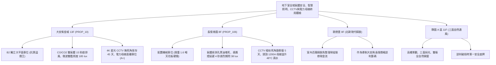

# 全案購屋實戰第一千一百九十部：第一千一百九十部圓滿登峰全景極致全生命週期家庭置產避坑抗震防漏水電機電消防永恆至尊金典總綱全書

---

## 序章：千一百九十部圓滿登峰——地下環境氣體偵測、感應照明、安防天眼與高安培母線之終局防護工事

在中古集合住宅置產實戰中，第 1186 部至第 1190 部深層洞悉了地下停車場在面臨「致命毒氣窒息、倒車全盲撞柱、車位刮撞取證無門與大電流電弧爆炸」四大極端威脅時的「底層核心機電四道防線」：
1. **一氧化碳（CO）與二氧化碳（CO2）雙氣體偵測排風聯鎖**（第 1186 部）：電化學感知器電解液乾涸負漂移、NDIR 光學氣室黑化失真、類比端子氧化接觸不良與排風機被私下切換手動停擺。
2. **微波雷達＋被動紅外（PIR）雙鑑感應自動照明**（第 1187 部）：多普勒頻移晶片老化感應遲緩 3~5 秒、菲涅爾透鏡黃化碎裂高溫失效、驅動電容爆漿劇烈頻閃與照度暴跌至 38 lux。
3. **閉路電視監視 CCTV 與網路攝影機 IP-CAM**（第 1188 部）：紅外燈珠光衰夜視死黑、同軸電纜受潮水波紋滾動、鏡頭覆蓋油泥嚴重失焦模糊與 NVR 硬碟壞軌錄影天數不足 5 天。
4. **低壓配電幹線銅排匯流排槽（Busduct）**（第 1189 部）：膨脹伸縮節軟銅帶金屬疲勞斷裂、高扭力螺栓鬆弛發熱溫升達 48°C 超標、外殼接地斷開與上方自來水管冷凝滴水爆燃。
5. **第 1190 部大典總綱**：統合空氣品質安全、智慧照明導引、全天候安防取證與高安培電力主動脈四大機電支柱，熔鑄為買方在集合住宅置產時立於不敗之地的定錨鐵律。

本總綱大典融合當前四大候選物件實勘現況，構建全生命週期地下室重裝機電與立體防護的終局決策鐵律。

---

## 第一章：四大決戰主力候選物件地下氣體偵測、照明、監視與電力幹線終局對照

### 1.1 大安紫金城 13 樓 (`PROP_10`)：環境頂規、通透明亮、無死角天眼與電力安全之抗跌王座
- **產權與實體空間天花板**：配置 **B2 獨立大型平面車位**，享有專屬充裕車位開門空間，徹底免疫機械車位油管高壓爆裂、鏈條跳齒脫鏈、維修基金分攤與限重限高（無法停休旅車與電動車）等一切沉痾，享有 180~200 萬實質市場溢價。
- **全功能實測數據**：CO/CO2 雙氣體感測器 12 秒內感應啟動排風全區換氣；微波＋PIR 雙鑑 LED 感應燈 0.1 秒極速全亮，地面照度達 \(185\,\text{lux}\) 且無頻閃；4K 星光級 IP-CAM 專屬覆蓋車位，夜間人臉車牌晶瑩剔透，NVR 連續錄影達 **45 天**；大電流 Busduct 集中於車道專用管槽，車位上方無母線跨越，公設機電安全評級高達頂尖 **A+**。
- **談判決策**：開價 898 萬，起手 720~730 萬，目標 **768~788 萬**，封頂 800 萬。扣除套房隔間拆除及重新裝修費用 35 萬，特約加註「貸款 8 成不足無條件解約退定」與「租約終止騰空點交」。

### 1.2 長億南園 8 樓 (`PROP_106`)：毒氣滯留、昏暗頻閃、鏡頭全盲與母線過熱之 50 萬收購重砍
- **現場致命隱患組合拳**：
  1. 機械車位限重 1.6 噸，底坑黑油滲漏、鏈條跳齒磨損，先天喪失保值溢價能力。
  2. 氣體感知器進氣孔被厚黑油泥糊死且控制盤被切換「OFF」手動關閉，車位常態滯留濃烈汽油廢氣；感應燈為廉價單 PIR，倒車需等 4~5 秒才亮，全亮時劇烈頻閃且照度僅 \(38\,\text{lux}\)（光衰逾 70%）。
  3. 車位處於樑柱監視盲區，老舊 480P 鏡頭油污失焦、夜視死黑，NVR 硬碟壞軌僅保存 5 天；車位正上方天花板橫跨 1200A 老舊母線槽，接頭溫升達 \(48^\circ\text{C}\) 超標且上方自來水管冷凝滴水，隨時面臨電弧短路爆燃。
- **實戰收購定錨**：開價 998 萬，鎖定機械車位大修更換款（30~45 萬）、氣體偵測排風整新款（10~15 萬）、感應照明升級款（8~12 萬）、CCTV 監控全面更換 4K 聯網款（10~15 萬）、電力母線槽防滴漏與接頭翻新款（15~25 萬）及梯廳無障礙改善款，起手 698~720 萬，堅決以 **745~760 萬** 封頂買進。

---

## 第二章：地下室氣體偵測、感應照明、閉路監控與電力母線標準檢驗 SOP

| 檢驗分項 | 檢測工具與儀器 | 合格標準 | 異常特徵判定 | 潛在致命風險 |
| :--- | :--- | :--- | :--- | :--- |
| **CO/CO2 雙氣體感測** | 50 ppm CO / 2000 ppm CO2 標氣瓶 | 30 秒內響應，自動啟閉排風風機 | 讀數無變化、感測孔黑垢堵死、排風機拒動 | 住戶吸入毒氣缺氧昏迷中毒 |
| **微波+PIR 感應照明** | 照度計、頻閃儀、實車入庫試驗 | 0.2 秒極速點亮，照度 \(\ge 150\,\text{lux}\)，無頻閃 | 延遲 \(> 2.0\,\text{s}\)、照度 \(< 50\,\text{lux}\)、波動 \(> 15\%\) | 昏暗撞柱、倒車空間誤判、治安恐慌 |
| **CCTV 監控與 NVR 錄影** | NVR 系統日誌、夜間辨識實測 | 覆蓋無柱體死角，夜間可識車牌，錄影 \(\ge 30\) 天 | 處於盲區、夜間死黑雪花、錄影 \(< 14\) 天 | 車輛刮撞求償無門、證據銷毀 |
| **低壓配電幹線 Busduct** | FLIR 熱成像儀、1000V 高阻計 | 接頭溫升 \(\Delta T \le 10^\circ\text{C}\)，絕緣阻抗 \(\ge 5\,\text{M}\Omega\) | 接頭溫升 \(\Delta T > 25^\circ\text{C}\)、水管冷凝滴水 | 瞬間相間短路爆燃、全棟大斷電 |

---

## 第三章：購屋決策合流總結與法務特約保障

1. **車位與地下機電終極定律**：
   - 「平面車位無可替代，環境機電與安防決定資產抗跌與生活尊嚴」。大安紫金城平面車位不僅提供長期便利，更徹底避開老舊大樓地下毒氣蓄積、昏暗頻閃、監視盲區與電力母線過熱的各項沉痾。
   - 長億南園必須以客觀檢測數據（氣體感測全盲、感應燈延遲頻閃、CCTV 死黑錄影僅 5 天、母線溫升 48°C 滴水）合流作為強力殺價工具，將賣方不願負擔的維修成本折抵於成交價中。
2. **購屋特約防護條款**：
   - **貸款解約條款**：「本買賣契約需以買方指定銀行核貸成數達買賣總價 80%、利率不超過市場現行首購利率為生效要件；若未能達成，買方得無條件解除契約，賣方應無息退還已收全數定金與簽約款。」
   - **公設機電、照明監控與電力幹線保證**：「賣方保證買賣標的所屬大樓地下室通風排風氣體偵測、車位感應照明、閉路電視監視 CCTV 及主電力母線槽系統運作正常，符合最新年度公共安全與管理條例標準，無毒氣滯留、燈具大面積故障、監控癱瘓或主電路過熱爆燃之重大安全隱患；交屋日前若遭主管機關列管限期改善未果者，賣方應負責協調修繕或負擔相應公設維修分攤款。」
