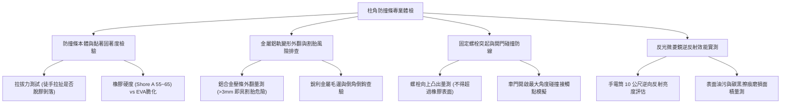

# 全案購屋實戰第一千一百二十一部：中古大樓地下室車位旁牆柱角防撞橡膠條脫膠下垂金屬鋁壓條外翻割胎與反光微菱鏡失效體檢工序全書

## 壹、緣起與車位旁立柱防撞護條之工學防禦意義

在中古大樓地下停車場中，承重柱（Column）與剪力牆（Shear Wall）是支撐整座建築物垂直載重與抗震韌性的命脈骨幹。然而，在車位停放、迴轉倒車動線中，這些堅硬的鋼筋混凝土（RC）柱角恰恰是車輛鈑金、前後保險桿、照後鏡與輪胎最常發生摩擦與撞擊的「硬接觸面」。

「車位旁牆柱防撞條（Corner Guard / Wall Protector）」正是為了在車輛擦碰時提供吸收動能彈性緩衝、保護車輛烤漆不留硬傷，同時保護結構柱粉刷層與表面 RC 不被碎解的「防護緩衝盾牌」。

然而，在屋齡二十年以上之社區，由於地下室潮濕、地坪反潮、汽車排放廢氣與車輛長期反覆擦碰，柱角防撞設施普遍出現嚴重的結構性衰退與物理危害：
1. **橡膠/EVA 本體老化、硬化與脫膠下垂**：早期施工若僅使用劣質強力膠或一般雙面膠黏貼，在地下室潮氣侵蝕下黏著劑徹底水解失效，整條重型橡膠護條自柱角脫膠向下垂掛，甚至橫躺於車位地坪上，妨礙倒車並容易捲入車底底盤。
2. **金屬鋁合金壓條變形外翻形成「割胎鋼刀」**：部分高檔社區採用「鋁合金軌道嵌入式橡膠防撞條」。當遭遇車輛擦撞後，內部金屬鋁壓條被強烈剪力扯出並向外翻起，形成一把銳利如刀的薄金屬倒鉤，車輛倒車入庫時極易直接刺穿輪胎胎側（Sidewall），引發立即性爆胎。
3. **固定鋼釘/膨脹螺絲鏽蝕拔出與刮傷車門**：用以固定防撞條之金屬螺絲鏽蝕斷裂，或因混凝土孔壁碎裂而凸出 1~2 公分，橡膠被扯掉後外露金屬尖頭，車主或乘客下車開門時直接撞上鐵螺栓，車門鈑金留下深層凹洞與見底刮痕。
4. **表面微菱鏡反光膜磨滅、沾滿黑油黑化失去夜間指引**：防撞條上的黃黑警示反光膜長年沾附柴油廢氣粉塵與輪胎擦撞碳黑，逆反射功能歸零，在昏暗地下室失去立柱輪廓提示功能。

本體檢工序全書專為高資產家庭置產實勘量身打造，將柱角防撞條之固著工法、鋁軌外翻安全性與反光度納入現場驗收，化為實戰議價砍價利刃。

---

## 貳、柱角防撞條四大核心檢測工序與病徵判讀

### 一、 防撞條材質、老化硬化與固著工法測試
- **檢測儀器**：蕭氏硬度計（Shore A）、強光手電筒、拉力檢驗鉤。
- **合格標準**：應採用高彈性環保天然橡膠（NR）或熱塑性彈性體（TPE），硬度應維持在 **Shore A 55~65 度**，具備優異吸震吸能特性；固定方式應為「膨脹螺絲＋耐水型結構膠」雙重固定。
- **病徵判讀**：
  - **EVA 泡棉粉化脆裂**：早期廉價 EVA 泡棉防撞條，經數年地下室廢氣浸潤，表面變硬脆化，一碰即碎解成粉末，完全失去吸震能力。
  - **整條脫膠垂掛**：僅靠雙面膠黏貼之護條，膠面長滿發霉黑斑並徹底喪失黏性，下半段垂落拖在地上，此現象在長億城與長億南園極為常見。

### 二、 鋁合金嵌入式軌道外翻與輪胎側壁割傷排查
- **檢測手法**：沿柱角由上至下（特別是高度 20~60 cm 輪胎胎壁高度區域）以強光側向照射，目視檢查金屬壓條是否扭曲外翻。
- **致命危害指標**：
  - **鋁合金壓條向外掀起超過 3 mm**：列為最嚴重紅色警戒！車輛倒車入庫時，輪胎側壁（最薄弱處僅 6~8 mm）貼柱倒車，外翻的金屬鋒口會像美工刀一樣切入胎壁，造成輪胎當場報銷爆胎。
  - **橡膠脫落露出金屬基座**：防撞橡膠被撞飛，只剩生鏽或變形的金屬固定條裸露在外，車身擦碰時直接產生金屬對金屬之毀滅性刮傷。

### 三、 螺栓外露突起與開門鈑金碰撞模擬
- **檢測手法**：
  1. 將車輛停妥於車位內，緩慢開啟駕駛座或副駕車門至最大開度或第二段卡位點。
  2. 觀察車門最外緣凸出點與柱角防撞條的接觸位置。
- **病徵判讀**：
  - 若車門邊緣正好撞擊在固定防撞條的外露生鏽螺栓頭上，車門烤漆將瞬間崩解見底，甚至造成鈑金凹陷（Door Ding）。
  - 合格防撞條之螺栓孔必須具備深層沉頭座，螺栓頭應低於橡膠表面至少 **5~8 mm**，且外層應覆蓋防塵防撞橡膠蓋塞。

### 四、 反光微菱鏡（Micro-prismatic）逆反射度檢驗
- **檢測手法**：於昏暗地下室以 1000 流明手電筒自距柱角 10 公尺處平視照射防撞條。
- **標準規範**：防撞條表面鑲嵌之黃黑警示條應採用 3M 工程級或鑽石級微菱鏡反光膜，在車燈照射下呈現明亮晶黃色；若反光膜磨光、表面覆蓋厚厚一層黑油碳黑，在地下室倒車視線死角中，駕駛極易誤判柱距而撞柱。

---

## 參、四大主力考慮名單柱角防撞條特檢分析

| 評估項目 | 大安紫金城 13 樓 (`PROP_10`) | 長億南園 8 樓 (`PROP_106`) | 歌德堡 8 樓 | 靜園 A 區 11 樓 |
| :--- | :--- | :--- | :--- | :--- |
| **防撞條材質規格** | **高彈性厚型天然橡膠（厚 15mm，圓弧倒角防撞）** | **劣質薄片 EVA 泡棉（已脆化破裂粉化）** | 鋁合金軌道厚橡膠防撞條 | 圓弧橡膠防撞護條 |
| **固著狀況與外觀** | **不鏽鋼沉頭螺絲 + 結構膠，緊密貼合柱面** | **脫膠下垂，下半截懸空垂在地上沾滿黑泥** | 鋁合金軌道固定穩固 | 膨脹螺栓固定良好 |
| **金屬外翻與割胎風險** | **無金屬壓條，一體成型橡膠，零割胎風險** | **固定鐵釘鏽蝕外凸 15 mm，宛如柱邊暗器** | 鋁壓條平整無外翻，橡膠完整 | 平整安全無外露鐵件 |
| **開門碰撞緩衝** | **獨立大車位靠柱處預留 50 cm，開門碰觸全橡膠** | **車位緊貼柱子，開門直接敲中生鏽外露鐵螺絲** | 開門有橡膠緩衝 | 開門間距合宜 |
| **反光警示條** | **3M 高強級微菱鏡黃黑警示帶，反光晶亮純淨** | **無反光膜，灰暗一片，滿是車身磨損烤漆痕** | 反光膜清晰 | 反光膜良好 |
| **總結防線評級** | 🌟🌟🌟🌟🌟 **極致頂規 A+** | ⚠️ **車損與割胎高風險 F 級（談判重磅砍價）** | 🌟🌟🌟🌟 良好 A 級 | 🌟🌟🌟🌟 良好 A 級 |

---

## 肆、談判終極砍價與合約防禦特約條款

### 一、 長億南園 8 樓議價砍價刀法（抓死防撞條脫膠、外凸鐵釘刮車門與割胎威脅）
長億南園車位旁柱角防撞條脫膠垂掛、固定鐵釘凸出 1.5 公分且沾滿鄰車刮痕，車門開門必撞鐵釘，倒車更有割胎風險：
- **修復與重置預算**：
  1. 廢棄脆化泡棉及生鏽鐵釘拔除清理、柱角 RC 裂縫修補：\$8,000 元。
  2. 重新安裝重負荷一體成型厚型天然橡膠防撞條（長 120cm $\times$ 厚 15mm $\times$ 雙邊寬 10cm，含深沉頭不鏽鋼錨栓與 3M 高反光黃黑警示條）：\$6,000 元/支 $\times 2$ 支 = \$12,000 元。
  3. 車位旁地坪除膠與高壓清洗：\$5,000 元。
  4. 潛在車門開門刮破見底烤漆鈑金修復折讓：\$25,000 元。
- **談判實戰口訣**：
  > 「周小姐、賣方大哥，長億南園這格車位旁邊的柱子，防撞條早就爛掉掉在地上，柱角上一排生鏽的鐵釘凸出來一公分半！我車門開下去第一段，直接敲在這根鐵釘上，門邊烤漆當場見鐵生鏽。而且倒車只要稍有不慎，輪胎胎壁直接被這根生鏽暗刺刺破爆胎！這種充滿陷阱的車位，我們買方接手要全部敲掉、修補柱角並換裝頂級橡膠防撞條。開價 998 萬如果不把這 5 萬塊的修復與車損風險折讓掉，每天開車出門都要提心吊膽。我們出價 745 萬是真正誠心買屋的公道底價！」

### 二、 成交通用特約防禦條款
> **【成交通用特約防禦條款】**
> 1. **車位相鄰柱面防撞設施安全點交**：賣方保證本買賣標的車位旁相鄰之承重柱及牆面防撞護條結構完好、固定穩固，無金屬尖銳物外翻、脫膠垂掛或螺栓突出妨礙車輛停放與開門安全之情事；若點交時有鐵釘突出或防撞條毀損，賣方應於交屋日前負責拔除修平並換新，或由賣方補貼新台幣 10,000 元由買方自理。
