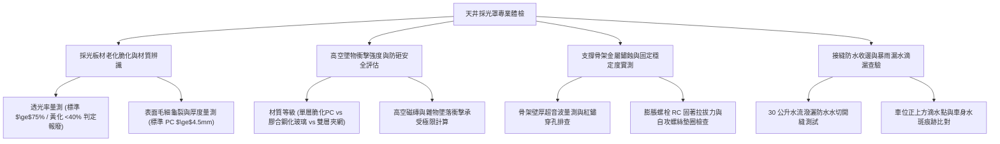

# 全案購屋實戰第一千一百二十七部：中古大樓地下室車位旁通風採光天井底層採光罩PC耐力板老化脆化黃化破裂漏水與高空墜物防砸體檢工序全書

## 壹、緣起與天井底層採光罩之防護盾牌意義

在中古大樓地下室或一樓中庭連接地下停車場的通風採光天井底部，為了兼顧漫射採光、阻隔雨水飄入並防止上方高樓層住戶或中庭雜物掉落，「採光罩（Canopy / Skylight）」扮演著不可或缺的「透明物理防護盾牌」。

特別是位於車位正上方或緊鄰車位進出動線的天井採光罩，其下方停放著價值數百萬元的家庭私家車輛，每天有人員進出上下車。若採光罩發生破損，輕則雨水如瀑布傾瀉沖刷車身地坪，重則高空墜物穿透採光罩直接砸毀車頂玻璃，甚至危及住戶人身生命安全。

然而，在屋齡二十年以上之社區，傳統天井採光罩普遍採用早期廉價的「聚碳酸酯（PC）單層耐力板」或「中空陽光板」，在長年紫外線（UV）曝曬、酸雨腐蝕、熱脹冷縮與落葉堆積下，面臨嚴重的物理脆化與毀滅性破壞：
1. **PC 耐力板表面 UV 塗層耗盡、黃化霧化與嚴重脆化**：早期 PC 板若未具備雙面共擠 UV 防紫外線塗層，經陽光曝曬 5~8 年後，材料分子鏈斷裂，板材由透明轉為焦黃發黑，衝擊強度衰退超過 90%，變成人手一按即脆裂如蛋殼之危險廢材。
2. **高空拋物衝擊穿透風險（花盆、寶特瓶、磁磚砸穿）**：高樓層住戶陽台盆栽、修繕掉落工具、甚至外牆剝落之丁掛磁磚自十幾層高空重力墜落（動能可達數百至上千焦耳）。已脆化之 PC 板毫無抗衝擊韌性，直接被貫穿砸入地下室車位，造成停放車輛天窗粉碎、板金全毀。
3. **金屬鋁合金/黑鐵骨架鏽蝕穿孔與固定自攻螺絲鬆脫**：採光罩支撐骨架若採用黑鐵烤漆，在天井常年潮濕下內部鏽蝕爛空；固定 PC 板之自攻螺絲橡膠墊圈（EPDM Washer）老化炭化，強陣風吹拂時整片 PC 板向上掀起噴飛，宛如高空飛刀。
4. **板材接縫水切收邊耐候膠老化脫膠與暴雨開縫漏水**：板與板之間的鋁壓條與矽利康防水膠長年熱脹冷縮拉扯，產生 5~10 mm 之巨大開縫，暴雨時雨水順著骨架直接垂直滴漏在車位正中央，長期滴漏在車漆表面形成洗不掉的頑固「水斑與碳酸鈣結晶（Water Spots）」。

本體檢工序全書專為高資產家庭置產實勘量身打造，將車位旁天井採光罩之板材材質、耐衝擊安全係數、骨架鏽蝕度與防漏密封性納入現場驗收，化為實戰議價砍價利刃。

---

## 貳、天井採光罩四大核心檢測工序與病徵判讀

### 一、 板材材質鑑別、黃化脆化度與透光率實測
- **檢測儀器**：高精度透光率計、超音波厚度計、高流明探照燈。
- **合格標準**：現代安全採光罩應採用 **$5\text{ mm} + 5\text{ mm}$ 雙層膠合鋼化安全玻璃（含 PVB 防爆膜）** 或 **至少 $4.5\text{ mm}$ 頂級抗 UV 實心 PC 耐力板**；透光率應 $\ge 75\%$，表面平滑無微裂紋。
- **病徵判讀**：
  - **廉價薄片 PC 板（厚度僅 2~3 mm）**：常見於老舊社區二次改裝，用手指輕彈發出清脆碎裂聲，表面布滿如蜘蛛網般的微細龜裂（Crazing）。
  - **黃化度過高（透光率 $\le 40\%$）**：板材呈茶褐色或焦黃發黑，代表內部高分子鏈已完全降解脆化，徹底喪失韌性，隨時可能破裂。

### 二、 高空墜物衝擊防禦力與防砸安全係數評估
- **防砸等級判別標準**：
  1. **危險 F 級（單層脆化老舊 PC 板）**：高空掉落一枚半滿寶特瓶或小石子即可穿透，毫無人車防護力。
  2. **合格 C 級（全新厚型 4.5mm PC 耐力板）**：可承受小型工具掉落，但對大塊磁磚衝擊仍有破裂風險。
  3. **頂規 A+ 級（$5+5\text{ mm}$ 膠合鋼化玻璃）**：即使遭外牆大塊石材砸中，玻璃雖呈蜘蛛網碎裂，但 PVB 膠膜牢牢黏附不掉落，完全阻隔異物砸入車位！
- **現場檢查要點**：
  - 探照燈照射採光罩頂部，檢查是否有上方掉落之枯木、碎磁磚或丟棄雜物卡在採光罩上方未清；若採光罩頂已有明顯凹陷裂痕，證明該處是「高空墜物熱區」，危險指數極高！

### 三、 骨架金屬鏽蝕、自攻螺絲固定與結構晃動排查
- **檢測手法**：
  1. 觀察採光罩骨架主樑與橫樑（特別是埋入 RC 牆面處之固定底座）。
  2. 使用檢查桿輕頂骨架，測試結構是否有晃動位移。
- **致命危害指標**：
  - 黑鐵方管骨架底部嚴重生鏽，銹皮層層剝落，金屬管壁厚度已鏽穿掏空超過 $40\%$。
  - 固定自攻螺絲全數鏽成紅褐色，螺絲下的防水橡膠墊圈已粉化消失，螺絲在螺孔中鬆動搖晃，強颱過境時整頂採光罩隨時會被掀翻砸落。

### 四、 接縫矽利康老化、水切收邊開裂與車位滴水實測
- **檢測手法**：自上方中庭以 30 公升清水均勻潑灑於採光罩上方接縫處，於地下室車位下方觀察滲漏狀況。
- **病徵判讀**：
  - 接縫鋁壓條之耐候中性矽利康發霉黑化、脫膠開裂，雨水順著骨架滴在車位正上方，形成常年「滴水穿石」水滴點。
  - 長期滴漏含有游離石灰與酸性鏽水之水滴，滴落在車輛引擎蓋或天窗上，高溫烘烤後在透明金屬漆上形成永久性凹陷「蝕刻斑（Paint Etching）」，即使全車重度美容拋光亦無法去除，必須整片重新烤漆。

---

## 參、四大主力考慮名單天井採光罩特檢實測分析

| 評估項目 | 大安紫金城 13 樓 (`PROP_10`) | 長億南園 8 樓 (`PROP_106`) | 歌德堡 8 樓 | 靜園 A 區 11 樓 |
| :--- | :--- | :--- | :--- | :--- |
| **採光罩板材規格** | **$5+5\text{ mm}$ 雙層膠合鋼化安全玻璃（含 PVB 防爆膜）** | **舊式 2mm PC 單層耐力板（嚴重黃化焦黑脆化）** | 4.5mm 綠半透抗 UV PC 板 | 5+5mm 膠合安全玻璃 |
| **高空防砸安全性** | **極致防砸 A+ 級，可抵擋 10kg 重物高空墜落** | **蛋殼級 F 級，人手一壓即碎，毫無防砸能力** | 良好抗衝擊力，無破孔 | 防砸安全性能佳 |
| **骨架鏽蝕度** | **SUS304 不鏽鋼厚壁方管，歷久彌新零紅鏽** | **黑鐵管骨架多處鏽穿凹陷，鏽粉直落車位** | 鋁合金陽極處理骨架穩固 | 不鏽鋼結構牢固 |
| **自攻螺絲與墊圈** | **不鏽鋼沉頭螺絲 + 雙層抗候 EPDM 墊圈緊密密封** | **鐵螺絲鏽蝕斷頭 6 處，墊圈粉化，強風劇烈晃動** | 螺絲固定完好，墊圈正常 | 螺絲緊固無鬆脫 |
| **接縫漏水與水斑** | **全新陶熙耐候矽利康密封，零滴漏，車位極致乾燥** | **接縫大裂開，暴雨如水簾，車位滿是碳酸鈣白水斑** | 防水接縫平整無漏水 | 排水流暢無滲漏 |
| **總結防線評級** | 🌟🌟🌟🌟🌟 **極致頂規 A+** | ⚠️ **高空砸車與車漆毀損高危 F 級（談判重磅砍價）** | 🌟🌟🌟🌟 良好 A 級 | 🌟🌟🌟🌟 良好 A 級 |

---

## 肆、談判終極砍價與合約防禦特約條款

### 一、 長億南園 8 樓議價砍價刀法（抓死採光罩脆化如蛋殼、高空墜物砸車與暴雨滴水斑）
長億南園車位旁天井採光罩為脆化 2mm 老舊 PC 板、黑鐵骨架鏽穿、自攻螺絲斷頭且暴雨大漏水，車位正對滴水點形成嚴重車漆腐蝕危機：
- **修復預算與工程重置成本**：
  1. 拆除危險老舊脆化 PC 板與廢棄鏽蝕黑鐵骨架清運：\$20,000 元。
  2. 全新配置高強度 SUS304 不鏽鋼方管結構支撐骨架（含化學錨栓深植固定）：\$65,000 元。
  3. 換裝 $5\text{ mm} + 5\text{ mm}$ 雙層膠合鋼化防爆安全玻璃（含一級耐候結構矽利康密封）：\$85,000 元。
  4. 車位正上方車輛引擎蓋遭鏽水與碳酸鈣滴漏蝕刻之全車局部重烤漆補償：\$25,000 元。
- **談判實戰口訣**：
  > 「周小姐、賣方大哥，長億南園這格車位頭頂上的天井採光罩，早就曬到發黑發脆像蛋殼一樣，黑鐵骨架鏽到穿孔掉鐵屑，螺絲斷了六七根，風大一點整個採光罩都在震動！樓上要是掉下一塊磁磚或一個花盆，直接打穿採光罩砸爛我車頂天窗。而且下大雨的時候，接縫漏水像瀑布一樣滴在車位正中間，地上全是厚厚一層白色的碳酸鈣水垢，新車停在那裡一個禮拜烤漆金油層全部被鏽水咬死報銷。這種採光罩管委會不換，我們買方接手要全部拆掉換裝安全膠合玻璃和不鏽鋼骨架，少說要花 17 萬。開價 998 萬如果不把這 12 萬塊的安全隱患直接折掉，誰敢把價值上百萬的車子停在隨時會被砸穿滴爛的危險車位？出價 745 萬是真正願意幫屋主承擔風險的公道底價！」

### 二、 成交通用特約防禦條款
> **【成交通用特約防禦條款】**
> 1. **車位上方採光罩結構防護點交**：賣方保證本買賣標的車位所屬區域上方之採光罩、採光天窗及棚架結構穩固安全，無板材破裂穿孔、骨架嚴重鏽蝕掏空、固定螺栓脫落或遇雨滴漏水情事；若點交時有採光罩破漏危及車輛停放安全，賣方應負責於交屋日前修復完竣，或由賣方補貼修復費用新台幣 30,000 元由買方自交屋尾款中扣除。
