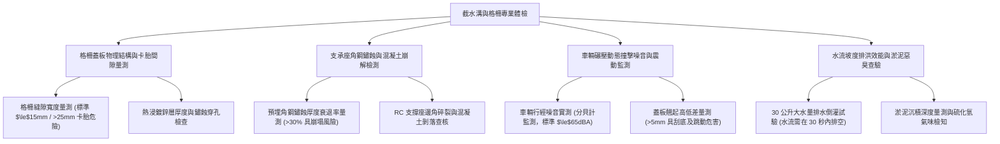

# 全案購屋實戰第一千一百二十三部：中古大樓地下室車位旁低窪截水溝蓋板間隙過大卡胎異音沉積淤泥惡臭與暴雨回湧倒灌體檢工序全書

## 壹、緣起與車道車位旁截水溝之水文防禦核心意義

在中古大樓地下室整體排水系統中，「車道與車位截水溝（Trench Drain / Interceptor Ditch）」是阻絕地表暴雨倒灌、承接洗車廢水及排除地下室冷凝水與微滲水的「第一道物理防禦壕溝」。特別是在車道斜坡底端、車位進出切角處，截水溝橫跨整個路面，肩負著重大的水力排洪與結構支撐任務。

然而，在屋齡二十年以上之社區，截水溝面臨極其嚴苛的車重碾壓動載重、污泥沉積與潮濕氧化，普遍出現嚴重的機能衰退與公共危險：
1. **溝蓋板間隙過大、跳動異音與卡死輪胎（卡胎陷阱）**：截水溝格柵（Grating）若規格不合或長年受車輛重壓，固定邊角角鐵變形磨損，兩塊蓋板間隙超過 20~30 mm。當車輛輪胎行經時，輪胎極易卡入格柵縫隙中造成胎皮撕裂甚至爆胎；車輛碾壓時更發出如同打雷般的巨大金屬撞擊聲（$80\sim 95\text{ dBA}$），造成低樓層住戶與地下室嚴重噪音公害。
2. **鍍鋅層磨損鏽蝕穿孔與角鋼支承座崩解斷裂**：水溝兩側預埋於 RC 樓板的支承角鋼受污水長年浸泡腐蝕，鏽蝕膨脹將周邊混凝土擠裂崩落。當重型休旅車或小貨車壓過時，支承角鋼瞬間斷裂，整塊重達數十公斤的鑄鐵蓋板翻轉塌陷，導致車輛底盤直接「卡死底切」，變速箱油底殼與懸吊臂瞬間報廢。
3. **長期淤積黑黏泥油垢引發病媒蚊孳生與惡臭撲鼻**：截水溝微坡度不足或清潔維護不善，沉澱了多年洗車油污、泥沙與枯枝落葉，形成發酵黑黏泥，散發出刺鼻的硫化氫惡臭，並成為地下室蚊蟲、蟑螂大量繁殖的溫床。
4. **排水坡度反向與排水孔堵塞引發暴雨「回湧倒灌」**：當逢極端強降雨時，若沉砂池或抽水泵浦吸水口被淤泥堵塞，截水溝非但無法排水，反而因水壓逆流變成「湧泉噴水孔」，污水溢流漫延至鄰近車位，造成停放車輛底盤泡水受損。

本體檢工序全書專為高資產家庭置產實勘量身打造，將車位周邊截水溝之結構強度、平整度、排水坡降與淤泥衛生納入現場驗收，化為實戰議價砍價利刃。

---

## 貳、截水溝與格柵蓋板四大核心檢測工序與病徵判讀

### 一、 格柵材質、縫隙寬度與卡胎危險排查
- **檢測儀器**：游標卡尺、鋼直尺、磁性測厚計、強光手電筒。
- **合格標準**：應採用**球墨鑄鐵（Ductile Iron）重型防噪蓋板**或**熱浸鍍鋅鋼格柵（鍍鋅量 $\ge 610\text{ g/m}^2$）**；承重等級應達 F900 或至少 D400（耐重 40 噸）；格柵縱向縫隙寬度應 **$\le 15\text{ mm}$**，杜絕輪胎卡入或高跟鞋踩入。
- **病徵判讀**：
  - **條縫變形過寬（> 25 mm）**：低扁平比性能胎或機車行經時，輪胎直接陷入格柵縫隙，割裂胎壁。
  - **熱浸鍍鋅層剝落生鏽**：表面生鏽起鱗片，厚度衰退超過 $20\%$，金屬強度大幅弱化，有被車重壓斷之虞。

### 二、 支承角鋼基座鏽蝕與 RC 樓板邊角崩解查驗
- **檢測手法**：使用鐵鎚或螺絲起子敲擊水溝兩側之預埋支承角鋼及周邊混凝土。
- **致命危害指標**：
  - **角鋼鏽蝕斷開**：角鋼底部的抓釘已鏽斷，角鋼懸空，蓋板壓下時發出「喀啷」金屬撞擊聲並嚴重下陷。
  - **RC 溝壁混凝土碎裂脫落**：混凝土孔壁呈粉碎狀，露出發黑生鏽的鋼筋，此乃結構性支承破壞，隨時可能發生整組蓋板連車帶輪掉入溝中的毀滅性事故。

### 三、 車輛輾壓動態撞擊噪音與防噪橡膠條檢查
- **檢測手法**：
  1. 架設分貝計於截水溝旁 1 公尺處。
  2. 請看屋車輛以時速 10~15 km/h 壓過截水溝蓋板，紀錄最大峰值噪音。
- **合格標準**：優質截水溝在角鋼與蓋板間鋪設有「三元乙丙（EPDM）耐磨防噪橡膠條」，車輛輾壓時僅發出低沈之橡膠沉悶聲（$\le 65\text{ dBA}$）。
- **嚴重缺失**：若無橡膠條且蓋板高低不平，車輛輾壓時產生高達 **$85\sim 95\text{ dBA}$** 的劇烈金屬撞擊巨響，震動順著大樓結構柱傳導至 1~3 樓，成為日後揮之不去的噪音折磨。

### 四、 排水坡度實測、30公升水流排洪與淤泥惡臭判定
- **檢測手法**：於截水溝上游端一口氣倒入 30 公升清水，碼表計時觀察水流排空速度。
- **標準規範**：截水溝底縱向坡度應維持在 **$1\%\sim 2\%$**，水流應在 **30 秒內**全數流向沉砂池或落水孔，溝底不得殘留水窪。
- **病徵判讀**：
  - **逆坡與積水**：水流停滯甚至往反方向倒流，積水深達 2~5 cm。
  - **黑黏泥沉積**：溝底沉澱超過 3 公分厚的腐敗黏泥，攪動時散發刺鼻阿摩尼亞與臭雞蛋（硫化氫）氣味，證明此排水系統已多年未清理疏通，暴雨時必定倒灌漫延至車位。

---

## 參、四大主力考慮名單截水溝特檢實測分析

| 評估項目 | 大安紫金城 13 樓 (`PROP_10`) | 長億南園 8 樓 (`PROP_106`) | 歌德堡 8 樓 | 靜園 A 區 11 樓 |
| :--- | :--- | :--- | :--- | :--- |
| **格柵材質規格** | **球墨鑄鐵重型防噪蓋板（內置 EPDM 橡膠條）** | **舊式生鏽鐵格柵（變形下陷，鍍鋅全掉）** | 熱浸鍍鋅重型格柵 | 鑄鐵水溝蓋板 |
| **縫隙寬度與平整** | **縫隙嚴格 12 mm，與地坪完全沉平零高低差** | **縫隙寬達 30 mm，蓋板翹起 15 mm（卡胎跳動）** | 縫隙 15 mm，平整良好 | 平整度良好，無翹起 |
| **角鋼與 RC 支撐** | **304 不鏽鋼預埋角鋼，RC 溝壁無龜裂堅固無比** | **鐵角鋼鏽穿斷裂，RC 混凝土邊角大面積碎裂** | 鍍鋅角鋼穩固 | 預埋角鋼正常 |
| **輾壓噪音監測** | **沉悶低響僅 $56\text{ dBA}$（五星級飯店安靜水準）** | **劇烈金屬撞擊巨響高達 $89\text{ dBA}$（魔音穿腦）** | 輕微金屬聲 $65\text{ dBA}$ | 橡膠減震良好 $63\text{ dBA}$ |
| **水流排洪與氣味** | **30L 水流 15 秒完全排空，無異味，極致乾燥** | **逆坡嚴重，積黑泥 5 cm，散發強烈惡臭（回湧高危）** | 水流通暢，無明顯沉積 | 排水正常 |
| **總結防線評級** | 🌟🌟🌟🌟🌟 **極致頂規 A+** | ⚠️ **結構破壞與淹水高危 F 級（談判重磅砍價）** | 🌟🌟🌟🌟 良好 A 級 | 🌟🌟🌟🌟 良好 A 級 |

---

## 肆、談判終極砍價與合約防禦特約條款

### 一、 長億南園 8 樓議價砍價刀法（抓死水溝蓋板塌陷、車胎卡死與暴雨倒灌車位）
長億南園車位前截水溝角鋼鏽穿、RC 溝壁碎裂、蓋板翹起 15 mm 且縫隙達 30 mm，輾壓發出 89 dB 巨響且滿溝黑臭黏泥逆坡積水：
- **修復預算與工程損失評估**：
  1. 碎裂 RC 溝壁水刀打除、舊鏽蝕角鋼切除清運：\$20,000 元。
  2. 重新植筋、施作早強高抗壓無收縮水泥重塑支承座：\$35,000 元。
  3. 換裝全新 SUS304 不鏽鋼支承角鋼及球墨鑄鐵重型防噪蓋板（含 EPDM 橡膠減震墊）：\$65,000 元。
  4. 水溝底逆坡重新抓洩水坡度並進行高壓水刀通管清淤：\$18,000 元。
  5. 潛在車位暴雨積水受損折讓賠償：\$30,000 元。
- **談判實戰口訣**：
  > 「周小姐、賣方大哥，長億南園這格車位前面這條截水溝，支撐角鋼早就生鏽斷掉了，水泥爛成粉末，鐵蓋板翹起來將近兩公分！我們開車壓過去那個聲音像打雷一樣將近 90 分貝，輪胎差點被 3 公分寬的爛鐵縫夾破爆胎。而且水溝底下全是黑發臭的爛爛泥巴，水根本排不掉還往回流。暴雨一來水全部從水溝漫到車位上，這車位隨時會變成泡水車庫！我們買方接手要整條敲掉、重新植筋打無收縮水泥換重型球墨鑄鐵蓋板，至少要花 13 萬。開價 998 萬若不把這條危險水溝的修補費用扣除 10 萬元，車子天天開過去提心吊膽誰敢買？出價 745 萬是真正願意幫屋主解決爛攤子的誠意底線！」

### 二、 成交通用特約防禦條款
> **【成交通用特約防禦條款】**
> 1. **地下室車道排水設施結構完好點交**：賣方保證本買賣標的車位出入動線之截水溝格柵蓋板平整牢固，無支承角鋼斷裂、混凝土碎裂塌陷、格柵外翻翹起卡胎或輾壓金屬異音超過 70 分貝之情事；若點交時有結構性塌陷或毀損，賣方應於交屋日前負責修復改善，或由賣方負擔修復費用新台幣 30,000 元由買方自交屋尾款中扣除。
> 2. **排除倒灌積水瑕疵**：賣方保證車位停放區域無因截水溝坡度不良或堵塞導致之經常性積水反潮或雨水倒灌情事，點交時溝內應清理通暢無淤積。
