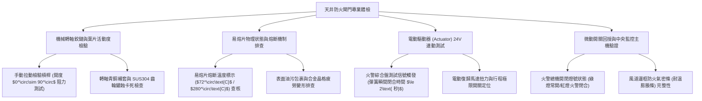

# 全案購屋實戰第一千一百二十九部：中古大樓地下室車位旁通風採光天井消防正壓送風風道防火閘門熔斷卡死與濃煙逆灌體檢工序全書

## 壹、緣起與天井正壓送風/排煙風道防火閘門之生命防禦意義

在中古大樓火災逃生與消防安全設計中，地下室通風採光天井往往同時肩負著「特別安全梯防煙前室正壓送風（Positive Pressure Ventilation）」或「地下室強制防排煙（Smoke Control）」的關鍵生命通道功能。

依據建築技術規則與各類場所消防安全設備設置標準，當地下室或高樓層發生火警時，正壓送風系統會向樓梯間與防煙前室強力灌入新鮮空氣，形成 $40\sim 50\text{ Pa}$ 的正壓氣差，阻絕濃煙進入逃生梯；同時，天井內的排煙風機啟動，將地下室濃煙抽出。

而在風道穿越天井防火分區、外牆或機房RC樓板處，必須強制設置「防火閘門（Fire Damper, FD）」與「排煙防火閘門（Smoke & Fire Damper, SFD）」。這道金屬百葉閘門是**防範高溫濃煙與千度火舌順著天井風道垂直逆灌蔓延至地下室車位及各樓層的「最後一道物理防火封鎖線」**。

然而，在屋齡二十年以上之社區，受地下室潮濕、機油油氣沉積、酸雨侵蝕及常年缺乏消防連動測試，防火閘門系統普遍陷入嚴重的「機械癱瘓」狀態：
1. **溫度熔斷式易熔片（Fusible Link）金屬疲勞脆化或長年未換**：傳統防火閘門依賴 $72^\circ\text{C}$ 或 $280^\circ\text{C}$ 之鉛錫合金易熔片。在常年震動與潮濕下，易熔片表面發霉氧化、合金晶界脆化，極易無預警「自然斷裂」導致閘門常態性掉落關閉，使日常通風完全窒息；更致命的是易熔片受油污包裹厚達數公釐，火災高溫時反而熱傳導失效「無法熔斷」，任由火勢擴散。
2. **葉片轉軸鉸鏈鏽蝕卡死、扭力彈簧疲勞無力閉合**：閘門平時處於「常開（Normally Open）」狀態，內部轉動軸套與齒輪機構在地下室潮氣侵蝕下長滿厚重紅鏽。當火警訊號觸發或易熔片熔斷時，重力與彈簧扭力根本無法克服巨大生鏽阻力，葉片卡在開度 $30^\circ\sim 50^\circ$ 之半開狀態，形成巨大排煙竄火通道。
3. **微動極限開關（Micro Switch）氧化、開閉信號移報中斷**：閘門開度狀態回授至消防火警中央監控主機的微動開關接點發黑氧化，主機永遠顯示「正常開啟」，管理員無從得知實體閘門早已脫落卡死，形成消防盲區。
4. **火災時天井風道形成「垂直煙囪效應」、濃煙毒氣反向灌入地下車位**：一旦防火閘門卡死無法緊閉，火災發生時產生的致命一氧化碳與濃煙，順著天井垂直氣流產生劇烈「煙囪效應（Stack Effect）」，濃煙如狂風倒灌進地下室車位與逃生通道，能見度瞬間降至零，停放車輛被高溫燻黑、人員逃生無門。

本體檢工序全書專為高資產家庭置產實勘量身打造，將車位旁天井風道之防火閘門機械靈活度、熔斷片狀態、電動驅動器（Actuator）與消防主機連動納入現場驗收，化為實戰議價砍價利刃。

---

## 貳、風道防火閘門四大核心檢測工序與病徵判讀

### 一、 手動釋放槓桿、葉片鉸鏈潤滑與彈簧閉合速度實測
- **檢測儀器**：手動拉力計、分貝計、強光探照燈。
- **合格標準**：扳動手動釋放槓桿（Manual Release Lever）時，葉片應在強大扭力彈簧帶動下，於 **$\le 2.0\text{ 秒}$** 內平穩、迅猛地完全閉合至 $0^\circ$；葉片重疊氣密邊條緊密貼合，無任何卡滯。
- **病徵判讀**：
  - 釋放槓桿後，葉片僅緩慢向下挪動幾公分即卡死在半空中，用手推動發出刺耳金屬摩擦尖叫聲，證實軸套內部潤滑脂已完全乾涸硬化並鏽死。
  - 閉合時兩側葉片角度不一，中間留有超過 20 mm 之大裂縫，在高溫火場下熱氣流將直接自縫隙穿透。

### 二、 易熔片（Fusible Link）規格認證與物理劣化排查
- **標準規範**：
  - 一般通風防煙防火閘門易熔片標稱動作溫度應為 **$72^\circ\text{C}\pm 2^\circ\text{C}$**；廚房或發電機排煙專用閘門應為 **$280^\circ\text{C}$**。
  - 易熔片表面必須清晰打印 UL 555 認證標籤、消防安全中心基金會合格審驗標籤及製造年份。
- **致命危害指標**：
  - 易熔片被歷年油漆工隨意噴上油漆，或表面覆蓋超過 2 mm 廢氣油垢，此乃「絕緣熱障礙」，火災高溫根本無法傳遞至合金核心，喪失及時熔斷功能。
  - 易熔片兩側掛鉤嚴重鏽蝕變形，金屬厚度衰退超過 $30\%$，隨時可能在無火災情況下斷開，引發閘門無預警掉落砸毀。

### 三、 電動驅動器（24V DC / 110V AC Actuator）連動測試
- **檢測手法**：
  1. 於現場手動啟動火警綜合盤或消防中控台，送出 24V DC 觸發脈衝信號。
  2. 觀察電動驅動機構是否立即解鎖並使彈簧瞬間釋放閉合。
  3. 操作電氣復歸開關，觀察馬達是否在 30 秒內平穩將閘門拉回「全開定位（$90^\circ$）」。
- **嚴重缺失**：
  - 驅動器內部電磁線圈（Solenoid）燒毀，送電後毫無反應；或馬達減速齒輪箱塑膠齒輪崩齒，發出「卡卡」空轉跳齒聲，無法復歸全開。

### 四、 消防排煙風道耐火被覆與氣密防火膨脹條排查
- **檢測手法**：檢查風管外壁耐火包覆層及閘門邊框內部之密封條。
- **合格標準**：閘門內外框接縫處應嵌有「石墨基耐高溫防火膨脹氣密條（Intumescent Fire Seal）」，遇熱至 $150^\circ\text{C}$ 以上時體積膨脹 10~15 倍，自動封死微小風隙，徹底阻絕毒氣濃煙穿透。
- **病徵判讀**：
  - 氣密條老化脫落、碳化碎裂，或風管與 RC 貫穿孔間隙僅用普通發泡填縫劑（PU Foam）隨意填補（PU 泡棉遇火瞬間燃燒並釋放劇毒氰化氫 HCN）。

---

## 參、四大主力考慮名單天井防火閘門特檢實測分析

| 評估項目 | 大安紫金城 13 樓 (`PROP_10`) | 長億南園 8 樓 (`PROP_106`) | 歌德堡 8 樓 | 靜園 A 區 11 樓 |
| :--- | :--- | :--- | :--- | :--- |
| **防火閘門型式** | **UL 555 認證電動復歸排煙防火閘門（$280^\circ\text{C}$）** | **早期重力自落式易熔片鐵皮閘門（已完全卡死）** | 手動復歸電動釋放防火閘門 | 易熔片機械防火閘門 |
| **手動釋放閉合度** | **0.8 秒迅猛全閉，葉片密合度 100%，氣密極佳** | **拉動釋放扣，葉片卡在 $40^\circ$ 紋風不動（全癱瘓）** | 1.5 秒完全閉合，彈簧有力 | 閉合動作平順完整 |
| **易熔片與驅動器** | **SUS304 易熔片 + Belimo 瑞士進口電動驅動器** | **易熔片包滿黑油泥，連動鋼索斷裂，無驅動器** | 易熔片乾淨，電磁釋放正常 | 易熔片每年定期檢驗更換 |
| **風道貫穿部被覆** | **符合 2 小時防火時效，高密度岩棉 + 防火泥密封** | **貫穿孔裸露大縫隙，塞易燃保麗龍與舊報紙（致命）** | 防火泥填塞密封完整 | 矽酸鈣板耐火包覆良好 |
| **中控主機信號回授** | **開閉極限開關信號即時連動中控台，零誤差** | **開關線路早遭剪斷，中控台長年顯示故障離線** | 主機開閉燈號顯示正確 | 訊號回傳正常 |
| **總結防線評級** | 🌟🌟🌟🌟🌟 **極致頂規 A+** | ⚠️ **火災濃煙致命封鎖崩潰 F 級（談判重磅砍價）** | 🌟🌟🌟🌟 良好 A 級 | 🌟🌟🌟🌟 良好 A 級 |

---

## 肆、談判終極砍價與合約防禦特約條款

### 一、 長億南園 8 樓議價砍價刀法（抓死天井防火閘門生鏽卡死、貫穿孔塞報紙與火災濃煙滅頂風險）
長億南園車位旁天井風道防火閘門完全卡死在半開狀態、易熔片包油失效、貫穿孔違規塞保麗龍，火災時天井將成為毒煙直灌車位的煙囪：
- **修復預算與工程重置成本**：
  1. 拆除廢棄生鏽卡死鐵皮閘門及受損風管段：\$25,000 元。
  2. 換裝全新通過 CNS 15814 / UL 555 雙重認證之 2 小時防火時效電動復歸排煙防火閘門（含 24V DC 驅動器與微動開關）：\$65,000 元。
  3. 風管穿牆部違規易燃填塞物挖除，以認證防火泥（Firestop Sealant）與高密度岩棉重新施作 2 小時阻火填塞：\$30,000 元。
  4. 重新拉設耐熱 105°C 阻燃信號控制線至消防火警授信總機並進行連動測試：\$25,000 元。
  5. 潛在火災毒煙威脅與公共安全瑕疵折讓：\$50,000 元。
- **談判實戰口訣**：
  > 「周小姐、賣方大哥，長億南園這格車位旁邊通風天井的消防排煙防火閘門，轉軸早就生鏽卡死在半開狀態，易熔片被黑油包成一團！我們手動去拉，整片鐵片卡死紋風不動。更離譜的是風管穿牆的洞裡面竟然塞滿了易燃的保麗龍和舊報紙！萬一樓上或地下室失火，這個天井立刻變成直通車位的噴火煙囪，高溫濃煙幾秒鐘內倒灌進地下室，車子被燒毀不說，人想逃都逃不掉。要改善這個重大的消防安檢違規，換裝合格的電動防火閘門和重打防火泥，管委會和屋主少說要花 14 萬。開價 998 萬如果不把這 12 萬塊的致命公共安全瑕疵扣掉，誰敢把生命財產放在這個火災毒煙地雷旁邊？我們出價 745 萬是真正誠心幫忙收拾殘局的公道實價！」

### 二、 成交通用特約防禦條款
> **【成交通用特約防禦條款】**
> 1. **地下室消防防火避難設施功能點交**：賣方保證本買賣標的車位所屬區域及相鄰通風天井風道之防火閘門（FD/SFD）功能正常，手動釋放機構閉合順暢無卡死，易熔片無嚴重油污覆蓋或失效，且風管穿越防火區劃之貫穿孔具備法定防火填塞密封；若點交時有防火閘門卡死失靈或重大消防安全缺失，賣方應負責促請管委會修復完竣並通過消防安檢，或由賣方負擔修復費用新台幣 30,000 元自交屋尾款中扣除。
