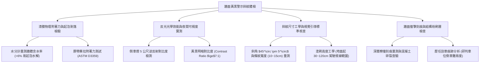

# 全案購屋實戰第一千一百二十二部：中古大樓地下室車位旁牆面防撞警示黃黑斜紋漆面剝落反光漆老化粉化與昏暗倒車擦撞體檢工序全書

## 壹、緣起與車位旁牆面黃黑斜紋警示標線之視覺防線意義

在中古大樓地下停車場中，地下室空間缺乏自然採光，且常受限於剪力牆、防震大柱與低矮橫樑的視線遮蔽。為了提升地下室行車視認性、引導倒車動線並防範車輛擦撞牆體，建築技術規則與交通工學規範在關鍵立柱、牆角、行車轉彎切點及車位正後方牆面，強制劃設「黃黑相間警示斜紋標線（Zebra Caution Markings）」。

這道 $45^\circ$ 的黃黑警示條紋，是利用人眼對「黃色（明度最高光譜）」與「黑色（全吸收對比）」的極致視覺反差，在駕駛人周邊視覺（Peripheral Vision）中建立一道醒目的「空間立體輪廓警示線」。

然而，在屋齡二十年以上之中古大樓，由於地下室通風不良、濕氣反潮、汽車排放之未完全燃燒碳氫化合物與機油油氣沉積，牆面黃黑警示漆面普遍面臨嚴重的退化與失效：
1. **水性水泥漆/一般油漆受潮水解起泡剝落**：早期施作若使用一般室內水泥漆或低階油漆，未塗佈封閉耐鹼底漆，RC 牆體內部的毛細水氣向外蒸發時將漆膜頂破，產生大面積起泡、空鼓與片狀剝落，露出慘白斑駁的水泥底層。
2. **反光玻璃微珠脫落、漆面粉化霧化（Chalking）**：受空氣中二氧化硫、氮氧化物侵蝕，樹脂黏結劑老化，黃色漆料粉化褪色呈灰黃色，嵌入之反光玻璃微珠全數掉落，在昏暗倒車燈照射下完全喪失「逆向反光導引功能」。
3. **滿牆車身擦撞刮傷留下黑底與各色殘漆**：由於警示線模糊、視線昏暗，車位旁牆面累積了歷任車主倒車擦撞保險桿留下的深層刻痕與黑色輪胎擦痕，不僅視覺髒亂，更隱藏著牆面批土碎裂、鋼筋保護層剝落之深層隱患。
4. **斜紋角度、寬度不符工學規範引發視覺錯覺**：部分社區修補時隨意用刷子塗畫，條紋寬度不一（過窄或過寬）且角度偏斜，非但無法提供距離參考尺標，反而在昏暗倒車影像鏡頭中產生視覺波紋錯覺，誤導駕駛倒車距離感。

本體檢工序全書專為高資產家庭置產實勘量身打造，將車位周邊牆體黃黑警示漆面之附著力、反光係數、尺寸工學與撞擊痕跡納入現場驗收，化為實戰議價砍價利刃。

---

## 貳、牆面黃黑警示斜紋四大核心檢測工序與病徵判讀

### 一、 漆膜附著力、起泡空鼓與牆體反潮含水率量測
- **檢測儀器**：高精度混凝土水分計、塗層附著力劃格器、強光手電筒。
- **合格標準**：漆膜應採用雙液型環氧樹脂漆（Epoxy Paint）或耐候氯化橡膠漆（Chlorinated Rubber Paint），底層需塗佈耐鹼底漆；牆體含水率應 $\le 6\%$。
- **病徵判讀**：
  - **白華鹽析頂破漆膜**：RC 牆體受背水面地下水氣滲入，水氣攜帶游離鈣在漆膜下方結晶成白色鹽斑，漆膜大面積空鼓脫落，用手輕壓即脆裂成碎片。
  - **粉化（Chalking）判定**：用手指或深色抹布在黃色警示條上用力一抹，指尖沾滿厚厚一層黃色色料粉末，證實漆料樹脂分子已徹底光解斷鏈，防護力喪失殆盡。

### 二、 反光效能、黃黑明度對比與昏暗倒車實測
- **檢測手法**：關閉車位周邊常態照明，將實車排入倒檔（R 檔），利用倒車燈與後視鏡、倒車顯影鏡頭觀察牆面條紋。
- **標準規範**：
  - **黃黑明暗對比度（Contrast Ratio）**：黃色塗層與黑色塗層的反射比應 $\ge 7:1$。
  - **逆向反光玻璃微珠**：優質警示漆在塗刷時表面均勻撒佈直徑 $150\sim 250\ \mu\text{m}$ 玻璃珠，在倒車燈投射下呈現強烈耀眼之逆向反光。
- **病徵判讀**：
  - 若在車內後視鏡中完全看不清黃黑條紋，只見一片模糊暗影，代表駕駛在昏暗環境下喪失對牆距離感，倒車極易撞牆。

### 三、 尺寸工學與視覺引導標準規範
- **標準尺寸規範**：
  - **傾斜角度**：黃黑斜條紋必須為 **$45^\circ \pm 5^\circ$**，且傾斜方向應「向車道中心或障礙物內側導引」，不得隨意亂畫。
  - **條紋寬度**：黃色與黑色條紋寬度必須等寬，標準寬度應為 **$10\sim 15\text{ cm}$**。條紋小於 5 cm 會造成遠距離視覺融合（灰成一片）；大於 25 cm 則喪失視覺警示頻率。
  - **塗佈高度**：自地坪起算高度應介於 **$30\text{ cm}\sim 120\text{ cm}$**，正好覆蓋小轎車保險桿至駕駛人坐姿平視視野。

### 四、 牆面歷任車輛擦撞痕跡剖析（判讀車位倒車地獄指數）
- **現場觀察重點**：
  - 觀察黃黑斜紋區是否有密密麻麻的深層刮痕。若牆面有紅色、藍色、白色等各色車漆刮擦沉積，且水泥粉刷層被撞落深達 1~2 公分，甚至露出內部鋼筋，這是一記**重大警訊**！
  - 證明該車位動線極為狹窄惡劣、迴轉半徑不足或視角死角過大，歷任車主倒車入庫時「十次有八次刮傷車子」，此乃日後天天用車的噩夢。

---

## 參、四大主力考慮名單車位牆面警示漆面特檢分析

| 評估項目 | 大安紫金城 13 樓 (`PROP_10`) | 長億南園 8 樓 (`PROP_106`) | 歌德堡 8 樓 | 靜園 A 區 11 樓 |
| :--- | :--- | :--- | :--- | :--- |
| **塗料材質規格** | **雙液型環氧樹脂反光漆（含微菱型反光微珠）** | **劣質水性水泥漆隨意塗刷（已粉化脫落 80%）** | 耐候油性反光漆，狀況良好 | 標準黃黑警示漆，漆面完整 |
| **漆膜起泡與粉化** | **無起泡，無白華，手指觸摸零粉化，鏡面平滑** | **嚴重白華鹽析，漆膜大片剝落，粉化極嚴重** | 表面平整，微量粉化 | 漆面完整，無大面積剝落 |
| **倒車顯影對比度** | **倒車燈一照，黃黑條紋晶亮如晝，對比度 10:1** | **倒車鏡頭一片昏黑，看不清牆角輪廓** | 倒車影像清晰可見 | 倒車視線清楚 |
| **尺寸工學規範** | **嚴格 $45^\circ$、15cm 等寬劃設，自地起 30~120cm** | **條紋寬窄不一（5~25cm 亂畫），角度偏斜亂七八糟** | 標準 $45^\circ$、10cm 等寬 | 標準劃線規範 |
| **歷任擦撞刮痕** | **牆面完全潔淨無暇，無任何保險桿擦碰痕跡** | **滿牆各色車漆擦痕，深層刮傷多達 15 處（地獄動線）** | 牆面輕微刮痕 1 處 | 牆面無撞痕 |
| **總結防線評級** | 🌟🌟🌟🌟🌟 **極致頂規 A+** | ⚠️ **車損極高風險 F 級（談判重磅砍價）** | 🌟🌟🌟🌟 良好 A 級 | 🌟🌟🌟🌟 良好 A 級 |

---

## 肆、談判終極砍價與合約防禦特約條款

### 一、 長億南園 8 樓議價砍價刀法（抓死警示漆剝落、滿牆撞痕與天天刮車風險）
長億南園車位旁牆面黃黑警示漆剝落 80%、滿是白華鹽析，牆上累積了 15 道不同車漆擦碰深層刻痕，證實該車位為高難度狹窄擦撞陷阱：
- **修復預算與損失評估**：
  1. 牆面劣化漆膜水刀高壓刨除、白華酸洗中和、批土打磨平整：\$10,000 元。
  2. 牆體裂縫結構補強注入與雙液型抗鹼封閉底漆塗佈：\$12,000 元。
  3. 專業放樣施作 $45^\circ$ 等寬雙液型耐候環氧樹脂反光警示條紋（含高折射反光玻璃微珠）：\$15,000 元。
  4. 狹窄倒車動線引發潛在保險桿擦撞烤漆修復預備金：\$25,000 元。
- **談判實戰口訣**：
  > 「周小姐、賣方大哥，長億南園這格車位旁邊的牆壁，黃黑警示漆早就掉光光，地上全是掉下來的水泥漆碎片！你看這面牆上，紅的、白的高達十幾道車身擦撞刮痕，水泥都被撞破好幾處，這代表這格車位動線爛到極點，連老司機倒車天天都會刮到車。我買這間房子，倒車停進去隨便刮一次保險桿烤漆就要五千一萬。管委會不管，我們自己請油漆工刨除重做抗水反光漆至少要三四萬。屋主開價 998 萬，如果不把這個動線地獄和修復漆面的費用折讓 5 萬元，天天刮車的代價誰受得了？我們出價 745 萬是最有誠意的解決方案！」

### 二、 成交通用特約防禦條款
> **【成交通用特約防禦條款】**
> 1. **車位周邊牆面安全標示點交**：賣方保證本買賣標的車位所屬區域之立柱及牆面黃黑反光警示油漆維持清晰可辨，無大面積起泡剝落或白華腐蝕影響倒車安全之情事；若點交時漆面剝落嚴重或牆面有結構性破損，賣方應於交屋日前負責修補平整並重新塗刷反光警示漆，或由買方於交屋尾款中扣除新台幣 10,000 元自理。
