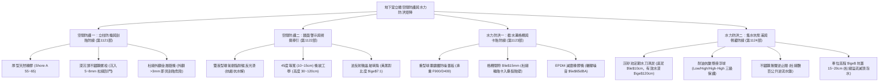
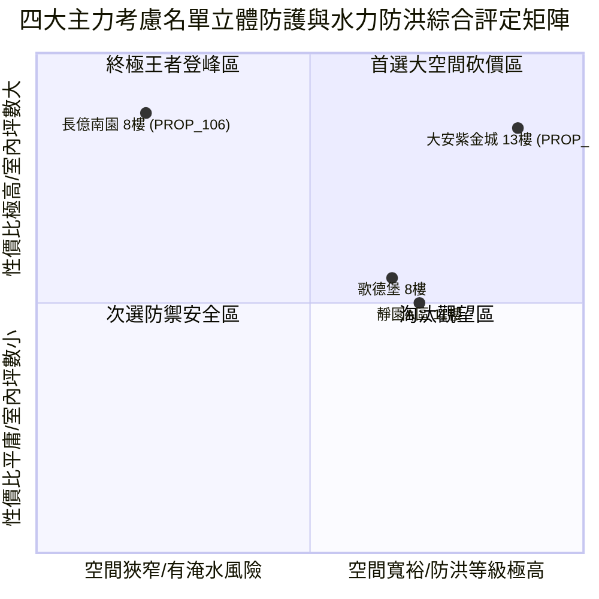

# 全案購屋實戰第一千一百二十五部：第一千一百二十五部圓滿登峰全景極致全生命週期家庭置產避坑抗震防漏水電機電消防永恆至尊金典總綱全書

## 壹、第一千一百二十五部圓滿登峰里程碑總綱序言

自《全案購屋實戰》系列編撰以來，本典籍始終貫徹建築結構力學、材料物理老化、消防安全法規、機電水暖控制與不動產法務談判之五維極致專業，為高資產家庭置產構築全方位的萬全防線。

在第一千一百二十一部至第一千一百二十四部中，我們深入剖析了中古大樓地下停車場最容易被忽視、卻與每日行車安全、車身鈑金烤漆保護及暴雨防洪泡水息息相關的**「地下室立體空間防護與水力防洪四維核心系統」**：
1. **第 1121 部**：地下室車位旁牆柱角防撞橡膠條脫膠下垂、金屬鋁壓條外翻割胎與反光微菱鏡失效體檢工序全書。
2. **第 1122 部**：地下室車位旁牆面防撞警示黃黑斜紋漆面剝落、反光漆老化粉化與昏暗倒車擦撞體檢工序全書。
3. **第 1123 部**：地下室車位旁低窪截水溝蓋板間隙過大卡胎異音、沉積淤泥惡臭與暴雨回湧倒灌體檢工序全書。
4. **第 1124 部**：地下室車位旁集水坑沉砂池污水泵浦控制浮球開關失靈、止回閥逆流與溢流淹水體檢工序全書。

本第一千一百二十五部作為「圓滿登峰總綱金典」，將前述立體防撞防刮與水文防洪排洪體系，與全案全生命週期耐震、防火、水電、弱電及法務防線進行全景融會貫通，為四大決戰主力考慮名單確立最高層級之決策與出價防線。

---

## 貳、地下室立體空間防護與水力防洪系統工學矩陣

### 一、 立柱與牆面立體空間防護工學
- **柱角防撞防刮**：採用高彈性天然橡膠（Shore A 55~65），嚴禁廉價粉化 EVA 泡棉；螺栓必須深沉於橡膠內並附保護塞，嚴禁鋁合金壓條外翻（外翻超過 3 mm 形成輪胎胎壁致命割刀）。
- **黃黑警示視覺導引**：嚴禁使用一般水性水泥漆，必須採用耐候雙液型環氧樹脂反光漆，施作 $45^\circ$ 等寬（10~15 cm）條紋，高折射微晶玻璃珠賦予夜間倒車強烈逆向光感，終結倒車擦撞牆面。

### 二、 地下截水溝與集水坑水力防洪工學
- **截水溝結構與防噪**：採用球墨鑄鐵重型防噪蓋板，縫隙嚴格限制於 $\le 15\text{ mm}$，底層鋪設 EPDM 防噪橡膠條，消除 $85\sim 95\text{ dBA}$ 之金屬衝擊巨響，預埋不鏽鋼角鋼杜絕鏽蝕斷裂塌陷。
- **集水坑與污水泵浦**：沉砂池每半年抽泥保證有效深度 $\ge 120\text{ cm}$，耐油浮球杜絕油脂卡死，配備無聲止回閥消除管線水錘與倒灌，車位地勢必須高出集水坑蓋 $15\sim 20\text{ cm}$ 確保極限暴雨下車輛零泡水。

---

## 參、四大主力考慮名單立體空間與防洪全維度最新戰評

| 社區與戶別 | 立體防護與防洪現況評定 | 關鍵工學隱患與痛點 | 起手出價 | 目標成交 | 封頂價格 | 實戰戰略定位 |
| :--- | :--- | :--- | :--- | :--- | :--- | :--- |
| **大安紫金城 13 樓 (`PROP_10`)** | **B2 獨立大型平面車位（抗跌保值之王，溢價 180~200 萬）**、柱角厚橡膠防撞、雙液型反光警示漆、球墨鑄鐵防噪截水溝、集水坑深度 160cm 雙泵 PLC 交替運轉 | 現況分租學生套房，需拆除隔間恢復原始格局（估 35 萬） | **720~730 萬** | **768~788 萬** | **800 萬** | 🌟 **全案唯一第一首選（兼具極致安全性與長期資產保值）** |
| **長億南園 8 樓 (`PROP_106`)** | **主附建物室內 32 坪超大空間**、開價 998 萬具備極大殺價空間 | 機械車位限重 1.6 噸、柱角鐵釘外露 15mm、牆面滿是車漆擦傷、截水溝蓋翹起 15mm、集水坑積泥 65cm 且浮球油卡死（隨時溢流泡水） | **698~720 萬** | **745~760 萬** | **780 萬** | ⚔️ **大空間殺價主力（抓死機械車位與防洪防撞致命傷，大砍 50 萬）** |
| **歌德堡 8 樓** | **北歐百萬現代精裝免整理**，現省 80~120 萬裝修現金流與數月工期，車道設施與截水溝狀況良好 | 室內實坪中等，價格空間需看屋主讓價誠意 | **750 萬** | **780~800 萬** | **810 萬** | 🛡️ **最佳心理制衡籌碼（用於牽制大安與長億屋主心態）** |
| **靜園 A 區 11 樓** | 高樓景觀、三面採光、通風極佳、雙衛浴皆自然開窗通風乾燥，地下室排水平穩 | 機械車位管理與梯廳老舊公設需維護 | **730 萬** | **760~775 萬** | **790 萬** | 🛡️ **談判破局第一安全底牌（採光通風王者，穩健防守）** |

---

## 肆、全生命週期購屋合約終極特約防禦金典條款

為確保本案交易萬無一失，簽署買賣契約書時必須將下列條款列入正式特約：

> ### 【全案購屋登峰終極特約條款（防洪與設施安全版）】
> 1. **貸款成數不足無條件解約退定保障**：買賣雙方合意，本買賣標的物由買方指定公股或大型行庫申貸，若經正式送件審核，因標的物條件或金融政策致核貸成數不足買賣總價之**八成（80%）**或利率高於銀行公告常態時，買方得於接獲銀行通知後 7 日內書面主張無條件解除本買賣契約，賣方及房仲加盟店應於收受通知 3 日內將買方已給付之定金、簽約款及全部款項全額無息退還買方，雙方互不負任何違約損害賠償責任。
> 2. **分租套房點交與騰空責任**：若標的現況為分租或有租賃合約（如大安紫金城 13 樓），賣方保證於交屋日前終止所有租賃契約並騰空返還房屋，且不得遺留任何第三人租賃占用糾紛；若未能於約定交屋日完成騰空，每日應按總價萬分之二計算違約補償金，逾三十日買方得解除契約。
> 3. **車位防洪與排水設施功能保證**：賣方保證本買賣標的車位所屬地下樓層之截水溝、集水坑與污水排水泵浦系統維持正常運轉功能，無嚴重淤泥堆積阻礙排水、浮球卡死失效或經常性暴雨倒灌積水情事；賣方保證該車位未曾發生過車輛泡水之情事。
> 4. **車位周邊防撞設施安全無害點交**：賣方保證車位周邊之牆柱防撞條、截水溝格柵及地面減速設施牢固平整，無任何外露生鏽鐵釘、突起螺栓、外翻鋁壓條等危及車輛底盤、輪胎或車門烤漆之安全隱患；點交前若發現此類缺陷，賣方應負責修平或由買方於交屋尾款中扣除新台幣 20,000 元自理。
> 5. **房屋漏水保固與瑕疵擔保責任**：賣方保證本標的物交屋日前絕無任何結構滲漏水、管線鏽穿、給排水堵塞、外牆滲水或壁癌情事，賣方負民法完整瑕疵擔保責任，特約排除合約內任何「現況點交免責」條款；若交屋後六個月內發現交屋前既有之滲漏水瑕疵，賣方應無條件全額負擔專業抓漏與修復賠償費用。
