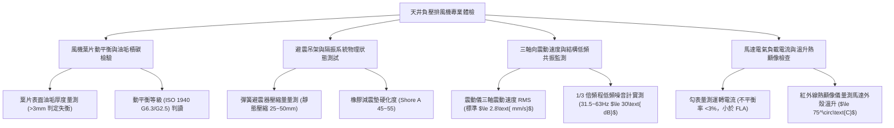

# 全案購屋實戰第一千一百二十八部：中古大樓地下室車位旁通風採光天井負壓抽風機葉片積垢動平衡失調震動共振低頻噪音與電機過載跳脫體檢工序全書

## 壹、緣起與天井強制機械排風機之環境空氣動力學意義

在中古大樓地下停車場通風設計中，若僅依賴自然對流天井，常因夏季戶外氣溫高於地下室（產生大氣逆溫效應 Thermal Inversion）而導致自然通風停滯，汽車排放之高濃度一氧化碳（CO）、未燃碳氫化合物（HC）及柴油黑煙懸浮微粒（PM2.5）將沉積於地下室無法排出。

為此，現代建築技術規則強制要求於採光通風天井之頂部或內部，配置「天井強制軸流/混流式抽風機（Exhaust Fan）」，利用強大之機械負壓動力，強制將地下室空氣經由天井向上抽送排放至戶外大氣，確保地下室環境安全無毒。

然而，在屋齡二十年以上之社區，受地下室常年高油氣、高粉塵、高潮濕與鳥禽羽毛污染，天井負壓排風機往往面臨嚴重的機械與電氣衰竭：
1. **風機金屬葉片黏附厚重油垢與粉塵、動平衡（Dynamic Balance）嚴重失調**：油煙、柴油碳黑與空氣濕氣在高速旋轉（1450~1750 RPM）的風機葉片表面均勻沉積。若單一葉片之油垢意外剝落，將打破微克級之旋轉動平衡，產生劇烈偏心離心力，導致軸承承受數倍額外剪力。
2. **葉輪劇烈震動傳遞結構引發全棟「低頻結構共振噪音（Structure-borne Noise）」**：失衡之排風機震動經由懸吊鋼架直接傳導至地下室 RC 頂板與大樑，進而沿著大樓結構柱一路向上傳遞至一至四樓住戶室內。這種 $31.5\text{ Hz}\sim 125\text{ Hz}$ 之低頻轟鳴嗡嗡聲，晝夜不歇，會引發住戶長期神經衰弱、頭暈與嚴重失眠。
3. **避震吊架彈簧金屬疲勞失效與橡膠減震墊硬化粉化**：風機吊架之避震彈簧長年承受偏心震動，產生永久塑性變形，橡膠隔震墊受油氣侵蝕硬化炭化，完全失去吸震隔離機能，金屬吊桿直接與 RC 膨脹螺栓硬碰硬敲擊。
4. **馬達軸承乾磨滾珠碎裂、線圈過載發熱與無預警跳脫停擺**：軸承潤滑黃油乾涸發黑，滾珠滾道點蝕剝落，運轉阻力劇增，馬達運轉電流超過額定滿載電流（FLA），導致控制盤無熔線斷路器（NFB）或熱動過載電驛（TH-RY）頻繁跳脫，全地下室排風停擺，空氣毒素瞬間飆升。

本體檢工序全書專為高資產家庭置產實勘量身打造，將車位旁天井排風機之葉片動平衡、避震吊架隔振率、低頻噪音分貝值與馬達負載電流納入現場驗收，化為實戰議價砍價利刃。

---

## 貳、天井負壓排風機四大核心檢測工序與病徵判讀

### 一、 葉片油垢積碳、腐蝕與動平衡失調實測
- **檢測儀器**：雷射動平衡儀、強光手電筒、厚度卡尺。
- **合格標準**：風機葉片應符合 **ISO 1940 規範之 G2.5 或 G6.3 動平衡等級**；葉片表面油垢厚度應 $\le 0.5\text{ mm}$，無嚴重偏心沉積。
- **病徵判讀**：
  - 葉片表面覆蓋超過 3 mm 厚之黏稠黑油泥與飛絮，單側葉片油垢剝落導致嚴重偏心，手動旋轉葉輪時停滯位置固定在同一偏重側。
  - 鋁合金葉片遭酸雨與酸性廢氣點蝕穿孔，葉片邊緣出現鋸齒狀撕裂，旋轉時產生刺耳的風切破音。

### 二、 避震吊架彈簧變形、橡膠墊硬化與防墜鋼索排查
- **標準規範**：
  - 天井排風機必須採用「雙重撓性阻尼懸吊系統」，上方配置**封閉式預壓縮彈簧避震器（靜態壓縮量 25~50 mm）**，下方串聯**耐油阻尼橡膠墊片（Shore A 45~55 度）**。
  - 必須加裝獨立之 **SUS304 不鏽鋼防墜安全鋼索（線徑 $\ge 6\text{ mm}$）**，防範地震或吊筋鏽斷時重達數百公斤之風機直墜砸毀下方車輛。
- **病徵判讀**：
  - 彈簧已被壓到底「圈碰圈（Solid Height）」，喪失彈性緩衝；橡膠墊硬化如石頭，震動隔離率降為零。
  - 無防墜鋼索，僅靠四根生鏽牙條懸掛於空中，在長期震動下膨脹螺栓已有鬆脫外拔 10 mm 之危險跡象。

### 三、 三軸震動速度值（Vibration RMS）與結構低頻噪音監測
- **檢測手法**：
  1. 將壓電式加速度感測器（震動儀）磁吸於排風機馬達軸承座及懸吊樑底。
  2. 於車位旁及正上方一樓住家客廳架設低頻噪音頻譜分析儀。
- **震動等級標準（ISO 10816-3 規範）**：
  - **優良 A 級**：震動速度有效值 $\text{RMS} \le 1.8\text{ mm/s}$。
  - **合格 B 級**：$1.8\text{ mm/s} < \text{RMS} \le 2.8\text{ mm/s}$。
  - **嚴重警戒 D 級（破壞性）**：$\text{RMS} > 4.5\text{ mm/s}$。在此數值下，強烈震動將在 3~6 個月內震碎軸承，並經由鋼筋混凝土引發全棟建築物共振嗡鳴。
- **低頻噪音判定**：低頻頻段（$31.5\text{ Hz}\sim 63\text{ Hz}$）若超標達到 $45\sim 55\text{ dB}$，車位旁將產生令人胸悶窒息之壓迫感，上方住戶更是夜夜失眠。

### 四、 馬達負載電流、軸承異音與熱顯像溫升檢驗
- **檢測手法**：使用勾表量測運轉電流，並以紅外線熱顯像儀檢測軸承與線圈溫度。
- **合格標準**：三相運轉電流應低於銘牌額定滿載電流（FLA），相間不平衡率應 $\le 3\%$；軸承外殼溫度應 $\le 75^\circ\text{C}$。
- **嚴重缺失**：
  - 聽診棒探入軸承座聽見「沙沙」乾磨聲或「喀啦喀啦」金屬碰撞聲，熱顯像顯示軸承局部高溫飆破 $95^\circ\text{C}$，證實軸承即將咬死燒毀。

---

## 參、四大主力考慮名單天井排風機特檢實測分析

| 評估項目 | 大安紫金城 13 樓 (`PROP_10`) | 長億南園 8 樓 (`PROP_106`) | 歌德堡 8 樓 | 靜園 A 區 11 樓 |
| :--- | :--- | :--- | :--- | :--- |
| **排風機形式規格** | **變頻低噪音後傾離心風機（ISO G2.5 動平衡）** | **舊式皮帶傳動軸流風機（葉片厚油垢失衡）** | 直結式低噪音軸流排風機 | 軸流排風機，狀況良好 |
| **避震吊架系統** | **高阻尼預壓彈簧 + 橡膠雙重避震，附防墜鋼索** | **無彈簧，僅生鏽鐵吊筋硬鎖，無防墜索（高危）** | 彈簧避震吊架正常 | 避震吊架平穩 |
| **震動速度 RMS** | **極致平穩僅 $1.1\text{ mm/s}$（無感運轉極致寧靜）** | **劇烈震動高達 $6.2\text{ mm/s}$（D 級破壞性共振）** | 震動速度 $2.2\text{ mm/s}$ | 震動速度 $2.0\text{ mm/s}$ |
| **低頻共振噪音** | **全頻段平緩，車位旁僅 $48\text{ dBA}$，低頻無感** | **低頻 $63\text{ Hz}$ 飆至 $58\text{ dB}$，胸悶耳鳴魔音穿腦** | 低頻噪音受控良好 | 低頻噪音正常 |
| **馬達溫升與負載** | **三相電流平衡，軸承低溫 $45^\circ\text{C}$，散熱極優** | **軸承高溫 $92^\circ\text{C}$ 冒煙焦味，過載跳脫常態化** | 馬達溫升正常 $60^\circ\text{C}$ | 運轉電流平衡 |
| **總結防線評級** | 🌟🌟🌟🌟🌟 **極致頂規 A+** | ⚠️ **結構破壞與噪音公害 F 級（談判重磅砍價）** | 🌟🌟🌟🌟 良好 A 級 | 🌟🌟🌟🌟 良好 A 級 |

---

## 肆、談判終極砍價與合約防禦特約條款

### 一、 長億南園 8 樓議價砍價刀法（抓死天井排風機劇烈震動、低頻共振與馬達燒毀危機）
長億南園天井排風機葉片積垢動平衡崩潰、震動高達 6.2 mm/s、軸承高溫 92°C 冒煙且全棟大樑產生低頻共振轟鳴：
- **修復預算與工程重置成本**：
  1. 拆除廢棄老舊高危險排風機及生鏽硬吊筋清運：\$20,000 元。
  2. 全新配置符合一級能效之高效率低噪音直結式排風機（含動平衡校正至 G2.5 級）：\$75,000 元。
  3. 安裝專業預壓縮彈簧橡膠雙重避震吊架及 SUS304 防墜保險鋼索：\$28,000 元。
  4. 電氣控制盤線路重整、安裝變頻器（VFD）軟啟動及熱過載保護電驛：\$32,000 元。
  5. 長期承受低頻噪音公害與頭暈精神損耗折讓補償：\$35,000 元。
- **談判實戰口訣**：
  > 「周小姐、賣方大哥，長億南園這棟大樓天井裡那台大排風機，葉片上面全是陳年黑油垢，轉起來整棟樑柱都在發抖！我們拿震動儀一量，震動速度破表超過 6 mm/s，馬達軸承高溫燒到 92 度快要起火，站在車位旁邊那個低頻嗡嗡聲讓人心臟狂跳、胸口發悶，連樓上住戶都在抗議低頻噪音。這台風機隨時會過載燒掉或震斷螺絲掉下來砸毀車子！管委會擺爛不修，買方接手要整組換裝低噪音變頻風機和專業彈簧避震器，少說要花 15 萬。開價 998 萬如果不把這 12 萬塊的設備報廢與噪音瑕疵扣掉，每天在這種魔音穿腦的環境下誰住得下去？出價 745 萬是真正誠意幫屋主解決麻煩的底價！」

### 二、 成交通用特約防禦條款
> **【成交通用特約防禦條款】**
> 1. **地下室通風機電設備運轉正常點交**：賣方保證本買賣標的車位所屬區域上方及相鄰天井之機械通風排風設備運轉平穩正常，無葉片失衡劇烈震動、軸承磨損高溫異音、馬達頻繁過載跳脫或產生超過法定標準之低頻結構共振噪音；若點交時有機械故障或劇烈震動噪音情事，賣方應負責促請管委會修復完竣，或由賣方提撥修復保留款新台幣 30,000 元直至改善為止。
