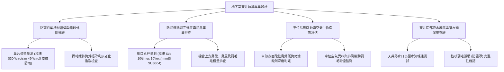

# 全案購屋實戰第一千一百二十六部：中古大樓地下室車位旁通風採光天井防雨百葉窗鏽蝕斷裂鳥網破損鳥禽築巢鳥糞污染與雨水飄灌體檢工序全書

## 壹、緣起與地下停車場採光通風天井之生態與物理防線意義

在中古大樓地下室設計中，「採光通風天井（Lightwell / Ventilation Shaft）」是改善地下停車場空氣品質、引入自然漫射採光、排除汽車廢氣並節省常態照明電費的重要物理開口。天井直通一樓中庭或頂樓地面，是地下室與外界大氣交換的垂直「氣孔」。

然而，正因為天井直接連通外界自然環境，天井頂部及立面所安裝的「防雨百葉窗（Weather Louver）」與「防鳥不鏽鋼鐵絲網（Bird Screen / Insect Mesh）」，就成為阻絕雨水潑入、強風倒灌、鳥禽入侵及落葉淤塞的「第一道環境邊界防線」。

在屋齡二十年以上之社區，受酸雨侵蝕、大氣沉降、鴿子與麻雀等野生鳥禽活動影響，天井防護設施極易產生毀滅性的老化與連鎖污染：
1. **防雨百葉窗鋁合金/鍍鋅鐵葉片鏽蝕斷裂脫落與雨水飄灌**：金屬百葉長年受風壓震動與雨水沖刷，轉軸鉚釘鏽斷，葉片向下耷拉或完全脫落。當遭遇強陣風或暴雨時，雨水順著殘破的百葉大面積「飄灌（Wind-driven Rain Infiltration）」入地下室，正下方或相鄰之停車位首當其衝，車頂與地面宛如水簾洞，引發底盤鏽蝕與電系短路。
2. **防鳥網金屬絲鏽穿撕裂、鳥禽入侵築巢**：原裝防鳥網因金屬線徑過細或非 304 不鏽鋼材質，受酸雨腐蝕破出大洞。鴿子、斑鳩及麻雀自破損處鑽入天井內部的樑柱凹槽、消防水管與電纜橋架上大量築巢繁衍。
3. **鳥糞酸性腐蝕車漆、堵塞截水溝與隱球菌呼吸道致命病菌**：天井下方停放之車輛，車頂、前擋風玻璃及後視鏡每日遭到高腐蝕性鳥糞（含尿酸 Uric Acid，pH 值達 3~4）狂轟濫炸。鳥糞若未在數小時內清除，將在透明金屬漆（Clear Coat）留下永久性腐蝕白斑與龜裂；更嚴重的是，乾涸的鳥糞粉塵隨天井排風氣流被吸入車內冷氣濾網，其中潛藏之「新型隱球菌（Cryptococcus neoformans）」極易引發住戶與幼童嚴重的肺部感染與腦膜炎！
4. **鳥巢樹枝落葉淤塞天井底排水孔造成蓄水池倒灌**：鳥禽叼啄之枯樹枝、羽毛及落葉長年堆積在天井底部排水口，暴雨時水流無法排出，天井底部迅速積水形成深達 30~50 公分的「空中蓄水池」，一旦水壓衝破天井防水收邊，整座天井的積水如瀑布般傾瀉灌入地下室車道與配電盤。

本體檢工序全書專為高資產家庭置產實勘量身打造，將車位旁天井之防雨密封度、防鳥網完整性、鳥糞污染度及排水暢通度納入現場驗收，化為實戰議價砍價利刃。

---

## 貳、天井百葉、防鳥網與環境衛生四大核心檢測工序

### 一、 防雨百葉窗材質規格、百葉仰角與防飄雨測試
- **檢測儀器**：雷射測距儀、仰角量角規、強光探照燈。
- **合格標準**：應採用鋁合金（A6063-T5）陽極氧化或氟碳烤漆雙層防雨百葉，百葉葉片傾角應維持在 **$30^\circ\sim 45^\circ$**，葉片重疊長度應 $\ge 15\text{ mm}$，具備有效阻擋 $15\text{ m/s}$ 強風橫向雨滴之能力。
- **病徵判讀**：
  - 鍍鋅鐵皮百葉鏽蝕呈黑褐色，葉片因重力彎曲下垂，迎風面失去遮雨阻擋角度。
  - 外框與混凝土開口處之耐候矽利康（Silicone）老化乾硬開裂，雨水順著外框縫隙直接滲透進 RC 牆體內部。

### 二、 防鳥網金屬材質、網目孔徑與鳥巢排查
- **標準規範**：
  - 防鳥網必須採用 **SUS304 不鏽鋼編織網**，線徑應 $\ge 1.2\text{ mm}$，網目孔徑必須 **$\le 10\times 10\text{ mm}$**，以徹底杜絕麻雀（體型小可穿過 15mm 孔隙）鑽入。
  - 嚴禁使用尼龍塑料軟網，紫外線照射 2~3 年即脆化碎裂。
- **致命危害指標**：
  - 探照燈照射天井內部，若在消防立管、電纜托架或橫樑頂部發現直徑超過 20 cm 之鳥巢，或地面散落大量鴿子羽毛、乾枯樹枝，證實天井防鳥防線已徹底瓦解。

### 三、 車位鳥糞酸性腐蝕與生物致病風險實測
- **檢測手法**：
  1. 仔細觀察車位地坪、車位正上方樑柱底部及相鄰停放車輛之車頂與引擎蓋。
  2. 使用漆面放大鏡檢視是否有圓形白灰斑點及烤漆金油層融解痕跡。
- **病徵判讀**：
  - 若相鄰車輛覆蓋著防塵車套，且車套上密布數十處乾涸鳥糞斑，此乃「鳥糞地獄車位」之鐵證！停放此車位若未天天蓋車套，新車烤漆只需半年即全部被尿酸咬破毀容。
  - 空氣中瀰漫強烈禽類排泄物阿摩尼亞騷味，對於家中有過敏體質長輩或幼童之家庭，存在高度吸入隱球菌引發重症之醫療風險。

### 四、 天井底部落水頭過濾罩與淤泥排水檢驗
- **檢測手法**：於天井底部排水落水口注入 20 公升清水。
- **合格標準**：排水口應配置「不鏽鋼半球型防落葉罩（Dome Strainer）」，水流應毫無阻礙瞬間旋渦排空。
- **病徵判讀**：
  - 落水口無防護罩，已被大量枯枝、鳥糞泥沙堵塞過半，倒水時產生積水冒泡泡，遇強降雨必定形成深水池倒灌車位。

---

## 參、四大主力考慮名單天井百葉與鳥禽衛生特檢分析

| 評估項目 | 大安紫金城 13 樓 (`PROP_10`) | 長億南園 8 樓 (`PROP_106`) | 歌德堡 8 樓 | 靜園 A 區 11 樓 |
| :--- | :--- | :--- | :--- | :--- |
| **天井百葉規格** | **雙層陽極氧化鋁合金百葉（$45^\circ$ 重疊防雨）** | **舊式薄鐵皮百葉（葉片鏽斷下垂 4 處）** | 鋁合金防雨百葉，無變形 | 鋁合金百葉，狀況良好 |
| **防鳥網完好度** | **全區封閉 SUS304 密目不鏽鋼網（10mm 孔徑）** | **尼龍網大面積破損撕裂，形成 30cm 大破洞** | 不鏽鋼防鳥網完好 | 金屬防鳥網無破洞 |
| **鳥禽築巢與排泄** | **零鳥巢、零羽毛、無鳥糞痕跡，空氣清新乾淨** | **樑上盤踞 3 處野鴿巢，車位滿地鳥糞（重災區）** | 無鳥巢，地面偶有一點落葉 | 無鳥禽築巢 |
| **暴雨飄灌情形** | **雨水完全被外側導槽排走，車位地坪乾爽如初** | **大雨直接順風飄灌，車位正對天井宛如淋雨** | 密封良好，無飄水 | 排水流暢無滲漏 |
| **天井底排水管** | **半球型 SUS304 防落葉罩，水流畅行無阻** | **落水頭全被鳥糞樹枝泥漿堵死，常年積黑臭水** | 落水頭乾淨 | 排水正常 |
| **總結防線評級** | 🌟🌟🌟🌟🌟 **極致頂規 A+** | ⚠️ **環境衛生崩潰與車漆毀滅 F 級（談判重磅砍價）** | 🌟🌟🌟🌟 良好 A 級 | 🌟🌟🌟🌟 良好 A 級 |

---

## 肆、談判終極砍價與合約防禦特約條款

### 一、 長億南園 8 樓議價砍價刀法（抓死天井野鴿築巢、鳥糞腐蝕車漆與暴雨飄水）
長億南園車位旁天井防雨百葉鏽斷、防鳥網破裂、野鴿築巢且車位天天遭到酸性鳥糞轟炸，且天井底堵死暴雨飄灌：
- **修復預算與環境整治成本**：
  1. 專業高空作業車天井全面清消、清除鳥巢、鳥屍及鳥糞高壓水刀消毒：\$25,000 元。
  2. 天井頂部拆除廢棄鐵皮百葉，換裝雙層鋁合金抗強風防雨百葉窗：\$45,000 元。
  3. 全面鋪設高強度 SUS304 密目不鏽鋼防鳥網（含不鏽鋼壓條固定）：\$35,000 元。
  4. 天井底部落水孔疏通與加裝不鏽鋼半球型防落葉過濾罩：\$12,000 元。
  5. 停放車輛金油層遭鳥糞腐蝕之車漆全車鏡面美容與鍍膜補償：\$20,000 元。
- **談判實戰口訣**：
  > 「周小姐、賣方大哥，長億南園這格車位旁邊的天井，鐵百葉早就鏽斷好幾片，防鳥網破了一個大洞，樑上面住了好幾窩野鴿子！地上和旁邊車頂全是一層層白發黑的酸性鳥糞，臭氣薰天，而且鳥糞裡全是致命隱球菌。只要把車停在這裡，一個禮拜車漆金油層全部被尿酸咬爛，每天還要吸鴿糞毒氣。下大雨天井還直接飄雨進來淋在車頂上。要解決這個鳥害天井，管委會要叫高空吊車清消、換鋁百葉和重拉不鏽鋼防鳥網，至少要花 13 萬。開價 998 萬如果不把這 10 萬塊的鳥害修復與車漆折讓扣掉，誰敢把車停在鳥糞坑裡？我們出價 745 萬已經是非常厚道的誠意價！」

### 二、 成交通用特約防禦條款
> **【成交通用特約防禦條款】**
> 1. **車位周邊環境衛生與天井防護點交**：賣方保證本買賣標的車位所屬區域上方及相鄰之通風採光天井結構完好，防雨百葉窗及防鳥網無嚴重破損、鳥禽築巢繁衍或大量排泄物污染車位之情事；若點交時有天井漏雨或鳥害衛生問題，賣方應於交屋日前負責促請管委會清消修復完竣，或由賣方提撥修復款新台幣 20,000 元自交屋尾款中扣除。
