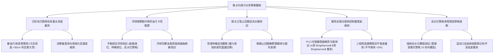

# 全案購屋實戰第一千一百二十四部：中古大樓地下室車位旁集水坑沉砂池污水泵浦控制浮球開關失靈止回閥逆流與溢流淹水體檢工序全書

## 壹、緣起與車位旁集水坑（Sump Pit）及污水泵浦之地下防洪心臟意義

在中古大樓地下室最深層的樓板下方，埋設著整棟建築物最關鍵的地下排水樞紐——「集水坑（Sump Pit / Catch Basin）」與「沉砂池（Sand Trap）」。

地下室由於地勢遠低於戶外市政道路雨水下水道與公共污水管，所有車道坡道流入的雨水、洗車廢水、地面截水溝收集水、冷卻水塔排污及地下連續壁之湧水，全部必須匯流進入地下室集水坑，再依賴「潛水式污水排水泵浦（Submersible Sump Pump）」加壓揚升 5~15 公尺，強制排放至地面市政排水系統。

然而，在屋齡二十年以上之社區，集水坑與排水泵浦系統長年浸泡於高酸鹼廢水、油污與泥沙環境中，常因維護不善爆發毀滅性的連鎖失效：
1. **沉砂池泥沙油垢板結、有效蓄水量縮水 70%**：沉砂池若五年以上未經專業抽泥水刀清理，洗車機油與車輛輪胎帶入之重泥沙在池底硬化固結，集水坑蓄水深度由 150 cm 縮減至 40 cm 以下，遇瞬間強降雨時僅需 3~5 分鐘即可水滿溢出。
2. **浮球液位感知開關油垢包裹卡死引發「拒動」或「空轉燒毀」**：水銀或機械式微動浮球開關長年被黏稠油脂、毛髮與衛生紙纖維包覆，比重失準沉底或卡在槽壁管線上，導致水位已達警戒線泵浦仍不啟動（引發淹水大災難），或者水位降乾後浮球卡在高處使泵浦持續空轉無水乾磨，馬達線圈過熱燒毀。
3. **排水揚水立管金屬止回閥（Check Valve）卡垢生鏽逆流**：泵浦出水管未配置或配置劣質止回閥，閥瓣因水垢與泥沙卡死無法密封。當泵浦停機瞬間，垂直排出的數百公升污水因重力全部逆流倒灌回集水坑，導致泵浦在幾秒內反覆啟動（水錘衝擊與短循環 Short-cycling），加速繼電器燒蝕與馬達報銷。
4. **無備援交替控制（Duplex Alternation）與水位過高警報移報中斷**：控制盤內的交替繼電器故障，無法自動切換雙泵輪流運轉，或高水位警報浮球故障未連動管理室中央監控中控台，暴雨夜裡污水悄無聲息溢流淹沒相鄰車位，多輛汽車底盤與電池組慘遭滅頂。

本體檢工序全書專為高資產家庭置產實勘量身打造，將車位周邊集水坑之泥沙深度、泵浦交替控制、止回閥密閉性與溢流高程納入現場驗收，化為實戰議價砍價利刃。

---

## 貳、集水坑與污水泵浦系統五大檢測工序與病徵判讀

### 一、 沉砂池淤泥厚度、有效水深與氣體毒性實測
- **檢測儀器**：不鏽鋼測深桿（Sludge Judge）、四合一氣體偵測器（檢測 $\text{H}_2\text{S}$、$\text{CO}$、$\text{CH}_4$、$\text{O}_2$）、防爆強光手電筒。
- **合格標準**：集水坑有效深度應 $\ge 120\text{ cm}$，底層泥沙厚度不得超過 **10 cm**，且空氣中硫化氫（$\text{H}_2\text{S}$）濃度必須維持在安全值 **$\le 10\text{ ppm}$**。
- **病徵判讀**：
  - 測深桿探入觸碰底層超過 40 cm 厚之重油泥沙，表示有效容積大幅縮減，暴雨時調蓄能力喪失殆盡。
  - 池蓋孔隙逸散刺鼻臭蛋味，$\text{H}_2\text{S}$ 濃度超標，長年酸性氣體會迅速腐蝕周邊金屬配電管與車位停放車輛之鋁圈與漆面。

### 二、 浮球開關油垢卡死與三級液位動作測試
- **檢測手法**：
  1. 戴絕緣手套，使用長桿勾住集水坑內懸掛之三顆浮球：**停機水位（Low）、啟動水位（High）、警報水位（High-High）**。
  2. 逐一輕輕提拉向上傾斜 $45^\circ$，觀察控制盤對應指示燈與泵浦運轉反應。
- **致命危害指標**：
  - 浮球表面黏附超過 10 mm 厚之黑色油脂塊，提拉時沉重無彈力或內部微動開關接點氧化無導通信號。
  - 浮球電纜老化硬化龜裂，水氣滲入引發短路跳脫，導致泵浦在滿水時毫無反應。

### 三、 揚水管止回閥（Check Valve）逆流與水錘衝擊檢測
- **檢測手法**：
  1. 強制手動啟動污水泵運轉 15 秒後立即切斷停止。
  2. 貼近出水立管傾聽管內聲音，並觀察壓力表或管體震動。
- **合格標準**：合格之「緩衝無聲逆止閥（Silent Check Valve）」在停機瞬間應平穩閉合，立管內水柱維持在止回閥上方，無任何水流逆衝回坑內之聲音。
- **嚴重缺失**：
  - 停機瞬間聽見巨大管線撞擊巨響（水錘 Water Hammer），並伴隨「嘩啦啦」數百公升污水狂瀉倒流回池內的聲響，證實止回閥閥門已嚴重卡死或破損，泵浦排出之污水有一半反覆回灌！

### 四、 控制盤交替運轉（Duplex Alternate）與馬達負載電流
- **檢測手法**：使用勾式安培計（Clamp Meter）量測泵浦運轉時之 R、S、T 三相電流。
- **標準規範**：
  - 控制盤切至「自動（AUTO）」模式下，每次水位觸發應依序由 1 號泵、2 號泵交替啟動。
  - 若遇大暴雨水位抵達 High-High 水位時，雙泵必須「同時啟動（Dual Operation）」進行倍數排洪。
  - 三相電流不平衡率應 $\le 5\%$。若單相電流超標過載，表示葉輪遭抹布或塑膠袋纏繞卡死，隨時會過載跳脫（Overload Trip）。

### 五、 集水坑溢流高程與車位停放淹水安全裕度
- **檢測手法**：使用雷射水準儀量測集水坑人孔蓋頂面與相鄰車位地面之地勢高低差。
- **安全防禦底線**：車位地坪高程必須高於集水坑溢流點至少 **$15\sim 20\text{ cm}$**，且坑邊需設有導流防溢擋水凸緣。若車位地勢反而低於集水坑蓋，一旦泵浦故障溢流，該車位將成為全地下室第一首當其衝的「蓄水池塘」！

---

## 參、四大主力考慮名單集水坑與污水泵浦特檢分析

| 評估項目 | 大安紫金城 13 樓 (`PROP_10`) | 長億南園 8 樓 (`PROP_106`) | 歌德堡 8 樓 | 靜園 A 區 11 樓 |
| :--- | :--- | :--- | :--- | :--- |
| **沉砂池清淤深度** | **有效水深 160 cm，底泥僅 5 cm，每半年水刀清淤** | **底泥沉積高達 65 cm，惡臭撲鼻，五年未清理** | 有效水深 130 cm，沉泥良好 | 水深 120 cm，正常清理 |
| **浮球開關動作** | **光電連桿式液位計 + 備援重型防油浮球，反應極靈敏** | **浮球全被黑油塊包死沉底，滿水拒動（隨時淹水）** | 浮球乾淨，動作切換正常 | 浮球動作正常 |
| **止回閥與水錘** | **進口不鏽鋼靜音無聲逆止閥，零逆流零水錘** | **鑄鐵止回閥卡死，停機瞬間污水狂瀉逆流回坑** | 止回閥密封良好，微弱水錘 | 止回閥密封正常 |
| **控制盤雙泵交替** | **PLC 微電腦交替輪泵，雙泵連動正常，電流平衡** | **交替繼電器燒壞卡死，僅能單泵運轉（無備援）** | 雙泵交替運轉正常 | 交替運轉正常 |
| **溢流與車位高程** | **車位高於坑蓋 25 cm，且有獨立導水溝，極致安全** | **車位緊鄰集水坑且地勢低窪，溢流直接灌入車位** | 車位地勢較高，安全無虞 | 車位動線乾燥安全 |
| **總結防線評級** | 🌟🌟🌟🌟🌟 **極致頂規 A+** | ⚠️ **淹水滅頂高危 F 級（談判重磅砍價）** | 🌟🌟🌟🌟 良好 A 級 | 🌟🌟🌟🌟 良好 A 級 |

---

## 肆、談判終極砍價與合約防禦特約條款

### 一、 長億南園 8 樓議價砍價刀法（抓死集水坑滿淤、浮球卡死與隨時水淹滅頂風險）
長億南園車位旁集水坑淤積厚達 65 cm、浮球全被廢油包裹卡死拒動、止回閥卡死逆流，且車位地勢低窪，暴雨時隨時面臨污水溢流滅頂之巨災：
- **修復預算與工程重置成本**：
  1. 環保水肥水刀高壓抽泥車全面抽除硬化污泥與高壓沖洗：\$30,000 元。
  2. 廢棄浮球拆除，換裝工業級耐油抗酸鹼懸掛式液位浮球開關（含高水位連動警報系統）：\$25,000 元。
  3. 出水立管拆卸更換全新重型鑄鋼無水錘靜音止回閥：\$35,000 元。
  4. 控制盤交替運轉繼電器更換、馬達過載電驛更新與三相線路絕緣重整：\$28,000 元。
  5. 潛在停放車輛泡水滅頂保險折讓預備金：\$50,000 元。
- **談判實戰口訣**：
  > 「周小姐、賣方大哥，長億南園這格車位旁邊就是地下室最重要的污水集水坑，我們打開人孔蓋一看，底下污泥積了快一公尺深，臭得像化糞池！三個浮球全被黑色廢油包成大油球卡死在旁邊，水滿了抽水機根本不會轉。更可怕的是止回閥爛掉，抽上去的水全部倒灌回來，而且這格車位地勢比水溝還低，下大雨只要抽水機一跳電，全地下室的污水第一個淹的就是這格車位！停在這裡每天像在賭命，修好這整套抽水系統和清污泥管委會要花快 15 萬。開價 998 萬如果不把這顆未爆彈折讓 12 萬，誰敢把價值百萬的車子停在隨時會淹水的坑洞旁邊？我們出價 745 萬是真正誠意願意承受風險的實底價！」

### 二、 成交通用特約防禦條款
> **【成交通用特約防禦條款】**
> 1. **地下室車位排水與防洪設施功能點交**：賣方保證本買賣標的車位所屬地下樓層之污水集水坑、沉砂池與排水泵浦系統維持正常運轉功能，雙泵交替與浮球水位啟閉正常，無浮球卡死、馬達燒毀或經常性溢流淹水情事；若點交時有抽水泵浦故障或淤泥堆積阻礙排水，賣方應於交屋日前負責促請管委會清淤修復完竣，或由賣方提撥修復保留款新台幣 30,000 元直至改善為止。
> 2. **排除歷史泡水車位瑕疵**：賣方保證本買賣標的車位未曾發生過因地下室溢水或暴雨倒灌導致之車輛泡水情事，若有隱匿，賣方應負完全賠償責任。
