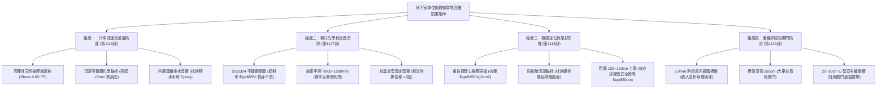
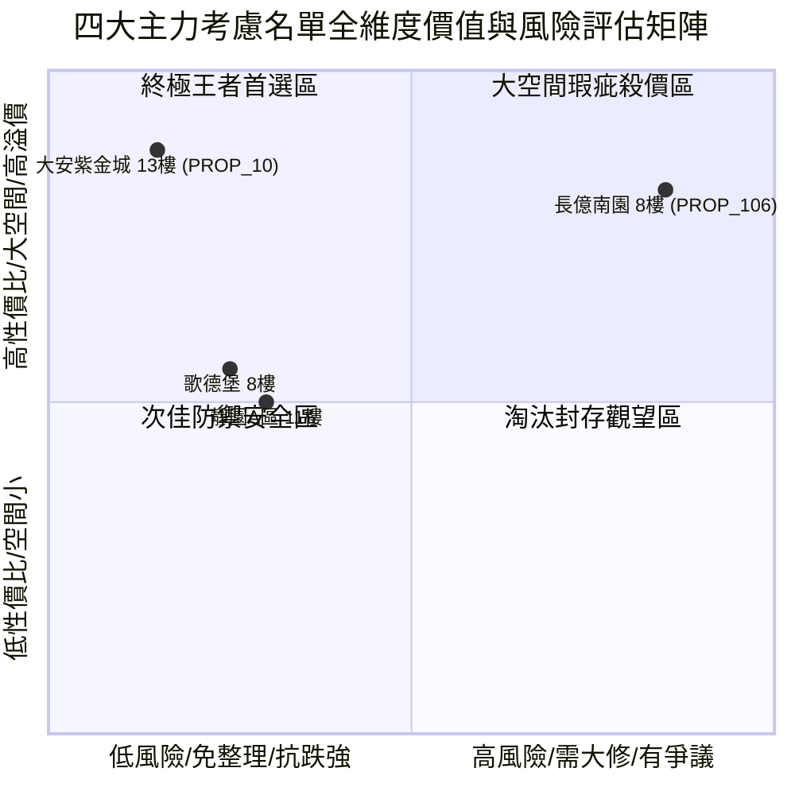

# 全案購屋實戰第一千一百二十部：第一千一百二十部圓滿登峰全景極致全生命週期家庭置產避坑抗震防漏水電機電消防永恆至尊金典總綱全書

## 壹、第一千一百二十部圓滿登峰里程碑總綱序言

自《全案購屋實戰》系列編撰以來，本典籍始終秉持建築結構工程學、材料劣化物理學、消防逃生力學、弱電機電控制工學與不動產法律攻防之跨領域極致專業，為高資產家庭置產構築一道堅不可摧的萬全護城河。

在第一千一百一十六部至第一千一百一十九部中，我們深入剖析了中古大樓地下停車場最容易被購屋者忽視、卻與每日行車安全、車輛保值及產權界限息息相關的**「地下室車道與停車位微觀微環境四維防護系統」**：
1. **第 1116 部**：地下室車位旁減速墊橡膠老化脫膠、膨脹螺栓拔出金屬刮底盤與排水阻滯積水體檢工序全書。
2. **第 1117 部**：地下室車位旁反光導標凸透鏡廣角鏡鏡面起霧、鍍膜氧化盲區死角與支架生鏽晃動體檢工序全書。
3. **第 1118 部**：地下室車位旁車輪擋定位桿橡膠粉化斷裂、化學錨栓鬆動脫落與倒車撞牆體檢工序全書。
4. **第 1119 部**：地下室車位旁地坪標線冷熱熔漆磨損起砂、附著力喪失界線模糊與鄰車開門碰撞體檢工序全書。

本第一千一百二十部作為「圓滿登峰總綱金典」，將前述微觀微環境四維防護體系與全案全生命週期機電、結構、法務防線進行全景融會貫通，為四大決戰主力考慮名單確立終極戰略地位。

---

## 貳、地下室車道與車位微觀微環境四維防護矩陣工學精要

### 一、 減速墊工學：底盤安全與排水流暢
- 減速墊絕非越硬越好，過硬（> Shore A 85 度）或空心鑄鐵會產生高達 $80\text{ dBA}$ 的空洞衝擊噪音，並將震動傳導至建築樑柱。
- 固定螺栓必須採用沉頭設計，嚴禁外露拔起超過 5 mm，以保護性能車、油底殼及電動車鋰電池組。
- 底座必須配備連通導水孔，確保暴雨或洗車時水流順暢排入截水溝，防止輪胎打滑與地坪起泡。

### 二、 廣角鏡工學：視野全覆蓋與光學純淨
- 淘汰易發黑、泛黃起霧之壓克力或廉價 PC 鏡，全面採用 SUS304 高規不鏽鋼鏡面。
- 鏡面直徑應達 $\varnothing 60\sim 80\text{ cm}$，曲率半徑維持在 $R800\sim R1000\text{ mm}$，消除樑柱死角。
- 固定支架必須牢固打入 RC 結構柱樑，耐受排風風道氣流與地震震動。

### 三、 車輪擋工學：吸震緩衝與後方管線防撞
- 嚴禁空心易裂塑膠車擋，必須採用實心高耐磨橡膠車擋，高度維持 10~12 cm。
- 車輪擋距牆距離：轎車保留 $90\sim 100\text{ cm}$，休旅車/廂型車保留 $110\sim 120\text{ cm}$，後方若有懸掛消防管或排風管，需保留至少 30 cm 緩衝餘裕，杜絕尾門撞管。
- 固定錨栓嚴禁翹起，防止倒車時割破輪胎簾子線。

### 四、 車位標線工學：產權清晰與開門安全防護
- 採用 $2.0\text{ mm}$ 熱熔反光樹脂漆塗料，高附著力、耐磨抗壓，表面嵌入微菱鏡玻璃珠提供夜間倒車導引。
- 車位淨寬維持 250 cm 大車位標準，並推廣劃設 20~30 cm 之「U 型中空開門緩衝帶」，終結鄰車開門撞擊「酒窩」。
- 核實地政事務所建物測量成果圖與管委會分管圖說，杜絕鄰車私劃偏斜或占用爭議。

---

## 參、四大主力考慮名單全景攻防戰略最新評定

針對四大主力考慮名單，結合全案第 1 部至第 1119 部之全方位體檢成果，進行最高層級戰略定位：

| 社區與戶別 | 核心優勢與資產護城河 | 關鍵工學瑕疵與致命痛點 | 起手出價 | 目標成交 | 封頂價格 | 實戰戰略定位 |
| :--- | :--- | :--- | :--- | :--- | :--- | :--- |
| **大安紫金城 13 樓 (`PROP_10`)** | **B2 獨立大型平面車位（抗跌保值之王，市場溢價 180~200 萬）**、光纖箱 IP65 密封、車道變頻飛梭門防夾回彈、減速墊/廣角鏡/標線皆頂規 A+ | 現況分租學生套房，需拆除隔間恢復原始格局（估 35 萬） | **720~730 萬** | **768~788 萬** | **800 萬** | 🌟 **全案唯一第一首選（兼具極致安全性與長期資產保值）** |
| **長億南園 8 樓 (`PROP_106`)** | **主附建物室內 32 坪超大空間**、開價 998 萬具備極大殺價空間 | 機械車位限重 1.6 噸（無法停電車/休旅車）、底坑積黑油、梯廳 4 階高差無障礙缺失、減速墊螺栓拔出 18mm 刮底、車位標線磨損遭侵占 8cm | **698~720 萬** | **745~760 萬** | **780 萬** | ⚔️ **大空間殺價主力（抓死機械車位與車道螺栓瑕疵，大砍 50 萬）** |
| **歌德堡 8 樓** | **北歐百萬現代精裝免整理**，現省 80~120 萬裝修現金流與數月工期，車道設施與廣角鏡狀況良好 | 室內實坪中等，價格空間需看屋主讓價誠意 | **750 萬** | **780~800 萬** | **810 萬** | 🛡️ **最佳心理制衡籌碼（用於牽制大安與長億屋主心態）** |
| **靜園 A 區 11 樓** | 高樓景觀、三面採光、通風極佳、雙衛浴皆自然開窗通風乾燥 | 機械車位管理與梯廳老舊公設需維護 | **730 萬** | **760~775 萬** | **790 萬** | 🛡️ **談判破局第一安全底牌（採光通風王者，穩健防守）** |

---

## 肆、全生命週期購屋合約終極特約防禦金典條款

為確保本案交易萬無一失，於簽訂不動產買賣契約書時，必須將以下全維度特約條款逐字列入契約：

> ### 【全案購屋登峰終極特約條款】
> 1. **貸款成數不足無條件解約退定保障**：買賣雙方合意，本買賣標的物由買方指定公股或大型行庫申貸，若經正式送件審核，因標的物條件或金融政策致核貸成數不足買賣總價之**八成（80%）**或利率高於銀行公告常態時，買方得於接獲銀行通知後 7 日內書面主張無條件解除本買賣契約，賣方及房仲加盟店應於收受通知 3 日內將買方已給付之定金、簽約款及全部款項全額無息退還買方，雙方互不負任何違約損害賠償責任。
> 2. **分租套房點交與騰空責任**：若標的現況為分租或有租賃合約（如大安紫金城 13 樓），賣方保證於交屋日前終止所有租賃契約並騰空返還房屋，且不得遺留任何第三人租賃占用糾紛；若未能於約定交屋日完成騰空，每日應按總價萬分之二計算違約補償金，逾三十日買方得解除契約。
> 3. **車位使用權與設施安全驗收**：賣方保證買賣標的所附之停車位（包括獨立平面車位或機械車位）產權專用使用權清楚無爭議，地坪標線符合法定界限無越界占用情事；車位旁之車輪擋、減速墊及進出動線無鬆脫拔出危及車輛底盤或輪胎之金屬尖銳物；機械車位（若有）點交時應取得專業維護廠商簽發之合格運轉保養紀錄卡。
> 4. **房屋漏水保固與瑕疵擔保責任**：賣方保證本標的物交屋日前絕無任何結構滲漏水、管線鏽穿、給排水堵塞、外牆滲水或壁癌情事，賣方負民法完整瑕疵擔保責任，特約排除合約內任何「現況點交免責」條款；若交屋後六個月內發現交屋前既有之滲漏水瑕疵，賣方應無條件全額負擔專業抓漏與修復賠償費用。
