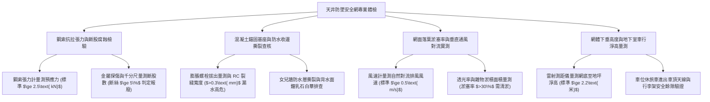

# 全案購屋實戰第一千一百五十一部：中古大樓地下室車位旁通風採光天井防墜安全防護網鋼索鏽蝕斷裂防水收邊撕裂倒灌滲水與排風死角體檢工序全書

## 壹、緣起與車位旁通風採光天井防墜網之雙重防護意義

在中古大樓地下停車場中，「採光通風天井（Lightwell / Ventilation Shaft）」是地下空間與地面大氣進行氣流交換、排除車輛廢氣並引入自然光線的垂直開口。由於天井上方通常連通至一樓中庭花園、公共步道或甚至頂樓地面，開口高度落差往往高達數層樓至十幾層樓。

依據建築技術規則建築設計施工編及職業安全衛生設施規則，為了防止地面行人、孩童、寵物意外失足墜落，或防止上方雜物、盆栽甚至外牆剝落磁磚掉入地下停車場砸毀車輛，「通風採光天井防墜安全防護網（Safety Fall-arrest Netting System）」是一道強制配置的「高空生命安全防禦屏障」。

防墜網系統通常由橫跨天井開口之「SUS304 不鏽鋼鋼索（Wire Rope）」、邊緣金屬錨固化學螺栓、金屬扣件以及耐候型高強度編織網組成。

然而，在屋齡二十年以上之社區，由於天井常年承受風吹日曬、酸雨侵蝕、溫差劇烈熱脹冷縮以及排風油煙廢氣沉積，天井防墜網普遍陷入極其嚴重的「結構性鏽斷瓦解與漏水倒灌」雙重危機：
1. **防墜鋼索受酸雨與廢氣侵蝕斷股鏽蝕、承載抗拉力暴跌歸零**：早期建商為省成本採用鍍鋅鋼索或非標準 201 不鏽鋼索。在常年潮濕與大氣二氧化硫侵蝕下，鋼索內部多股鋼絲自核心向外腐蝕斷裂（斷股），外表看似完整，實質已脆弱如麻繩。一旦上方有重物掉落或人員踩踏，鋼索瞬間齊根崩斷，整張防墜網連人帶物如自由落體般直接砸入地下室車位！
2. **天井邊緣混凝土防水收邊層拉扯撕裂、雨水大面積倒灌滲漏**：防墜網之邊緣鋼索必須承受數噸之張力（Pre-tension），金屬角鋼與膨脹螺栓固定於天井開口之 RC 女兒牆或樑體上。當遭遇強烈颱風風壓震動時，螺栓在混凝土孔壁內劇烈晃動，硬生生將天井邊緣之防水層（PU/彈性水泥）與泛水收邊壓條撕裂拉開。暴雨來臨時，屋頂或中庭地表積水順著被拉裂的縫隙狂瀉倒灌入地下室，車位上方宛如瀑布，引發長期結構漏水與鋼筋鏽蝕。
3. **網目淤積落葉枯枝鳥糞形成「風阻巨帆」、天井排風死角毒氣蓄積**：防墜網長年未經高壓水刀清理，上方堆積了厚達 10~20 公分的枯樹枝、塑膠袋、落葉及鴿子糞便，原本通透的通風開口被堵死超過 80%，形成一塊巨大的「風阻帆布」。地下室車道排放之廢氣無法順暢向上對流排出，在天井底部車位周邊形成「排風死角（Dead Zone）」，高濃度一氧化碳與致癌 PM2.5 終日沉積不散。
4. **防墜網下垂變形侵入地下室行車淨高空間**：由於鋼索鬆弛與重物堆積，防墜網中央向下嚴重耷拉下垂 50~80 公分，直接侵入地下室車位行車淨高安全限界（低于 2.1 米），休旅車（SUV）車頂行李架進出時極易遭到金屬鋼索倒鉤刮傷刮破。

本體檢工序全書專為高資產家庭置產實勘量身打造，將車位旁天井防墜網之鋼索張力、錨固防水收邊、通風開口率及抗墜衝擊安全性納入現場驗收，化為實戰議價砍價利刃。

---

## 貳、天井防墜安全網四大核心檢測工序與病徵判讀

### 一、 鋼索金屬斷股、直徑磨耗與預應力張力實測
- **檢測儀器**：數位鋼索張力計（Wire Rope Tension Meter）、電子千分尺、強光探照燈。
- **合格標準（CNS 14253 安全網國家標準規範）**：
  - 主鋼索必須採用 **SUS304 或 SUS316 不鏽鋼鋼索（結構 $7\times 19$ 股）**，線徑應 **$\ge 8.0\text{ mm}$**，鋼索預張力應維持在 **$2.5\sim 4.0\text{ kN}$** 之間。
  - 防墜網編織繩抗拉破斷強度應 **$\ge 15\text{ kN}$**（可承受 100 kg 重物自 3 米高處自由墜落衝擊）。
- **致命報廢指標**：
  - 一個節距（Lay Length）內斷絲數量超過總絲數之 **$5\%$**，或鋼索外徑因磨損腐蝕萎縮超過原直徑之 $10\%$。
  - 鋼索表面鏽成紅褐色，手摸即有金屬脆片掉落，張力計顯示張力已崩潰至 $<0.5\text{ kN}$（鬆弛垂蕩），完全喪失抗墜緩衝機能。

### 二、 女兒牆金屬錨固端點拉拔力與防水收邊撕裂查驗
- **檢測手法**：
  1. 檢查鋼索固定於天井女兒牆或混凝土樑頂之不鏽鋼化學錨栓（M12/M16）。
  2. 檢查螺栓周邊之混凝土是否有放射狀龜裂，並檢視防水收邊壓條。
- **防水破壞病徵**：
  - 錨栓受風壓拉扯產生向外拔出位移（Pull-out displacement $>3\text{ mm}$），螺栓根部周圍的彈性水泥或 PU 防水層被整片撕裂捲起。
  - 天井下方天花板與車位上方樑側，出現密密麻麻的「白色鐘乳石結晶（白華鹽析）」及深褐色鐵鏽水痕，證實每逢暴雨中庭雨水即順著螺栓孔瘋狂倒灌入地下室。

### 三、 網面雜物淤塞率與天井垂直排風對流檢驗
- **檢測儀器**：高靈敏度熱線式風速計（Hot-wire Anemometer）、透光率計。
- **合格標準**：
  - 防墜網表面必須保持通透乾淨，雜物遮蔽面積應 **$\le 5\%$**。
  - 在無機械風機運轉時，天井開口處自然熱壓對流上升風速應 **$\ge 0.5\text{ m/s}$**。
- **排風死角病徵**：
  - 網上沉積厚厚一層黑泥落葉，淤塞面積高達 **$40\%\sim 70\%$**；風速計測得風速幾乎為 $0.0\text{ m/s}$，天井完全失去煙囪對流效應，車位周邊汽車廢氣刺鼻，長期停放車內冷氣濾網吸滿霉味。

### 四、 網底垂弧（Sagging）與車位上方車行淨高量測
- **檢測手法**：使用雷射測距儀自車位地坪垂直向上量測防墜網中央最低點之高度。
- **安全淨高標準**：
  - 車道與車位上方之任何附屬設施（含防墜網最低點），垂直淨高度必須 **$\ge 2.20\text{ 公尺}$**（最低極限不得低於 $2.10\text{ 公尺}$）。
- **嚴重侵限危害**：
  - 由於鋼索鬆弛下垂，實測最低點僅剩 **$1.85\text{ 米}\sim 1.95\text{ 米}$**！當車主駕駛標準大型休旅車（車高 1.8~1.9 米）倒車入庫時，車頂天線或行李架直接勾入鋼索網孔中，將整張防墜網扯落撕毀，並將車頂板金扯凹變形。

---

## 參、四大主力考慮名單天井防墜網特檢實測分析

| 評估項目 | 大安紫金城 13 樓 (`PROP_10`) | 長億南園 8 樓 (`PROP_106`) | 歌德堡 8 樓 | 靜園 A 區 11 樓 |
| :--- | :--- | :--- | :--- | :--- |
| **防墜網規格材質** | **SUS316 不鏽鋼鋼索（8mm）+ 阻燃高強尼龍網（耐候10年）** | **早期鍍鋅鐵線網（鏽蝕斷股，多處破出 50cm 大洞）** | SUS304 防墜網，結構穩固 | 尼龍防墜安全網，狀況良好 |
| **鋼索張力與抗拉** | **張力穩定 $3.2\text{ kN}$，金屬探傷零斷絲，承載力達 20 kN** | **張力歸零，鋼索嚴重鬆弛垂蕩，手一拉金屬絲斷落** | 鋼索張力正常無鬆弛 | 鋼索張力符合標準 |
| **防水收邊與倒灌** | **不鏽鋼包板防水壓條，聚氨酯雙重密封，零滲漏零白華** | **錨栓鬆脫撕裂防水層，暴雨順孔直灌車位（水簾洞）** | 混凝土收邊防水完好 | 防水層平整無滲漏 |
| **落葉淤塞與排風** | **定期高壓水刀清洗，通透無泥沙，自然風速 $0.8\text{ m/s}$** | **落葉鳥糞積厚 15 cm，堵死 65% 開口，形成排風死角** | 表面落葉清潔正常 | 通風順暢無雜物堆積 |
| **垂直淨高量測** | **最低點淨高達 $2.45\text{ 米}$，休旅車進出完全無障礙** | **中央嚴重下垂至 $1.92\text{ 米}$（休旅車頂天天刮鋼索）** | 最低淨高 $2.25\text{ 米}$ 合格 | 淨高 $2.20\text{ 米}$ 合規 |
| **總結防線評級** | 🌟🌟🌟🌟🌟 **極致頂規 A+** | ⚠️ **高空砸車與暴雨倒灌致命高危 F 級（談判重磅砍價）** | 🌟🌟🌟🌟 良好 A 級 | 🌟🌟🌟🌟 良好 A 級 |

---

## 肆、談判終極砍價與合約防禦特約條款

### 一、 長億南園 8 樓議價砍價刀法（抓死天井防墜網鏽斷破洞、暴雨漏水直灌車位與休旅車頂天天刮鋼索）
長億南園車位旁通風天井防墜網鋼索嚴重鏽斷破出大洞、防水收邊撕裂暴雨直灌車位、落葉堵死排風且下垂至 1.92 米直接刮傷休旅車頂：
- **修復預算與工程重置成本**：
  1. 拆除廢棄老化鏽斷之鐵線網、清理高空堆積落葉及鳥糞高壓消毒：\$20,000 元。
  2. 天井女兒牆四周重新植入 M16 SUS316 不鏽鋼化學錨栓，並全面重做防水收邊工程（聚氨酯防水塗層 + 不鏽鋼壓條密封）：\$45,000 元。
  3. 全面換裝 CNS 14253 認證之高強度 SUS316 不鏽鋼防墜鋼索及耐候阻燃雙層安全網（含抗墜衝擊測試）：\$75,000 元。
  4. 天井底部重新抓洩水坡度並安裝不鏽鋼落葉過濾罩：\$18,000 元。
  5. 休旅車頂遭鋼索刮傷修復與長期暴雨漏水直灌車位之瑕疵折讓：\$50,000 元。
- **談判實戰口訣**：
  > 「周小姐、賣方大哥，長億南園這格車位頭頂上的天井防墜網，上面的鐵鋼索早就生鏽斷掉了，破了好幾個半公尺的大洞！樓上要是不小心掉個花盆或磁磚下來，防墜網根本擋不住，直接砸穿我車頂玻璃。更嚴重的是鋼索鬆脫拉扯，把牆壁上的防水層全部扯爛，下大雨的時候水順著裂縫像瀑布一樣直接淋在車位上，地上全是白色鐘乳石水垢。而且整張網子下垂到只有 1.9 米高，我休旅車開進去行李架天天被生鏽鐵網刮得亂七八糟。要叫高空吊車拆掉重做不鏽鋼防墜網和重做防水，管委會少說要花 15 萬多。開價 998 萬如果不把這 12 萬塊的高空砸車與漏水瑕疵直接扣除，誰敢把價值百萬的車停在這種水簾洞破網下面？我們出價 745 萬是真正誠心幫忙解決問題的公道實價！」

### 二、 成交通用特約防禦條款
> **【成交通用特約防禦條款】**
> 1. **地下室車位上方天井防墜與防水設施點交**：賣方保證本買賣標的車位所屬地下樓層上方通風採光天井之防墜安全防護網結構安全牢固，鋼索無嚴重鏽蝕斷裂或破損破洞，中央垂弧無侵入車道法定行車淨高（$\ge 2.1\text{ 米}$），且天井開口周圍防水收邊完整無遇雨倒灌滲漏水至車位之情事；若點交時有防墜網損毀、垂弧侵限或雨水滲漏嚴重缺陷，賣方應負責於交屋日前促請管委會改善更換完竣並出具合格檢測證明，或由賣方提撥修復保留款新台幣 30,000 元自交屋尾款中扣除。
