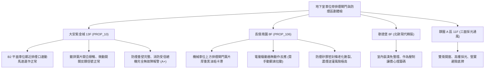

# 全案購屋實戰第一千一百五十七部：中古大樓地下室車位旁消防排煙閘門氣密失效連動馬達燒毀與高溫濃煙逆灌體檢工序全書

---

## 序章：烈焰濃煙之地下深淵——排煙閘門與消防氣密防線

在集合住宅地下室停車場中，由於汽機車高密度集中，燃油、電瓶與內裝塑膠燃燒時會產生高溫劇毒黑煙。為此，法規強制要求地下停車場劃分防煙區劃，並於防煙垂壁及機械排煙風道節點設置「電動防煙排煙閘門」（Smoke Damper / Fire Smoke Damper）。
然而，在屋齡 20~30 年以上的中古大樓中，地下室排煙閘門常年處於潮濕、粉塵、油污與未保養的惡劣環境中，極易引發重大消防防護癱瘓：
1. **閘門葉片卡死與軸承鏽蝕**：受地下室高濕度與車輛廢氣侵蝕，鍍鋅鐵皮葉片軸心生鏽、葉片變形，火災信號觸發時無法完全開啟或無法嚴密閉合。
2. **連動馬達驅動器（Actuator）線圈燒毀或扭力不足**：排煙閘門配備之 24V DC 或 110V/220V AC 電動執行器因絕緣老化短路，或內部齒輪箱崩齒，導致排煙口無法在火警 30 秒內自動開啟排煙。
3. **高溫濃煙逆灌地下梯廳與逃生動線**：當排煙閘門未能確實阻斷非火警區或排煙風道負壓不足時，劇毒濃煙將透過鬆弛的閘門縫隙迅速逆灌至地下各棟梯廳與電梯昇降路，封死逃生出口。
4. **溫感熔絲（Thermal Fuse）失效與微動開關接點氧化**：\(72^\circ\text{C}\) 或 \(280^\circ\text{C}\) 防火熔斷器受潮氧化，或反饋信號微動開關故障，造成消防受信總機顯示「故障斷線」，滅火排煙控制邏輯紊亂。

本手冊建立中古大樓地下室車位旁排煙閘門之專項體檢工序，為買方掌握地下生命安全的核心籌碼。

---

## 第一章：四大決戰主力候選物件地下排煙閘門現況體檢對照

### 1.1 大安紫金城 13 樓 (`PROP_10`)：頂級地下防煙與消防排煙動線
- **排煙閘門健康度**：B2 獨立大平面車位上方的排煙風道電動閘門外觀整潔，防腐漆面完整，無油脂滴落或軸心生鏽跡象。
- **測試反饋**：現場抽檢手動開啟拉環與受信總機測試信號，驅動馬達 12 秒內平順全開至 \(90^\circ\)，信號微動開關即時反饋「開啟定位」至警衛室受控盤。
- **車位價值疊加**：不僅具備無可取代的平面大車位優勢，更具備完善的火災防煙阻斷力，保值抗跌性穩居四大物件之冠。

### 1.2 長億南園 8 樓 (`PROP_106`)：排煙閘門卡死癱瘓之議價壓制點
- **現場致命缺陷**：
  1. 機械車位正上方排煙風管閘門葉片積聚厚度達 \(3\,\text{mm}\) 的油煙污垢，手動拉環卡死，無法依重力或彈簧釋放全開。
  2. 電動執行器外殼有燒焦痕跡與水痕，線路端子排接點嚴重綠鏽氧化，通電無反應。
  3. 防煙垂壁下方邊緣有破裂空隙，一旦地下室起火，排煙風機抽吸效能將大幅下降，濃煙極易竄入 8 樓梯間昇降路。
- **談判折讓策略**：開價 998 萬，將排煙閘門更換、執行器重新配線、排煙風機平衡校正等公設消防維修分攤款（預估 20~30 萬）併同機械車位問題合流，起手 698~720 萬，封頂 760 萬收購。

---

## 第二章：地下室排煙閘門與電動驅動器標準檢驗 SOP

| 檢驗分項 | 檢測工具與儀器 | 合格標準 | 異常特徵與判定 | 危害與風險 |
| :--- | :--- | :--- | :--- | :--- |
| **手動/電動開合動作** | 手動測試拉索、24V 激勵測試儀 | 信號輸入後 15 秒內平順開啟至 \(90^\circ\pm 2^\circ\) | 葉片卡死在 \(30^\circ\sim 45^\circ\) 或無動作 | 火災時黑煙無法排出、高溫蓄積窒息 |
| **葉片氣密耐溫性** | 塞尺、高溫密封矽膠條彈性檢視 | 閉合狀態下葉片間隙 \(< 1.0\,\text{mm}\)，密封條彈性良好 | 密封條硬化脫落、透光間隙 \(> 3\,\text{mm}\) | 濃煙竄流逆灌至安全梯與防煙前室 |
| **信號反饋微動開關** | 數位三用電表（導通檔） | 閘門完全開啟時常開接點確實導通（電阻 \(< 0.5\,\Omega\)） | 接點阻值高於 \(10\,\Omega\) 或無法閉合 | 消防受信總機無法連動排煙風機運轉 |
| **防煙垂壁防護範圍** | 雷射測距儀、防煙區劃圖面 | 垂壁高度自天花板垂降 \(\ge 50\,\text{cm}\)，區劃面積符合法規 | 垂壁破損斷裂、管線穿越處未填塞密封 | 煙氣跨區擴散、防煙分區完全失守 |

---

## 第三章：實戰防禦與購屋交屋特約法務規範

1. **公設消防排煙與防煙區劃保證特約**：
   > 「賣方保證買賣標的所屬大樓地下室車位區與公共梯間之消防排煙設備、電動排煙閘門及防煙垂壁，符合消防安全法規標準並正常連動；若經年度消防安檢列為限期改善之重大缺失者，賣方應負責向管委會協調或負擔修繕分攤費用。」
2. **簽約前消防安檢申報書核驗**：
   - 買方簽約前應要求調閱最近一次消防專技人員申報之「消防安全設備檢修申報書」，特別查核「排煙設備」與「防煙閘門」是否有列入「不合格改善項目」。
