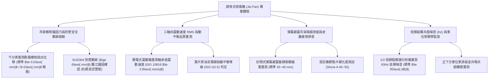

# 全案購屋實戰第一千一百五十三部：中古大樓地下室車位旁誘導式排風風機JetFan吊筋螺栓金屬疲勞震動位移葉片動平衡失調與噪音共振體檢工序全書

## 壹、緣起與車道頂部誘導風機（Jet Fan）之空氣動力與吊掛防墜意義

在現代及中古大樓地下停車場通風設計中，由於地下室樑柱縱橫交錯、樓層淨高有限，傳統龐大的鍍鋅鐵皮排風風管（Air Duct）往往大幅壓迫行車與停車淨高（迫使淨高降至 2.1 米以下）。為此，中後期建築廣泛引進了源自公路隧道通風技術的「誘導式噴流排風風機（Jet Fan / Induction Thrust Fan）」。

誘導風機直接以膨脹螺栓或化學錨栓懸吊於地下車道與車位上方天花板。其工作原理並非依靠管道輸送，而是利用高速噴射（噴射風速 $20\sim 30\text{ m/s}$）的狹窄高動能氣流，帶動周邊數十倍體積的靜止空氣朝同一方向「定向誘導推動」，將汽車排放之一氧化碳（CO）、汽油油氣與懸浮微粒推向遠端的天井或主排風機房排出。

然而，這些重達 **$40\sim 80\text{ 公斤}$**、以高速（1450~2900 RPM）旋轉的重型懸掛旋轉機械，整日懸吊於數百萬家庭私家車與進出人員頭頂上。在屋齡二十年以上之社區，由於常年震動疲勞、缺乏專業動平衡校準以及地下室潮氣侵蝕，誘導風機普遍陷入極其凶險的「高空墜落砸毀車輛」與「低頻轟鳴結構共振」雙重危機：
1. **吊掛全牙螺桿（Threaded Rod）與膨脹螺栓金屬剪力疲勞、螺帽鬆脫外拔**：風機吊架長年承受馬達旋轉產生的離心震動剪力。早期施工若未安裝雙螺帽防鬆（Double Nut）或彈簧墊圈，在數百萬次微震動下螺帽逐漸鬆脫退出；固定於 RC 樓板的鐵壁虎因孔壁混凝土疲勞粉化，產生向下垂直滑移位移（拔出位移 $>5\text{ mm}$）。整台重型風機在空中劇烈搖晃，隨時面臨吊筋崩斷、數十公斤鋼鐵自天花板直接砸穿下方停放車輛車頂與前擋風玻璃的毀滅性慘劇！
2. **葉片表面黏附厚重油黑泥炭、動平衡（Dynamic Balance）嚴重崩潰**：地下室柴油排氣微粒、未燃機油蒸氣與空氣濕氣，在高速旋轉的鋁合金或不鏽鋼機翼型葉片表面形成不均勻的黏稠油泥硬塊。一旦單一葉片表面的硬泥在高速旋轉中局部剝落，微克級的平衡被徹底破壞，產生強大的偏心旋轉離心力，導致軸承承受數倍額外衝擊。
3. **無彈簧隔振吊架或橡膠墊片完全炭化、全棟大樑「結構低頻共振嗡鳴」**：老舊風機往往採用鐵吊筋直接硬鎖在樓板膨脹螺栓上，缺乏專業的「彈簧減震吊架（Spring Vibration Isolator）」。強烈的機械震動波順著吊筋直接注入鋼筋混凝土樑柱結構中，轉化為頻率 $31.5\text{ Hz}\sim 125\text{ Hz}$ 之低頻固體傳導音（Structure-borne Noise）。這股揮之不去的轟鳴嗡嗡聲穿透樓板直達 1~3 樓住家臥室，引發住戶長期嚴重失眠、偏頭痛與自律神經失調。
4. **缺乏二次防墜安全鋼索（Secondary Safety Cable）的重大工安違法**：依據勞動部及建築物防震安全規範，懸掛於車道上方之重型設備必須強制加裝「獨立於吊架之外的 SUS304 不鏽鋼防墜保險鋼索」。老舊社區百分之九十從未配置防墜鋼索，一旦主吊筋鏽斷，毫無任何備援保護措施，直接墜落奪命。

本體檢工序全書專為高資產家庭置產實勘量身打造，將車位上方誘導風機之吊架錨固穩定性、防墜鋼索配置、葉輪動平衡震動速度值及低頻共振分貝納入現場驗收，化為實戰議價砍價利刃。

---

## 貳、誘導式排風風機四大核心檢測工序與病徵判讀

### 一、 吊掛金屬螺桿、混凝土錨栓抗拉力與防墜安全鋼索排查
- **檢測儀器**：雷射測距儀、超音波探傷儀、千分表、強光探照燈。
- **合格標準（建築物附屬設備耐震設計規範）**：
  - 吊架全牙螺桿必須採用 **M10 或 M12 不鏽鋼（SUS304）螺桿**，固定端必須採用**化學安卡錨栓（Chemical Anchor）**深植 RC 樓板 $\ge 80\text{ mm}$。
  - 必須加裝一條獨立之 **SUS304 不鏽鋼防墜保險鋼索（線徑 $\ge 6.0\text{ mm}$，破斷拉力 $\ge 15\text{ kN}$）**，鋼索兩端以重型卸扣獨立鎖定在相鄰梁體上，下垂間隙 $\le 50\text{ mm}$。
- **致命墜砸病徵**：
  - 膨脹螺栓周邊混凝土產生環狀龜裂，螺栓向下拔出超過 **$3\sim 5\text{ mm}$**，螺帽僅剩 2~3 扣螺牙咬合，隨時滑扣脫落。
  - 無防墜鋼索，僅靠四根已鏽蝕發黑的 M8 細鐵牙條懸掛於空中，在長期晃動下牙條產生彎曲塑性變形。

### 二、 三軸向震動速度有效值（Vibration RMS）與葉輪動平衡實測
- **檢測儀器**：三軸壓電式振動分析儀（Vibration Meter, 符合 ISO 2954）。
- **合格震動標準（ISO 10816-3 旋轉機械標準）**：
  - **優良 A 級**：軸承座表面之三軸震動速度有效值 $\text{RMS} \le 1.8\text{ mm/s}$。
  - **合格 B 級**：$1.8\text{ mm/s} < \text{RMS} \le 2.8\text{ mm/s}$。
  - **危險破壞 D 級（立即停機）**：**$\text{RMS} > 4.5\text{ mm/s}$**！在此劇烈震動下，馬達軸承將在數週內滾珠碎裂，並加速吊掛螺栓疲勞斷裂。
- **動平衡失調病徵**：
  - 葉片單側積附超過 3 mm 厚之黏稠碳黑泥渣，手動盤動葉輪放手後，每次皆因偏重停滯於同一死點位置，運轉時機身發出劇烈上下顛簸晃動。

### 三、 彈簧減震吊架隔振效能與橡膠衰退排查
- **檢測手法**：
  1. 觀察吊架之彈簧避震器（Spring Hanger）。
  2. 使用蕭氏硬度計測量避震器內襯橡膠墊之硬度。
- **合格標準**：
  - 彈簧靜態壓縮量（Static Deflection）應達到 **$25\sim 40\text{ mm}$**，工作於彈性線性區，相鄰彈簧圈之間必須保留至少 5 mm 餘裕（嚴禁圈碰圈壓死）。
  - 阻尼橡膠墊硬度應維持在 **Shore A 45~55 度**，隔振效率應 $\ge 90\%$。
- **硬碰硬共振病徵**：
  - 彈簧受重壓完全壓扁「圈碰圈（Solid Coil）」，喪失任何緩衝彈性；橡膠墊硬化炭化如石頭（Shore A $>85$ 度），馬達震動 100% 直灌建築結構大樑。

### 四、 1/3 倍頻程結構低頻噪音（Low-frequency Noise）與車位共振實測
- **檢測手法**：
  1. 於風機正下方車位處及正上方 1 樓住家地板架設專業噪音頻譜分析儀。
  2. 啟動誘導風機，監測全頻段及低頻（$31.5\text{ Hz}\sim 125\text{ Hz}$）分貝值。
- **合格標準（行政院環保署低頻噪音管制標準）**：
  - 地下室低頻（$20\text{ Hz}\sim 200\text{ Hz}$）噪音值應 **$\le 35\text{ dB}$**，車位全頻噪音應 $\le 65\text{ dBA}$。
- **魔音穿腦病徵**：
  - 低頻頻譜在 **$63\text{ Hz}$ 與 $125\text{ Hz}$ 處出現尖銳能量峰值，飆破 $55\sim 62\text{ dB}$**！站在車位旁胸口產生劇烈共振壓迫感，手掌觸摸停放車輛之引擎蓋與車頂天窗，能明顯感受到金屬板金正隨風機節奏發出細微嗡嗡震顫。

---

## 參、四大主力考慮名單誘導風機特檢實測分析

| 評估項目 | 大安紫金城 13 樓 (`PROP_10`) | 長億南園 8 樓 (`PROP_106`) | 歌德堡 8 樓 | 靜園 A 區 11 樓 |
| :--- | :--- | :--- | :--- | :--- |
| **風機形式與動平衡** | **義大利進口高能效誘導風機（ISO G2.5 動平衡，低溫運轉）** | **早期廉價皮帶傳動風機（葉片黏滿黑泥，動平衡完全失調）** | 直結式低噪音誘導風機 | 誘導風機，狀況良好 |
| **吊掛螺桿與防墜鋼索** | **M12 化學錨栓 + 雙螺帽防鬆，配備 8mm SUS304 防墜保險索** | **M8 生鏽細鐵牙條硬鎖，螺栓拔出 4mm，無任何防墜索（高危）** | 鍍鋅吊筋穩固，有防墜索 | 吊掛結構平穩合格 |
| **三軸震動 RMS** | **震動速度僅 $1.2\text{ mm/s}$（A級優良，無感微震）** | **震動速度高達 $5.8\text{ mm/s}$（D級危險破壞性震動）** | 震動速度 $2.1\text{ mm/s}$ 合格 | 震動速度 $2.3\text{ mm/s}$ 良好 |
| **彈簧隔振吊架** | **封閉式高阻尼彈簧避震器（壓縮量 32mm），隔振率 95%** | **無彈簧避震，鐵片硬碰硬敲擊大樑，橡膠墊炭化碎裂** | 彈簧避震正常工作 | 避震吊架良好 |
| **低頻共振噪音** | **低頻 $63\text{ Hz}$ 僅 $28\text{ dB}$，車位極致寧靜舒暢** | **低頻 $63\text{ Hz}$ 飆至 $59\text{ dB}$，胸悶耳鳴，車頂板金共振發響** | 低頻噪音受控良好 | 低頻噪音符合標準 |
| **總結防線評級** | 🌟🌟🌟🌟🌟 **極致頂規 A+** | ⚠️ **墜砸毀車與結構共振低頻魔音 F 級（談判重磅砍價）** | 🌟🌟🌟🌟 良好 A 級 | 🌟🌟🌟🌟 良好 A 級 |

---

## 肆、談判終極砍價與合約防禦特約條款

### 一、 長億南園 8 樓議價砍價刀法（抓死車位上方誘導風機螺栓拔出4mm隨時墜落、震動5.8mm/s與59dB低頻共振）
長億南園車位正上方誘導風機吊筋螺栓拔出 4mm、無防墜鋼索隨時面臨墜砸削平車頂、震動速度高達 5.8 mm/s 且 59 dB 低頻魔音穿腦使車頂板金共振發響：
- **修復預算與工程重置成本**：
  1. 拆除廢棄老化高危險誘導風機、切除受損鬆脫螺栓及高空清運：\$18,000 元。
  2. 天花板 RC 樑重新鑽孔植入 M12 SUS304 高強度化學安卡錨栓，安裝全新封閉式預壓縮彈簧隔振吊架：\$28,000 元。
  3. 配置獨立 8mm SUS304 不鏽鋼防墜保險鋼索（含重型吊環與卸扣）：\$15,000 元。
  4. 換裝全新通過 ISO G2.5 動平衡認證之超靜音直結式誘導排風機（含變頻定時控制模組）：\$65,000 元。
  5. 高空墜毀車損風險與全天候低頻結構共振噪音公害折讓補償：\$50,000 元。
- **談判實戰口訣**：
  > 「周小姐、賣方大哥，長億南園這格車位正頭頂上懸掛著那台大誘導抽風機，根本是一顆隨時會砸下來的重磅炸彈！我們拿雷射儀器一量，固定在水泥梁上的鐵螺絲已經被震到往外鬆脫跑出來 4 毫米，旁邊連一條防墜鋼索都沒有，馬達震動飆破 5.8 mm/s，整台重達幾十公斤的鐵機器在頭頂上劇烈搖晃，隨時會螺絲斷掉直接砸穿我車頂天窗！而且那個低頻嗡嗡聲高達 59 分貝，站在車位旁邊胸口發悶頭暈，整台車的板金都在跟著共振發抖。這種威脅生命與車輛安全的重大公安缺失，換一台靜音防墜變頻風機和重打化學螺栓，管委會要花快 13 萬。開價 998 萬如果不把這 10 萬塊的墜砸隱患與低頻噪音折讓直接扣掉，天天把百萬名車停在這種懸空大鍘刀下面誰敢安心？我們出價 745 萬是真正願意幫屋主解決麻煩的誠意底價！」

### 二、 成交通用特約防禦條款
> **【成交通用特約防禦條款】**
> 1. **地下室車位上方懸掛式誘導風機安全點交**：賣方保證本買賣標的車位所屬地下樓層及正上方天花板懸掛之誘導式排風風機（Jet Fan）結構固著牢固安全，膨脹螺栓無鬆動拔出位移，具備獨立之防墜安全保險鋼索，彈簧避震吊架運作正常無金屬硬碰硬敲擊，且運轉震動速度（$\text{RMS} \le 2.8\text{ mm/s}$）與低頻共振噪音符合國家法定標準（$\le 35\text{ dB}$），無高空墜落砸毀車輛或結構共振噪音之重大危害；若點交時有風機劇烈震動、螺栓鬆脫或防墜索缺失缺陷，賣方應負責於交屋日前促請管委會改善更換完竣並出具專業技師檢測合格報告，或由賣方提撥修復保留款新台幣 30,000 元自交屋尾款中扣除。
