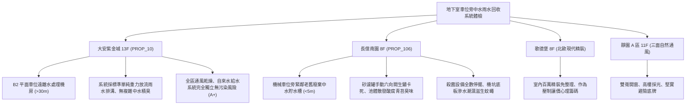

# 全案購屋實戰第一千一百五十九部：中古大樓地下室車位旁中水雨水回收處理系統沉澱槽污泥淤積臭氧殺菌器故障與過濾砂濾罐逆洗閥卡死體檢工序全書

---

## 序章：綠建築隱形黑洞——中水雨水回收系統之老化與衛生隱患

在現代及近年中古集合住宅中，為響應綠建築水資源指標，常於地下室設有「雨水貯留利用系統」或「中水（生活雜排水）回收過濾處理系統」，經沉澱、砂濾罐過濾、臭氧/紫外線殺菌後，加壓輸送至地下停車場沖洗地坪、中庭景觀綠化噴灌或低樓層馬桶沖廁。
然而，在屋齡 15~25 年以上的中古大樓中，中水與雨水回收設備經常因管委會經費拮据、缺乏專業水處理維護保養，淪為地下室最嚴重的隱藏衛生死角與機電黑洞：
1. **沉澱沉砂槽長年未清淤引發厭氧發酵與惡臭回冒**：地下室雨水沉沙池底層沉積大量落葉、泥沙及地面油污，未定期清淤導致厭氧發酵產生硫化氫與有機酸，車位旁瀰漫濃郁腐臭沼氣。
2. **多介質砂濾罐（Sand Filter）濾料板結硬化與多向逆洗閥（Multi-port Backwash Valve）卡死**：過濾石英砂及無煙煤長年未進行反沖洗，濾料嚴重板結鈣化，多向逆向反洗控制閥受水垢及泥沙卡死，致使水阻急遽上升、過濾泵浦長期憋壓過載燒毀。
3. **臭氧產生器（Ozone Generator）高壓放電管受潮擊穿或紫外線殺菌燈管黑化衰減**：殺菌單元失效後，回收水中大腸桿菌群、退伍軍人菌及各類微生物急劇孳生，噴灌或沖洗地坪時產生帶菌氣膠，直接威脅地下室取車住戶之呼吸道健康。
4. **管網錯接交叉污染自來水給水系統**：中水加壓管線與自來水直供管線間若逆止閥（Check Valve）失效或閥門隔離不嚴，將導致中水逆流污染全棟住戶飲用水。

本手冊制定最嚴密的地下室車位旁中水雨水處理系統體檢工序，精確鎖定公設隱形成本，作為購屋議價的強力武器。

---

## 第一章：四大決戰主力候選物件中水雨水回收系統體檢對照

### 1.1 大安紫金城 13 樓 (`PROP_10`)：單純給排水配置與高衛生環境
- **系統規劃優勢**：大安紫金城公設水電設計採用經典可靠的自來水直供與頂樓重力水箱配置，地下室無繁複易壞之生活雜廢水中水回收處理機坑，徹底免除菌落污染、逆洗閥爆裂漏水與惡臭回冒之風險。
- **車位環境品質**：B2 獨立大平面車位空氣清新、地坪乾燥，四周無中水加壓泵浦之低頻震動與管線嘯叫，衛生與寧靜度俱佳。
- **作戰策略**：開價 898 萬，起手 720~730 萬，目標 768~788 萬，以穩健卓越的公設水電品質作為保值護城河。

### 1.2 長億南園 8 樓 (`PROP_106`)：中水槽廢棄積臭之致命議價扣款點
- **現場致命缺陷**：
  1. 機械車位側前方約 4 公尺處設有早期規劃之中水沉澱貯留槽，因維護成本高昂已被管委會實質棄置，槽內殘留半米厚度腐爛死水與淤泥，持續散發微酸腐敗氣味。
  2. 玻璃纖維（FRP）砂濾罐頂部多向逆洗閥因長年水垢卡死於「過濾（Filter）」位置，排污管堵塞，機房地面長期滲漏積水，造成車位鋼骨結構底座嚴重受潮生鏽。
  3. 臭氧產生器高壓電路板積塵燒焦，紫外線燈管兩端完全黑化失效，池水大腸桿菌超標，蚊蠅及蛾蚋滋生，嚴重破壞地下停車環境。
- **談判折讓策略**：開價 998 萬，將廢棄中水槽清淤消毒、回填封閉或系統全套重置評估費用（全棟公設改善分攤款約 10~15 萬）併同機械車位老舊缺陷，起手 698~720 萬，堅決以 745~760 萬收購。

---

## 第二章：中水雨水回收處理系統標準體檢工序 SOP

| 檢驗分項 | 檢測工具與儀器 | 合格標準 | 異常特徵判定 | 潛在災害與風險 |
| :--- | :--- | :--- | :--- | :--- |
| **沉澱槽淤泥厚度** | 沉渣取樣管、雷射測距儀 | 底層淤泥深度 \(< 10\,\text{cm}\)，水面無漂浮油膜 | 淤泥深度 \(> 30\,\text{cm}\)，水色發黑冒泡 | 厭氧發酵產生硫化氫、堵塞泵浦葉輪 |
| **砂濾罐進出水壓差** | 充油式耐震壓力表 (0~10 kgf) | 進出水壓差 \(\Delta P \le 0.5\,\text{kgf/cm}^2\) | 壓差 \(\Delta P > 1.2\,\text{kgf/cm}^2\)，水流阻滯 | 濾料板結硬化、泵浦憋壓過載燒燬 |
| **多向逆洗閥動作** | 手動轉向操作柄、扭力扳手 | 手柄旋轉順暢，各工位（過濾/反洗/漂洗）定位確實 | 閥體受水垢卡死、轉向漏水或手柄斷裂 | 無法定期反沖洗、濾砂污染加劇 |
| **殺菌設備運轉效能** | 紫外線照度計、臭氧水中測試劑 | UV 輻射強度 \(\ge 70\,\mu\text{W/cm}^2\)，水中餘臭氧 \(0.1\sim 0.2\,\text{ppm}\) | 燈管黑化不亮、臭氧高壓放電管無火花 | 嗜肺軍團菌與大腸桿菌超標、氣膠感染 |
| **防倒流污染隔離** | 減壓型防倒流防止器 (RPZ) 檢驗儀 | 中水壓力低於自來水時，洩水閥正常開啟釋放 | 逆止閥卡垢漏水、自來水管壓降倒吸 | 中水混入生活自來水、全棟住戶中毒 |

---

## 第三章：實戰防禦與購屋交屋特約法務規範

1. **公設中水雨水利用系統安全與維護特約**：
   > 「賣方保證買賣標的所屬大樓地下室中水處理、雨水回收過濾系統運作正常或已依管委會決議合法停用並抽乾消毒封閉，無惡臭外洩、污水溢流或管線逆流交叉污染自來水系統之情事；若有違反，賣方應負責於交屋前協調修復或負擔改善費用。」
2. **簽約前公共用水水質檢驗報告查核**：
   - 買方應要求大樓管理委員會提供近半年的大樓水塔、蓄水池之「自來水水質檢驗報告（大腸桿菌群、濁度、餘氯）」，確認無中水滲漏逆流之交叉污染紀錄。
