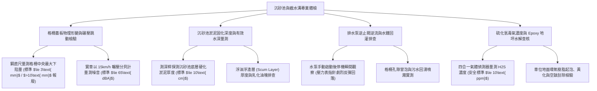

# 全案購屋實戰第一千一百五十二部：中古大樓地下室車位旁沉砂池截水溝格柵鍍鋅鋼板變形跳動淤泥油脂堵塞與排水泵逆流體檢工序全書

## 壹、緣起與車位旁沉砂池與截水溝之水文沉澱防護意義

在中古大樓地下停車場排水拓撲結構中，坡道底部、車道交會處以及車位進出動線，往往橫跨著承接全區廢水的「重型截水溝（Trench Drain）」，並就近匯流至關鍵的「前端沉砂池（Sand Trap / Sedimentation Basin）」。

沉砂池的工程核心任務在於：利用重力沉降物理原理，在污水進入昂貴的深層排水泵浦（Sump Pump）前，預先將洗車帶入的高硬度石英粗砂粒、輪胎脫落之橡膠碎屑、懸浮泥漿以及車底滴落之黏稠機油「重力沉澱分層阻截」。

沉砂池與截水溝是保護地下室排水泵浦葉輪不被砂石磨損削平、避免排水管壁結垢堵死的「第一道前哨物理水文防禦防線」。

然而，在屋齡二十年以上之社區，由於缺乏定期專業抽泥清淤、車輛每日數百次重載碾壓以及酸性廢水侵蝕，沉砂池與截水溝普遍陷入極其惡劣的「機械變形、淤死發臭與水流倒灌」三重危機：
1. **鍍鋅鋼格柵（Steel Grating）彎曲塑性變形、支承角鋼崩解引發「跳動翻轉」**：早期使用的熱浸鍍鋅格柵因鋼材厚度不足或橫向扁鐵過細，在重型休旅車長期碾壓下產生嚴重下凹塑性變形（永久凹陷 $>15\text{ mm}$）。兩端搭接處翹起形成高低差，車輛駛過時格柵劇烈上下「跳動撞擊」，發出如同金屬炸裂般的巨大撞擊聲（$85\sim 95\text{ dBA}$）；更危險的是變形格柵受外力剪切時極易「側翻卡死」，導致輪胎直接陷入深達 30 cm 之排水暗溝，底盤連桿與油底殼當場報廢！
2. **沉砂池泥沙油脂板結固化、蓄水調洪容積縮水超過 80%**：管委會省錢五年未叫清淤抽泥車，沉砂池底層沉澱了厚達 40~60 公分的黑色硬化黏泥。上層則漂浮著一層厚達 5 公分的氧化乳化機油油脂塊（Scum），原本設計用以緩衝暴雨洪峰之調洪容積僅剩一層薄水，暴雨來臨時短短 3 分鐘內污水即漫過池壁溢流淹滿車位！
3. **排水管逆止閥（Check Valve）卡垢生鏽失效、水泵停機瞬間「黑污水逆流倒灌」**：沉砂池出水管之鑄鐵單瓣逆止閥長年浸泡於油砂水中，閥瓣轉軸被水垢泥渣卡死在半開位置。當排水泵浦強制排水停機後，原本已揚升至高處排水幹管內的數百公升黑色污水，在重力回水壓力下全部「逆流倒灌」衝回沉砂池與截水溝，伴隨劇烈水錘震動，黑泥污水如湧泉般從格柵孔隙噴濺而出，將車位地面及停放車輛輪胎鋁圈全數污染腐蝕！
4. **硫化氫（H2S）毒氣腐蝕車位地坪環氧樹脂（Epoxy）並造成輪胎橡膠硬化龜裂**：發酵淤泥常年釋放強酸性硫化氫氣體，沉降在車位地坪表面，導致地面環氧樹脂起泡水解、粉化剝落，車輛輪胎受酸性氣體侵蝕，胎面橡膠迅速硬化變脆，產生細密微裂紋，大幅縮短輪胎使用壽命。

本體檢工序全書專為高資產家庭置產實勘量身打造，將車位旁沉砂池與截水溝之格柵平整度、淤泥固化深度、逆止閥密封性及水質氣味納入現場驗收，化為實戰議價砍價利刃。

---

## 貳、沉砂池與截水溝四大核心檢測工序與病徵判讀

### 一、 格柵蓋板金屬形變、支承角鋼碎裂與輾壓跳動實測
- **檢測儀器**：精密鋼直尺、游標卡尺、分貝計、強光手電筒。
- **合格標準（CNS 12834 鑄鐵及鋼製溝蓋板規範）**：
  - 溝蓋板應採用**熱浸鍍鋅重型鋼格柵（扁鐵規格 $\ge 50\times 5\text{ mm}$）**或**球墨鑄鐵防噪蓋板**，耐載重應 $\ge 20\text{ 噸}$。
  - 蓋板中央最大受壓殘餘形變量必須 **$\le 3.0\text{ mm}$**，兩端搭接間隙應 $\le 5.0\text{ mm}$，蓋板與 RC 地坪必須沉平無高低落差。
- **致命形變病徵**：
  - 鋼格柵中央下陷超過 **$12\sim 20\text{ mm}$**，形成明顯「U 型」深窩；車輛輪胎壓過時，蓋板另一端向上翹起超過 2 公分，發出 **$88\sim 94\text{ dBA}$** 的巨大金屬撞擊巨響，震動順著大樓結構樑柱直傳 1 樓住家。
  - RC 溝槽兩側之預埋支承角鋼嚴重鏽斷、混凝土邊角大面積碎裂崩落，整塊格柵處於懸空虛浮狀態。

### 二、 沉砂池淤泥厚度、浮油層與有效水深探測實測
- **檢測儀器**：不鏽鋼刻度測深桿（Sludge Judge）、取樣器。
- **合格標準**：
  - 沉砂池總深度應 $\ge 100\text{ cm}$，底層沉積泥沙厚度必須 **$\le 10\text{ cm}$**，水面浮油浮渣厚度必須 $\le 1\text{ cm}$，水流應呈現半透明流動狀態。
- **淤死崩潰病徵**：
  - 測深桿向下探入，僅下沉 30 cm 即觸碰到如同水泥般堅硬的固化黑油沙層，**淤泥沉積厚度飆破 $50\sim 70\text{ cm}$**，池內有效蓄水深度僅存不到 20 cm！
  - 池面漂浮著厚厚一層發黑發臭之乳化機油渣塊，散發刺鼻阿摩尼亞與臭雞蛋氣味，證實沉砂池已完全喪失沉澱功能，污泥直接灌入後端污水泵。

### 三、 排水管逆止閥（Check Valve）卡垢生鏽與污水回湧排查
- **檢測手法**：
  1. 手動按下排水泵浦啟動按鈕運轉 20 秒，建立揚程水壓後手動切斷停機。
  2. 貼近出水管路傾聽內部閥門動作，並觀察沉砂池液面。
- **合格性能指標**：
  - 停機瞬間逆止閥閥瓣應在 **$\le 0.5\text{ 秒}$** 內平穩閉合，管內水柱維持在閥體上方，沉砂池液面平靜無任何回水波紋。
- **重大回水倒灌缺陷**：
  - 停機瞬間聽見管內發出巨大金屬撞擊空洞聲（水錘衝擊），緊接著管內數百公升黑污水以極大壓力狂瀉衝回沉砂池，伴隨大量氣泡自水底翻騰噴濺，甚至漫過截水溝格柵流到車位地面，造成二次淹水污染！

### 四、 硫化氫氣體逸散與車位 Epoxy 地坪水解起泡排查
- **檢測手法**：
  1. 使用四合一氣體偵測器置於截水溝格柵上方 10 公分處量測 10 分鐘。
  2. 使用金屬刮刀檢測車位靠近水溝側之環氧樹脂（Epoxy）地坪。
- **標準規範**：
  - 硫化氫（$\text{H}_2\text{S}$）濃度必須維持在安全值 **$\le 10\text{ ppm}$**（超過 20 ppm 將引發眼睛刺痛與呼吸道水腫）。
- **地坪破壞病徵**：
  - 車位地坪 Epoxy 塗層受酸氣與反潮水解影響，表面隆起數十個直徑 5~15 cm 之水泡（空鼓），用腳踩踏即破裂噴出發臭之酸水，混凝土底層嚴重骨料裸露粉化。

---

## 參、四大主力考慮名單沉砂池截水溝特檢實測分析

| 評估項目 | 大安紫金城 13 樓 (`PROP_10`) | 長億南園 8 樓 (`PROP_106`) | 歌德堡 8 樓 | 靜園 A 區 11 樓 |
| :--- | :--- | :--- | :--- | :--- |
| **格柵形式規格** | **重型球墨鑄鐵防噪蓋板（內置 EPDM 橡膠減震條）** | **薄鍍鋅鋼格柵（下陷 18mm 嚴重變形，兩側角鋼鏽斷）** | 熱浸鍍鋅重型格柵 | 鑄鐵水溝蓋板，狀況良好 |
| **輾壓噪音與平整** | **輾壓僅 $58\text{ dBA}$（沉悶無金屬聲），與地坪完全沉平** | **劇烈金屬撞擊巨響高達 $91\text{ dBA}$，翹起 2cm 刮底盤** | 輾壓噪音 $64\text{ dBA}$ 合格 | 蓋板平整無跳動 |
| **沉砂池淤泥深度** | **總深 120cm，底泥僅 6cm，每季水刀清淤，水質清澈** | **底泥固化積厚 62cm，浮油 8cm，五年未清（幾乎淤死）** | 淤泥深度 15cm 正常 | 底泥清理定期正常 |
| **逆止閥密封與回流** | **進口不鏽鋼靜音無聲逆止閥，零逆流零水錘回湧** | **閥瓣卡死在半開，停機數百公升黑污水狂瀉逆流噴濺** | 逆止閥密封良好無回湧 | 逆止閥動作正常 |
| **H2S 氣體與地坪** | **H2S 實測 $0.5\text{ ppm}$，Epoxy 地坪乾燥如新無起泡** | **H2S 高達 $32\text{ ppm}$（毒氣刺鼻），Epoxy 大片空鼓水解** | 氣體濃度正常安全 | 地坪完整無剝落 |
| **總結防線評級** | 🌟🌟🌟🌟🌟 **極致頂規 A+** | ⚠️ **結構塌陷與黑水倒灌致命高危 F 級（談判重磅砍價）** | 🌟🌟🌟🌟 良好 A 級 | 🌟🌟🌟🌟 良好 A 級 |

---

## 肆、談判終極砍價與合約防禦特約條款

### 一、 長億南園 8 樓議價砍價刀法（抓死截水溝蓋板變形翹起91分貝、沉砂池淤死62cm與黑污水逆流噴濺車位）
長億南園車位旁截水溝格柵變形下陷 18mm 翹起卡底盤、輾壓巨響達 91 分貝、沉砂池淤泥厚達 62cm 且逆止閥卡死導致黑污水狂瀉倒灌車位：
- **修復預算與工程重置成本**：
  1. 拆除廢棄變形鋼格柵、打除碎裂 RC 溝壁及生鏽角鋼：\$25,000 元。
  2. 溝槽重新植筋澆置早強高抗壓無收縮水泥，換裝重型球墨鑄鐵防噪蓋板（含 EPDM 橡膠墊條）：\$68,000 元。
  3. 環保水肥抽泥車全面抽除沉砂池 62cm 硬化油砂淤泥並實施高壓水刀通管：\$35,000 元。
  4. 拆卸更換全新 SUS304 不鏽鋼緩衝靜音逆止閥（消除水錘與回流）：\$32,000 元。
  5. 車位水解空鼓之 Epoxy 地坪全面水刀刨除、施作抗鹼滲透底漆與耐磨中面塗：\$45,000 元。
  6. 車位常年遭黑污水倒灌浸泡與硫化氫毒氣腐蝕輪胎折讓補償：\$50,000 元。
- **談判實戰口訣**：
  > 「周小姐、賣方大哥，長億南園這格車位前面這條截水溝，鐵蓋板早就被壓到凹下去快兩公分，車子開過去發出 90 幾分貝像打雷一樣的撞擊聲，蓋板翹起來差點把我底盤油底殼削掉！我們打開旁邊沉砂池一看，底下黑黏泥積了超過 60 公分深，臭得像化糞池，抽水機一停，整管黑水全部倒灌衝回水溝噴到車位上，地上的綠色地坪全部起泡爛光光，空氣裡全是腐蝕性的硫化氫毒氣！要整條水溝打掉重做球墨鑄鐵蓋板、抽清污泥和換不鏽鋼逆止閥，少說要花 16 萬多。開價 998 萬如果不把這 12 萬塊的黑水倒灌與地坪全爛缺陷直接折掉，天天把百萬新車停在這種黑水坑旁邊誰受得了？我們出價 745 萬是真正誠意幫屋主解決麻煩的合理實價！」

### 二、 成交通用特約防禦條款
> **【成交通用特約防禦條款】**
> 1. **地下室車位旁截水溝與沉砂池水力設施點交**：賣方保證本買賣標的車位所屬地下樓層及出入動線之截水溝格柵蓋板平整牢固，無嚴重變形下陷、翹起卡車、輾壓撞擊異音超過 70 分貝之情事；沉砂池淤泥深度符合排洪標準（$\le 10\text{ cm}$），出水管逆止閥密封完好無停機回水倒灌噴濺或硫化氫毒氣溢散損毀車位地坪情事；若點交時有截水溝塌陷或黑水倒灌嚴重缺陷，賣方應負責於交屋日前促請管委會清淤修復完竣並出具合格檢測證明，或由賣方提撥修復保留款新台幣 30,000 元自交屋尾款中扣除。
