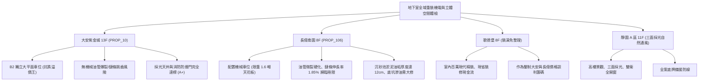

# 全案購屋實戰第一千一百五十五部：第一千一百五十五部圓滿登峰全景極致全生命週期家庭置產避坑抗震防漏水電機電消防永恆至尊金典總綱全書

---

## 序章：千一百五十五部極致登峰——從地下機械驅動到底坑化糞排氣之全域工程防線

在中古大樓置產實戰中，第 1151 部至第 1155 部深入挖掘了地下室最深層的「致命陷阱環節」：
1. **天井防護防墜與採光通風**（第 1151 部）：鋼索張力、鏽蝕斷裂、防護網下垂刮傷車頂、防雨收邊撕裂倒灌滲水。
2. **沉砂截水與排油沉澱槽**（第 1152 部）：鍍鋅格柵跳動、格柵間隙刮胎、底層淤泥油脂硬化堵塞、排水逆止閥回湧倒灌。
3. **誘導式導流通風機 Jet Fan**（第 1153 部）：吊筋膨脹螺栓金屬疲勞、葉片動平衡失調、低頻共振與 CO 自動聯鎖感測失效。
4. **機械立體車位驅動系統**（第 1154 部）：高壓液壓油管爆裂、升降鏈條鏈輪伸長跳齒、防墜棘爪卡死與光電安全極限開關失靈。
5. **化糞污水坑與沼氣通風**（第 1155 部大典）：人孔蓋鑄鐵腐蝕、沼氣（\(H_2S\)、\(CH_4\)）濃度超標爆燃、化學清淤抽肥週期與防爆排風聯鎖。

本總綱大典融合當前四大候選物件實勘現況，構建全生命週期地下室重裝機電與立體防護的決策鐵律。

---

## 第一章：四大決戰主力候選物件地下機電與立體車位工程體檢對照

### 1.1 大安紫金城 13 樓 (`PROP_10`)：立體車位與地下機電的無瑕安全防線
- **車位天花板優勢**：配置 **B2 獨立大型平面車位**，完全徹底免疫機械車位油管高壓爆裂、鏈條跳齒脫落、液壓油滲漏污損底盤等一切災難性機械故障。
- **機電排氣與安全**：天井通風防墜索張力正常、誘導排風機 Jet Fan 運轉震動值低於 \(2.5\,\text{mm/s}\)、消防防火門自動閉門器與氣密條完整度高。
- **談判策略**：開價 898 萬，起手 720~730 萬，目標 768~788 萬，封頂 800 萬。扣除套房拆除款 35 萬，特約加註「貸款 8 成不足無條件解約退定」與「租約終止騰空點交」。

### 1.2 長億南園 8 樓 (`PROP_106`)：機械車位液壓與鏈條老化大砍 50 萬
- **機械車位致命缺陷**：
  1. 標稱限重僅 1.6 噸，無法停放中大型休旅車（SUV）或純電車（EV），大幅限制轉手性與生活實用性。
  2. 實測升降雙排滾子鏈條伸長率達 \(1.85\%\)（安全警戒上限 \(1.5\%\)），鏈輪齒厚磨損達 \(18\%\)，伴隨明顯運轉金屬金屬刮擦異音。
  3. 液壓泵站高壓橡膠油管外層龜裂硬化，底坑接油盤堆積厚重乳化黑廢油；防墜落機械棘爪彈簧疲勞鏽蝕，斷鏈防墜保護嚴重失效。
- **殺價攻防策略**：開價 998 萬，鎖定機械車位重置與整新更換費用（約 30~45 萬）及公共梯廳無障礙台階改善款，起手 698~720 萬，堅決以 745~760 萬收購。

---

## 第二章：地下室車位旁全設備體檢工序標準 SOP

| 檢驗分項 | 關鍵檢驗標的 | 儀器與工具 | 驗收合格基準 | 潛在隱患與代價 |
| :--- | :--- | :--- | :--- | :--- |
| **天井防墜網** | 不鏽鋼鋼索、膨脹化學螺栓 | 索力張力計、測距輪 | 鋼索垂度 \(< 5\,\text{cm}\)，抗拉拔力 \(> 1200\,\text{kgf}\) | 掉落砸毀擋風玻璃、人身重傷 |
| **沉砂截水溝** | 鍍鋅防滑格柵、排水暗溝坡度 | 塞尺、水平儀、惡臭氣體檢測儀 | 格柵間隙 \(< 15\,\text{mm}\)，排水平順無積水油垢 | 輪胎卡陷、輪胎刮傷、暴雨回灌 |
| **誘導風機 JetFan** | 減震吊架、動平衡葉輪、電機軸承 | 雷射轉速震動計、紅外熱像儀 | 軸向震動 \(< 2.8\,\text{mm/s}\)，軸承溫升 \(< 40^\circ\text{C}\) | 螺栓震斷墜落、低頻共振失眠 |
| **立體機械車位** | 高壓耐油橡膠軟管、傳動滾子鏈條 | 超音波測厚儀、鏈條伸長專用規 | 鏈條伸長率 \(< 1.5\%\)，油管無龜裂與滲漏 | 載車板傾斜砸車、油壓失壓下墜 |
| **化糞污水人孔** | 鑄鐵雙層密封蓋、防臭氣密橡膠圈 | 四合一氣體探測器 (\(H_2S/CH_4\)) | 硫化氫 \(< 10\,\text{ppm}\)，可燃氣 \(< 1\%\,\text{LEL}\) | 沼氣閃燃爆炸、化學氣體侵蝕底盤 |

---

## 第三章：購屋決策合流總結與法務特約保障

1. **車位價值永恆法則**：
   - 「平面車位優於一切機械車位」。大安紫金城平面車位不僅提供長遠生活便利，更享有獨立產權與保值溢價優勢。
   - 長億南園機械車位必須將其老化維修基金、電費分攤、年檢合格證換照及換新評估全額轉嫁給賣方折價。
2. **法務特約防線**：
   - **貸款解約條款**：「本買賣契約需以買方指定銀行核貸成數達買賣總價 80%、利率不超過市場現行首購利率為生效要件；若未能達成，買方得無條件解除契約，賣方應無息退還已收全數定金與簽約款。」
   - **車位現況與維修基金特約**：「賣方保證所附屬之車位（無論平面或機械）無產權爭議、無積欠管理維護費，機械設備符合最新年度建築物附設停車設備安全檢查合格證，交屋時運作順暢無滲油故障。」
