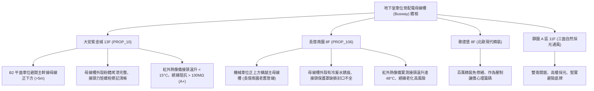

# 全案購屋實戰第一千一百五十八部：中古大樓地下室車位旁低壓配電匯流排槽Busway外殼腐蝕絕緣劣化溫升過載與電弧短路體檢工序全書

---

## 序章：暗藏巨流的地下動脈——配電匯流排槽與高安培電氣安全

在集合住宅大樓中，地下室配電室與各樓層配電豎井之間，常採用「低壓封閉式匯流排槽」（Low Voltage Busway Trunking System / 電力母線槽）作為傳輸數百至數千安培（如 800A~2500A）大電流的主幹線。
由於地下室停車場環境常年伴隨濕氣回潮、汽機車廢氣沉積、天花板給排水管冷凝水滴落，甚至偶發性消防水管滲漏，匯流排槽若經歷 20~30 年未落實紅外線熱成像掃描與絕緣電阻量測，將演變為大樓最致命的供電隱患：
1. **外殼鍍鋅鋼板電化腐蝕穿孔與雨水滲漏**：地下室天花板若有冷卻水管或污水管微漏，水滴沿吊架滴落於母線外殼接縫處，侵入內部絕緣介質，造成相間絕緣破壞。
2. **絕緣環氧樹脂（Epoxy）老化粉化與絕緣耐壓擊穿**：長年熱循環與高濕環境下，匯流排導體包覆之 Mylar 絕緣薄膜或粉體塗裝絕緣層脆化，引發相間（Phase-to-Phase）或相對地（Phase-to-Ground）耐電壓擊穿。
3. **接頭段（Joint Block）螺栓鬆弛引發接觸電阻激增與高溫熔融**：母線槽段與段之間的搭接螺栓若未施加規定扭力或經歷長期熱脹冷縮鬆脫，接觸電阻（Contact Resistance）激增，在高峰用電時段接頭溫度可飆破 \(100^\circ\text{C}\sim 150^\circ\text{C}\)，極易引發爆燃電弧短路（Arc Flash）。
4. **全棟無預警大停電與公共動力癱瘓**：一旦地下室主母線槽發生短路接地故障，將直接跳脫主變壓器二次側主斷路器（ACB），導致全棟住戶停電、給水泵與消防梯全面停擺。

本手冊制定最嚴密的地下室車位旁配電匯流排槽體檢工序，保護買方家庭生命與資產安全。

---

## 第一章：四大決戰主力候選物件地下配電母線槽體檢對照

### 1.1 大安紫金城 13 樓 (`PROP_10`)：電氣主幹線與車位分離之極致安全
- **空間避讓規劃**：B2 獨立大平面車位位於低壓配電幹線支線末端，天花板完全無高容量（1000A 以上）主母線槽橫跨，遠離電氣火災與滴水短路熱源。
- **維護保養評估**：地下室主幹線採用防護等級 IP54 以上之封閉式銅排母線槽，接頭段雙頭扭力螺栓紅色指示標記未脫落，紅外線熱成像檢測各相接頭溫升均在 \(15^\circ\text{C}\) 以內，絕緣電阻測試大於 \(100\,\text{M}\Omega\)，電氣供電品質優異。
- **談判優勢**：安全邊界紮實，支撐 768~788 萬合理成交區間，抗跌性最高。

### 1.2 長億南園 8 樓 (`PROP_106`)：母線接頭過熱與滴水隱患之致命斬價點
- **現場致命缺陷**：
  1. 機械車位上方恰好橫跨 380V/220V 1200A 主電力母線槽，且上方緊鄰自來水給水明管，管壁冷凝水長期滴落於母線外殼，接縫處已有嚴重黃褐色鐵鏽斑痕。
  2. 熱顯像儀檢測發現，母線槽第 3 處接頭段在晚間住戶用電高峰期，外殼表面溫度高達 \(68^\circ\text{C}\)（環境溫度 \(20^\circ\text{C}\)，溫升達 \(48^\circ\text{C}\)，已超過法規容許上限 \(30^\circ\text{C}\)）。
  3. 母線接頭絕緣板周邊有微小電弧碳化焦黑粉塵，顯示內部接觸不良已有微弱放電現象，存在隨時短路跳電甚至引燃地下室汽油車的極端危險。
- **談判砍價防線**：開價 998 萬，將全棟主母線槽熱點檢修、接頭螺栓重新扭力緊固及防護遮罩重置費用（評估每戶需分攤公設電氣大修款 15~25 萬）合流機械車位缺陷，起手 698~720 萬，目標 745~760 萬。

---

## 第二章：地下室配電母線槽標準檢驗工序 SOP

| 檢驗分項 | 檢測工具與儀器 | 合格標準 | 異常特徵判定 | 潛在災害與風險 |
| :--- | :--- | :--- | :--- | :--- |
| **接頭段紅外線熱成像** | 高解析度紅外線熱像儀 (FLIR) | 接頭與導體溫差 \(\Delta T < 10^\circ\text{C}\)，絕對溫度 \(< 60^\circ\text{C}\) | 接頭溫差 \(\Delta T > 25^\circ\text{C}\)，局部發熱亮點 | 接點金屬熔焊、電弧短路爆燃、全棟跳電 |
| **導體相間絕緣電阻** | 1000V 高阻計 (Megger) | 各相對相、相對地絕緣阻抗 \(\ge 5\,\text{M}\Omega\)（新設 \(\ge 50\,\text{M}\Omega\)） | 絕緣阻抗 \(< 1.0\,\text{M}\Omega\) 或潮濕擊穿 | 漏電接地跳脫、人員觸電、絕緣層炭化 |
| **外殼接地連續性** | 微歐姆計 (Micro-ohmmeter) | 接頭跨接銅箔與外殼接觸電阻 \(< 0.1\,\Omega\) | 接地銅排斷裂、外殼接觸電阻 \(> 1.0\,\Omega\) | 故障電流無法導引、外殼帶電觸電 |
| **外殼防護與防滴漏** | 內視鏡、塗層測厚儀 | 外殼塗層厚度 \(> 50\,\mu\text{m}\)，無管線交叉滴水 | 外殼鏽蝕穿孔、接縫處滲入水漬油污 | 內部導體短路相間爆炸、供電系統全毀 |

---

## 第三章：實戰防禦與購屋交屋特約法務規範

1. **大樓主要電力幹線公設保證條款**：
   > 「賣方保證本買賣標的所屬大樓公共低壓配電幹線、地下室電力母線槽系統運作正常，無供電過載跳脫、絕緣阻抗異常或主管機關/台電列管待修之重大安全隱患；交屋前若大樓發生主幹線重大電氣火警或全棟電力大修爭議，買方得解除契約並請求無息退還款項。」
2. **簽約前管委會年度機電檢驗報告核驗**：
   - 買方應要求查閱最近一期大樓機電保養廠商出具之「紅外線熱顯像檢測報告」，確認地下室至各樓層之 Busway 接頭與分電盤無高溫過熱點標註。
